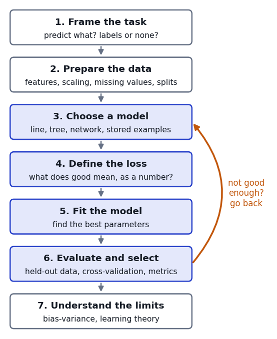
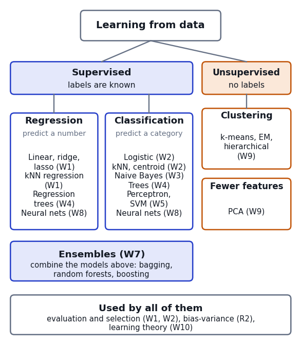

# Course map

Read this first, then come back whenever a topic feels disconnected. It shows how the methods in the course relate to each other.

## The one idea behind the course

Machine learning means learning a rule from examples instead of writing the rule by hand. Nearly every method in this course is a different set of answers to the same four questions:

- **What could the answer look like?** This is the model: a line, a tree, a network, a set of stored examples.
- **What counts as a good answer?** This is the loss: one number that scores a candidate model on the data.
- **How do we find a good answer?** This is the fitting method: a formula, gradient descent, greedy splitting, or counting.
- **How do we know it will work on new data?** This is evaluation: held-out data, cross-validation, and the theory behind them.

When you meet a new method, try to answer these four questions for it. Once you can, you understand where it sits. The table further down answers the first three for the main methods in the course.

## The workflow: seven stages

Every page in these notes uses the same seven stage names. Each "Where this fits" box tells you which stage you are in.

| Stage | The question it answers | Where the course covers it |
|---|---|---|
| 1. Frame the task | What are we predicting, and do we have labels? | W1, W2 introductions, W9 for no labels |
| 2. Prepare the data | How do we turn raw data into usable features? | indicator variables and polynomial features (W1), scaling and missing values (W2), PCA (W9) |
| 3. Choose a model | What family of functions could the answer be? | every algorithm in W1 to W9 |
| 4. Define the loss | What does "good" mean, as a number? | squared error (W1), log loss (W2), entropy and Gini for splits (W4), hinge loss (W5) |
| 5. Fit the model | How do we find the best parameters? | normal equations and gradient descent (W1), counting (W3), greedy splitting (W4), quadratic optimisation (W5), backpropagation (W8), EM (W9) |
| 6. Evaluate and select | How do we know it works, and how do we pick settings? | train, validation and test splits (W1), cross-validation and metrics (W2) |
| 7. Understand the limits | Why does it work, and when must it fail? | bias-variance (R2, W7), curse of dimensionality (W2), PAC and VC theory (W10) |

## Which method solves which task

The first split is whether your data has labels. With labels, the second split is whether you are predicting a number or a category.

## The main methods side by side

This is the most useful table for comparison questions. Scroll it sideways on a phone.

| Method | Task | The idea in one line | What "good" means | How it is fitted | Main setting | Watch out for |
|---|---|---|---|---|---|---|
| Linear regression (W1) | regression | predict with a weighted sum of the features | small squared error | normal equations or gradient descent | which features to use | sensitive to outliers |
| Ridge and lasso (W1) | regression | linear regression that is charged for large weights | squared error plus a penalty | as above (lasso has no closed form) | penalty strength $\lambda$ | lasso can zero out features, ridge only shrinks them |
| kNN (W1, W2) | both | look up the closest stored examples and average or vote | no training loss: it stores the data | no fitting, a lazy learner | $k$ and the distance measure | slow to predict, needs scaling, weak in high dimensions |
| Nearest centroid (W2) | classification | assign to the class whose average point is closest | no training loss | compute each class mean | distance measure | one centre per class can't describe complicated classes |
| Logistic regression (W2) | classification | pass a weighted sum through a sigmoid to get a probability | high likelihood of the labels | gradient descent | features, threshold | the boundary is linear |
| Naive Bayes (W3) | classification | use Bayes rule, assuming features are independent given the class | none directly: it estimates probabilities | counting | smoothing | the independence assumption is usually false |
| Decision tree (W4) | both | ask a sequence of questions about the features | pure leaves (entropy, Gini, or variance for regression) | greedy top-down splitting | depth and pruning | high variance, greedy so not guaranteed best |
| Perceptron (W5, W8) | classification | nudge a line whenever it makes a mistake | no mistakes on the training data | mistake-driven updates | learning rate | only finds a separator if one exists |
| SVM (W5) | classification | find the separating line with the widest margin | wide margin, few violations (hinge loss) | quadratic optimisation | $C$ and the kernel | choice of kernel and $C$ matters |
| Bagging, random forest (W7) | both | average many trees trained on resampled data | as for the base model | train the models independently | number of trees, features per tree | mainly reduces variance, not bias |
| AdaBoost (W7) | classification | train weak models in turn, each focusing on the last one's mistakes | exponential loss | sequential re-weighting | number of rounds | susceptible to very noisy data |
| Gradient boosting (W7) | both | train small models in turn, each fitting what is still wrong | a chosen loss, such as squared error | sequential fits to residuals | rounds, step size | sequential, so can't train in parallel |
| Neural network (W8) | both | layers of simple units learn their own features | squared error or cross-entropy | gradient descent with backpropagation | architecture, learning rate | finds a local minimum, can overfit |
| CNN (W8) | mostly images | a network that slides small filters across the input | as for neural networks | as for neural networks | filters, stride, pooling | needs a lot of data and computation |
| $k$-means (W9) | clustering | alternate between assigning points and moving centres | small within-cluster squared distance | alternating updates | $k$ | depends on the starting centres |
| Mixture model, EM (W9) | clustering | each cluster is a probability distribution with soft membership | high likelihood | EM | number of components | finds a local maximum |
| Hierarchical clustering (W9) | clustering | merge the closest clusters step by step | no single objective | repeated merging | linkage, where to cut | produces a tree even if no real clusters exist |
| PCA (W9) | dimensionality reduction | find the directions along which the data varies most | keep as much variance as possible | eigenvectors of the covariance matrix | number of components | only finds linear structure |

## Comparisons that keep coming up

These are ways of grouping the same methods. Exam questions often test which side a method falls on.

| Comparison | One side | Other side | Covered in |
|---|---|---|---|
| Keeps a fixed set of parameters, or keeps the data? | linear models, neural networks (parametric) | kNN, local regression (instance-based, lazy) | W1, W2 |
| Models how data is generated, or only the boundary? | Naive Bayes (generative) | logistic regression, SVM (discriminative) | W2, W3 |
| One straight boundary or something more flexible? | logistic regression, perceptron, linear SVM | trees, kNN, kernel SVM, neural networks | W2, W4, W5, W8 |
| Lower variance or lower bias? | bagging, random forests reduce variance | boosting reduces bias | W7 |
| Exact formula or iterative search? | normal equations | gradient descent, backpropagation, EM | W1, W8, W9 |

## Threads that run through the course

The same few ideas come back under different names. Spotting them removes a lot of apparent complexity.

| Thread | How it appears |
|---|---|
| **A weighted sum of features** | linear regression (W1), logistic regression (W2), perceptron and SVM (W5), and each single neuron (W8) |
| **Gradient descent** | introduced in W1, reused for logistic regression (W2) and neural networks (W8), and the idea behind gradient boosting (W7) |
| **Stopping overfitting** | regularisation (W1), validation (W1, W2), pruning (W4), the SVM's $C$ (W5), bagging (W7), weight penalties and dropout (W8) |
| **Bias against variance** | defined in R2, explains choosing $k$ (W2), why trees need help (W4), and why ensembles work (W7) |
| **Probability as the foundation** | least squares is maximum likelihood (R2), logistic regression (W2), Naive Bayes (W3), mixture models (W9) |
| **Distance as similarity** | kNN (W1, W2), kernels (W5), clustering (W9) |
| **Better features** | polynomial features (W1), kernels (W5), hidden layers and CNNs that learn their own (W8), PCA (W9) |
| **Trees as building blocks** | built in W4, then combined by bagging, random forests and boosting (W7) |

## How to read the notes

Two kinds of box appear throughout.

> **Where this fits:** Blue boxes open a section. They say what problem the section solves, which workflow stage it belongs to, what it builds on, and where it comes back.

> **In plain words:** Yellow-edged boxes follow a formula. They explain the logic without symbols, so you can skip the formula on a first read and come back to it once the idea is clear.
