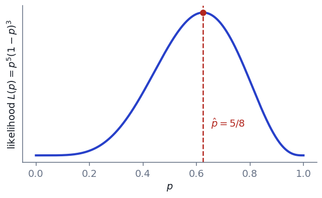
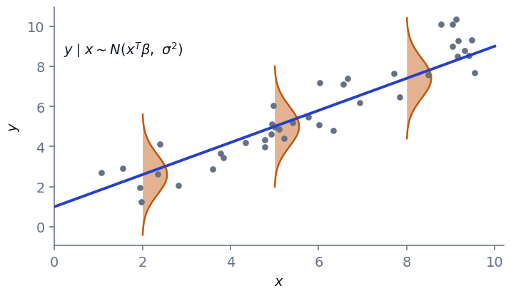
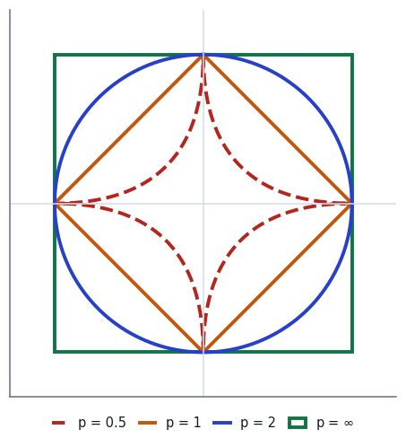

# Regression II: Maximum Likelihood, Bias and Variance, Geometry of Regularisation

Sources: Tutorial "Regression II" and its official solutions; Lab 2 "Bias, Variance and k-Nearest Neighbours" (questions and solutions); W1 slides p.46-51 (probabilistic view), p.52-64 (statistical background), p.103-109 (bias-variance tradeoff).

## The big picture

> **Where this fits:** W1 gave you the working tools of regression: fit a line, score it with squared error, add a penalty when it overfits. Most of this unit is statistics rather than new algorithms. It explains why those tools work, and later units reuse the explanations constantly.
>
> - **Statistical background.** We only ever see a sample, so everything computed from it is a guess about a wider population. That raises the question of how to make and judge a guess.
> - **Maximum likelihood.** To make a good guess on purpose, assume how the data was produced and pick the parameters that make what you saw most probable.
> - **Bias and variance of an estimator.** A different sample would give a different guess, so we judge a guessing method by how far off it is on average and by how much it moves around.
> - **Probabilistic view of least squares.** Apply maximum likelihood to a line with Gaussian noise and squared error falls out, so W1's loss now has a reason behind it.
> - **Norms and geometry.** Ridge and LASSO limit the size of the coefficients, and "size" depends on which norm you use. The shape of each norm explains why LASSO gives exact zeros.
> - **Bias-variance tradeoff.** Apply the estimator idea to a whole learned function, and test error splits into bias², variance and noise. This is the explanation of underfitting and overfitting.
> - **kNN and linear smoothing.** These are two models with one complexity dial each, so you can watch that tradeoff happen. The curse of dimensionality then shows where methods built on distance fail.

So far regression has been an optimisation problem: pick a loss, minimise it. This topic asks three deeper questions.

1. **Where does the loss come from?** If you assume how the data was generated, you can pick parameters by **maximum likelihood**: choose the parameters that make the observed data most probable. With Gaussian noise, this gives exactly least squares, so squared error stops being an arbitrary choice.
2. **How do we judge an estimator?** An estimator is computed from a random sample, so it is itself random. It has a **bias** (is it right on average?) and a **variance** (how much does it move from sample to sample?). Its mean squared error is bias squared plus variance.
3. **How does this explain overfitting?** Applied to a learned function $\hat f$, the same idea gives test error = bias² + variance + irreducible noise. Simple models have high bias, flexible models have high variance, and you tune complexity to minimise the total. kNN regression (with $k$ as the dial) and linear smoothing (with bandwidth $h$ as the dial) are clean examples. Ridge and LASSO are the same dial, and their geometry explains why LASSO zeroes out coefficients.

**Notation warning.** The slides and tutorials use different letters for the same things.

| Thing | Slides (W1) | Tutorial and lab |
|---|---|---|
| Parameter vector | $\theta$ | $\beta$ (and $w$ when recalling Regression I) |
| Number of samples | $m$ in the regression slides, $N$ in the statistics slides | $n$ |
| Index of a sample | $j$ | $i$ |
| Sample mean | $\bar x$ or $m$ (p.58, p.60: so $m$ means two different things in this deck) | $\bar X$ |
| Likelihood | $\mathcal L(\theta)$, log-likelihood $\ell(\theta)$ | $L(\theta)$, $\log L(\theta)$ |
| Noise | $\varepsilon_j$ | $\epsilon_i$ |

## Statistical background

> **Where this fits:** A model is trained on a sample, but we care about the whole population the sample came from, so every number a model learns is an estimate that could have come out differently. This section gives the vocabulary for that: sample, estimator, unbiased. It is background for the Understand the limits stage and repeats W1's short statistics section. Later in this unit, the bias and variance of an estimator turn this vocabulary into the tools that explain overfitting.

### Probability versus statistics (W1 p.53)

- **Probability** reasons from populations to samples. This is deductive reasoning, usually logically sound. Example: given a fair coin, what is the chance of 7 heads in 10 flips?
- **Statistics** reasons from samples to populations. This is inductive reasoning, usually logically unsound (the conclusion can be wrong even if the reasoning is good). Example: given 7 heads in 10 flips, what is the coin's bias?

Machine learning is on the statistics side: we see a sample and infer something about the process that made it.

### Sampling (W1 p.55-56)

- Homogeneous populations need little data. You do not need to sip a cup of tea several times to decide it is too hot.
- Populations with irregularities need either measurement of the whole group or some other way of getting a good picture of it.
- **Sampling** lets you draw conclusions about a population without measuring all of it. The conclusions need not be completely accurate. It works if the sample closely resembles the population.

What we want from a sampling method (p.56):

- No systematic bias, or at least no bias we cannot account for in our calculations.
- The chance of an unrepresentative sample can be calculated, so if it is high we can choose not to draw conclusions.
- The chance of an unrepresentative sample decreases as the sample size grows.

### Estimation and unbiasedness (W1 p.58-60)

**Estimation** is making inferences about a population from information in a sample. Some sample measures are very good estimates of the population value (sample mean for population mean $\mu$). Others are not: the range of a sample usually **underestimates** the population range, because a sample rarely contains the two most extreme values in the population.

An estimator is **unbiased** if its expected value equals the true population parameter (p.59). Intuition: draw many sample sets, compute the estimate on each, and average. For the sample mean, this average equals the population mean.

| Sample statistic | Formula | Slide's label (p.60) |
|---|---|---|
| Sample mean | $\bar x = \frac1N \sum_{i=1}^N x_i$ | unbiased |
| Sample median | middle value of the sorted data; less affected by outliers than the mean | biased (see warning below) |
| Sample variance | $s^2 = \frac{1}{N-1}\sum_i (x_i - m)^2$, where $m$ is the sample mean | unbiased |
| Sample standard deviation | $s = \sqrt{s^2}$ | biased |
| Sample range | maximum minus minimum | biased |

Two details to remember:

- The divisor $N-1$ is what makes $s^2$ unbiased. Dividing by $N$ gives the MLE (next section), which is biased.
- $s^2$ is unbiased but its square root $s$ is not. Unbiasedness does not survive a nonlinear transformation.

> **In plain words:** An estimator is a recipe for turning a sample into a guess. "Unbiased" means the recipe aims at the right value: repeat it on many samples and the guesses average out to the truth, even though any one guess can miss. The $N-1$ in $s^2$ is a correction, because dividing by $N$ comes out too small on average. A square root is not a straight-line transformation, so $s$ does not inherit this property from $s^2$.

**Warning on the median.** The slide labels the sample median "biased" with no conditions. That depends on the distribution and on what it is estimating. For a symmetric distribution such as the normal, the sample median is an unbiased estimator of the mean; for a skewed distribution it generally is not. The lab also lists the median as a valid estimator of the population mean without calling it biased. No question in the bank depends on this point. If an exam repeats the slide's table literally, answer "biased".

### Covariance and correlation (W1 p.61-64)

> **Where this fits:** Before modelling, you often want to know which pairs of variables move together. Covariance and correlation are quick summaries of that, so they are exploration tools for the Prepare the data stage, not models. They come back in W1's lab, where a correlation of 0.998 between two features signals multicollinearity, and covariance returns in W3's LDA and QDA.

**Covariance** measures the relationship between two random variables:

$$\operatorname{cov}(x,y) = \frac{\sum_i (x_i-\bar x)(y_i-\bar y)}{N-1} = \frac{\left(\sum_i x_i y_i\right) - N\bar x\bar y}{N-1}$$

> **In plain words:** Covariance answers the question "when $x$ is above its average, is $y$ usually above its average too?" For each point, take how far $x$ is from its mean and how far $y$ is from its mean, multiply the two, then add these up and divide by $N-1$. The product is positive when both are on the same side of their means and negative when they are on opposite sides, so a large positive result means they rise together and a large negative result means one rises as the other falls. Its size depends on the units of $x$ and $y$, which makes the raw number hard to read. The second form is the same quantity rearranged for hand calculation.

**Pearson correlation** rescales it to lie between $-1$ and $+1$:

$$r = \frac{\operatorname{cov}(x,y)}{\sqrt{\operatorname{var}(x)}\sqrt{\operatorname{var}(y)}}$$

> **In plain words:** Correlation is covariance with the units taken out. Divide by the spread of $x$ and the spread of $y$, and the answer lands between $-1$ and $+1$, so it reads the same whatever the units of the data. The value tells you how tightly the points hug a straight line and which way that line tilts. It tells you nothing about how steep the line is, and a value near 0 only rules out a straight-line pattern, not a curved one.

Meaning of the value (p.63):

- Close to $+1$: high $x$ goes with high $y$, low with low, and scatter is low.
- Close to $-1$: strong inverse association.
- Near 0: no **linear** association.

Limits (p.61, p.63, p.64):

- $r$ only captures linear relationships. It is only appropriate when $x$ and $y$ are roughly linearly associated. The figure on p.62 shows circles, X shapes and U shapes that all have $r=0$ despite obvious structure.
- The magnitude of $r$ reflects scatter, not slope. In the middle row of the figure on p.62, straight lines of different positive slopes all have $r=1$. A perfectly horizontal line has no defined $r$ (the label is blank), since $\operatorname{var}(y)=0$.
- The sign gives the direction of the association.
- $r$ does not model the relationship: given $x$, you cannot compute $y$ from $r$. Two datasets can have the same correlation with different relationships, or the same relationship with different correlations.
- Do not use correlations to compare datasets. Do not use correlation to imply causation in either direction.

**Inconsistency in the slides.** p.63 says a value near 0 "indicates that there is no association", but p.61 and the figure on p.62 show that $r=0$ only rules out a *linear* association. Trust the second version.

Because $r$ divides by both standard deviations, rescaling $x$ or $y$ by a positive constant changes the covariance but leaves $r$ unchanged. A negative constant flips the sign of $r$.

## Maximum likelihood estimation (Tutorial Q1)



> **Where this fits:** You have data and a family of possible models, and you need a principled way to pick the parameters instead of choosing a loss by taste. Maximum likelihood is that principle. It is a method for the Fit the model stage, and it also hands you a loss for the Define the loss stage. It underlies the probabilistic view of least squares later in this unit, logistic regression and cross-entropy in W2, ML and MAP in W3 (MAP is the alternative when you also have a prior belief), and the EM fitting of mixture models in W9.

**Setting.** We observe $X_1,\dots,X_n \overset{\text{i.i.d.}}{\sim} P$: independent and identically distributed draws from an unknown distribution $P$. In a **parametric** model we assume $P$ belongs to a family indexed by a parameter vector $\theta$ living in a parameter space $\Theta$. For the normal family, $\theta=(\mu,\sigma^2)$ and the density is

$$p_\theta(x) = \frac{1}{\sqrt{2\pi\sigma^2}}\exp\left(-\frac{(x-\mu)^2}{2\sigma^2}\right).$$

Knowing $\theta$ would mean knowing $P$, so learning reduces to finding the best $\theta$.

> **In plain words:** This is the bell curve written as a formula. Its job is to say how plausible a value $x$ is once you have chosen a centre $\mu$ and a spread $\sigma^2$. The exponential part looks at how far $x$ is from the centre, measured relative to the spread, and shrinks quickly as that distance grows, so values near the centre are plausible and far-out values are not. The fraction at the front is a scaling factor that does not depend on $x$. Choose different $\mu$ and $\sigma^2$ and you get a different bell, so "learn the distribution" becomes "learn these two numbers".

**Likelihood.** By independence, the probability of the data is a product:

$$L(\theta) = \prod_{i=1}^n p_\theta(X_i).$$

The data is fixed and $\theta$ varies. $L$ is a function of the parameter, not of the data, and it does not need to sum or integrate to 1 over $\theta$.

> **In plain words:** The likelihood scores a candidate parameter value against the data you already have. Take the candidate, ask how probable it makes each data point, and multiply those together, since independent events multiply. The score only means something compared with other candidates: one that makes the data more probable scores higher, and one under which the data would be surprising scores lower. The data stays fixed while you try different candidates, which is why the likelihood is a curve over parameter values, as in the figure, and not a probability distribution over them.

**Maximum likelihood estimator.**

$$\hat\theta_{\text{MLE}} = \arg\max_{\theta\in\Theta} L(\theta) = \arg\max_{\theta\in\Theta} \log L(\theta).$$

The two are the same because $\log$ is strictly increasing, so it preserves the location of the maximum, although not the value (W1 p.49). The log is convenient because it turns a product into a sum.

> **In plain words:** Maximum likelihood means "choose the candidate that best explains what you saw". In the coin figure, 5 heads and 3 tails are most probable when the chance of heads is 5/8, so that is the estimate. Taking the log first changes the height of the curve but not where its peak sits, so you get the same answer. The gain is that a product of many terms becomes a sum, which is much easier to differentiate.

**Recipe.** Write $L$, take logs, differentiate, set to zero, solve, then check a maximum with the second derivative.

Results to memorise:

| Model | MLE | Note |
|---|---|---|
| $N(\mu,1)$ | $\hat\mu = \bar X$ | second derivative $-n<0$ |
| $\text{Bernoulli}(p)$ | $\hat p = \bar X$ | the proportion of ones |
| $N(\mu,\sigma^2)$ | $\hat\mu=\bar X$, $\hat\sigma^2 = \frac1n\sum_i (X_i-\bar X)^2$ | divide by $n$, not $n-1$ |

> **In plain words:** These answers match common sense, which is a good check on the method. The maximum likelihood guess for a mean is the average of your data, for a probability of success it is the share of successes, and for a variance it is the average squared distance from your sample mean. That last one divides by $n$, so it is not the same as $s^2$ from earlier, and the next section shows what that costs.

For two unknown parameters you solve a system. In the normal case the $\mu$ equation does not involve $\sigma^2$, so solve it first and substitute $\bar X$ into the $\sigma^2$ equation. A fully rigorous check needs first partial derivatives zero, at least one second partial negative, and the Hessian determinant positive. The tutorial says that this is beyond the scope of the course.

## Bias and variance of an estimator (Tutorial Q2, Lab 2)


> **Where this fits:** MLE is one way to get an estimate, but there are always others, so we need a way to compare them, and bias and variance are that comparison. They are theory for the Understand the limits stage, because in practice you usually have only one dataset and cannot measure them directly. The same split, applied to a learned function, becomes the bias-variance tradeoff later in this unit, which is how W2 discusses $k$, why W4 flags trees as high variance, and what W7 builds ensembles on. The word "bias" here means systematic error, which is different from the bias weight in W5 and W8 and the inductive bias in W3.

An estimator is a function of random data, $\hat\theta=\hat\theta(X)$, so it is a random variable. For true parameter $\theta$:

$$\text{bias}(\hat\theta) = \mathbb E(\hat\theta) - \theta, \qquad \text{var}(\hat\theta) = \mathbb E\left(\hat\theta - \mathbb E(\hat\theta)\right)^2.$$

**Thought experiment (lab).** Imagine a black box giving infinitely many datasets $D_1, D_2, \dots$ of the same size $n$. Compute the estimator on each. $\mathbb E(\hat\theta)$ is the average of these estimates and $\text{var}(\hat\theta)$ is their spread. This is theoretical: usually we have one dataset.

> **In plain words:** Picture the black box again. Each dataset gives one estimate, and together they form a cloud of guesses around the true value, as in the figure. Bias asks where the centre of the cloud sits compared with the truth: zero means the method aims correctly, even if individual guesses miss. Variance asks how wide the cloud is: take each guess's distance from the cloud's own centre, square it and average. A misaligned sight and a shaky hand are different faults, and you can have either one without the other.

There are many possible estimators of the same parameter. For the population mean the lab lists the sample mean, the sample median and the silly estimator $\dot\theta = X_2$ (just the second data point). $X_2$ is unbiased, but its variance stays at $\sigma^2$ however large $n$ gets. So being unbiased is not enough on its own. A good estimator has low bias **and** low variance.

**Results (Tutorial Q2).**

- $X_i\sim N(\mu,1)$: $\text{bias}(\bar X)=0$, $\text{var}(\bar X)=\frac1n$.
- In general for i.i.d. $X_i$ with variance $\sigma^2$: $\text{var}(\bar X)=\frac{\sigma^2}{n}$. Independence is what lets you split the variance of the sum. Constants come out of a variance squared: $\text{var}(aX)=a^2\text{var}(X)$.
- $X_i\sim\text{Bernoulli}(p)$: $\text{bias}(\hat p)=0$, $\text{var}(\hat p)=\frac{p(1-p)}{n}$.
- $\hat\sigma^2_{\text{MLE}}$ is biased. Since $s^2=\frac{1}{n-1}\sum(X_i-\bar X)^2$ is unbiased (W1 p.60) and $\hat\sigma^2=\frac{n-1}{n}s^2$, we get $\mathbb E\hat\sigma^2=\frac{n-1}{n}\sigma^2$ and bias $-\sigma^2/n$. It underestimates on average and the bias vanishes as $n$ grows. So an MLE need not be unbiased.

> **In plain words:** The sample mean has no bias, and its variance is divided by $n$: average four times as many independent points and the variance falls to a quarter, so the standard deviation halves. That is why more data gives steadier estimates. The Bernoulli result is the same idea, because a proportion is an average of 0s and 1s. The MLE of the variance behaves differently: it runs slightly low on average, by an amount that fades as $n$ grows, which shows that maximum likelihood does not promise an unbiased answer.

**MSE decomposition (Tutorial Q2(c)).** Define $\text{MSE}(\hat\theta) = \mathbb E(\hat\theta-\theta)^2$. Add and subtract $\mathbb E\hat\theta$:

$$\begin{aligned}
\text{MSE}(\hat\theta) &= \mathbb E\left[(\hat\theta-\mathbb E\hat\theta) + (\mathbb E\hat\theta-\theta)\right]^2 \\
&= \mathbb E(\hat\theta-\mathbb E\hat\theta)^2 + 2(\mathbb E\hat\theta-\theta)\,\mathbb E(\hat\theta-\mathbb E\hat\theta) + (\mathbb E\hat\theta-\theta)^2 \\
&= \text{var}(\hat\theta) + 0 + \text{bias}(\hat\theta)^2.
\end{aligned}$$

The cross term vanishes because $\mathbb E\hat\theta-\theta$ is a constant and $\mathbb E(\hat\theta-\mathbb E\hat\theta)=0$.

Consequence: a slightly biased estimator with much lower variance can have a lower MSE than an unbiased one. When comparing unbiased estimators, pick the one with minimum variance (W1 p.108). Otherwise compare total MSE.

> **In plain words:** MSE is the overall score for an estimator: how far the guess lands from the truth, squared and averaged over datasets. The derivation shows that this one number splits cleanly into two faults, the variance (how wide the cloud of guesses is) plus the squared bias (how far the cloud's centre sits from the truth). The middle term could have mixed them, but it averages to zero. Because the total is what counts, a little bias can be worth accepting if it buys a big drop in variance, as estimator B in the figure can. That trade returns below as the bias-variance tradeoff.

## The probabilistic view of least squares (W1 p.46-51, Tutorial Q3)



> **Where this fits:** Squared error can look like an arbitrary choice of loss. This section gives it a reason by applying maximum likelihood to a line with Gaussian noise, so it adds no new model and instead justifies a choice made in the Define the loss stage. The same move produces the loss for logistic regression in W2 (Bernoulli in place of Gaussian) and cross-entropy in W8, and W3 repeats the argument for least squares. It also shows exactly what you are assuming, so you know that a different noise model would call for a different loss.

**Data generating process.** Assume there is a true function $f$ and we see noisy observations:

$$y = f(x)+\varepsilon.$$

The noise might be measurement error or unmodelled effects. Make two assumptions: $f$ is linear, and the noise is i.i.d. Gaussian:

$$y_j = x_j^T\theta+\varepsilon_j,\quad \varepsilon_j\sim N(0,\sigma^2) \quad\Longrightarrow\quad y_j\mid x_j \sim N(x_j^T\theta,\sigma^2).$$

In matrix form, $y\mid X\sim N(X\beta,\sigma^2 I)$. The solutions page writes $y_i\mid x_i\sim N(x_i^T\beta^*)$ with the $\sigma^2$ left out: that is a typo.

> **In plain words:** This is a story about how each $y$ came to exist. Start with the true value for that input, then add a random error, as likely up as down, whose typical size is set by $\sigma$. Under the linear assumption the true values sit on a line, so at every $x$ the possible values of $y$ form a bell curve centred on the line, with the same width everywhere. That is the picture in the figure. Fitting now means finding the line under which the observed points look most probable.

**Likelihood.** Independence of the noise gives independence of the samples, so

$$\mathcal L(\theta) = P(\mathbb y\mid X;\theta) = \prod_{j=1}^m \frac{1}{\sqrt{2\pi\sigma^2}}\exp\left(-\frac{(y_j-x_j^T\theta)^2}{2\sigma^2}\right).$$

> **In plain words:** To score a candidate line, go through the points one at a time. For each point, measure its miss from the line and ask the bell curve how probable that miss is: small misses get a high value and big misses a tiny one. Multiply across all points, which the independence assumption allows. A line passing close to every point scores high, and one wild miss drags the whole product down.

**Log-likelihood**, slide form and tutorial form (the same thing):

$$\ell(\theta) = m\log\frac{1}{\sqrt{2\pi\sigma^2}} - \frac{1}{\sigma^2}\cdot\frac12\sum_{j=1}^m (y_j-x_j^T\theta)^2$$

$$\log L(\beta) = -\frac n2\log(2\pi\sigma^2) - \frac{1}{2\sigma^2}\Vert y-X\beta\Vert_2^2.$$

The first term has no $\theta$ in it. The second is a negative constant times the sum of squared errors. So maximising the log-likelihood is minimising the sum of squared errors:

$$\hat\beta_{\text{MLE}} = \arg\min_\beta \Vert y-X\beta\Vert_2^2 = (X^TX)^{-1}X^Ty = \hat\beta_{\text{LS}}.$$

> **In plain words:** This is why the two methods agree. Taking the log turns the product of bell curves into a sum, and the exponentials disappear, leaving each point's squared miss. What remains has two parts: a constant that no candidate line can change, and minus a positive number times the sum of squared errors (the $\Vert y-X\beta\Vert_2^2$ term). To make that as large as possible you must make the sum of squared errors as small as possible, which is the W1 problem, so the answer is the W1 normal equations solution. The value of $\sigma^2$ only scales the score, so it never changes which line wins.

Key points:

- Under i.i.d. Gaussian noise, the MLE equals the least squares estimate (W1 p.50).
- The value of $\sigma^2$ does not affect the choice of $\theta$ (W1 p.50). It only scales the objective.
- The equivalence is **not** general. A different noise distribution or a different loss breaks it. This is a probabilistic justification of least squares, and it depends on the assumptions.

**Linear regression assumptions (W1 p.51).**

1. **Linearity**: the relationship between $x$ and the mean of $y$ is linear.
2. **Homoscedasticity**: the variance of the residual is the same for any value of $x$.
3. **Independence**: observations are independent of each other.
4. **Normality of residuals**: for any fixed $x$, $y$ is normally distributed.

Note that nothing is assumed about the distribution of $x$ itself.

## Geometric interpretations (Tutorial Q4)

> **Where this fits:** W1 fought overfitting by penalising large coefficients, and LASSO gave exact zeros where ridge rarely does. To see why, we need a way to measure the size of a coefficient vector, then a picture of what limiting that size does. This is theory for the Understand the limits stage, about a penalty chosen in the Define the loss stage. It builds on W1's regularisation section and feeds the bias-variance tradeoff next, where the penalty acts as a complexity dial.

### $p$-norms and unit circles



> **Where this fits:** A penalty on coefficients and a distance between data points both need an answer to "how big is this vector?". The $p$-norm family supplies the options, so it is a building block and not a model. In this unit it sets the ridge and LASSO penalties. It returns in W2 as Minkowski distance, the choice of distance behind kNN, where the same failure of the triangle inequality for $p<1$ appears.

For $x\in\mathbb R^2$ and $p\ge1$,

$$\Vert x\Vert_p = \left(\lvert x_1\rvert^p+\lvert x_2\rvert^p\right)^{1/p}, \qquad \Vert x\Vert_\infty=\max\{\lvert x_1\rvert,\lvert x_2\rvert\}.$$

> **In plain words:** A norm is a rule for measuring the length of a vector, and the value of $p$ picks which rule. Each version takes the size of every coordinate, raises it to a power, adds the results, then undoes the power. With $p=1$ you add up the sizes of the coordinates, with $p=2$ you get ordinary straight-line length, and with $p=\infty$ only the largest coordinate counts. As $p$ rises, a vector's measured length stays the same or shrinks, as the table below shows.

A norm $g$ must satisfy (the tutorial's list):

1. Triangle inequality: $g(x+y)\le g(x)+g(y)$.
2. Absolute homogeneity: $g(cx)=\lvert c\rvert g(x)$.
3. Positive definiteness: the tutorial writes $g(0)=0$. The standard condition is stronger: $g(x)=0$ only when $x=0$.

**$p=0.5$ is not a norm.** It fails the triangle inequality. Take $x=(0,9)$, $y=(4,0)$. Then $\Vert x\Vert_{0.5}=(\sqrt9)^2=9$ and $\Vert y\Vert_{0.5}=4$, which sum to 13, yet $\Vert x+y\Vert_{0.5}=(\sqrt4+\sqrt9)^2=25$. It is sometimes called a pseudo-norm.

> **In plain words:** These conditions say what any sensible length must do. Walking along $x$ and then along $y$ is never shorter than going straight to where you end up. Stretching a vector by a factor stretches its length by that factor, and reversing it changes nothing. The third condition ties zero length to the zero vector, though the tutorial states only half of that. The $p=0.5$ rule breaks the first condition: in the example the direct route measures 25, longer than the two legs at 13.

**The unit circle** for a given $p$ is the set $\{x:\Vert x\Vert_p=1\}$ and the region inside is the **unit ball**. Shapes: $p=0.5$ is a star with sides curving inward, $p=1$ a diamond, $p=2$ a circle, $p=\infty$ a square. The ball is **convex when $p\ge1$** and not convex when $p<1$.

> **In plain words:** To see a norm, mark every point whose length is exactly 1 under that rule. The outline you get is the unit circle, which only looks like a circle for $p=2$, and everything inside it is the unit ball. Convex means the shape has no dents, so the $p=0.5$ star, with its sides curving inward, is not convex. Remember the diamond and the disc, because scaled versions of them are the regions LASSO and ridge allow in the next subsection.

The four vectors in the tutorial:

| Vector | $p=0.5$ | $p=1$ | $p=2$ | $p=\infty$ | Lies on the unit circle of |
|---|---|---|---|---|---|
| $(1,1)$ | 4 | 2 | $\sqrt2$ | 1 | $p=\infty$ only |
| $(\tfrac12,-\tfrac12)$ | 2 | 1 | $\tfrac{1}{\sqrt2}$ | $\tfrac12$ | $p=1$ only |
| $(-\tfrac{1}{\sqrt2},\tfrac{1}{\sqrt2})$ | $2\sqrt2$ | $\sqrt2$ | 1 | $\tfrac{1}{\sqrt2}$ | $p=2$ only |
| $(0,-1)$ | 1 | 1 | 1 | 1 | all four |

General rule: $\Vert x\Vert_p\ge\Vert x\Vert_q$ whenever $p<q$. The same vector has a different length under a different norm. (The figure in the tutorial labels the green vector $(-\sqrt2,\sqrt2)$. That is a typo for $(-1/\sqrt2,1/\sqrt2)$, as the question text says.)

### Ridge and LASSO as constrained problems

> **Where this fits:** Ridge and LASSO both fight overfitting, and W1 introduced them as penalties added to the loss, which is the Define the loss stage. This subsection rewrites each one as a size limit on the coefficients, which turns the difference between them into a picture (W1's regularisation section has the figure). The picture explains the practical choice: ridge shrinks coefficients, while LASSO can remove features altogether, so LASSO is the one to reach for when you want a few interpretable features. Penalising large weights returns in W8 as a way to regularise neural networks.

Each has an unconstrained (penalised) form and an equivalent constrained form:

$$\hat\beta_{\text{ridge}}=\arg\min_\beta\left\{\Vert y-X\beta\Vert_2^2+\lambda\Vert\beta\Vert_2^2\right\} \quad\text{or}\quad \arg\min_\beta\Vert y-X\beta\Vert_2^2 \text{ subject to } \Vert\beta\Vert_2\le k$$

$$\hat\beta_{\text{LASSO}}=\arg\min_\beta\left\{\Vert y-X\beta\Vert_2^2+\lambda\Vert\beta\Vert_1\right\} \quad\text{or}\quad \arg\min_\beta\Vert y-X\beta\Vert_2^2 \text{ subject to } \Vert\beta\Vert_1\le k$$

In general $k\ne\lambda$, and the values differ between ridge and LASSO. More penalty (larger $\lambda$) corresponds to a tighter constraint (smaller $k$). Note that the ridge penalty uses the **squared** 2-norm, the LASSO penalty the **unsquared** 1-norm.

> **In plain words:** Both formulas ask for a small error while keeping the coefficients small, and each can be said in two ways. The penalised form adds a charge for coefficient size to the error, with $\lambda$ setting the price. The constrained form gives the coefficients a size budget $k$ (unrelated to the $k$ of kNN) and asks for the lowest error within that budget. A higher price acts like a smaller budget, so raising $\lambda$ goes with lowering $k$. The two methods differ in how they measure size: ridge charges for the squared 2-norm and its budget region is a disc, while LASSO charges for the 1-norm and its budget region is a diamond.


**Reading the picture** (2 dimensions, $\beta=(\beta_1,\beta_2)$):

- The contours of $\Vert y-X\beta\Vert_2^2$ are rings around $\hat\beta_{\text{LS}}$, and smaller rings mean lower error. Least squares is the point at the centre.
- Ridge: the feasible region is a disc around the origin. The solution is the point in the disc reached by the lowest contour, on the boundary if $\hat\beta_{\text{LS}}$ is outside the disc.
- LASSO: the same, but the feasible region is a diamond with corners on the axes at $(\pm k,0)$ and $(0,\pm k)$.

If $\hat\beta_{\text{LS}}$ is already inside the feasible region, the constraint does nothing and the solution is $\hat\beta_{\text{LS}}$.

**Why LASSO induces sparsity.** A vector is **sparse** if only a few of its elements are nonzero: $[0,0,0,1,0,0,0.2,0]$ is sparse, $[0,2,2,1,0,3,0.2,1]$ is not. The diamond has corners on the axes and is flat between them, so an expanding contour is likely to touch it first at a corner, and a corner has a coordinate equal to zero. The disc is round, so touching exactly on an axis is unlikely: ridge shrinks coefficients but rarely sets them exactly to zero.

**Why sparsity is useful.** A sparse model attributes the response to a few features, so it can be interpreted, which matters in science. If gathering data is expensive, narrowing down to a few good features also makes the model cheaper to operate.

The tutorial's letters are inconsistent here: the text says radius $k$, the figures label the balls with $\alpha$ and $\lambda$, and the solution says "radius $\alpha$". Treat them all as the constraint radius $k$.

## The bias-variance tradeoff (W1 p.103-109, Lab 2)

> **Where this fits:** A model can do well on training data and still fail on new data, and you need to know why before you can fix it. This section splits test error into parts you can reason about, by applying the estimator idea from earlier to a learned function. It is theory for the Understand the limits stage, and it guides the Evaluate and select stage, where you pick complexity on a validation set. Most of the course's tools against overfitting and underfitting can be read through it: ridge and LASSO in W1, $k$ in W2, pruning in W4, $C$ in W5, bagging (which cuts variance) and boosting (which cuts bias) in W7, and dropout in W8, while W10 comes at generalisation from another angle by asking how much data is enough.

### Definitions

We now estimate a function rather than a number. Assume $y=f(x)+\varepsilon$ with zero-mean noise of variance $\sigma^2$, and $\hat f$ is learned from a random dataset. At a fixed input $x$:

- **Bias**: difference between the average prediction of the model and the correct value, $\text{Bias}(\hat f(x))=\mathbb E[\hat f(x)]-f(x)$. A high bias model pays little attention to the training data and oversimplifies. It tends to have high error on **both** training and test data (W1 p.105).
- **Variance**: variability of the model's prediction at a given point across datasets. A high variance model pays a lot of attention to the training data and does not generalise. It does very well on training data but often badly on test data (W1 p.105).

The expectation here is over datasets, as in the black box thought experiment. The slide adds that variance "tells us spread of our data": read this as spread of the *predictions*, not of the raw data.

> **In plain words:** Fix one input and imagine training the same kind of model on many different datasets, so you get many predictions for that one input. Bias compares the average of those predictions with the true value, so high bias means the model misses in the same direction whichever dataset it got. Variance measures how much those predictions differ from one another, so high variance means the answer depends heavily on which dataset you happened to get. Neither can be read off one fitted model, because both are defined across datasets.

**Target diagram (W1 p.104).** Each dot is a model fitted to one dataset, and the bullseye is the truth.

| | Low variance | High variance |
|---|---|---|
| **Low bias** | good fit: tight cluster on the bullseye | overfitting: scattered around the bullseye |
| **High bias** | underfitting: tight cluster off centre | scattered and off centre (unlabelled) |

**Underfitting**: the model cannot capture the underlying pattern; usually high bias and low variance. **Overfitting**: the model captures the noise along with the underlying pattern (W1 p.106).

### The decomposition (W1 p.107)

$$\mathbb E\left[(y-\hat f)^2\right] = (f-\mathbb E[\hat f])^2+\text{Var}(\hat f)+\text{Var}(\varepsilon)$$

$$\text{MSE} = \text{Bias}^2+\text{Variance}+\text{irreducible error}$$

Here $\text{Var}(\varepsilon)=\sigma^2$. The lab writes the bias with the opposite sign, $\mathbb E[\hat f(x)]-f(x)$; it makes no difference after squaring. This is an expected **test** error at a new point, and it holds for any learning method.

> **In plain words:** This splits the average squared miss on a new point into three separate causes. The first is the model being wrong on average (squared bias), the second is the model changing with the dataset (variance), and the third is the noise in $y$ itself. You can attack the first two by changing the model. The third is a floor that no model can go under, so with noisy data the expected test error stays above zero even for a perfect model.

- **Irreducible error** comes from natural variability (noise). It cannot be reduced by any model.
- **Reducible error** is bias² plus variance, and adjustments to the model can lower it.

Compare with the estimator version: $\text{MSE}(\hat\theta)=\text{bias}^2+\text{var}$ has no noise term, because it measures distance to $\theta$ itself. The learning version has $\sigma^2$ because the target $y$ is itself noisy. Even the perfect model $\hat f=f$ has expected squared error $\sigma^2$.

### The tradeoff (W1 p.108-109)


Too simple (few parameters): high bias, low variance. Too complex (many parameters): low bias, high variance. As complexity rises, bias² falls, variance rises, and total error is U-shaped.

There is no direct formula for the best complexity. The slides say to adjust complexity, preferably checking on an unseen validation set, until overall error is minimised. Training error is no use for this, because it keeps falling as complexity rises.

The sketch on p.109 draws the optimum exactly where the bias² and variance curves cross. That is just how that sketch looks. The minimum of the sum is where the slopes cancel, which need not be the crossing point.

### What the lab shows

True function $f(x)=0.001x^3$ on $x\in[1,10]$, noise $\sigma=0.2$, $n=25$, nine datasets, polynomial regression, predictions compared at $x_0=5$ where $f(5)=0.125$. Rerunning the lab's code with its seed gave:

| Features | Bias² at $x_0=5$ | Variance at $x_0=5$ | Comment |
|---|---|---|---|
| $x$ | 0.0108 | 0.0004 | lines cannot bend: all miss in the same direction |
| $x, x^2$ | about 0 | 0.0031 | curvature is captured, fits vary a little more |
| $x,\dots,x^6$ | about 0 | 0.0097 | very flexible, fits differ by dataset |

These use 9 datasets as a proxy for the infinite number that the definition needs, so they are rough. The notebook's images are not in the text extraction, so these figures are from my rerun of the code, not from the notebook's output.

The advanced exercise repeats this with $f(x)=0.00002x^3+0.2\cos(x^{1.2})$, polynomial degrees 1 to 9, 80 datasets. The orange average curve $\mathbb E(\hat f)$ moves closer to the truth as degree rises, and the blue fits spread out. Variance grows sharply at the highest degrees. Bias² falls overall until the highest degrees, not smoothly, and the estimates there are noisy. The tails behave wildly and are ignored for the analysis (the lab says to focus on the middle 90%).

The exercise text says $n=100$ and $\sigma=0.1$, but the solution code uses $n=25$ and $\sigma=0.2$. The first exercise says uniform on $(0,10)$, but the text and the code use $(1,10)$.

## kNN regression, the curse of dimensionality, and linear smoothing (Lab 2)

> **Where this fits:** Linear regression commits to one formula for the whole input space. If you don't want to assume a shape, you can predict from nearby training points instead, which gives a different family of models for the Choose a model stage, with one setting ($k$ or $h$) to tune in the Evaluate and select stage. These methods are the cleanest demonstration of the bias-variance tradeoff, and the curse of dimensionality shows where they stop working. They build on W1's local regression and return in W2 for classification.

### kNN regression

> **Where this fits:** You want a prediction at a new point without fitting any equation, so you look up the most similar stored examples and use their answers. kNN regression is a Choose a model option and the alternative to fitting a global line. W1 introduced it, and W2 swaps the average for a majority vote and uses bias and variance to discuss $k$.

The $k$-neighbour function $\mathcal N_k(x)$ returns the $k$ points in the data nearest to $x$. The usual distance is Euclidean, but any distance works (for words, Levenshtein edit distance). The prediction averages the responses of the neighbours. kNN classification replaces the average with a majority vote.

$$\hat y(x)=\frac1k\sum_{i\in\mathcal N_k(x)}Y_i=\sum_{i=1}^n\frac1k\mathbf 1\{X_i\text{ is a kNN of }x\}Y_i$$

kNN regression is the most basic example of local regression.

> **In plain words:** To predict at a new point, find the $k$ training points closest to it and report the average of their $y$ values. The neighbours act as a stand-in for what the function does near that point. The second form says the same thing over the whole dataset: every point gets a weight of $1/k$ if it is a neighbour and 0 if not, and you add up weight times response. That way of writing it matters because linear smoothing, later in this section, changes only the weights.

**Lab toy example.** $X=[-1,0,1,2,3,4]$, $y=[0.5,0.25,1,0.2,0.8,3]$, $k=3$, $x=0.25$. Distances are $1.25, 0.25, 0.75, 1.75, 2.75, 3.75$, so $\mathcal N_3(0.25)=\{-1,0,1\}$ and $\hat y=\frac13(0.5+0.25+1)\approx0.58$.

**$k$ controls complexity.** Small $k$ means a jagged fit, low bias and high variance: $k=1$ reproduces each training point, so training error is 0 when inputs are distinct. Large $k$ means a smooth fit, high bias, low variance: $k=n$ predicts the global mean of $y$ everywhere. If the neighbours' $X$ values are held fixed and noise is independent, the variance of the prediction is $\sigma^2/k$ for the same reason that $\text{var}(\bar X)=\sigma^2/n$.

> **In plain words:** Think of $k$ as a dial between trusting one point and trusting everyone. With few neighbours the prediction is truly local, so bias is low, but it follows whatever noise those few points carry, so variance is high. With many neighbours the noise averages out, with variance falling like $\sigma^2/k$ under the conditions above, but the average now reaches further from the query point, which tends to raise bias. At the far end, $k=n$ gives the same number everywhere.

Running the lab's data ($n=80$, $\sigma=0.2$, seed 120), with test MSE computed over a fine grid of $x\in[1,10]$ plus the noise $\sigma^2=0.04$, gave:

| $k$ | Training MSE | Test MSE |
|---|---|---|
| 1 | 0 | 0.073 |
| 4 | 0.025 | 0.052 |
| 16 | 0.034 | 0.043 |
| 40 | 0.057 | 0.063 |
| 80 | 0.132 | 0.144 |

The test error is U-shaped with a floor above $\sigma^2=0.04$. Training error rises steadily with $k$. This table is from my rerun, not from the lab itself.

### The curse of dimensionality

> **Where this fits:** kNN and smoothing rely on "nearby" meaning something, and with many features it stops meaning much. This is an Understand the limits topic: it tells you when distance-based methods fail. W2 returns to it for kNN, and W9 gives it as one reason to reduce dimensions.

In high dimensions distances stop being informative: all points are at a similar distance from each other. Methods relying on neighbours (kNN, linear smoothing, local regression in general) then degrade, and can become useless. MNIST example: a $28\times28$ image has 784 features, and an image of a '0' can be about as far from an '8' as from another '0'.

**Lab experiment.** Sample $n=1000$ points uniformly in the unit cube $[0,1]^d$ and plot all pairwise distances. The maximum possible distance is $\sqrt d$. As $d$ rises the histogram becomes more concentrated relative to that range, so everything is roughly equally far from everything else. In a rerun (averaged over many random pairs of points):

| $d$ | Mean distance | SD of distances | SD / mean |
|---|---|---|---|
| 2 | 0.52 | 0.25 | 0.48 |
| 10 | 1.27 | 0.25 | 0.19 |
| 100 | 4.08 | 0.24 | 0.06 |
| 1000 | 12.91 | 0.24 | 0.02 |

The mean grows like $\sqrt{d/6}$, while the SD stays roughly constant, so the ratio shrinks. Distances grow in absolute terms: what collapses is their *relative* difference.

> **In plain words:** The last column of the table is the one to read: it compares how much distances vary with how big they typically are. As dimensions are added, typical distances grow while their spread stays about the same, so in relative terms they bunch together. When every point is about the same distance away, "nearest" no longer picks out anything special. The problem is lost contrast between distances, not points crowding together.

### Linear smoothing (advanced part of the lab)


> **Where this fits:** kNN's all-or-nothing neighbours give jagged predictions, so the fix is to let each point's influence fade with distance. Linear smoothing is the alternative to kNN in the Choose a model stage, with bandwidth $h$ as its dial, and W2 and W4 both return to it. The word "kernel" here means a weight based on distance. W5's kernels are a different tool (a dot product in some feature space), so don't merge the two ideas, even though the name "Gaussian kernel" appears in both.

kNN's weights are crude: $1/k$ for the neighbours, 0 for everyone else. This hard cut-off makes the fit jagged. A **linear smoother** uses a kernel to give smooth weights:

$$\hat y(x)=\sum_{i=1}^n\frac{K\left(\frac{\Vert x-X_i\Vert_2}{h}\right)}{\sum_{j=1}^nK\left(\frac{\Vert x-X_j\Vert_2}{h}\right)}Y_i$$

> **In plain words:** This is still a weighted average of the training responses, but the weights can now fade gradually. For a query point, measure the distance to each training point, divide by $h$ to put it on the bandwidth's scale, and feed that to the kernel to get a raw weight, where closer points get at least as much as farther ones. Then divide each raw weight by the total of all of them, so the weights add to 1 and the result is a proper weighted average. Close points pull the prediction strongly, and distant points pull it weakly or not at all.

Kernels:

- Box-car: $K(u)=\mathbf 1\{\lvert u\rvert\le1/2\}$
- Gaussian: $K(u)=\frac{1}{\sqrt{2\pi}}\exp(-u^2/2)$
- Epanechnikov: $K(u)=\frac34(1-u^2)\mathbf 1\{\lvert u\rvert\le1\}$

The denominator makes the weights add to 1. This also means constant factors in $K$ cancel. The **bandwidth** $h$ plays the role of $k$: larger $h$ uses points further away, giving a smoother fit with more bias and less variance. Small $h$ gives a wiggly fit. Box-car with bandwidth $h$ is a plain average of all points within distance $h/2$ of $x$. Box-car and Epanechnikov can give zero weight to every point when $h$ is small, whereas the Gaussian kernel is never exactly zero. The lab's code handles this with `if Ksum > 0`.

> **In plain words:** The three kernels are three ways of letting weight change with distance. Box-car gives the same weight to every point inside a window and nothing outside it. Epanechnikov falls to exactly zero at the edge of its window, and Gaussian keeps fading without ever reaching zero. The bandwidth $h$ sets how far the reach extends, so larger $h$ brings in points further away, giving a smoother fit with more bias and less variance. Only the kernels with a hard edge can leave every point with zero weight, which is why the code needs its guard.

This method is also called kernel regression or Nadaraya-Watson. sklearn has no implementation of it.

## Worked examples

All tutorial questions below have official solutions. The numbers in examples marked "variation" are my own and were checked in the verification script.

### Tutorial Q1(a): MLE of $\mu$ for $N(\mu,1)$

$$\log L(m)=\sum_{i=1}^n\log\left[\frac{1}{\sqrt{2\pi}}\exp\left(-\tfrac12(X_i-m)^2\right)\right]=-\frac n2\log(2\pi)-\frac12\sum_{i=1}^n(X_i-m)^2$$

Differentiate: $\frac{\partial}{\partial m}\log L(m)=\sum_i(X_i-m)=0$, so $\hat\mu=\frac1n\sum_iX_i=\bar X$. Second derivative is $-n<0$, so it is a maximum.

### Tutorial Q1(b): MLE of $p$ for Bernoulli

The mass function is $P(X=k)=p^k(1-p)^{1-k}$ for $k=0,1$. Then

$$\log L(p)=\log\prod_{i=1}^np^{X_i}(1-p)^{1-X_i}=n\bar X\log p+n(1-\bar X)\log(1-p).$$

Set the derivative to zero: $\frac{n\bar X}{p}-\frac{n(1-\bar X)}{1-p}=0$. So $\bar X(1-p)=(1-\bar X)p$, giving $\hat p=\bar X$.

Variation: data $1,0,1,1,0,1,1,0$ gives $\hat p=5/8$.

### Tutorial Q1(c): MLE of $(\mu,\sigma^2)$

$$\log L(m,s^2)=-\frac n2\log(2\pi)-\frac n2\log(s^2)-\frac{1}{2s^2}\sum_i(X_i-m)^2$$

$\partial/\partial m$: $\frac{1}{s^2}\sum_i(X_i-m)=0$, so $\hat\mu=\bar X$.

$\partial/\partial s^2$: $-\frac{n}{2s^2}+\frac{1}{2s^4}\sum_i(X_i-m)^2=0$, so $\hat\sigma^2=\frac1n\sum_i(X_i-\bar X)^2$.

Variation: data $2,4,6,8$. Mean 5, squared deviations $9,1,1,9$ sum to 20, so $\hat\sigma^2=5$ (while $s^2=20/3\approx6.67$).

### Tutorial Q2(a,b): bias and variance of $\bar X$

$\mathbb E\bar X=\frac1n\sum_i\mathbb EX_i=\mu$, so the bias is 0. By independence, $\text{var}(\bar X)=\frac{1}{n^2}\sum_i\text{var}(X_i)=\frac{n\cdot1}{n^2}=\frac1n$. For Bernoulli, $\text{var}(X_i)=p(1-p)$, so $\text{var}(\hat p)=\frac{p(1-p)}{n}$ with bias 0.

### Tutorial Q2(c): MSE decomposition

See the derivation in the bias and variance section.

Variation: $T=0.8\bar X$, $X_i\sim N(5,4)$, $n=16$. Then $\mathbb ET=4$, so bias $=-1$. $\text{var}(T)=0.64\times\frac{4}{16}=0.16$. MSE $=1+0.16=1.16$. Compare $\bar X$: MSE $=0.25$.

### Tutorial Q3: MLE for linear regression

See the derivation in the probabilistic view section.

Variation: no intercept, $x=(1,1,2)$, $y=(2,3,5)$. $\hat\theta=\frac{\sum x_jy_j}{\sum x_j^2}=\frac{2+3+10}{1+1+4}=2.5$. Residuals $-0.5,0.5,0$, SSE $=0.5$.

### Tutorial Q4(a): norms of $(1,1)$

$\Vert(1,1)\Vert_{0.5}=(1+1)^2=4$, $\Vert(1,1)\Vert_1=2$, $\Vert(1,1)\Vert_2=\sqrt2$, $\Vert(1,1)\Vert_\infty=1$. Decreasing in $p$, as the general rule says.

### Tutorial Q4(b) variation: ridge versus LASSO with circular contours

Suppose the contours of the squared error are perfect circles around $\hat\beta_{\text{LS}}=(3,1)$, and the constraint radius is $k=2$. Then the solution is the feasible point nearest to $(3,1)$.

- Ridge: scale onto the circle: $2\cdot\frac{(3,1)}{\sqrt{10}}\approx(1.90,0.63)$. Both are nonzero.
- LASSO: the nearest point of the diamond $\lvert\beta_1\rvert+\lvert\beta_2\rvert\le2$ is the corner $(2,0)$. This is sparse.

### Lab variation: bias and variance from simulated predictions

Five models predict $0.30,0.35,0.40,0.25,0.20$ at $x_0=5$, with $f(5)=0.125$. Mean prediction is $0.30$, bias $=0.175$, bias² $\approx0.0306$. Using the lab's `np.var` (divide by the count), the variance is $\frac{0+0.0025+0.01+0.0025+0.01}{5}=0.005$.

## Code you should recognise

**Sampling from the data generating process.**

```python
def f_sampler(f, n=100, sigma=0.1, seed=None):
    if seed:                                    # seed=0 is falsy, so it is NOT applied
        np.random.seed(seed)
    xvals = np.random.uniform(low=1, high=10, size=n)
    yvals = f(xvals) + sigma * np.random.normal(0, 1, size=n)   # noise SD is sigma
    D = np.zeros(shape=(n, 2))
    D[:,0] = xvals; D[:,1] = yvals
    return D
```

`np.random.normal(loc, scale, size)` takes the **standard deviation** as `scale`, not the variance.

**Fitting and reading a linear model.** The lab reshapes `y` to a column, which makes `mod.intercept_` have shape `(1,)` and `mod.coef_` have shape `(1, p)`. With a 1-D `y`, `intercept_` is a plain scalar, and `mod.intercept_[0]` raises an `IndexError`.

```python
X = fsamples[:,0].reshape(-1,1)                       # sklearn needs a 2-D X
X = np.concatenate((X, X**2), axis=1)                 # add polynomial features
y = fsamples[:,1].reshape(-1,1)
mod = LinearRegression().fit(X, y)
```

**Polynomial features.** `PolynomialFeatures(degree=d, include_bias=False).fit_transform(X)` on a single column gives `d` columns ($x,\dots,x^d$). With the default `include_bias=True`, it adds a column of ones, giving `d+1`.

**Bias and variance from simulation.**

```python
preds = np.zeros(shape=(9, nmb_datasets, xx_len))     # degree, dataset, x position
variances[i,:] = np.var(preds[i], axis=0)             # across datasets, at each x
bias_sq[i,:]   = (np.mean(preds[i], axis=0) - f(xx))**2
```

`axis=0` runs over datasets. That is the whole point: expectation and variance are across datasets at a fixed $x$. `np.var` divides by the count (`ddof=0`). Note that `np.cov` divides by $N-1$ by default, so the two differ.

**kNN regression from scratch.**

```python
kNearestIdx = np.argsort(np.sqrt((X-x0)**2))[:k]      # indices of the k smallest distances
return y[kNearestIdx].mean()
```

`np.argsort` returns indices, not values. The square root is optional since it does not change the order.

**sklearn kNN.** `KNeighborsRegressor(n_neighbors=k)` and `KNeighborsClassifier(n_neighbors=7, p=2)`, where `p=2` means Euclidean distance. `X` must be 2-D. A comment in the lab says "5 neighbours" next to `n_neighbors=7`; the code and the text say 7.

**Curse of dimensionality.** The lab text suggests `np.random.random(low=0.0, high=1.0, size=(n, d))`. This does not run (`TypeError`), since `np.random.random` takes only a size. The lab's code correctly uses `np.random.uniform(low=0., high=1., size=(n, d))`.

**Linear smoother.**

```python
K = kernel(np.sqrt((X - x0)**2)/h)
Ksum = K.sum()
weights = K/Ksum if Ksum > 0 else np.zeros_like(y)    # guard: no point inside the window
return weights @ y
```

## Formula sheet

| Name | Formula | Note | In words |
|---|---|---|---|
| Likelihood | $L(\theta)=\prod_{i=1}^np_\theta(X_i)$ | product needs independence | How probable the data is under a candidate parameter |
| MLE | $\hat\theta=\arg\max_\theta\log L(\theta)$ | same argmax as $L$ since log is strictly increasing | Pick the parameter that best explains the data |
| Normal MLE | $\hat\mu=\bar X$, $\hat\sigma^2=\frac1n\sum(X_i-\bar X)^2$ | $\hat\sigma^2$ is biased | The sample average, and the average squared distance from it |
| Bernoulli MLE | $\hat p=\bar X$ | proportion of ones | Share of successes in the data |
| Sample variance | $s^2=\frac{1}{N-1}\sum(x_i-\bar x)^2$ | unbiased | Squared spread, corrected so it is right on average |
| Covariance | $\frac{\sum(x_i-\bar x)(y_i-\bar y)}{N-1}=\frac{\sum x_iy_i-N\bar x\bar y}{N-1}$ | slides use $N-1$ | Do x and y tend to sit on the same side of their means? |
| Pearson correlation | $r=\frac{\text{cov}(x,y)}{\sqrt{\text{var}(x)}\sqrt{\text{var}(y)}}$ | $-1\le r\le1$, linear only | Covariance without units: how tightly points hug a straight line |
| Bias of an estimator | $\mathbb E\hat\theta-\theta$ | zero means unbiased | Average guess minus the truth |
| Variance of an estimator | $\mathbb E(\hat\theta-\mathbb E\hat\theta)^2$ | spread across datasets | How much the guess moves between datasets |
| Variance of the mean | $\text{var}(\bar X)=\sigma^2/n$ | needs independence | More independent data, steadier average |
| Bernoulli mean variance | $\text{var}(\hat p)=p(1-p)/n$ | | The same idea for a proportion |
| Estimator MSE | $\mathbb E(\hat\theta-\theta)^2=\text{bias}^2+\text{var}$ | no noise term | Average squared miss, split into aim error and spread |
| Regression model | $y\mid x\sim N(x^T\theta,\sigma^2)$ | i.i.d. Gaussian noise | At each x, y is a bell curve centred on the line |
| Regression log-likelihood | $-\frac n2\log(2\pi\sigma^2)-\frac{1}{2\sigma^2}\Vert y-X\beta\Vert_2^2$ | maximise means minimise SSE | A constant minus a scaled sum of squared errors |
| Least squares and MLE | $\hat\beta=(X^TX)^{-1}X^Ty$ | equals the MLE only under Gaussian noise | Under Gaussian noise, both routes give this same line |
| $p$-norm | $\Vert x\Vert_p=(\sum_i\lvert x_i\rvert^p)^{1/p}$, $p\ge1$ | $\Vert x\Vert_\infty=\max_i\lvert x_i\rvert$ | A family of rules for measuring vector length |
| Norm ordering | $\Vert x\Vert_p\ge\Vert x\Vert_q$ for $p<q$ | | Raising p never makes a vector longer |
| Ridge | $\Vert y-X\beta\Vert_2^2+\lambda\Vert\beta\Vert_2^2$, or $\Vert\beta\Vert_2\le k$ | disc constraint | Squared error plus a charge on squared coefficient size |
| LASSO | $\Vert y-X\beta\Vert_2^2+\lambda\Vert\beta\Vert_1$, or $\Vert\beta\Vert_1\le k$ | diamond constraint, sparse | Squared error plus a charge on total absolute coefficient size |
| Test error decomposition | $\mathbb E(y-\hat f)^2=(f-\mathbb E\hat f)^2+\text{Var}(\hat f)+\sigma^2$ | third term is irreducible | Average squared miss on new data: aim error, spread, noise |
| kNN regression | $\hat y(x)=\frac1k\sum_{i\in\mathcal N_k(x)}Y_i$ | average of the neighbours | Average the answers of the k nearest points |
| Linear smoother | $\hat y(x)=\sum_i\frac{K(\Vert x-X_i\Vert/h)}{\sum_jK(\Vert x-X_j\Vert/h)}Y_i$ | weights add to 1 | Weighted average, with weights set by distance |
| Max distance in unit cube | $\sqrt d$ | in $[0,1]^d$ | Corner to opposite corner |

## Exam traps

- $\hat\sigma^2_{\text{MLE}}$ divides by $n$ and is biased. The sample variance $s^2$ divides by $N-1$ and is unbiased. MLEs are not automatically unbiased.
- $s^2$ being unbiased does not make $s$ unbiased.
- Unbiased does not mean good: $X_2$ is unbiased for the mean, and its variance never falls as $n$ grows.
- Lower MSE can come from a biased estimator. Compare totals, not bias alone.
- Bias enters the MSE **squared**. A decomposition needs $\sigma^2$ and not $\sigma$: if $\sigma=0.2$, the noise term is $0.04$.
- Estimator MSE has two terms, test error has three.
- $\text{var}(aX)=a^2\text{var}(X)$. Separately, $\text{var}(\bar X)=\sigma^2/n$, so halving the standard deviation of $\bar X$ takes four times the data.
- Log-likelihood: the argmax is preserved, the maximum value is not.
- The likelihood is a function of the parameter with the data fixed. It is not a distribution over the parameter.
- MLE equals least squares only with i.i.d. zero-mean Gaussian noise of constant variance. $\sigma^2$ does not change $\hat\theta$.
- The normality assumption is about residuals, or $y$ given $x$. It is not about $x$.
- $r=0$ does not mean no relationship. $r$ near $\pm1$ does not mean a steep slope. Correlation is not causation, and $r$ cannot predict $y$.
- Formulas in the slides use $N-1$ for covariance and variance, while `np.var` uses $N$ unless you pass `ddof=1`, and `np.cov` uses $N-1$.
- $p=0.5$ is not a norm, because it fails the triangle inequality, and its ball is not convex. Note that $\Vert x\Vert_p$ gets **smaller** as $p$ grows.
- Ridge penalty is the squared 2-norm. LASSO is the unsquared 1-norm. $\lambda$ and $k$ are not equal, and they move in opposite directions.
- Ridge shrinks, LASSO zeroes. Corners, not roundness, cause sparsity.
- Overfitting is low bias and high variance. Underfitting is high bias and low variance. High bias hurts training error too.
- Training error keeps falling with complexity. Use a validation set to choose complexity.
- The optimal complexity is not necessarily where the bias² and variance curves cross.
- Small $k$ in kNN is the complex model (not large $k$). Large $h$ is the smooth model. Note that the direction of the dial is the same for $k$ and $h$: larger means simpler.
- $k=1$ gives zero training error when inputs are distinct, and that says nothing about test error.
- In high dimensions absolute distances **grow**. Their relative differences shrink. Do not say that points become close together.
- Box-car kernel $\mathbf 1\{\lvert u\rvert\le1/2\}$ with $u=d/h$ keeps points within $h/2$, not within $h$.
- `np.random.normal(0, s)` means standard deviation $s$, not variance $s$.
- `if seed:` skips seeding when `seed=0`.

## Self-check

1. Derive the MLE for $N(\mu,1)$ and for Bernoulli$(p)$ from scratch, including the second derivative test for the first.
2. Derive $\hat\sigma^2_{\text{MLE}}$ and say why it is biased and what its bias is.
3. Compute the bias, variance and MSE of a scaled or weighted mean such as $0.8\bar X$.
4. Prove $\text{MSE}=\text{bias}^2+\text{var}$ and state why the cross term is zero.
5. Show, line by line, why Gaussian noise makes MLE equal to least squares, and name what would break this.
6. List the four linear regression assumptions and recognise a violation of each from a description.
7. Compute $\text{cov}$ and $r$ by hand for five points, and give an example with $r=0$ but a perfect relationship.
8. Compute the 1-, 2-, $\infty$- and $0.5$-norms of a vector, and show why $0.5$ is not a norm.
9. Sketch the ridge and LASSO constraint regions and explain from the sketch why LASSO gives zeros.
10. Compute a kNN and a kernel smoother prediction by hand, say what happens to bias and variance as $k$ or $h$ changes, and explain what the curse of dimensionality does to distances.
