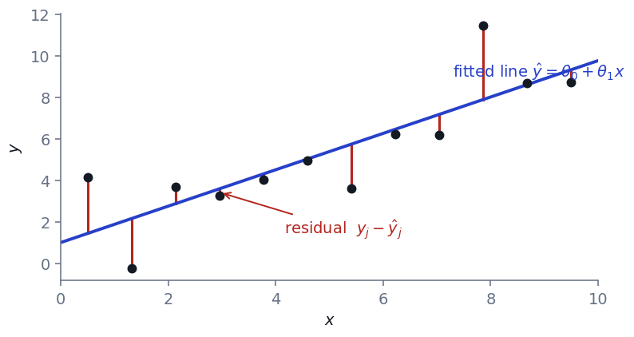
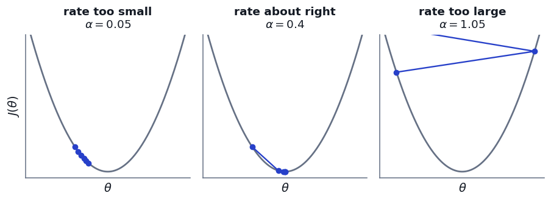
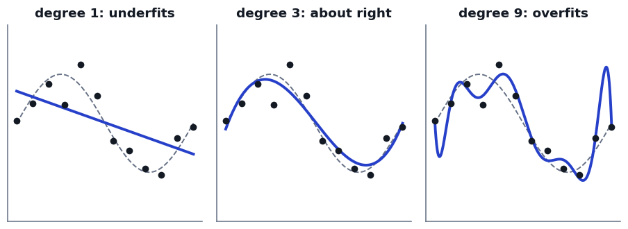
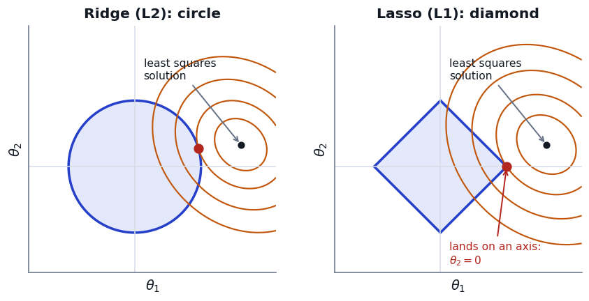
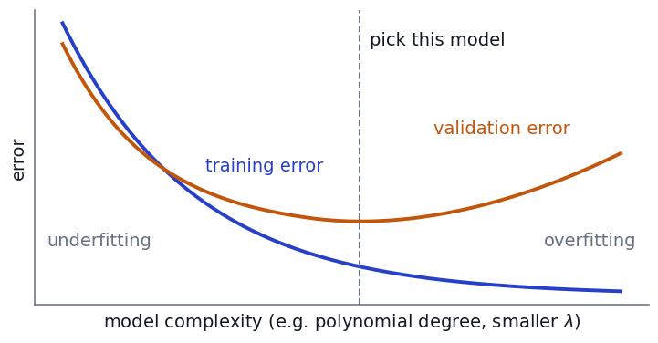
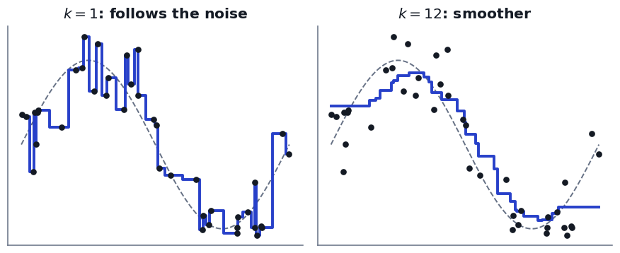

# Week 1: Regression

Sources: W1 slides (110 pages, all viewed), Tutorial Regression I with official solutions, Lab 1 "Linear Regression, the LASSO and Ridge" with solutions (re-run on the lab's `data.csv`).

## The big picture

> **Where this fits:** This is the first unit of the course, and regression is where you first meet the seven workflow stages that the rest of the course reuses. The boxes in these notes name the stage each topic belongs to: Frame the task (what are we predicting?), Prepare the data (features, scaling, splits), Choose a model (what family of functions?), Define the loss (what does "good" mean, as a number?), Fit the model (how do we find the best parameters?), Evaluate and select (how do we know it works, and how do we pick settings?) and Understand the limits (why does it work, and when must it fail?). Here is this unit's story in lecture order, with the stage in brackets.
>
> - Machine learning finds patterns in data, and regression is the supervised case where the target is a number (Frame the task).
> - To predict that number we take a weighted sum of the features, but many lines are possible, so we need a score for "best": squared error (Choose a model, Define the loss).
> - With a score in hand we need a way to minimise it: gradient descent takes repeated small steps, and the normal equations jump straight to the answer (Fit the model).
> - That leaves the question of why squared error is a sensible score: if the noise is Gaussian, maximum likelihood gives the same answer (Define the loss, as theory).
> - Some statistics tools (estimators, covariance, correlation) then give the one-feature line as a short formula, and the same fit extends to several features (Fit the model).
> - Straight lines are too stiff for curved data, so we build new features such as $x^2$, and the maths stays the same (Prepare the data).
> - Flexible models can chase noise, so ridge and LASSO add a charge for large weights to the loss (Define the loss).
> - The strength of that charge has to be picked on data the model has not seen, which needs train, validation and test data and measures such as RMSE and $R^2$ (Evaluate and select).
> - Categories become 0/1 indicator features, and when features pile up, model selection decides how to cut back (Prepare the data, Evaluate and select).
> - Nearest-neighbour and local regression drop the single global equation and predict from nearby training points (Choose a model).
> - Finally, bias-variance gives the reason both too-simple and too-flexible models fail, and unit R2 takes it up in depth (Understand the limits).

Regression is supervised learning of a numeric output. You have training pairs (input features, numeric target) and want a function that predicts the target for new inputs. This week's main model is linear regression: the prediction is a weighted sum of the features.

Everything in the deck hangs off four questions.

1. **How do we fit it?** Define a loss (squared error), then minimise it, either in closed form (normal equations) or iteratively (gradient descent). Under Gaussian noise, the same answer comes out of maximum likelihood.
2. **How do we make it flexible?** Add new features such as $x^2$, products, and indicators for categories. The model stays linear in its parameters, so the same maths applies.
3. **How do we stop it overfitting?** Penalise large weights (ridge, LASSO), select features, and tune hyperparameters on validation data.
4. **How do we judge it?** Use RMSE, MAE, $R^2$ and adjusted $R^2$ on data the model has not seen.

The deck ends with a different, non-parametric approach (nearest-neighbour and local regression) and a short look at the bias-variance tradeoff.

**Notation warning.** The three sources use different letters for the same things. Questions may use any of them.

| Thing | Slides | Tutorial | Lab |
|---|---|---|---|
| Number of samples | $m$ (index $j$); $N$ in the statistics section | $n$ (index $i$) | $n$ |
| Number of features | $n$, excluding the bias | $p$, **including** the bias column | $p$, excluding the bias |
| Parameters | $\theta$ | $w$ | $\beta$ |
| Target vector | a blackboard-bold y, written $\mathbf y$ in these notes | $y$ | $y$ |
| Ridge/LASSO strength | $\lambda$ | $\lambda$ | $\lambda$ or $\alpha$ (sklearn's `alpha`) |

The slides also use $m$ for the sample mean on W1 p.60, and $k$ both as the number of neighbours and as a feature index on W1 p.100.

## What machine learning is

> **Where this fits:** Before picking any method, you need to know what kind of problem you have: do you have the right answers to learn from, or only raw inputs? This is the Frame the task stage, and the supervised versus unsupervised split decides which part of the course applies: most units up to W8 are supervised, and W9 covers unsupervised learning. The pipeline at the end of this section is the slides' own coarser version of the same journey, and it also includes getting the data and deploying the model.

Machine learning is about programs that automatically improve from experience, or the automated detection of meaningful patterns in data. Data mining is the extraction of implicit, previously unknown and potentially useful information from data (W1 p.13).

**Supervised learning:** the output (class or label) is given. It develops a predictive model from inputs and outputs. **Unsupervised learning:** no output is given, and it finds internal structure from inputs alone (W1 p.17, p.18). Hybrids exist, such as semi-supervised learning, and there are other ways to acquire data, such as reinforcement learning and active learning. An output can be real-valued or discrete, a scalar, a vector or another structure.

Supervised learning dominates applications because it is much easier to define the problem and an error measure (a loss function) to compare algorithms, settings and data transformations (W1 p.20). Good labelled data is difficult and expensive to obtain, which motivates unsupervised, semi-supervised, self-supervised and transfer learning (W1 p.21).

**The ML pipeline** (W1 p.16): data retrieval, then data preparation (cleaning and pre-processing, feature engineering and extraction, feature scaling and selection), then modelling, then evaluation and tuning, then deployment and monitoring. If performance is not satisfactory, go back to data preparation and repeat.

## Introduction to regression

> **Where this fits:** Once a task is supervised, the next question is what kind of output you want: a number or a category. This is still Frame the task. A number means regression, the subject of this unit and R2, and it returns in W4 as regression trees. A category means classification, which starts in W2.

Regression predicts numeric values, such as house prices. Classification predicts discrete values, such as spam or not spam (W1 p.24).

Example (W1 p.26): House Price $= -8775.58 + 147.12\times$ Size $+ 9660.37\times$ Bedrooms $+ 25691.99\times$ Bathrooms $- 1285.01\times$ Age. Each coefficient is the predicted change in price for a one-unit change in that feature, with the others held fixed.

## Linear regression and least squares



> **Where this fits:** You want to predict a number from features, and you need two things: a form for the prediction and a way to say which candidate is best. This section gives both, so it covers Choose a model (the linear model) and Define the loss (squared error). The same weighted sum of features comes back in W2 logistic regression, W5 perceptrons and SVMs, and the W8 neuron. The habit of defining a loss and then minimising it runs through W2, W5, W7 and W8, with different losses.

**The model** (W1 p.28, p.30). Linear regression assumes the expected output $E[y\mid x]$ is linear in the input. The prediction is a linear combination of attributes:

$$\hat y = \theta_0 + \theta_1x_1 + \dots + \theta_nx_n = h(x)$$

Setting $x_0 = 1$ lets us write $h(x) = x^T\theta$ with $x = [x_0, x_1, \dots, x_n]^T$ and $\theta = [\theta_0, \dots, \theta_n]^T$. That is $n+1$ parameters.

> **In plain words:** This is the prediction rule. Take each feature, multiply it by its weight, add the results, and start from a base value $\theta_0$ (the intercept). A large weight means the prediction moves a lot for each unit of that feature, and a weight of zero means the feature is ignored. Setting $x_0 = 1$ is a bookkeeping trick: it treats the intercept as one more weight, so the whole rule becomes a single weighted sum.

**Univariate regression** has one input variable. **Multiple (multivariable) regression** has more than one (W1 p.31).

**The design matrix** (W1 p.34). Stack observations as rows, and add a column of ones for the intercept:

$$X = \begin{bmatrix}1 & x_{11} & \dots & x_{1n}\\ \vdots & & & \vdots\\ 1 & x_{m1} & \dots & x_{mn}\end{bmatrix},\qquad \mathbf y = \begin{bmatrix}y_1\\ \vdots\\ y_m\end{bmatrix}$$

$X$ is $m\times(n+1)$. If you forget the column of ones, the model is forced through the origin.

> **In plain words:** This is the training data laid out as a table, so that one calculation can handle every example. Each row is one example, each column is one feature, and the target values sit in their own column $\mathbf y$. The extra column of ones gives the intercept something to multiply, which is why $X$ has one more column than there are features. Multiplying $X$ by $\theta$ then gives the predictions for all rows at once.

**The cost function** (W1 p.33). Infinitely many lines can be drawn through data, so we need a criterion for "best". The most popular is least squares, also called ordinary least squares (OLS). An error is the difference between actual and predicted value. We minimise the sum of squared errors:

$$J(\theta) = \sum_{j=1}^m\Big(y_j - \sum_{i=0}^n\theta_ix_{ji}\Big)^2 = \sum_{j=1}^m(y_j - x_j^T\theta)^2 = (\mathbf y - X\theta)^T(\mathbf y - X\theta)$$

$J$ is the **cost** or **loss function**. In OLS it is also called the **residual sum of squares (RSS)**. The tutorial calls it the sum of squared errors (SSE).

> **In plain words:** This is the scorecard for a candidate line. For each training example, see how far the prediction misses the true value, square that miss, and add everything up. Squaring means the sign doesn't matter and one big miss hurts far more than several small ones. Zero would be a perfect fit, and learning means finding the $\theta$ that makes this number as small as possible. The three versions in the formula are the same score, written with every weight shown, then per example, then for the whole table at once.

Dividing by $m$ gives the **mean squared error (MSE)**: $J(\theta) = \frac1m\sum_j(y_j - x_j^T\theta)^2$. It gives the same minimising $\theta$ (W1 p.35). The minimum value differs by a factor of $m$. So $\arg\min$ is the same but $\min$ is not (Tutorial Q2(h)). MSE is easier to interpret, because SSE can be larger just because there are more samples.

> **In plain words:** MSE is the same scorecard divided by the number of examples, so it reads as the average squared miss per example. Dividing every candidate's score by the same number can't change which candidate wins, so the best $\theta$ stays the same. Only the winning score itself changes, which is why $\arg\min$ agrees and $\min$ does not.

With two features the fit is a plane, and with more it is a hyperplane (W1 p.36).

**Convexity** (W1 p.37). For linear regression, $J$ is convex with one global minimum, so a search that keeps lowering $J$ cannot get stuck in a worse local minimum.

## Gradient descent



> **Where this fits:** We have a score to minimise, and now we need a way to find the $\theta$ that minimises it. Gradient descent is a fitting method (Fit the model): it improves a guess step by step, so it still works when no direct formula exists. For linear regression you could use the normal equations in the next section instead, but W2 logistic regression has no closed form and uses gradient descent. It comes back in W8, where backpropagation computes the gradients, and it is the idea behind W7 gradient boosting.

Gradient descent starts from an initial $\theta$ and repeatedly updates it (W1 p.38):

$$\theta_i^{(t+1)} := \theta_i^{(t)} - \alpha\frac{\partial}{\partial\theta_i}J(\theta^{(t)})$$

$\alpha$ is the **learning rate** (step size). Each step goes in the direction of steepest decrease of $J$.

> **In plain words:** This is how to walk downhill on the cost when you can't see the bottom, like a ball rolling down a slope. At the current $\theta$, measure the slope of $J$ for each parameter, then move that parameter a small step against the slope. $\alpha$ sets the step length, and the slope itself makes the steps shorter as the ground flattens out. At the bottom the slope is zero, so the updates stop changing anything.

**One sample** (W1 p.40). For $J = (y_j - h_\theta(x_j))^2$, the derivative is $\frac{\partial J}{\partial\theta_i} = -2(y_j - h_\theta(x_j))x_{ji}$, so the update is

$$\theta_i^{(t+1)} := \theta_i^{(t)} + 2\alpha(y_j - h_\theta(x_j))x_{ji}\quad\text{for every } i$$

This is the **Least Mean Squares (LMS)** rule. The minus in the update and the minus in the derivative combine to give a plus. The update is proportional to the error, so a sample that is already predicted well changes little.

> **In plain words:** This is one downhill step using a single training example. Work out the error on that example (true value minus prediction), multiply it by the example's value of feature $i$, and add a small multiple of that to weight $i$. If the prediction was too low and the feature is positive, the weight goes up, which raises the prediction for this example. A zero error changes nothing, and a feature value of zero leaves that weight alone, since the weight played no part in this prediction.

**Batch gradient descent** (W1 p.41) uses all $m$ samples for each update of the MSE:

$$\theta_i^{(t+1)} = \theta_i^{(t)} + \alpha\frac2m\sum_{j=1}^m(y_j - h_{\theta^{(t)}}(x_j))x_{ji}\quad\text{for every } i$$

Continue until convergence, meaning the estimated $\theta$ stabilises.

> **In plain words:** This is the same nudge, worked out on every training example before any weight moves. For each example, take its error times its feature value, average those over all $m$ examples, and take one step. In the $\frac2m$, the 2 comes from differentiating the square and the $\frac1m$ comes from the MSE being an average. The price is that each update needs a full pass through the data, which is what SGD avoids.

**Stochastic gradient descent (SGD)** (W1 p.42) loops through the samples and updates after each one, using the single-sample rule, so each sample sees the $\theta$ already changed by the one before. Repeat until convergence. Each update is much less costly than a batch update, but SGD may never converge to the minimum (W1 p.43).

| | Batch | Stochastic |
|---|---|---|
| Samples per update | all $m$ | 1 |
| Updates per pass over the data | 1 | $m$ |
| Cost per update | high | low |
| Behaviour | settles as $\theta$ stabilises | may never converge to the minimum |

**For both** (W1 p.44): initial values can be arbitrary. Too small an $\alpha$ makes the algorithm very slow. Too big an $\alpha$ can stop it converging.

Example: for $J(\theta) = (\theta-3)^2$, the update gives $(\theta-3)\leftarrow(1-2\alpha)(\theta-3)$. It converges for $0<\alpha<1$, reaches 3 in one step at $\alpha=0.5$, oscillates forever at $\alpha=1$, and diverges for $\alpha>1$. Convexity alone does not save you from a large $\alpha$.

> **In plain words:** In this example, each step multiplies your distance from the answer by the same factor, $1-2\alpha$. If the factor is between $-1$ and $1$ the distance shrinks every step, and if it is 0 you land on the answer at once. If it is exactly $-1$ you bounce between two points forever, and beyond that each bounce is bigger than the last. So a bigger step is not always faster, and even this bowl-shaped cost blows up if $\alpha$ is too large.

## Normal equations (closed form)

> **Where this fits:** Walking downhill takes many steps, and for linear regression with squared error you can skip them. This is the other fitting method (Fit the model), the alternative to gradient descent: solve directly for the point where the slope is zero. You can only do that when a closed form exists. Ridge, later in this unit, keeps one with a small change to this formula, but LASSO and W2 logistic regression have none, so they need an iterative search.

Instead of iterating, set the derivative to zero (W1 p.45):

$$\frac{\partial J}{\partial\theta} = -2X^T(\mathbf y - X\theta) = 0 \;\Rightarrow\; X^TX\theta = X^T\mathbf y \;\Rightarrow\; \boxed{\theta = (X^TX)^{-1}X^T\mathbf y}$$

> **In plain words:** This finds the bottom of the cost in one calculation instead of walking there. At the bottom the slope is zero for every weight, and that gives an equation: for each feature column, the leftover errors multiplied by that feature's values must add up to zero. Rearranging gives $X^TX\theta = X^T\mathbf y$, and $(X^TX)^{-1}$ plays the part of dividing both sides by $X^TX$. That last move only works when $X^TX$ can be inverted, which the paragraphs below deal with.

**Why it is a global minimum** (Tutorial Q2(b)). The Hessian of the SSE is $2X^TX$. For any $u$, $u^T(2X^TX)u = 2\lVert Xu\rVert^2\ge0$, so the Hessian is positive semi-definite, $J$ is convex, and any critical point is a global minimum.

> **In plain words:** The Hessian measures how the slope changes, which is the curvature of the cost. This check shows the curvature is never negative in any direction $u$, because it comes out as twice a squared length, and a squared length can't go below zero. So the cost is bowl-shaped, with no hills and no false dips, and any point where the slope is zero must be a lowest point. It may be one of many equally low points, as the next paragraph explains.

**When $X^TX$ is not invertible** (Tutorial Q2(f)). This happens when the columns of $X$ are linearly dependent, for example a duplicated feature, or fewer samples than columns. The formula with the inverse fails, but least squares does not. Minimisers still exist, there are infinitely many, and `np.linalg.pinv` (the Moore-Penrose pseudo-inverse) finds one. The tutorial says the pseudo-inverse itself is outside the scope of the course.

## Probabilistic interpretation

> **Where this fits:** So far squared error has been a choice, and this section asks why it is a sensible one. It is theory behind the Define the loss stage: assume the data is a line plus random Gaussian noise, ask which $\theta$ makes the observed data most probable, and least squares comes out as the answer. R2 goes through this in more depth, and W3 repeats the argument. W2 uses the same maximum likelihood reasoning to get the loss for logistic regression.

Assume $y_j = x_j^T\theta + \varepsilon_j$, where $\varepsilon_j$ is unmodelled effects or random noise, and the $\varepsilon_j$ are i.i.d. Gaussian, $\varepsilon_j\sim N(0,\sigma^2)$ (W1 p.46). Then

$$P(y_j\mid x_j;\theta) = \frac{1}{\sqrt{2\pi\sigma^2}}\exp\left(-\frac{(y_j-x_j^T\theta)^2}{2\sigma^2}\right)$$

> **In plain words:** This says how likely an observed $y_j$ is if $\theta$ were the true line. Picture a bell curve centred on the line's prediction for that example: values near the prediction are likely, and values further away become unlikely fast. $\sigma^2$ sets how wide the bell is, so with more noise a big miss is less surprising. The fraction in front only scales the curve so that its total area is 1.

The **likelihood** is $\mathcal L(\theta) = P(\mathbf y\mid X;\theta)$ (W1 p.47). By independence it is the product of these terms over $j$ (W1 p.48). **Maximum likelihood** picks the $\theta$ that maximises it.

Any strictly increasing function of $\mathcal L$ has the same maximiser, so we use the **log likelihood** (W1 p.49):

$$\ell(\theta) = m\log\frac{1}{\sqrt{2\pi\sigma^2}} - \frac{1}{\sigma^2}\cdot\frac12\sum_{j=1}^m(y_j-x_j^T\theta)^2$$

The first term does not contain $\theta$. So maximising $\ell$ is the same as minimising $\sum_j(y_j-x_j^T\theta)^2$, which is the RSS.

**Conclusion** (W1 p.50): under i.i.d. $N(0,\sigma^2)$ errors, least squares is the maximum likelihood estimate of $\theta$. The value of $\sigma^2$ does not affect the choice of $\theta$.

> **In plain words:** The likelihood multiplies together how probable each example is under a candidate $\theta$, and taking the log turns that product into a sum without changing which $\theta$ wins. The result has two parts: a fixed amount that is the same for every $\theta$, minus a positive number times the sum of squared errors. So the only way to raise the likelihood is to shrink the squared errors, which is the least squares problem again. $\sigma^2$ only changes the size of that positive number, so it can't change which $\theta$ is best.

The noise model decides the loss. Doing the same steps with Laplace noise, $P(\varepsilon)\propto\exp(-\lvert\varepsilon\rvert/b)$, gives the sum of absolute errors instead.

**The four assumptions of linear regression** (W1 p.51):

1. **Linearity:** the relationship between $x$ and the mean of $y$ is linear.
2. **Homoscedasticity:** the variance of the residuals is the same for any value of $x$.
3. **Independence:** observations are independent of each other.
4. **Normality of residuals:** for any fixed $x$, $y$ is normally distributed.

## Statistics background

> **Where this fits:** Training data is only a sample, yet we want conclusions about the whole population, so we need tools for reasoning from one to the other. This section is background theory rather than a step you perform, closest to Understand the limits. Its covariance feeds straight into the slope formula in the next section, and R2 revisits this material and builds on the idea of an estimator being right on average.

**Probability vs statistics** (W1 p.53). Probability reasons from populations to samples. It is deductive and usually sound in the logical sense. Statistics reasons from samples to populations. It is inductive and usually unsound in the logical sense.

**Population and sample** (Tutorial Q3). A population is what we want to learn about. A sample is the subset we have access to. A **population parameter** is an unknown quantity we want to estimate, such as the mean weight $\mu$ of all kangaroos, or the probability $p$ of heads on a bent coin. We estimate it from a sample, for example with the sample mean $\bar X$. Greek letters such as $\mu,\sigma$ are for population parameters, not sample statistics. $X_1,\dots,X_n\sim F(\theta)$ means we want $\theta$ but only have the samples.

**Sampling** (W1 p.55, p.56). Fairly homogeneous populations need little data: you do not need many sips of tea to know it is too hot. Irregular populations need more. Sampling draws conclusions about a population without measuring all of it, and the conclusions need not be completely accurate. This works if the sample closely resembles the population. We want a sampling method with:

- no systematic bias, or none that we cannot account for
- a calculable chance of an unrepresentative sample (if it is high, we can decline to conclude)
- a chance of an unrepresentative sample that decreases as the sample grows

**Estimation** (W1 p.58, p.59). Estimation is making inferences about a population from a sample. An **unbiased estimator** has expected value equal to the true population parameter, so it is correct on average.

| Estimator | Formula | Course's label |
|---|---|---|
| Sample mean | $\bar x = \frac1N\sum_ix_i$ | unbiased |
| Sample median | middle value when ordered; less affected by outliers than the mean | biased |
| Sample variance | $s^2 = \frac{1}{N-1}\sum_i(x_i-\bar x)^2$ | unbiased |
| Sample standard deviation | $s = \sqrt{s^2}$ | biased |
| Sample range | max minus min | biased; usually underestimates the population range |

(W1 p.60)

> **In plain words:** "Unbiased" means that if you repeated the sampling many times, the estimates would average out to the true value, even though any one estimate can be off. The sample variance $s^2$ measures spread: take each value's distance from the sample mean, square it, add these up, and divide by $N-1$ rather than $N$. That $N-1$ is what makes it unbiased, as R2 explains.

**Covariance and correlation** (W1 p.61):

$$\mathrm{cov}(x,y) = \frac{\sum_i(x_i-\bar x)(y_i-\bar y)}{N-1} = \frac{(\sum_ix_iy_i) - N\bar x\bar y}{N-1},\qquad r = \frac{\mathrm{cov}(x,y)}{\sqrt{\mathrm{var}(x)}\sqrt{\mathrm{var}(y)}}$$

> **In plain words:** Covariance measures whether two variables move together. For each point, see how far it sits from the mean in $x$ and in $y$, multiply those two gaps, add the products up, and divide by $N-1$. If points high in $x$ tend to be high in $y$, most products are positive, and if high goes with low, most are negative. Covariance changes with the units, so $r$ divides by both spreads to give a unit-free number from $-1$ to $+1$. The second form of covariance is the same number, arranged for hand calculation.

What to know about the Pearson correlation $r$ (W1 p.61 to p.64):

- It lies between $-1$ and $+1$, and its sign gives the direction of the association.
- It only captures **linear** relationships, so it does not work well when the association is curved. Data on a circle or a parabola can have $r=0$ (W1 p.62).
- Data exactly on a line has $r=\pm1$ whatever the slope (W1 p.62). So $r$ is not the slope.
- It does not model the relationship: you cannot compute $y$ from $x$ and $r$.
- Two datasets can have the same correlation with different relationships, or the same relationship with different correlations. Do not use it to compare datasets.
- It does not imply that $x$ causes $y$, or the reverse.

## Univariate linear regression

> **Where this fits:** With one input you don't need matrices: the best line has a short formula you can work out by hand. This is Fit the model for the simplest case, giving the same answer as the normal equations but written with the covariance and variance from the previous section. It also shows a weakness of the squared error loss: outliers pull the line hard.

Fit $\hat y = \theta_0 + \theta_1x$ by minimising $\sum_j(y_j-\hat y_j)^2$. The solution is (W1 p.66, p.68)

$$\theta_1 = \frac{\mathrm{Cov}(x,y)}{\mathrm{var}(x)} = \frac{\sum_j(x_j-\bar x)(y_j-\bar y)}{\sum_j(x_j-\bar x)^2},\qquad\theta_0 = \bar y - \theta_1\bar x$$

The denominators $N-1$ cancel, as long as you use the same one on top and bottom. The tutorial writes the same result with averages, where $\overline{xy} = \frac1n\sum x_iy_i$ and $\overline{x^2} = \frac1n\sum x_i^2$:

$$w_1 = \frac{\overline{xy}-\overline x\,\overline y}{\overline{x^2}-\overline x^2},\qquad w_0 = \overline y - w_1\overline x$$

Do not confuse $\overline{x^2}$ (mean of squares) with $\overline x^2$ (square of the mean).

> **In plain words:** The slope answers "when $x$ moves, how much does $y$ tend to move with it?". Take how much $x$ and $y$ vary together and divide by how much $x$ varies on its own. If they don't vary together at all, the slope is zero and the line is flat at $\bar y$. The intercept then slides the line up or down so that it passes through the middle of the data, the point $(\bar x,\bar y)$. The tutorial's version is the same covariance over variance, written with averages.

**Properties** (W1 p.69, p.70, Tutorial Q1(b)):

- The line always passes through the centroid $(\bar x,\bar y)$.
- Adding a constant to all $x$-values changes only the intercept, not the slope, because regression uses deviations from the mean.
- If $x$ is centred, the intercept equals $\bar y$. If $y$ is centred too, the intercept is 0.
- The residuals sum to zero: $\sum_j(y_j-x_j^T\theta)=0$. This comes from the row of the normal equations for the column of ones, so it needs an intercept in the model.

**Outliers** (W1 p.70 to p.72). Squared error makes linear regression susceptible to outliers, meaning points far from the line, often due to measurement error. In the slides' example, one weight wrongly increased by 10 kg visibly moves the line. A change $\Delta y$ at point $i$ changes the slope by $(x_i-\bar x)\Delta y/\sum_j(x_j-\bar x)^2$. So a point near the edge of the $x$ range tilts the line, and a point at $\bar x$ only raises it.

> **In plain words:** This says how much one point can tilt the line. Its pull on the slope is its change in $y$ multiplied by how far it sits from $\bar x$, so distance from the centre works like a lever. A point at the edge of the range has a long lever, and a point exactly at $\bar x$ has none. The bottom of the fraction is the total spread of the $x$ values, so the more spread out the data, the less any single point can tilt the line.

## Multiple linear regression

> **Where this fits:** One input is often not enough, as when predicting weight from height and body frame, so the model needs several. This stays in Choose a model and Fit the model, with nothing new to learn: the linear model, squared error and normal equations from earlier already cover it, with more columns in $X$. Later sections use those extra columns for curves and categories.

The model has several inputs, for example $\hat w = \theta_0 + \theta_1h + \theta_2b$ for weight from height and body frame (W1 p.75). You minimise the same sum of squared residuals. Including more variables can give a narrower confidence interval on the prediction. With many variables, the matrix form is the natural way to write the solution.

## Linear regression for curve shapes



> **Where this fits:** A straight line can't follow curved data, but we don't want to give up the simple maths of linear regression. The fix sits in Prepare the data and Choose a model: build new features such as $x^2$ and run ordinary linear regression on them. Feature maps return in W5, where kernels work with them without building them, and W8's CNNs build a hierarchy of features inside the network. More features also make overfitting possible, which is why regularisation comes next.

Linear regression can fit curves. Define new features: for example, with $x_2 = x_1^2$ and $x_3 = x_1^3$, the model $\hat y = \theta_0+\theta_1x_1+\theta_2x_1^2+\theta_3x_1^3$ becomes $\hat y = \theta_0+\theta_1x_1+\theta_2x_2+\theta_3x_3$ (W1 p.78).

These models are nonlinear in $x$ but still **linear in the parameters**, and that is what "linear regression" means. True nonlinear regression is not linear in its parameters, for example $\hat y = \frac{\theta_1x}{\theta_2+x}$.

**Feature maps** (Tutorial Q2(g)). A feature map is any function $\phi:\mathbb R^p\to\mathbb R^K$, where $K$ can be larger or smaller than $p$. The model becomes $\hat y_i = w^T\phi(x_i)$. Build the design matrix $\Phi$ with rows $\phi(x_i)^T$, so $\Phi$ is $n\times K$, and solve $\hat w = (\Phi^T\Phi)^{-1}\Phi^Ty$. Nothing else changes.

> **In plain words:** A feature map is a preprocessing step. Take each example's original inputs, turn them into a new list of numbers (powers, logs, or anything else you choose), and use those as the columns of a new table $\Phi$. Then run ordinary linear regression on $\Phi$ with the same formula as before. The curve lives in the features while the model stays a weighted sum, and "linear" only ever referred to that weighted sum.

Which features you use matters a great deal. In the lab, data from $x^2$ is fitted badly by $b_0+b_1x$ and well by $w_0+w_1x^2$.

Too low a degree **underfits**, too high a degree **overfits** (W1 p.79). That raises the question of how to control complexity.

## Regularisation



> **Where this fits:** Flexible models can fit the noise in the training data, so we need a way to hold them back. Regularisation changes the loss (Define the loss) by adding a charge for large weights, and its strength is then a setting to tune in Evaluate and select. Ridge and LASSO are the two versions: pick LASSO if you want some features dropped outright, and ridge if you want to keep them all with smaller weights. R2 redraws both as constrained problems, W8 adds the same kind of weight penalty to networks, and the fight against overfitting continues with W4 pruning and W7 bagging.

**Regularisation** avoids overfitting by applying additional constraints to the weight vector. A common approach keeps weights small on average, which is called **shrinkage** (W1 p.82). You add a penalty term to the cost:

$$J(\theta) = \sum_{j=1}^m(y_j-h_\theta(x_j))^2 + \lambda\sum_{i=1}^n\theta_i^2$$

It can be solved by gradient descent or by setting derivatives to zero (W1 p.83). $\lambda$ is a scalar that sets the amount of regularisation.

> **In plain words:** This is the old scorecard with a second charge added: a fee for having large weights. A candidate now has to fit the data and keep its weights small, and $\lambda$ sets how much the fee counts. At $\lambda=0$ the fee disappears and this is ordinary least squares, and as $\lambda$ grows the weights get pushed towards zero overall and the model gets simpler. In this version the fee's sum starts at $i=1$, so the intercept pays nothing, but the sources disagree on this, as the errors section explains.

**Ridge regression** (W1 p.84, p.85):

$$\theta^* = \arg\min_\theta(y-X\theta)^T(y-X\theta)+\lambda\lVert\theta\rVert^2,\qquad\theta = (X^TX+\lambda I)^{-1}X^Ty$$

Regularisation adds $\lambda$ to the diagonal of $X^TX$, a well-known trick to improve the numerical stability of the inverse. In fact $X^TX+\lambda I$ is invertible for every $\lambda>0$, because $u^T(X^TX+\lambda I)u = \lVert Xu\rVert^2+\lambda\lVert u\rVert^2>0$ for $u\ne0$.

> **In plain words:** The first formula is the same two-part score in matrix form. The second is the normal equations with one change: add $\lambda$ to each diagonal entry of $X^TX$ before inverting. That change does two jobs. It pulls the solution towards smaller weights, and it guarantees the inverse exists for any $\lambda$ above zero, even with a duplicated feature. Written this way the intercept is penalised too if $X$ has a column of ones, which sklearn does not do, as the errors section explains.

**LASSO** (Least Absolute Shrinkage and Selection Operator) replaces $\sum_i\theta_i^2$ with $\sum_i\lvert\theta_i\rvert$. Some weights are shrunk and others are set to exactly 0, so LASSO favours **sparse** solutions (W1 p.85). It has no closed form like ridge's.

One-parameter picture of why: minimising $(\theta-3)^2+\lambda\theta^2$ gives $\theta = 3/(1+\lambda)$, which is never exactly 0. Minimising $(\theta-3)^2+\lambda\lvert\theta\rvert$ gives $\theta = 3-\lambda/2$ until $\lambda=6$, and exactly 0 after that.

> **In plain words:** Compare what each penalty charges as a weight gets close to zero. Ridge charges the square, so the fee on an already small weight is tiny and there is little to gain from removing the last bit: in this example $3/(1+\lambda)$ gets smaller but never reaches 0. LASSO charges the size itself, so the fee for each unit of weight stays the same all the way down: here the weight falls steadily, hits exactly 0 at $\lambda=6$ and stays there. That is how LASSO drops features while ridge only shrinks them.

| | Ridge | LASSO |
|---|---|---|
| Penalty | $\lambda\sum\theta_i^2$ | $\lambda\sum\lvert\theta_i\rvert$ |
| Closed form | yes | no |
| Exact zeros | no, shrinks towards 0 | yes, sparse |
| Near-duplicate features | shares weight between them | tends to keep one |
| Large $\lambda$ | coefficients approach 0 | all coefficients reach exactly 0 |

**Effects of increasing $\lambda$:** training error cannot fall, $\lVert\hat\theta\rVert$ does not rise, and the model gets simpler. $\lambda=0$ is OLS. A single coefficient need not shrink steadily: in the lab, the ridge coefficient of $X_4$ goes from $+4.0$ at $\lambda=0.01$ to $-9.8$ at $\lambda=1$.

**Standardise first.** The penalty acts on coefficient sizes, and a coefficient's size depends on its feature's units. Standardising makes the comparison across features less arbitrary (Lab Q2). Plain OLS predictions do not depend on feature scale, but ridge and LASSO do.

**What the lab found on `data.csv`** ($n=38$, 8 features; these numbers were reproduced):

- $X_3$, $X_4$ and $X_5$ are nearly collinear (correlation of $X_3$ and $X_4$ is 0.998). This multicollinearity makes coefficients hard to interpret, inflates their standard errors, and can make $X^TX$ non-invertible.
- Ridge: the $X_3$ and $X_4$ coefficients start almost opposite (for tiny $\lambda$), then become almost equal as $\lambda$ grows, for example $-5.86$ and $-5.89$ at $\lambda=100$.
- LASSO: the weight goes onto one of the pair. At $\lambda=1$ the coefficients are $-20.51$ and $-0.27$ (nearly dropped), and at $\lambda=10$ they are $0$ and $-23.04$ (dropped exactly). All coefficients reach 0 for large $\lambda$.
- LOOCV: ridge is best at $\lambda=22.3$ (error about 1443), LASSO at $\lambda=5.5$ (about 1587, with 5 of 8 coefficients exactly 0), and OLS gives about 1975.
- Conclusion: for prediction prefer ridge, since it has the lower LOOCV error. For inference (understanding the relationship), prefer LASSO, since its model is much simpler.

## Train, validation and test data



> **Where this fits:** Training error flatters a model, because the model has already seen those points, so we need unseen data to tell how it will do on new cases. Splitting the data is part of Prepare the data, and using the splits to pick settings such as $\lambda$ is Evaluate and select. W2 extends this to K-fold cross-validation, and W10 gives the theory of when performance on training data carries over to new data.

- **Training data:** used to learn the model and its parameters.
- **Validation data:** unseen by the model, used for an unbiased evaluation while tuning hyperparameters.
- **Test data:** unseen data used to test the model and show how well it generalises.

(W1 p.86)

**Generalisation** is the model's ability to adapt properly to new, previously unseen data drawn from the same distribution as the data used to create the model. Ideally, test performance matches validation and training performance (W1 p.87).

Procedure: pick the hyperparameter with the best validation score, then report that model's test score. Do not pick using the test set.

**Cross validation** comes from the lab. Leave-one-out CV (LOOCV) fits on all points except one, predicts the left-out point, repeats for every point, and averages the squared errors. Do this for each $\lambda$ on a grid and pick the smallest score. That costs (grid size) $\times\,n$ model fits.

## Model evaluation

> **Where this fits:** Once a model makes predictions on unseen data, you need a number that says how good they are. These are evaluation tools (Evaluate and select): RMSE and MAE give the size of a typical error, and $R^2$ compares the model with always predicting the mean. They are for numeric targets, and W2 gives the classification counterparts such as accuracy, precision and recall.

(W1 p.89)

$$\mathrm{RMSE} = \sqrt{\frac1m\sum_{j=1}^m(y_j-\hat y_j)^2},\qquad\mathrm{MAE} = \frac1m\sum_{j=1}^m\lvert y_j-\hat y_j\rvert$$

> **In plain words:** Both give the size of a typical prediction error, in the units of $y$. MAE takes each miss, ignores its sign, and averages. RMSE squares each miss, averages, then takes the square root to get back to the original units, so big misses count for more than they do in MAE. For both, zero means perfect predictions and there is no upper limit.

$$R^2 = 1-\frac{\sum_j(y_j-\hat y_j)^2}{\sum_j(y_j-\bar y)^2},\qquad R^2_{\text{adjusted}} = 1-\frac{(1-R^2)(m-1)}{m-n-1}$$

Here $m$ is the number of samples and $n$ is the number of features.

$R^2$ is the portion of variance in the output explained by the model. Its range is $(-\infty,1]$. It is negative when the model does worse than always predicting $\bar y$. $R^2=1$ is a perfect fit.

> **In plain words:** $R^2$ asks how much better the model does than the laziest possible guess, always predicting the mean $\bar y$. Divide the model's squared errors by that guess's squared errors, and subtract the result from 1. No errors gives 1, matching the guess gives 0, and doing worse than the guess gives a negative value. Adjusted $R^2$ takes the unexplained share, $1-R^2$, and scales it up by more as the number of features grows relative to the samples, so a new feature has to improve the fit enough to earn its place.

Interpretation (W1 p.90):

- The absolute value of RMSE does not tell you how bad a model is, because it has the units of $y$. It can only be used to compare models.
- Adjusted $R^2$ also speaks to quality: 0.05 is definitely poor. It accounts for the number of features, while plain $R^2$ on training data cannot fall when a feature is added.
- If you only care about prediction accuracy, RMSE is best. It is computationally simple, easily differentiable, and the default metric for most models.

## Categorical variables

> **Where this fits:** A linear model multiplies features by weights, so it needs numbers, yet many useful inputs are categories such as "takes the drug or not". This is Prepare the data: turn the category into 0/1 indicator columns, then run ordinary linear regression. An interaction term is one more built feature, like the powers in the curve-shapes section. W4 returns to encoding categories, including one-hot encoding.

**Indicator (binary) variables** take the values 0 or 1 and bring categorical variables into a linear model (W1 p.92). With $D=1$ if a patient takes a drug:

$$y = 70+5D+0.44\,\text{Age}$$

Taking the drug changes blood pressure by 5, with age held constant.

> **In plain words:** $D$ works as an on/off switch. With the switch off, the drug term vanishes, and with it on, the prediction goes up by 5 at every age. So the model is two parallel lines 5 apart, with the same slope for age in both groups.

**Interaction** (W1 p.93). To let the drug's effect depend on age, add $z = D\times\text{Age}$:

$$y = 70+5D+0.44\,\text{Age}+0.21z$$

For $D=0$ this is $y=70+0.44\,\text{Age}$. For $D=1$ it is $y=75+0.65\,\text{Age}$. The two groups now have different intercepts and different slopes.

> **In plain words:** The new feature is the switch multiplied by age, so it is zero for people off the drug and equals their age for people on it. That gives the drug group its own slope as well as its own starting point, so the two lines are no longer parallel. The drug's effect now depends on age: it is $5+0.21\times$ Age rather than a flat 5.

If you add one indicator for every category as well as the column of ones, the indicators sum to the ones column, $X$ is rank deficient, and $X^TX$ is singular. Leave one category out. This follows from the normal equations section; the slides do not state it.

## Model selection

> **Where this fits:** With many features, using them all gives an overly complex model, so you need a way to cut back. This is Evaluate and select, and there are three alternatives: choose a subset of features (this section), shrink weights inside one model (ridge and LASSO, from earlier), or project the data into fewer dimensions (PCA in W9). Subset selection compares many separate models, while shrinkage finds one model by optimisation. Grid search then handles settings such as the shrinkage strength.

With many features, some of them products or powers, using them all gives an overly complex model. There are three ways to reduce complexity (W1 p.94):

1. **Subset selection:** search over the subset lattice. Each subset is a new model, and you choose one.
2. **Shrinkage (regularisation):** one single model, found by optimisation, with unimportant variables having near-zero coefficients.
3. **Dimensionality reduction:** project the points into a lower dimensional space. This comes later in the course.

**Stepwise regression** is the subset-selection family (W1 p.95). These are greedy searches:

- **Forward selection:** start with no variables, and at each step add the one that gives the most improvement to the fit.
- **Backward elimination:** start with all variables, and at each step remove the one whose loss gives the most insignificant deterioration of the fit.
- **Bidirectional:** combine the two, testing at each step for variables to include or exclude.

Fit quality is often measured by $R^2$, using the change in $R^2$ from adding or removing a variable (W1 p.96). Greedy search can miss the best subset, and the two directions can end in different places.

Other hyperparameters, such as the shrinkage parameter, can be set by **grid search** (W1 p.96).

## Local (nearest-neighbour) regression



> **Where this fits:** One global equation can struggle when the pattern changes across the data, so this family does without one. It is a different answer to Choose a model and the alternative to linear regression here: keep the training data and predict from the points nearest the query, which is useful for non-linear functions or changing distributions. R2 studies kNN regression further, and the idea of distance returns in W2 kNN classification, W5 kernels as similarity and W9 clustering.

**Local learning** (W1 p.98) relates to rote learning. The training instances are searched for the one most like the query, and the instances themselves are the knowledge. It is also called nearest-neighbour, instance-based, memory-based or case-based learning. The similarity or distance function is what goes beyond simple memorisation. It is **lazy learning**: no model is built in advance.

**Nearest neighbour for numeric prediction** (W1 p.99). Store all training examples. For a query $x_q$:

- 1-NN: find the nearest neighbour $x_n$ and predict $\hat y_q = f(x_n)$.
- $k$-NN: predict the mean of the $k$ nearest neighbours, $\hat y_q = \frac1k\sum_{i=1}^kf(x_i)$.

> **In plain words:** To predict for a new point, find the $k$ training points closest to it and average their $y$ values. With $k=1$ you copy the nearest point's value, so the prediction follows every point, noise included. A larger $k$ averages the noise away but can flatten real structure.

**Distance** (W1 p.100). The distance function defines what is learned. The most common is Euclidean distance:

$$d(x_i,x_j) = \sqrt{\sum_{k=1}^n(x_{ik}-x_{jk})^2}$$

Because all features enter one sum, a feature with large numbers dominates. Changing its units can change which neighbour is nearest.

> **In plain words:** This is the straight-line distance you would measure with a ruler, extended to any number of features. For each feature, take the gap between the two points and square it, then add the squares and take the square root. Zero means the points are identical, and the value grows the more they differ. Because raw gaps are added together, the feature with the biggest numbers dominates, which is why W2 normalises features first. In this formula $k$ counts features, not neighbours.

**Local regression** (W1 p.101). For each query, fit a linear function $\hat y = \theta_0+\theta_1x_1+\dots+\theta_nx_n$ to the $k$ nearest neighbours of the query point. Linear, quadratic or higher-order polynomials can be used. This gives a **piecewise approximation**, useful for non-linear functions or data with changing distributions.

## Bias-variance tradeoff (brief)

> **Where this fits:** Why do both too-simple and too-flexible models fail? This is theory for Understand the limits, and here it is only a preview: R2 gives the full treatment, and W2, W4 and W7 put it to use.

This is covered in depth in the notes for Regression II and Lab 2 (unit R2). The essentials from W1 p.103 to p.109:

- **Bias:** the difference between the model's average prediction and the correct value. High bias means oversimplifying, with high error on training and test data.
- **Variance:** the variability of the model's prediction for a given point. High variance means paying too much attention to training data, doing very well on it but poorly on test data.
- **Underfitting:** usually high bias and low variance. **Overfitting:** the model captures the noise along with the pattern.
- With $y = f+\varepsilon$: $E[(y-\hat f)^2] = (f-E[\hat f])^2+\mathrm{Var}(\hat f)+\mathrm{Var}(\varepsilon)$, that is, $\text{MSE} = \text{Bias}^2+\text{Variance}+\text{irreducible error}$.
- Irreducible error comes from noise and cannot be reduced. Reducible error can be reduced by adjusting the model.
- Few parameters give high bias and low variance. Many parameters give high variance and low bias. There is no formula for the best point: adjust complexity, preferably using an unseen validation set, until total error is lowest.

## Errors and inconsistencies in the material

None of these is relied on in the question bank in a way that depends on picking a side. Where it matters, the stem states the convention.

- **Is the intercept penalised?** W1 p.83 sums the penalty from $i=1$, so $\theta_0$ is excluded. W1 p.84 and p.85 use $\lVert\theta\rVert^2$ and $(X^TX+\lambda I)^{-1}$, which penalises $\theta_0$ too if $X$ has a column of ones. Tutorial Q1(c) penalises only $w_1$. sklearn does not penalise the intercept. I checked this numerically: on one small dataset the $\lambda I$ formula gives $(0.457, 1.326)$ and sklearn gives $(1.5, 1.0)$. To reproduce sklearn, use $\lambda\,\mathrm{diag}(0,1,\dots,1)$.
- **Scale of the objective.** W1 p.83 says "if MSE is the cost function" but writes a sum with no $\frac1m$. The lab states three objectives: $\frac1n\lVert\cdot\rVert^2+\lambda\lVert\cdot\rVert^2$ in the introduction and $\frac12\lVert\cdot\rVert^2+\lambda\lVert\cdot\rVert^2$ in Q3, then calls `Ridge(alpha=L)`, which uses $\lVert\cdot\rVert^2+\alpha\lVert\cdot\rVert^2$. sklearn's `Lasso` uses $\frac{1}{2n}\lVert\cdot\rVert^2+\alpha\lVert\cdot\rVert_1$. So a given $\lambda$ means different things in different places, and `alpha` values are not comparable between `Ridge` and `Lasso`.
- **"Residuals sum to zero"** (W1 p.70) is stated without condition. It holds only if the model has an intercept. For example, fitting $\hat y=\theta_1x$ to $(1,1),(2,1)$ gives residuals summing to 0.2.
- **"Subtract the mean of $y$ to get a zero intercept"** (W1 p.69) needs $x$ centred as well. It follows on from the previous bullet on the slide.
- **"One global minimum"** (W1 p.37) needs $X$ to have full column rank. Otherwise $J$ is still convex, but there are infinitely many minimisers.
- **$r$ near 0** (W1 p.63) is described as "no association". This contradicts W1 p.61 and p.62, where $r=0$ data has clear curved structure, and the lab says the same. Read it as no *linear* association.
- **Median "(biased)"** (W1 p.60) is too general. As an estimator of the population mean of a symmetric distribution, the median is unbiased, and the tutorial lists it as an estimator of the normal mean. No question depends on this.
- **Test labels.** W1 p.86 says that in practice we do not know the label of test data, yet test data is used to measure performance, which needs labels. The lab has test labels. The slide seems to mean data met after deployment.
- **Tutorial Q2(b) solution** defines $L$ with $\frac1n$ but gets the Hessian $2X^TX$. With the $\frac1n$ it is $\frac2nX^TX$. The conclusion is unaffected.
- **Tutorial Q2(h)(ii)** "min MSE = min SSE is false" holds unless the minimum is 0 or $n=1$.
- **"New indicator variable $z = D\times$ Age"** (W1 p.93): $z$ is not an indicator, because it takes the value Age when $D=1$.
- **Lab Q5 solution** says LASSO "forces X4 to be zero and attaches all weight to X3". That holds for small $\lambda$, but at $\lambda=10$ the fit has $X_3=0$ and $X_4=-23.04$. The safe statement is that LASSO keeps one of the pair.
- **Lab LOOCV solution** standardises all the data once, before the leave-one-out loop. Strictly, the scaler should be refitted without the left-out point. This is mild leakage.
- **`LassoCV` output depends on the version.** The lab's table (test MSE 0.208) reproduces on sklearn 1.8 only with a tighter `tol`, which selects $\alpha\approx0.10$. With the default `tol`, sklearn 1.8 selects $\alpha\approx0.41$ with test MSE 0.859. The other rows match.
- **Small typos.** W1 p.67: the residual is printed without brackets, as $w_j-\theta_0+\theta_1h_j$; it should be $w_j-(\theta_0+\theta_1h_j)$. W1 p.40: sums start at $i=1$, dropping the bias term that W1 p.33 includes. W1 p.68: "solve for $\theta_0$" should say both parameters. W1 p.89: "Adjuster". W1 p.101: "liner". W1 p.107: "irreducable" and "can not be not reduced". Tutorial Q2(a) hint 2 mixes $z$ and $u$. A lab comment says "generate 100 points" where $n=40$.

## Worked examples

**Tutorial Q1(a): univariate least squares.** Let $L = \frac1n\sum_i(y_i-w_0-w_1x_i)^2$.

1. $\frac{\partial L}{\partial w_0} = \frac1n\sum_i-2(y_i-w_0-w_1x_i) = -2[\overline y-w_0-w_1\overline x]$. Setting it to 0 gives $w_0 = \overline y-w_1\overline x$.
2. $\frac{\partial L}{\partial w_1} = \frac1n\sum_i-2x_i(y_i-w_0-w_1x_i) = -2[\overline{xy}-w_0\overline x-w_1\overline{x^2}]$. Setting it to 0 gives $w_1 = \frac{\overline{xy}-w_0\overline x}{\overline{x^2}}$. These two are the normal equations.
3. Substitute $w_0$ into $w_1$ and rearrange: $w_1 = \frac{\overline{xy}-\overline x\,\overline y}{\overline{x^2}-\overline x^2}$.

**Tutorial Q1(b): the centroid.** $\hat y(\overline x) = w_0+w_1\overline x = \overline y-w_1\overline x+w_1\overline x = \overline y$. So $(\overline x,\overline y)$ is on the line.

**Tutorial Q1(c): penalising $w_1$.** Let $L = \frac1n\sum_i(y_i-w_0-w_1x_i)^2+\lambda w_1^2$. The $w_0$ equation is unchanged, so $w_0 = \overline y-w_1\overline x$. The $w_1$ equation gains $2\lambda w_1$, which gives

$$w_1 = \frac{\overline{xy}-\overline x\,\overline y}{\overline{x^2}-\overline x^2+\lambda}$$

The penalty increases the denominator, so $w_1$ shrinks.

**Tutorial Q2(a): the critical point.** $\lVert y-Xw\rVert^2 = y^Ty-2y^TXw+w^TX^TXw$. Its derivative is $-2X^Ty+2X^TXw$. Setting that to 0 gives $\hat w = (X^TX)^{-1}X^Ty$. The hints used are $\partial(v^Tu)/\partial u = v$ and $\partial(u^TAu)/\partial u = Au+A^Tu$.

**Tutorial Q2(b): global minimum.** Hessian $= 2X^TX$, and $u^T(2X^TX)u = 2(Xu)^T(Xu) = 2\lVert Xu\rVert^2\ge0$. The function is convex, so the critical point is a global minimiser.

**Tutorial Q2(c), (d): the $p=2$ case.** With rows $(1,x_i)$:

$$X^TX = \begin{bmatrix}n & n\overline x\\ n\overline x & n\overline{x^2}\end{bmatrix},\quad(X^TX)^{-1} = \frac{1}{n(\overline{x^2}-\overline x^2)}\begin{bmatrix}\overline{x^2} & -\overline x\\ -\overline x & 1\end{bmatrix},\quad X^Ty = \begin{bmatrix}n\overline y\\ n\overline{xy}\end{bmatrix}$$

Multiplying gives the same $w_0$ and $w_1$ as Q1.

**Tutorial Q2(e): numbers.** $x = 3,6,7,8,11$ and $y = 13,8,11,2,6$.

1. $n=5$, $\sum x=35$, $\sum x^2=279$, $\sum y=40$, $\sum xy=246$.
2. $X^TX = \begin{bmatrix}5&35\\35&279\end{bmatrix}$, with determinant $5(279)-35^2=170$. $X^Ty = \begin{bmatrix}40\\246\end{bmatrix}$.
3. $\hat w = \frac{1}{170}\begin{bmatrix}279&-35\\-35&5\end{bmatrix}\begin{bmatrix}40\\246\end{bmatrix} = \frac{1}{170}\begin{bmatrix}2550\\-170\end{bmatrix} = \begin{bmatrix}15\\-1\end{bmatrix}$.

So $\hat y = 15-x$. Check with deviations: $\bar x=7$, $\bar y=8$, $S_{xy}=-34$, $S_{xx}=34$, so the slope is $-1$. The residuals are $1,-1,3,-5,2$, which sum to 0, as they must. SSE $=40$ and MSE $=8$.

**Tutorial Q2(g): feature map example.** $\phi(x) = [x,x^2,x^3,\log x]^T$ maps $\mathbb R$ to $\mathbb R^4$. $\phi(x) = [\frac12(x_1+x_2),x_3^2]^T$ maps $\mathbb R^3$ to $\mathbb R^2$. Either way, build $\Phi$ and solve as before.

**Tutorial Q2(h): MSE and SSE.** For $g(x) = (x-2)^2+4$, $\arg\min g = 2$ and $\arg\min\frac1ng = 2$, but $\min g = 4$ and $\min\frac1ng = \frac4n$. So the arg min statement is true and the min statement is false.

**Tutorial Q3.** See the population and sample part of the statistics section.

**Batch step (no official solution; verified by script).** Data $(1,3),(2,3),(3,6)$, $\theta=(0,0)$, $\alpha=0.1$. With $\theta=0$ the residuals equal $y$. $\theta_0 = 0.1\cdot\frac23\cdot12 = 0.8$, and $\theta_1 = 0.1\cdot\frac23\cdot(3+6+18) = 1.8$.

**Lab exercise: why does `Lasso()` do badly?** The default `alpha=1.0` is too large for this data. Train MSE (4.95) and test MSE (4.42) are both high, which is underfitting. Tuning by `LassoCV` brings them to about 0.20 and 0.21.

**Lab exercise: a different true function.** The lab gives no official solution. The idea is that the "bad" model uses the wrong features. For example, with noise-free $y=x^2$ on $x=-2,\dots,2$, the best line is $\hat y=2$ with MSE 2.8, and the model $w_0+w_1x^2$ has MSE 0.

## Code you should recognise

Fitting and predicting. All sklearn models share these methods.

```python
from sklearn.linear_model import LinearRegression, Lasso, Ridge, LassoCV
from sklearn.model_selection import train_test_split
from sklearn.metrics import mean_squared_error, mean_absolute_error

X_train, X_test, y_train, y_test = train_test_split(X, y, train_size=0.7, random_state=rs)
m = LinearRegression().fit(X_train, y_train)   # learns from training data only
pred = m.predict(X_test)
mean_squared_error(y_test, pred)               # argument order: true, predicted
m.intercept_, m.coef_                          # beta_0 and [beta_1, ..., beta_p]
```

`LinearRegression` fits an intercept by default, so do not add a column of ones yourself. `Lasso()` and `Ridge()` default to `alpha=1.0`. `LassoCV` and `RidgeCV` choose it by cross validation.

If `y` has shape `(n, 1)`, then `coef_` has shape `(1, p)` and `intercept_` has shape `(1,)`, which is why the lab writes `coef_[0][1]`. If `y` is 1-D, they have shapes `(p,)` and scalar.

Normal equations by hand, from the tutorial. Here you do add the ones.

```python
X = np.stack((np.ones(n), x), axis=1)     # shape (n, 2)
w = np.linalg.inv(X.T @ X) @ (X.T @ y)    # singular X.T @ X raises LinAlgError
w = np.linalg.pinv(X) @ y                 # still works when X is rank deficient
model.fit(x.reshape(-1, 1), y)            # sklearn wants a 2-D feature array
```

Adding features.

```python
good_mod.fit(np.concatenate((X, X**2), axis=1), y)   # axis=1 adds columns
```

Scaling.

```python
scaler = StandardScaler().fit(X)   # learns the means and standard deviations
scaled_X = scaler.transform(X)     # mean 0, variance 1 per column
scaled_X.var(axis=0)               # numpy's default divides by N, so this gives 1
```

For honest evaluation, fit the scaler on training data only, then transform train and test with it.

Coefficient paths.

```python
coefs_mat = np.zeros((scaled_X.shape[1], N))     # rows: features, columns: lambdas
for i in range(N):
    coefs_mat[:, i] = Ridge(alpha=lambdas[i]).fit(scaled_X, Y).coef_
plt.plot(np.log(lambdas), coefs_mat[j])          # the path of feature j
```

Leave-one-out cross validation.

```python
for L in lambdas:
    for i in range(n):
        x_removed = np.delete(scaled_X, i, axis=0)   # dataset without point i
        y_removed = np.delete(Y, i, axis=0)
        mod = Ridge(alpha=L).fit(x_removed, y_removed)
        err = (mod.predict(scaled_X[i].reshape(1, -1)) - Y[i])**2   # one row must stay 2-D
```

`np.arange(0, 50.1, step=0.1)` has 501 values, so that is $501\times n$ fits.

Exploring data: `sns.boxplot` shows a variable's distribution and outliers, `le_df.corr()` gives a symmetric correlation matrix (hence the mask on the upper triangle), and `sns.pairplot` shows a scatter for each pair of variables with histograms on the diagonal.

A NumPy trap: if `y` has shape `(m, 1)` and `theta` has shape `(p,)`, then `y - X @ theta` silently broadcasts to `(m, m)`.

## Formula sheet

| Name | Formula | Note | In words |
|---|---|---|---|
| Linear model | $\hat y = x^T\theta = \sum_{i=0}^n\theta_ix_i$ | $x_0=1$ | Weighted sum of the features, with the intercept as one more weight |
| Sum of squares | $J(\theta) = (\mathbf y-X\theta)^T(\mathbf y-X\theta)$ | also RSS or SSE | Square every miss and add them up |
| MSE | $\frac1m\sum_j(y_j-x_j^T\theta)^2$ | same minimiser as SSE | Average squared miss per example |
| Gradient of SSE | $-2X^T(\mathbf y-X\theta)$ | Hessian $2X^TX$ | Slope of the cost for each weight; zero at the best fit |
| Normal equations | $\theta = (X^TX)^{-1}X^T\mathbf y$ | needs $X^TX$ invertible | Jump straight to the point where the slope is zero |
| GD update | $\theta_i := \theta_i-\alpha\,\partial J/\partial\theta_i$ | $\alpha$ is the learning rate | Move each parameter a small step downhill |
| LMS / SGD update | $\theta_i := \theta_i+2\alpha(y_j-h_\theta(x_j))x_{ji}$ | one sample | Nudge each weight by one example's error times its feature value |
| Batch update | $\theta_i := \theta_i+\alpha\frac2m\sum_j(y_j-h_\theta(x_j))x_{ji}$ | for the MSE | Same nudge averaged over all examples, one step per pass |
| Gaussian noise density | $\frac{1}{\sqrt{2\pi\sigma^2}}\exp\big(-\varepsilon^2/(2\sigma^2)\big)$ | $\varepsilon\sim N(0,\sigma^2)$ | Bell curve: small noise is likely, large noise is unlikely |
| Log likelihood | $m\log\frac{1}{\sqrt{2\pi\sigma^2}}-\frac{1}{2\sigma^2}\sum_j(y_j-x_j^T\theta)^2$ | maximising it minimises RSS | A fixed amount minus a positive multiple of the squared errors |
| Sample mean | $\bar x = \frac1N\sum_ix_i$ | unbiased | Add the values and divide by how many there are |
| Sample variance | $s^2 = \frac{1}{N-1}\sum_i(x_i-\bar x)^2$ | unbiased | Squared distances from the mean, added up, divided by $N-1$ |
| Covariance | $\frac{\sum_i(x_i-\bar x)(y_i-\bar y)}{N-1} = \frac{\sum_ix_iy_i-N\bar x\bar y}{N-1}$ | | Positive if $x$ and $y$ rise together, negative if one falls as the other rises |
| Pearson correlation | $r = \frac{\mathrm{cov}(x,y)}{\sqrt{\mathrm{var}(x)}\sqrt{\mathrm{var}(y)}}$ | linear association only | Covariance rescaled to a unit-free number from $-1$ to $+1$ |
| Univariate slope | $\theta_1 = \frac{\mathrm{Cov}(x,y)}{\mathrm{var}(x)}$ | $=\frac{\overline{xy}-\overline x\,\overline y}{\overline{x^2}-\overline x^2}$ | How $x$ and $y$ vary together, over how $x$ varies alone |
| Univariate intercept | $\theta_0 = \bar y-\theta_1\bar x$ | line passes through $(\bar x,\bar y)$ | Slides the line so it passes through the middle of the data |
| Ridge objective | $(y-X\theta)^T(y-X\theta)+\lambda\lVert\theta\rVert^2$ | W1 p.84; p.83 sums the penalty from $i=1$ (no $\theta_0$) | Squared errors plus a fee for large weights |
| Ridge solution | $\theta = (X^TX+\lambda I)^{-1}X^Ty$ | adds $\lambda$ to the diagonal; penalises $\theta_0$ too if $X$ has a ones column, sklearn does not | Normal equations with $\lambda$ added to the diagonal before inverting |
| LASSO penalty | $\lambda\sum_i\lvert\theta_i\rvert$ | sparse, no closed form | Fee on each weight's size; can push weights to exactly 0 |
| Univariate ridge (tutorial) | $w_1 = \frac{\overline{xy}-\overline x\,\overline y}{\overline{x^2}-\overline x^2+\lambda}$ | loss uses $\frac1n$; only $w_1$ penalised | The usual slope with $\lambda$ added underneath, so it shrinks |
| RMSE | $\sqrt{\frac1m\sum_j(y_j-\hat y_j)^2}$ | units of $y$ | Typical miss, with big misses counting for more |
| MAE | $\frac1m\sum_j\lvert y_j-\hat y_j\rvert$ | | Average size of the miss, ignoring its sign |
| $R^2$ | $1-\frac{\sum_j(y_j-\hat y_j)^2}{\sum_j(y_j-\bar y)^2}$ | range $(-\infty,1]$ | How much better than always predicting the mean; 1 is perfect |
| Adjusted $R^2$ | $1-\frac{(1-R^2)(m-1)}{m-n-1}$ | $n$ features, $m$ samples | $R^2$ with a handicap for using more features |
| $k$-NN prediction | $\hat y_q = \frac1k\sum_{i=1}^kf(x_i)$ | mean of the neighbours | Average the $y$ values of the $k$ closest training points |
| Euclidean distance | $\sqrt{\sum_k(x_{ik}-x_{jk})^2}$ | | Straight-line distance between two points across all features |
| Bias-variance | $E[(y-\hat f)^2] = (f-E[\hat f])^2+\mathrm{Var}(\hat f)+\mathrm{Var}(\varepsilon)$ | see unit R2 | Expected squared error splits into bias squared, variance and irreducible noise |

## Exam traps

- "Linear" means linear in the **parameters**. $\theta_0+\theta_1x+\theta_2x^2$ is linear regression; $\frac{\theta_1x}{\theta_2+x}$ is not.
- $X$ has $n+1$ columns in slide notation. In the tutorial, $p$ already includes the bias.
- $\arg\min$ of MSE and SSE agree; $\min$ does not.
- Gradient descent has a minus sign, but the LMS rule shows a plus, because the derivative already has a minus. Getting this wrong climbs the loss.
- Keep the factor 2 and the $\frac1m$ in batch updates. Check which $J$ the question uses.
- SGD updates in sequence: the second sample uses the changed $\theta$.
- A batch update uses all samples for one update. SGD makes $m$ updates per pass.
- Too small an $\alpha$ is slow; it does not diverge. Convexity does not protect against too large an $\alpha$.
- $\sigma^2$ does not change the maximum likelihood $\theta$.
- Least squares equals maximum likelihood only under the Gaussian i.i.d. assumption. The formula itself does not need Gaussian noise, and neither does the residual-sum property.
- Homoscedasticity is about constant variance, not about the mean or the shape.
- $N-1$ for sample variance and covariance. RMSE and MAE divide by $m$. `numpy.var` and `StandardScaler` divide by $N$ by default.
- $s^2$ is unbiased but $s$ is biased. The sample range tends to underestimate the population range.
- $r=0$ does not mean no relationship. $r=1$ does not mean slope 1. Correlation is not causation.
- $\overline{x^2}\ne\overline x^2$.
- Residuals sum to zero only with an intercept.
- Translating $x$ changes the intercept, not the slope. Centring only $x$ gives intercept $\bar y$, not 0.
- A high point at the edge of the $x$ range tilts the line and can move the intercept the opposite way.
- LASSO gives exact zeros; ridge does not. A swapped description is a common wrong option.
- Ridge adds $\lambda$ to the diagonal only.
- Increasing $\lambda$ raises training error (or leaves it the same). Test error typically falls and then rises.
- OLS predictions do not change with feature scale; ridge, LASSO and $k$-NN results do.
- Choose hyperparameters on validation data, never on test data, and never on training error.
- Fit scalers on training data only.
- $R^2$ can be negative. Plain $R^2$ on training data never falls when features are added; adjusted $R^2$ can.
- RMSE depends on the units of $y$; $R^2$ does not.
- In the adjusted $R^2$ denominator it is $m-n-1$.
- With an interaction, the effect of $D$ depends on the other variable: it is $5+0.21\times$ Age, not 5.
- Forward and backward selection are greedy and can miss the best subset.
- $k$-NN builds no model in advance. Prediction is the mean of the neighbours, while local regression fits a line to them.

## Self-check

1. Write $X$ and $\mathbf y$ for a small dataset, and state their shapes.
2. Derive $\theta = (X^TX)^{-1}X^T\mathbf y$ and show it is a global minimum.
3. Do one batch update and two SGD updates by hand.
4. Derive least squares from the Gaussian likelihood, and say why $\sigma^2$ drops out.
5. Compute a sample variance, covariance, Pearson $r$, regression slope and intercept for five points.
6. Explain why the fitted line passes through the centroid, and when the residuals sum to zero.
7. Turn a polynomial model into a linear one using a feature map, and state the shape of the new design matrix.
8. Apply the ridge closed form, and explain why ridge shrinks while LASSO gives exact zeros.
9. State the jobs of train, validation and test data, and pick a $\lambda$ from a table of results.
10. Compute RMSE, MAE, $R^2$ and adjusted $R^2$, and interpret a negative $R^2$.
11. Work out a prediction with an indicator and an interaction term.
12. Run forward and backward selection on a table of $R^2$ values.
13. Make a $k$-NN and a local linear prediction for a query point.
