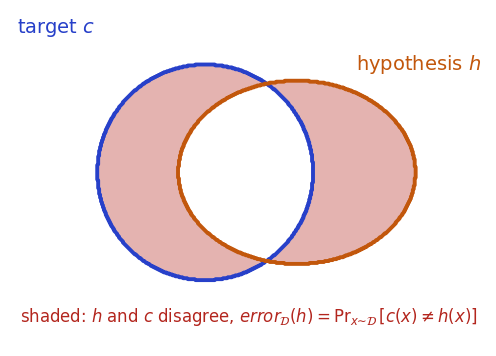
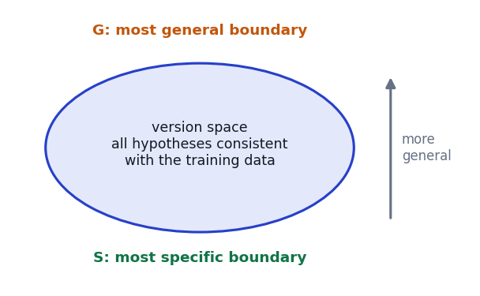
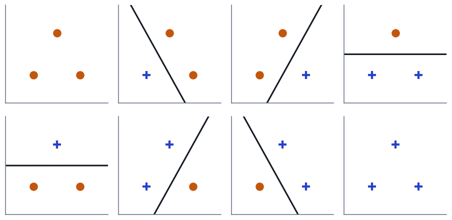
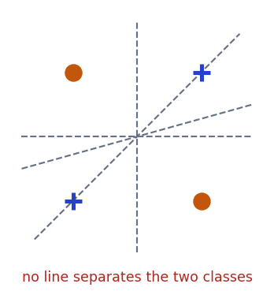

# Week 10: Learning Theory

Sources: W10 deck (58 pages, all viewed). There is no tutorial or lab for this topic, so every worked example below was built for these notes and checked in Python.

## The big picture

> **Where this fits:** This is the last unit, and all of it is stage 7, Understand the limits. Every earlier supervised unit fitted a model to a sample and then checked it on held-out data. This unit asks why that can work at all, how much data it takes, and what that should change about how you use those models.
>
> - Every algorithm so far was trained on a sample and then trusted on new data, so we start by asking what can be promised about that, for all algorithms at once.
> - To ask it precisely we separate training error, which you can measure, from true error, which you care about. That gap is why W1 and W2 keep a test set.
> - A random sample cannot pin down the exact target, so PAC defines success as "probably, approximately correct".
> - To put numbers on that we need a model family we can count, so EnjoySport supplies one, and we see that choosing a family limits what can be learned.
> - Many hypotheses in that family can fit the data perfectly, so the version space collects them all, and the question becomes whether any bad ones remain.
> - Haussler's theorem says enough examples clear out the bad ones, and the number needed grows with only the logarithm of the family's size. This tells you when zero training error can be trusted.
> - Real data are noisy and the truth may lie outside the family, so agnostic learning settles for true error being close to training error, at a higher price in data.
> - Both bounds break for infinite families, which include linear classifiers and neural networks, so we need a new measure of complexity.
> - Shattering supplies it: stop counting hypotheses and ask how many points the family can label in every possible way. The largest such number is the VC dimension.
> - Counting parameters looks like a shortcut to VC dimension, but it fails in both directions, so it cannot be how you judge a model's capacity.
> - VC dimension then goes into a sample size bound, and the final theorem says a family is PAC-learnable exactly when its VC dimension is finite.
> - Back in practice, the message is that restricting the model family is what makes learning from limited data possible. That is the theory behind W1 regularisation, W4 pruning and W5's C, while validation stays your working tool because the bounds are worst-case and usually loose.

Every other week of the course gives you an algorithm. This week asks questions that apply to all algorithms at once. How much data is enough? What can we promise about performance on data we have not seen? Which hypothesis spaces can be learned at all?

The story has four steps.

1. Define success. A learner cannot be expected to find the exact target from a random sample, so we settle for a hypothesis with small true error ($\epsilon$), produced with high probability ($1-\delta$). This is **PAC learning**.
2. Finite hypothesis spaces, target in $H$. Any hypothesis with zero training error is a member of the **version space**. Haussler's theorem says that with enough examples, every member of the version space has small true error. This gives $m\ge\frac{1}{\epsilon}(\ln|H|+\ln\frac{1}{\delta})$.
3. Finite hypothesis spaces, target possibly not in $H$. This is **agnostic** learning. Hoeffding bounds give a guarantee that true error is close to training error, at a cost of $1/\epsilon^2$ instead of $1/\epsilon$.
4. Infinite hypothesis spaces. $\ln|H|$ is useless here, so we replace $|H|$ by the **VC dimension**: the largest number of points that $H$ can label in all possible ways. $H$ is PAC-learnable exactly when its VC dimension is finite.

The course outline's learning outcome CLO5 is "Explain key concepts from the foundations of learning theory, describe their applicability, and express knowledge of the general limits of machine learning". Expect definitions, plugging numbers into the bounds, and short shattering arguments.

**Notation warnings for this deck**

- $m$ is the number of training examples here. $n$ is the *length of an instance*, not the sample size (W10 p.15).
- $\mathcal{D}$ (calligraphic) is the probability distribution. $D$ (plain) is the training set. They look nearly the same on p.34, and the difference matters: $error_{\mathcal{D}}$ is true error and $error_{D}$ is training error.
- $d$ means number of features on p.49 but VC dimension on p.56.
- $\theta$ is a threshold on p.43 and p.46 but the whole parameter vector on p.40.
- In the p.27 diagram, $r$ is training error and $error$ is true error.
- $c$ is the target concept, $C$ the class of possible targets, $H$ the hypothesis space, $L$ the learner.
- $h(x)=x\ge\theta$ is shorthand for "$h(x)=1$ if $x\ge\theta$, otherwise 0". Some pages use $\pm1$ through sign() (p.40) and others use 0/1. The ideas are identical.

## What learning theory asks

> **Where this fits:** The earlier supervised units gave you algorithms and validation scores, but did not say in general how much data an algorithm needs or why its score should hold up on new data. Those are the questions of stage 7, Understand the limits, and this section states them as theory about whole classes of algorithms, not one method. Keep the three kinds of complexity below apart, because they are three separate practical worries: how much data to collect, how long fitting takes (W5's kernel trick helps with this one), and how flexible a model family to pick (the depth of a W4 tree, for example).

**Goal (W10 p.4).** Build formal models that explain which concepts can be learned efficiently and with how much data, what guarantees are possible (error bounds, complexity bounds), and why particular algorithms do or do not work under various conditions.

**Key idea (p.5, p.9).** We want results about the algorithm-independent aspects of learning, characterising classes of algorithms and not one algorithm. The slide admits "we're not quite there yet".

**Inductive learning (p.6)** means learning from examples. All ML algorithms are a kind of inductive learning. The quantities of interest are the probability of successful learning, the number of training examples, the complexity of the hypothesis space, the time complexity of the algorithm, the accuracy of the approximation, and how the training examples are presented.

**Three kinds of complexity (p.7).**

| Term | Question |
|---|---|
| Sample complexity | How many training examples until the learner converges, with high probability, to a successful hypothesis? |
| Computational complexity | How much computational effort is required for that? |
| Hypothesis complexity | How do we measure the complexity of a hypothesis, and how large is the hypothesis space? |

**What is a "successful" hypothesis? (p.8)** Candidates: identical to the target, or mostly agrees with the target, or does this most of the time. PAC takes the last two together.

**PAC (p.9, p.10).** Probably Approximately Correct is a framework for mathematical analysis of learning, proposed by Valiant in 1984. It addresses how many examples are needed, how much computation, how complex a hypothesis class is needed, how to quantify complexity, and how many mistakes will be made.

## Setup, true error and training error

> **Where this fits:** Every method so far was fitted to a training set and then trusted on new data, and the gap between those two is the problem this unit studies. This section defines the two quantities for stage 7, Understand the limits: training error, which you can measure, and true error, which you care about but can never see directly. The test and validation scores of W1 and W2 are your practical estimates of true error. The requirement that later instances come from the same distribution is W2's generalisation assumption, so if a model is used on data unlike its training data, none of this unit's guarantees apply.

**The setting (p.11).** We are given a set of instances $X$, a set of hypotheses $H$, a set of possible target concepts $C$, and a **fixed, unknown** distribution $\mathcal{D}$ over $X$. The learner sees a sequence $D$ of examples $\langle \mathbf{x}, c(\mathbf{x})\rangle$ for some $c\in C$. Instances are drawn at random from $\mathcal{D}$, and a teacher gives the target value. The learner outputs $h$, which is judged on later instances drawn from the *same* $\mathcal{D}$.

**True error (p.13).** The probability that $h$ misclassifies a random instance:

$$error_{\mathcal{D}}(h)\equiv\Pr_{\mathbf{x}\in\mathcal{D}}[c(\mathbf{x})\ne h(\mathbf{x})]$$

In the p.12 picture, $c$ and $h$ are two overlapping regions of $X$, and the true error is the probability mass of the part where they do not overlap. It is a *weighted* area, weighted by $\mathcal{D}$, not a count of instances.

> **In plain words:** This is the number we want but cannot compute, because it describes performance on all future data. Imagine drawing one instance at random, with common instances drawn more often, and asking whether the hypothesis and the target give it different labels. True error is the chance that they do. Zero means a random draw never catches them disagreeing, and a disagreement on an instance that almost never occurs barely raises it.

**Two notions of error (p.14).** Training error is how often $h(\mathbf{x})\ne c(\mathbf{x})$ over the training instances. True error is how often this happens over future random instances. The central question is whether we can bound true error given training error. The deck starts with the case of zero training error.

## PAC learning

> **Where this fits:** A learner working from a random sample cannot be expected to find the exact target, so we need a realistic meaning of "it worked". PAC supplies that meaning, and it is the theory standard that the rest of stage 7, Understand the limits, measures against. It answers the question "what can I honestly claim about a trained classifier?", and the honest claim has two parts: how wrong it might be, and how likely it is that the data let you down. Every bound below is this definition turned into a number of examples.

**Definition (p.15).** $C$ is **PAC-learnable** by $L$ using $H$ if for all $c\in C$, all distributions $\mathcal{D}$ over $X$, all $\epsilon$ with $0<\epsilon<1/2$, and all $\delta$ with $0<\delta<1/2$, learner $L$ will with probability at least $1-\delta$ output a hypothesis $h\in H$ such that $error_{\mathcal{D}}(h)\le\epsilon$, in time (for sample size) polynomial in $1/\epsilon$, $1/\delta$, $n$ and $size(c)$.

Read each piece:

- **Approximately:** $\epsilon$ is the error goal. The hypothesis may be wrong on up to $\epsilon$ of the probability mass.
- **Probably:** $\delta$ is the uncertainty goal. The probability is over the random draw of the training set. A bad sample can happen, and we allow it with probability at most $\delta$.
- **For all $c$ and all $\mathcal{D}$:** it is a worst-case, distribution-free guarantee. The learner does not know $\mathcal{D}$.
- **Polynomial:** the resources must not blow up as you ask for more accuracy, more confidence, or longer instances. Anything with $2^n$ or $2^{1/\epsilon}$ fails. Logs are fine because $\ln(1/\delta)\le1/\delta$.
- $n$ is the instance length and $size(c)$ is the encoding length of the target.

> **In plain words:** PAC is a deal with two allowances. You accept a hypothesis that is slightly wrong, with $\epsilon$ setting how wrong is acceptable, and you accept that an unlucky training sample could spoil things, with $\delta$ setting how often that may happen. In return the learner must meet both allowances for every target and every distribution, and its resources may grow only polynomially as you tighten them. Smaller values of $\epsilon$ and $\delta$ are a stronger promise, and they cost more examples.

## Concept learning and EnjoySport

> **Where this fits:** To turn PAC into actual numbers we need a model family small enough to count, and EnjoySport provides one. It is an example of Choose a model, used here in service of stage 7, Understand the limits. The decision carries over directly: picking conjunctions here is the same kind of decision as picking a linear model in W1 or a tree in W4, and W3 calls that restriction inductive bias. The practical point is that the model family is a real choice, because what is not in it cannot be learned, and the bounds below show that its size affects the data you need.

The deck uses concept learning as the running example for PAC (p.16).

**Concept learning (p.19)** is acquiring the definition of a general category from positive and negative examples. Mitchell's formulation is searching through a predefined space of hypotheses for the one that best fits the training examples.

**The task (p.17, p.18).** Instances are days described by six attributes: Sky, AirTemp, Humidity, Wind, Water, Forecast. The target is $c: X\to\{0,1\}$ (EnjoySport). Hypotheses are conjunctions of literals. The training table on p.17 has four rows:

| Sky | AirTemp | Humidity | Wind | Water | Forecast | EnjoySport |
|---|---|---|---|---|---|---|
| Sunny | Warm | Normal | Strong | Warm | Same | Yes |
| Sunny | Warm | High | Strong | Warm | Same | Yes |
| Rainy | Cold | High | Strong | Warm | Change | No |
| Sunny | Warm | High | Strong | Warm | Change | Yes |

Two different goals are stated: find $h$ with $h(\mathbf{x})=c(\mathbf{x})$ for all $\mathbf{x}$ in $D$, or for all $\mathbf{x}$ in $X$. Learning theory is about the gap between them.

**Hypothesis representation (p.20).** A hypothesis is a vector of six constraints, each being:

- `?`: any value is acceptable,
- a single value, such as Warm,
- $\emptyset$: no value is acceptable.

An instance is labelled 1 only if it passes all six constraints.

Examples (p.21): $\langle Sunny,?,?,Strong,?,Same\rangle$. The **most general** hypothesis is $\langle ?,?,?,?,?,?\rangle$, which labels everything positive. The **most specific** is $\langle\emptyset,\emptyset,\emptyset,\emptyset,\emptyset,\emptyset\rangle$, which labels everything negative.

**What can be learned? (p.22)** Only what is in the hypothesis space. A disjunction such as "Sky = Sunny or Wind = Strong" is not a conjunction, so this $H$ cannot represent it. Choosing a representation is what makes search possible, and it also limits what you can find.

**Size of the spaces (p.23).** Sky has 3 values and the other five attributes have 2.

- Instances: $3\times2\times2\times2\times2\times2=96$.
- Syntactically distinct hypotheses (add `?` and $\emptyset$ to each attribute): $5\times4\times4\times4\times4\times4=5120$.
- Semantically distinct hypotheses: $1+4\times3\times3\times3\times3\times3=973$. Any hypothesis containing a single $\emptyset$ covers no instance, so all of those count as one hypothesis. The rest have (values + 1) choices per attribute.

General recipe for attributes with $v_1,\dots,v_k$ values: instances $\prod v_i$, syntactic $\prod(v_i+2)$, semantic $1+\prod(v_i+1)$.

> **In plain words:** The two hypothesis counts measure how big the model family is, and that size is what the sample size bound later needs. For the syntactic count, each attribute can be one of its values, or `?`, or $\emptyset$, which is why two is added, and you multiply because each attribute is chosen separately. The semantic count is smaller because any hypothesis containing a $\emptyset$ rejects everything, so all of those behave as one hypothesis, which is the $+1$. Every other hypothesis picks a value or `?` for each attribute.

**Generality order (p.24, p.25).** Hypotheses can be compared by which instances they cover.

$h_j$ is **more-general-than-or-equal-to** $h_k$, written $h_j\ge_g h_k$, iff

$$(\forall x\in X)[(h_k(\mathbf{x})=1)\rightarrow(h_j(\mathbf{x})=1)]$$

Any instance that satisfies $h_k$ also satisfies $h_j$. In set terms, the instances covered by $h_k$ are a subset of those covered by $h_j$.

$h_j$ is **strictly** more general, $h_j>_g h_k$, iff $(h_j\ge_g h_k)\wedge(h_k\not\ge_g h_j)$. $h_j$ is more specific than $h_k$ when $h_k$ is more general than $h_j$.

> **In plain words:** This compares two hypotheses by what they accept, with no reference to any data. One hypothesis is at least as general as another if everything the second accepts, the first accepts too, so its accepted region contains the other's. More constraints make a hypothesis more specific, and fewer make it more general. Two regions can also overlap without either containing the other, and then neither hypothesis is more general, which is what makes this a partial order.

Deck example (p.24): $h_1=\langle Sunny,?,?,Strong,?,?\rangle$, $h_2=\langle Sunny,?,?,?,?,?\rangle$, $h_3=\langle Sunny,?,?,?,Cool,?\rangle$. Then $h_2\ge_g h_1$ and $h_2\ge_g h_3$, but $h_1$ and $h_3$ are not comparable, because each covers a day the other rejects. So the relation is a **partial order**, not a total one. That is why the slide draws a lattice. Note that the diagram puts Specific at the top and General at the bottom. For the instances on that slide, $x_1=\langle Sunny,Warm,High,Strong,Cool,Same\rangle$ satisfies all three hypotheses, while $x_2=\langle Sunny,Warm,High,Light,Warm,Same\rangle$ satisfies only $h_2$.

## Version spaces

> **Where this fits:** Many hypotheses can fit the same data perfectly, and a learner picks one without knowing whether it picked well. W4 says ID3 outputs a single tree and cannot tell how many other viable ones there are, and W5 says that where the perceptron stops depends on the order of the examples. The version space is the set of all those equally perfect candidates, a theory tool for stage 7, Understand the limits, that lets us ask one question about all of them at once: can any member still be bad? It leads straight to Haussler's theorem in the next section, and it assumes noise-free data until the agnostic section drops that.

**Consistent (p.26).** $h$ is consistent with $D$ iff $h(\mathbf{x})=c(\mathbf{x})$ for every example in $D$:

$$Consistent(h,D)\equiv(\forall\langle\mathbf{x},c(\mathbf{x})\rangle\in D)\ h(\mathbf{x})=c(\mathbf{x})$$

**Version space (p.26).** The subset of $H$ consistent with all examples in $D$:

$$VS_{H,D}\equiv\{h\in H\mid Consistent(h,D)\}$$

So "$h\in VS_{H,D}$" means the same as "$h$ has zero training error" (p.14). With noise-free data and $c\in H$, the target itself is always in the version space. Adding examples can only remove hypotheses from it.

> **In plain words:** These two definitions sort hypotheses into survivors and rejects. Go through the training examples and throw out any hypothesis that gets even one wrong. Whatever is left is the version space, and every survivor has zero training error. Each new example can only throw more out, like suspects being ruled out by each new clue. With noise-free data and a target in $H$, the true target is never thrown out.

**$\epsilon$-exhausted (p.27, p.28).** $VS_{H,D}$ is $\epsilon$-exhausted with respect to $c$ and $\mathcal{D}$ if every hypothesis in it has true error less than $\epsilon$:

$$(\forall h\in VS_{H,D})\ error_{\mathcal{D}}(h)<\epsilon$$

It is not $\epsilon$-exhausted if it contains at least one $h$ with $error_{\mathcal{D}}(h)\ge\epsilon$.

> **In plain words:** This tests the whole set of survivors, not one hypothesis. Look up the true error of every hypothesis still in the version space and take the worst one. If even that one is below $\epsilon$, the version space is exhausted, meaning no bad hypothesis has managed to survive. Hypotheses already thrown out are ignored, whatever their true errors are.

In the p.27 diagram, $H$ has six hypotheses. Two are in the version space (both $r=0$), with true errors 0.2 and 0.1. So this version space is $\epsilon$-exhausted only for $\epsilon>0.2$. Hypotheses outside the version space do not count, however large or small their errors are. One of the outside hypotheses has true error 0.1 with $r=0.2$, which shows that a hypothesis outside the version space can be as good as one inside.

**Why this matters.** A *consistent learner* outputs some member of the version space. If the version space is $\epsilon$-exhausted, then it does not matter which member it picks: true error is below $\epsilon$. Exhaustion turns "zero training error" into a statement about true error.

## Sample complexity for finite hypothesis spaces

> **Where this fits:** On separable data W5's perceptron stops with zero training errors, but that alone says nothing about new data, so the question is how many examples make zero training error trustworthy. This section answers it for finite model families where the target is in the family and the labels are clean, and it is the first real result of stage 7, Understand the limits. It uses true error, PAC and version spaces from above. The next sections remove its assumptions: agnostic learning allows noise and a target outside the family, and VC dimension allows infinite families.

**Theorem (Haussler 1988, p.29).** If $H$ is finite and $D$ is a sequence of $m\ge1$ independent random examples of some target concept $c$, then for any $0\le\epsilon\le1$, the probability that $VS_{H,D}$ is not $\epsilon$-exhausted is less than

$$|H|e^{-\epsilon m}$$

This bounds the probability that *any* consistent learner outputs a hypothesis with error at least $\epsilon$.

> **In plain words:** This is a cap on the chance that a bad hypothesis survives, which is the one thing that can hurt a consistent learner. A hypothesis with true error of at least $\epsilon$ has to get lucky on every training example to survive, and each extra example makes that exponentially less likely, which is the $e^{-\epsilon m}$ part. The $|H|$ in front allows for every hypothesis getting its own chance to survive. More examples push the value down fast and a bigger family pushes it up, and if it comes out above 1 it tells you nothing.

**Why it is true.** The slides do not prove this, but the proof is short and it explains the formula.

1. Take one hypothesis with true error at least $\epsilon$. It is correct on one random example with probability at most $1-\epsilon$.
2. Independence: it survives all $m$ examples with probability at most $(1-\epsilon)^m$.
3. Let $k$ be the number of such bad hypotheses. The version space fails if at least one survives. By the union bound this has probability at most $k(1-\epsilon)^m$.
4. $k\le|H|$, and $1-\epsilon\le e^{-\epsilon}$, which gives $|H|e^{-\epsilon m}$.

**Sample complexity (p.30, p.31).** Require $|H|e^{-\epsilon m}\le\delta$. Take logs: $\ln|H|-\epsilon m\le\ln\delta$. Rearrange:

$$m\ge\frac{1}{\epsilon}\left(\ln|H|+\ln\frac{1}{\delta}\right)$$

With this many examples, with probability at least $1-\delta$, every $h$ in $VS_{H,D}$ has $error_{\mathcal{D}}(h)\le\epsilon$.

> **In plain words:** This turns the failure chance around to answer the practical question: how many examples are enough? You say how much error you will accept and how much risk of an unlucky sample, and it returns a count. Halving the error you accept doubles the count, while more confidence or a bigger family adds only a logarithmic amount, so accuracy is the expensive request. The catch is a family that can express everything: W4's trees can represent any Boolean function, and worked example 2 shows that for all Boolean functions the logarithm itself grows exponentially with the number of variables, so a restricted family, such as trees of limited depth, is what keeps the count reasonable. Read the count as a guide to what drives the need for data, not as a dataset size to aim for, since it is enough but usually far from tight.

**EnjoySport (p.32, p.33).** $|H|=973$, $\epsilon=0.1$, $\delta=0.05$: $m\ge10(\ln973+\ln20)=10(6.88+3)=98.8$. The slide stops at 98.8. Since $m$ is a count, you need $m=99$.

**How to read the bound.**

- Natural logs, because it comes from $e^{-\epsilon m}$.
- Linear in $1/\epsilon$: halving $\epsilon$ exactly doubles the bound.
- Logarithmic in $|H|$: doubling $|H|$ adds only $(\ln2)/\epsilon$, and squaring $|H|$ doubles the $\ln|H|$ term.
- Logarithmic in $1/\delta$: halving $\delta$ adds only $(\ln2)/\epsilon$. High confidence is cheap.
- $\mathcal{D}$ does not appear: the result holds for any distribution.
- It is **sufficient, not necessary**. It is a worst-case upper bound, usually far from tight. With fewer examples the guarantee disappears, but the version space may well be exhausted anyway.
- It needs $c\in H$, noise-free labels, and independent examples.
- If $|H|e^{-\epsilon m}>1$, the bound is vacuous because every probability is at most 1.

## Agnostic PAC learning

> **Where this fits:** Real data have noise and your chosen family may not contain the truth, so zero training error may be impossible and the version space may be empty. This is the realistic alternative to the last section, still in stage 7, Understand the limits, and it makes the same move as going from W5's hard margin to the soft margin, which stops insisting that every point be separated. Instead of asking whether the hypothesis is nearly perfect, we ask how far training error can be trusted as a guide to true error. Use the realisable bound only when the target is in the family and the labels are clean, and this one otherwise, which means any time your classifier has training errors it cannot remove.

So far $c\in H$ and the learner is consistent (noise-free) (p.34). In the **agnostic** setting we do not assume $c\in H$. The version space may then be empty, so we want the hypothesis $h_{best}$ that makes the fewest errors on the training data.

**Hoeffding bound for one fixed hypothesis (p.34).**

$$\Pr[error_{\mathcal{D}}(h)>error_{D}(h)+\epsilon]\le e^{-2m\epsilon^2}$$

> **In plain words:** This covers one hypothesis that was fixed before the sample was drawn. Treat the sample as a poll of that hypothesis's error rate: the chance that the poll flatters it by more than $\epsilon$ falls exponentially as the sample grows, and it is smaller for a larger $\epsilon$. A held-out test set is this situation, because the model is frozen before it meets those examples, and that is why a test score means something. Watch the fonts: the first error is true error and the second is the error on the sample.

**For the hypothesis space.**

$$\Pr[error_{\mathcal{D}}(h_{best})>error_{D}(h_{best})+\epsilon]\le|H|e^{-2m\epsilon^2}$$

The factor $|H|$ is there because $h_{best}$ is picked *after* seeing the data, so it is not a fixed hypothesis. To cover whichever one gets picked, the bound must hold for all of $H$ at once, which costs a union bound. This explanation is not on the slide, but it is the reason for the extra factor.

> **In plain words:** Here the hypothesis was chosen because it looked best on this very sample, so part of its good score may be luck. Think of a class guessing on a quiz: the top scorer looks good even if nobody knows the material. To stay safe, the bound has to hold for every hypothesis at once, so the cap on the failure chance is multiplied by $|H|$. The same logic is behind the rule in W1, W2 and W4 to choose settings on validation data and never on the test set: W4 warns that picking `max_depth` on the test set and quoting that test error is optimistic.

**Sample complexity.**

$$m\ge\frac{1}{2\epsilon^2}\left(\ln|H|+\ln\frac{1}{\delta}\right)$$

> **In plain words:** This is "how many examples are enough?" again, but $\epsilon$ is now the gap you will tolerate between true error and training error, not the true error itself. It needs more data than the realisable case because no hypothesis is ruled out by a single mistake. You have to measure each error rate accurately, and measurements sharpen slowly as data grows. Halving the gap takes four times the data, and the size of the family still enters only through its logarithm.

**Comparison.**

| | Realisable (consistent learner) | Agnostic |
|---|---|---|
| Assumption | $c\in H$, no noise | none on $c$ |
| Learner outputs | any consistent $h$ | $h_{best}$, fewest training errors |
| Tool | $(1-\epsilon)^m$ and union bound | Hoeffding and union bound |
| What $\epsilon$ means | absolute: $error_{\mathcal{D}}(h)\le\epsilon$ | gap: $error_{\mathcal{D}}(h)\le error_{D}(h)+\epsilon$ |
| Failure bound | $\lvert H\rvert e^{-\epsilon m}$ | $\lvert H\rvert e^{-2m\epsilon^2}$ |
| Scaling in $\epsilon$ | $1/\epsilon$ | $1/\epsilon^2$ |

Halving $\epsilon$ doubles the realisable bound and quadruples the agnostic one.

You can also run the agnostic bound backwards. Given $m$, the gap is $\epsilon=\sqrt{\frac{\ln|H|+\ln(1/\delta)}{2m}}$.

> **In plain words:** Run this way, the formula puts a reliability label on a training error you already have. Put in your sample size, the size of your family and the risk you accept, and out comes how far true error might sit above training error. More data narrows the gap and a richer family widens it. This is overfitting as a number: a flexible family may reach a low training error, but its wider gap means that low figure promises less.

## Infinite hypothesis spaces and complexity

> **Where this fits:** Both bounds contain $\ln|H|$, yet most models you have used have infinitely many hypotheses, because weights and split thresholds are real numbers: linear classifiers such as W2 logistic regression and the W5 SVM, W8 networks, and W4 trees on continuous inputs. So the results so far say nothing about them, and this part of stage 7, Understand the limits, shows we need a better measure of complexity. The trade-off here is the one R2 described as bias-variance, seen from a new angle: complexity decides how far training error can be trusted. That is why the course keeps giving you anti-overfitting tools, such as W1 regularisation (R2 shows a larger penalty means a tighter constraint on the coefficients), W4 pruning, W5's C and W8's weight penalties.

**The problem (p.35).** Both bounds use $\ln|H|$, but many useful hypothesis spaces are infinite, which makes the bound infinite and therefore useless.

**Which are finite? (p.36)** The slide asks this and does not answer it. The answer:

| Hypothesis space | Size | Why |
|---|---|---|
| Decision trees, discrete inputs | finite | finitely many instances, so at most $2^{\lvert X\rvert}$ distinct classifiers |
| Neural networks | infinite | real-valued weights, on real-valued inputs |
| Linear classifiers | infinite | real-valued weights |
| Decision trees, continuous inputs | infinite | real-valued split thresholds |

**Complexity (p.37).** Different learners have different complexity, which relates to representational power. The usual trade-off: more power can represent more complex systems but may overfit, and less power will not overfit but may not find the best learner.

**Link to PAC (p.38).** We want to say something about true error from training error. In the underfitting domain, the two errors are pretty similar. In the overfitting domain, test error (a stand-in for true error) can be much worse. So complexity controls how far training error can be trusted. Quantifying complexity is not easy, and one solution is the VC dimension.

## Shattering

> **Where this fits:** We cannot count an infinite family, but we can ask what it can do to a handful of points: can it fit them whatever the labels are? If it can, a perfect fit on those points tells you nothing, which is the same reason W2 warns that 1-NN's zero training error says nothing about generalisation. Shattering is the building block for VC dimension in the next section, and it is pure theory within stage 7, Understand the limits. The XOR pattern from W5 and W8 is the classic example of labels a line cannot fit, and it returns below.

**Dichotomy (p.39).** A partition of a set $S$ into two disjoint subsets. Think of it as a labelling of $S$ with two labels. A set of $m$ points has $2^m$ labellings (one subset may be empty, and swapping the labels counts as a different dichotomy).

**Shattered (p.39).** $S$ is shattered by $H$ iff for every dichotomy of $S$ there is some hypothesis in $H$ consistent with that dichotomy.

**Same thing for a classifier (p.40).** $f$ can shatter $\mathbf{x}_1,\dots,\mathbf{x}_m$ iff for all possible $y_1,\dots,y_m$, $f$ can achieve zero training error on $(\mathbf{x}_1,y_1),\dots,(\mathbf{x}_m,y_m)$. That is, some parameter value $\theta$ gets zero error.

The order of the quantifiers is the whole definition. For **every** labelling there **exists** a hypothesis. Different labellings can use different hypotheses.

> **In plain words:** Think of shattering as a game against someone trying to defeat your model family. The points are fixed, they choose any labels they like, and you then choose a hypothesis to fit those labels. The family shatters the points if you can win every round, however they label them. You may use a different hypothesis each round, and with $m$ points there are $2^m$ rounds to win.

**Line example (p.40).** $f(\mathbf{x})=\text{sign}(\theta_0+\theta_1x_1+\theta_2x_2)$ shatters the three non-collinear points shown. The slide draws a line for each of the 8 labellings.

**Circle example (p.41).** $f(\mathbf{x})=\text{sign}(\mathbf{x}^T\mathbf{x}-\theta)$ is a circle centred at the origin with outside positive and inside negative. For two points at different distances from the origin, the nearer point positive and the farther negative is impossible, so these two points are not shattered. The slide's panels show the three labellings that work (circle between the points, both inside, both outside) and the fourth, which cannot be done.

## VC dimension

> **Where this fits:** The bounds need a size for the model family, and $\ln|H|$ fails for infinite families, so VC dimension replaces it with one number for how flexible the family is. It is theory in stage 7, Understand the limits, and it answers "how complex is this model family?" for thresholds, intervals and, through the general rule below, any linear classifier, such as W2 logistic regression or the W5 perceptron. Use it in place of counting hypotheses when the family is infinite. It goes into the sample size bound at the end of the unit.

**Definition (p.42).** $VC(H)$, for $H$ over instance space $X$, is the size of the largest finite subset of $X$ shattered by $H$. If arbitrarily large finite subsets can be shattered, $VC(H)\equiv\infty$.

It is defined even when $H$ is infinite, because it only looks at finite subsets of $X$.

> **In plain words:** VC dimension measures flexibility with a stress test, not a head count. Find the biggest set of points the family can label in every possible way, and the size of that set is the answer. One such set is enough, so badly placed points do not lower it. A high value means the family can fit a lot of patterns, so a good fit proves less, and a family that can do this at any size has infinite VC dimension.

**How to prove $VC(H)=d$.**

- Lower bound: show **one** set of $d$ points that is shattered. You choose the set, so choose a convenient one.
- Upper bound: show that **no** set of $d+1$ points is shattered. For every such set, give a labelling that cannot be produced.

A bad set of size $d$ proves nothing. Three collinear points are not shattered by lines, but the VC dimension of lines is still 3.

**Thresholds (p.43).** $X=\{1,\dots,10\}$, $H=\{h(x)=x\ge\theta\}$. One point such as $\{6\}$ can get both labels. A pair such as $\{5,7\}$ cannot get $(1,0)$: labelling 5 positive forces 7 positive. So $VC=1$. A one-parameter class with weak expressive power.

**Intervals (p.44, p.45).** $X=\mathbb{R}$, $H=\{h(x)=x\in[a,b]\}$. 2 parameters, infinite $H$, $VC=2$. Two points can get all four labellings. For three points $x_1<x_2<x_3$, $(1,0,1)$ is impossible, because an interval containing $x_1$ and $x_3$ contains $x_2$.

**Lines in the plane (p.46 to p.50).** $X=\mathbb{R}^2$, $H=\{h(\mathbf{x})=w^T\mathbf{x}\ge\theta\}$. 3 parameters ($w_1,w_2,\theta$), infinite $H$, $VC=3$.

- Two points: all four labellings are easy.
- Three non-collinear points: all 8 labellings work (p.48 shows three and asks about "the other five"; p.50 case (a) shows a line cutting off one point). So $VC\ge3$.
- Three collinear points cannot be shattered (p.50 case (b)), but this does not matter.
- No set of 4 points can be shattered (p.49 states this; p.48 shows an example). The slide does not prove it. The argument: either the four points form a convex quadrilateral, and then labelling the two diagonals differently is impossible (XOR), or one point lies in the triangle of the other three (or three are collinear), and then labelling that point differently from the rest is impossible.

**General rule (p.49).** Linear classifiers in $d$ dimensions, with $d$ = number of features, have VC dimension $d+1$. That rule includes the threshold $\theta$. Without a threshold (hyperplanes through the origin) it is $d$. That second fact is not in the deck.

> **In plain words:** For a linear classifier, flexibility grows by one with each feature, plus one for the threshold. That is the rule for what adding features costs: each extra feature in a linear model, such as polynomial features (W1) or a mapped feature space (W5), usually raises the VC dimension, and the VC sample size bound below rises with it. W5's kernel trick makes a big feature space cheap to compute in, but that helps computational complexity and leaves the space as flexible as it was. So a large mapped space still needs something else to guard against overfitting, and W5 points to the maximum margin for that.

## VC dimension and number of parameters

> **Where this fits:** It is tempting to judge a model's flexibility by counting its parameters, such as the weights in a W8 network. This section shows that shortcut is unreliable, which matters for stage 7, Understand the limits, because flexibility is what drives the data you need. R2's "few parameters" and "many parameters" remain a useful everyday picture of complexity, and the count often matches for simple families. But it is a rule of thumb, so ask what the parameters can do, not how many there are.

VC dimension does **not** necessarily equal the number of parameters (p.51). Thresholds (1 parameter, VC 1), intervals (2, 2) and lines (3, 3) make it look as if it does. It does not, in either direction.

- Lots of parameters, little power: $h(x)=[x\ge\theta_1+\dots+\theta_{100}]$ has 100 parameters, but only the sum matters, so $VC=1$. (This example is built for these notes. The slide makes the claim without one.)
- One parameter, lots of power (p.52, p.53): $I(\sin(\alpha x)>0)$. By choosing a high enough frequency $\alpha$, this can separate an arbitrarily large number of points. So its VC dimension is infinite, with one parameter. The p.52 figure shows $\sin(50x)$ on $[0,1]$.

> **In plain words:** A parameter count tells you how many dials there are, and VC dimension tells you what the dials can do. In the 100-parameter example every dial feeds one sum, so together they act as a single dial. In the sine example the single dial sets the frequency. A high enough frequency makes the curve swing fast enough to put as many suitably chosen points as you like on whichever side you want.

## Sample complexity from VC dimension

> **Where this fits:** We can now finish the job and get a sample size guarantee for infinite families such as linear classifiers. This is the end of the argument in stage 7, Understand the limits: it does for infinite families what the finite bound did earlier, with VC dimension in place of $\ln|H|$, and the theorem at the end says which families can be learned at all. It also explains W3's inductive bias. Restricting the family is not a weakness to apologise for, because without some restriction no amount of data gives a guarantee.

**Bound (p.54, p.55).** The number of random examples that suffice to $\epsilon$-exhaust $VS_{H,D}$ with probability at least $1-\delta$:

$$m\ge\frac{1}{\epsilon}\left(4\log_2(2/\delta)+8\,VC(H)\log_2(13/\epsilon)\right)$$

Details to remember: base-2 logs (the finite bound uses natural logs), 4 with $2/\delta$, 8 with $13/\epsilon$. To compute $\log_2 x$ on a basic calculator, use $\ln x/\ln2$.

Behaviour: linear in $VC(H)$; halving $\delta$ adds exactly $4/\epsilon$; halving $\epsilon$ more than doubles it, because $\epsilon$ also sits inside a log.

> **In plain words:** This answers the same question as the finite bound, how many examples make every zero-training-error hypothesis good, but it measures the family by VC dimension, so it still works when the family is infinite. You state your error and risk, and the count comes out made of two parts: a confidence part, and a flexibility part that grows in direct proportion to VC dimension. Less error is costly and more confidence is cheap, as before. The constants are large, so the count can far exceed the finite bound (worked example 9). That is one reason you still judge a real model with validation as in W2, and use this bound to see what drives the need for data.

So VC dimension gives a general framework for the complexity or capacity of a hypothesis class, in terms of its ability to express all possible target concepts.

**VC dimension of finite $H$ (p.56).** To shatter $d$ points you need a separate hypothesis for each of the $2^d$ labellings. So

$$2^d\le|H|\quad\Rightarrow\quad d\le\log_2|H|$$

This is an upper bound only. It need not be reached.

> **In plain words:** This links the two ways of measuring a family's size. To shatter a set of points the family needs a different hypothesis for every labelling, and the number of labellings doubles with each extra point. So the largest set a family can shatter has at most the base-2 logarithm of the family's size, rounded down. It is a ceiling only, and many families fall well short of it.

**Theorem (p.56).** $H$ is PAC-learnable **if and only if** its VC dimension is finite.

Consequences:

- Infinite $H$ with finite VC dimension (lines, intervals) is PAC-learnable.
- $I(\sin(\alpha x)>0)$ is not PAC-learnable, despite having one parameter.
- If $H$ can shatter arbitrarily large sets, then there is no data size at which the training data forces the hypotheses to agree on unseen points.

> **In plain words:** This is the unit's final answer on whether a family can be learned at all. If VC dimension is finite, some finite number of examples is enough, even if the family has infinitely many hypotheses. If it is infinite, the family can fit any labels on some sets of every size, so no amount of data forces its hypotheses to agree on unseen points. The theorem is about the number of examples and says nothing about computing time (see the p.56 note under "Errors and loose wording in the slides"). It is also a worst-case statement over all distributions, so it tells you which families can carry this guarantee, not how a model will do on your dataset.

## Mentioned elsewhere or not covered

You may see these listed as "learning theory" topics. Do not spend long on them.

- **Mistake bounds.** The deck has one bullet, "How many mistakes will be made?" (p.10), and no slides on it. The only mistake bound in the course is the perceptron convergence theorem in Week 8: for separable data with margin $\gamma$ and $R=\max_i\Vert\mathbf{x}_i\Vert_2$, the perceptron makes at most $(R/\gamma)^2$ mistakes (W8 p.16).
- **No Free Lunch.** Not in the deck or anywhere else in the course material. The closest ideas in the deck are "(only) what is in the hypothesis space can be learned" (p.22) and the theorem on p.56. If $H$ shatters arbitrarily large subsets of $X$, it is not PAC-learnable, so restricting $H$ is necessary for generalisation. Week 3 calls this kind of restriction inductive bias.
- **Growth function.** The course's Table of Contents lists it for this week, but no slide in the deck defines or uses it.

## Errors and loose wording in the slides

None of these is used as the deciding point of any question in the bank.

- **p.43:** "$H$, here, is an infinite hypothesis space". With $X=\{1,\dots,10\}$, the parameter $\theta$ may be real, but only 11 different functions on $X$ exist (from all-1 to all-0). Counted as functions, $H$ is finite. The statement is right for $X=\mathbb{R}$. $VC=1$ is correct either way.
- **p.56:** the theorem says "$H$ is PAC-learnable", while the definition on p.15 says "$C$ is PAC-learnable by $L$ using $H$" and includes running time. The VC theorem is about sample size only. It says nothing about computation time. Read it as "learnable from a polynomial number of examples".
- **p.56:** "at least $2^d$ hypothesis in the hypothesis space that can shatter $d$ points". It is the collection of hypotheses that shatters, not each one.
- **p.28 against p.31:** $\epsilon$-exhausted is defined with $<\epsilon$, but the sample complexity question uses $\le\epsilon$. Similarly p.29 says the probability is "less than" $|H|e^{-\epsilon m}$, and p.30 asks for $\le\delta$. These make no practical difference.
- **p.16 against p.15:** p.16 drops the "at least" from "with probability at least $1-\delta$". p.15 is the correct form.
- **p.33:** stops at 98.8 using rounded logs. The exact value is 98.76, and the whole number needed is 99.
- **p.34:** the two errors in the Hoeffding bound differ only in the font of $D$. The first is true error and the second is training error. They are not the same quantity, whatever the slide looks like.
- **p.39:** "partition into two disjoint subsets" gives $2^m$ only if one subset may be empty and swapping the subsets counts as a different dichotomy. p.48 confirms that this is what is meant, since 3 points have 8 dichotomies.
- **p.17, p.23:** the table shows only Sunny and Rainy, but the count uses 3 Sky values. The third is never named (Mitchell's textbook uses Cloudy).
- **Typos:** p.5 "Leaning theory", p.23 "synthetically" for syntactically, p.29 title has lost its $\epsilon$, p.56 "in means".
- **p.36:** the question has no answer in the deck. The table above gives it.

## Worked examples

There are no official solutions for this topic. All numbers below were checked in Python.

**1. EnjoySport sample size.** $|H|=973$, $\epsilon=0.1$, $\delta=0.05$.

$\ln973=6.880$ and $\ln(1/0.05)=\ln20=2.996$. So $m\ge\frac{1}{0.1}(6.880+2.996)=98.76$, which means $m=99$.

With $\epsilon=0.05$: $m\ge197.5$, so 198. The bound doubles.

Changing $\delta$ from 0.1 to 0.001 with $\epsilon=0.1$ adds $10\ln100=46.05$ examples, whatever $|H|$ is.

**2. Why restricting $H$ matters.** Take the unrestricted EnjoySport space: every subset of the 96 instances, so $|H|=2^{96}$.

$m\ge10(96\ln2+\ln20)=695.4$, so 696. That compares with 99 for conjunctions.

Now take instances of $n$ Boolean variables. Conjunctions of literals have $|H|=3^n+1$, so $\ln|H|\approx n\ln3$, which is linear in $n$. For $n=10$, $\epsilon=0.1$, $\delta=0.05$: $m\ge10(10.99+3.00)=139.8$, so 140. All Boolean functions have $|H|=2^{2^n}$, so $\ln|H|=2^n\ln2$, which is exponential in $n$. That violates the polynomial requirement.

**3. Using the bound the other way.**

Failure probability: $|H|=1000$, $m=150$, $\epsilon=0.1$. Bound: $1000e^{-15}=3.06\times10^{-4}$.

Accuracy from a fixed sample: $|H|=1024$, $m=500$, $\delta=0.01$. $\epsilon=\frac{\ln1024+\ln100}{500}=\frac{6.931+4.605}{500}=0.0231$.

Vacuous case: $|H|=973$, $m=50$, $\epsilon=0.1$. Bound: $973e^{-5}=6.56$. This is greater than 1, so it says nothing.

**4. Agnostic.** $|H|=973$, $\epsilon=0.1$, $\delta=0.05$: $m\ge\frac{1}{2(0.01)}(9.876)=493.8$, so 494. With $\epsilon=0.05$: 1975.2, so 1976, which is 4 times as many.

Gap from a fixed sample: $|H|=1000$, $m=2000$, $\delta=0.05$. $\epsilon=\sqrt{\frac{6.908+2.996}{4000}}=0.0498$. So with probability 0.95, true error is at most training error plus about 0.05.

**5. Version space by hand.** Use the p.17 table with the EnjoySport $H$.

Humidity and Forecast take both values among the positive examples, so they must be `?`. The other four attributes have the same value in all positives, so each constraint is that value or `?`. That gives $2^4=16$ candidates, all generalisations of $\langle Sunny,Warm,?,Strong,Warm,?\rangle$.

The negative example has Wind = Strong and Water = Warm, so only Sky = Sunny or AirTemp = Warm can reject it. At least one of these must be kept: 3 options out of 4. So $|VS_{H,D}|=3\times2\times2=12$. Brute force over all 5120 hypotheses gives the same 12.

**6. True error from the hypothesis structure.** $\mathcal{D}$ uniform on the 96 instances, $c=\langle Sunny,?,?,?,?,?\rangle$, $h=\langle Sunny,?,?,Strong,?,?\rangle$.

$c$ covers 32 instances and $h$ covers 16 of those. They disagree on the 16 Sunny days with Wind = Light. So $error_{\mathcal{D}}(h)=16/96=1/6$.

**7. VC dimension of simple classes.**

| Class | $X$ | Parameters | VC | Shattered set | Why $VC+1$ points fail |
|---|---|---|---|---|---|
| One hypothesis | any | 0 | 0 | the empty set | one point can get only one label |
| Constant 0 and constant 1 | any | 1 bit | 1 | any single point | $(0,1)$ impossible |
| Singletons $[x=t]$ | finite | 1 | 1 | any single point | $(1,1)$ impossible |
| Thresholds $x\ge\theta$ | $\mathbb{R}$ | 1 | 1 | one point | $(1,0)$ impossible |
| Circles at origin | $\mathbb{R}^2$ | 1 | 1 | one point | nearer point $+$, farther point $-$ impossible |
| Two-sided rays $x\ge\theta$ or $x\le\theta$ | $\mathbb{R}$ | 2 | 2 | two points | $(1,0,1)$ impossible |
| Intervals $[a,b]$ | $\mathbb{R}$ | 2 | 2 | two points | $(1,0,1)$ impossible |
| Union of two intervals | $\mathbb{R}$ | 4 | 4 | four points | $(1,0,1,0,1)$ needs three intervals |
| Lines | $\mathbb{R}^2$ | 3 | 3 | a triangle | see the XOR argument below |
| Axis-aligned rectangles | $\mathbb{R}^2$ | 4 | 4 | the diamond below | bounding box argument below |
| Conjunctions of literals | $\{0,1\}^n$ | $n$ literals | $n$ | checked for $n=2,3$ | $\log_2(3^n+1)$ is only an upper bound |
| $I(\sin(\alpha x)>0)$ | $\mathbb{R}$ | 1 | $\infty$ | any size | never fails |

**Rectangles.** $(1,0),(-1,0),(0,1),(0,-1)$ is shattered: the smallest box around any subset misses the other points. For any 5 points, take a leftmost, a rightmost, a topmost and a bottommost point, and label those 1. That is at most 4 points, so at least one is left over and labelled 0. Any rectangle containing those extreme points contains the whole bounding box, including the left-over point. So 5 points are never shattered.

**XOR proof that the square is not shattered by a line.** Label $(0,0)$ and $(1,1)$ as 1, and $(1,0)$ and $(0,1)$ as 0. We would need $0\ge\theta$, $w_1+w_2\ge\theta$, $w_1<\theta$ and $w_2<\theta$. Adding the first pair gives $w_1+w_2\ge2\theta$. Adding the second pair gives $w_1+w_2<2\theta$. These contradict each other.

**The sine class, concretely.** Take $x_i=10^{-i}$. Given labels $y_i\in\{0,1\}$, set

$$\alpha=\pi\left(1+\sum_{i:\,y_i=0}10^{i}\right)$$

For two points $x_1=0.1$, $x_2=0.01$ and labels $(0,1)$: $\alpha=11\pi$, so $\sin(1.1\pi)<0$ and $\sin(0.11\pi)>0$, as wanted. For $(1,0)$: $\alpha=101\pi$, and $\sin(10.1\pi)>0$, $\sin(1.01\pi)<0$. Checked in Python for all labellings of up to 7 points. Even simpler, on the points $\{1,2\}$ the values $\alpha=1, 2.5, 4, 5$ give $(1,1),(1,0),(0,1),(0,0)$.

**8. VC sample complexity.** $\epsilon=0.1$, $\delta=0.05$: $\log_2(2/\delta)=\log_240=5.322$ and $\log_2(13/\epsilon)=\log_2130=7.022$.

| $VC(H)$ | Example | Bound | Smallest $m$ |
|---|---|---|---|
| 1 | thresholds | $10(21.29+56.18)=774.7$ | 775 |
| 2 | intervals | $10(21.29+112.36)=1336.5$ | 1337 |
| 3 | lines in $\mathbb{R}^2$ | $10(21.29+168.54)=1898.2$ | 1899 |
| 10 | 9 features, linear | $10(21.29+561.79)=5830.8$ | 5831 |

**9. Comparing the two bounds.** If $|H|=1024$ and $VC(H)=10$, with $\epsilon=0.1$, $\delta=0.05$: the finite bound gives 100 and the VC bound gives 5831. Both are sufficient, so the smaller one is a valid guarantee. The VC bound has big constants. Its value is that it still works when $|H|$ is infinite.

**10. $VC$ of a finite class.** $|H|=973$: $d\le\log_2973=9.93$, so $VC(H)\le9$. $|H|=1000$: $d\le9.97$, so again at most 9. Round down, because $2^{10}=1024>1000$.

## Formula sheet

| Name | Formula | Note | In words |
|---|---|---|---|
| True error | $error_{\mathcal{D}}(h)=\Pr_{\mathbf{x}\in\mathcal{D}}[c(\mathbf{x})\ne h(\mathbf{x})]$ | weighted by $\mathcal{D}$ | chance a random new instance is mislabelled |
| PAC goal | $\Pr[error_{\mathcal{D}}(h)\le\epsilon]\ge1-\delta$ | polynomial in $1/\epsilon,1/\delta,n,size(c)$ | probably (at least $1-\delta$) approximately right (error at most $\epsilon$) |
| Hypothesis counts | instances $\prod v_i$; syntactic $\prod(v_i+2)$; semantic $1+\prod(v_i+1)$ | EnjoySport: 96, 5120, 973 | multiply choices per attribute; all $\emptyset$ hypotheses count as one |
| More general | $h_j\ge_g h_k$ iff $h_k(\mathbf{x})=1\rightarrow h_j(\mathbf{x})=1$ for all $\mathbf{x}$ | partial order | accepts everything the other accepts, possibly more |
| Version space | $VS_{H,D}=\{h\in H\mid Consistent(h,D)\}$ | zero training error | every hypothesis still perfect on the training data |
| $\epsilon$-exhausted | $(\forall h\in VS_{H,D})\ error_{\mathcal{D}}(h)<\epsilon$ | every member | no bad hypothesis is left among the survivors |
| Haussler | $\Pr[\text{not }\epsilon\text{-exhausted}]<\lvert H\rvert e^{-\epsilon m}$ | finite $H$, $c\in H$ | cap on the chance a bad hypothesis survives $m$ examples |
| Realisable sample size | $m\ge\frac{1}{\epsilon}(\ln\lvert H\rvert+\ln\frac{1}{\delta})$ | natural logs | examples enough to make every survivor good |
| Hoeffding, one $h$ | $\Pr[error_{\mathcal{D}}(h)>error_{D}(h)+\epsilon]\le e^{-2m\epsilon^2}$ | $h$ fixed in advance | a sample rarely flatters a fixed hypothesis by much |
| Hoeffding, all of $H$ | $\Pr[error_{\mathcal{D}}(h_{best})>error_{D}(h_{best})+\epsilon]\le\lvert H\rvert e^{-2m\epsilon^2}$ | union bound | same, paying for picking the best after seeing the data |
| Agnostic sample size | $m\ge\frac{1}{2\epsilon^2}(\ln\lvert H\rvert+\ln\frac{1}{\delta})$ | $\epsilon$ is the gap | examples enough to trust training error to within $\epsilon$ |
| Labellings of $m$ points | $2^m$ | needed to shatter | each point can take either label |
| VC of linear classifiers | $d+1$ | $d$ features, with threshold | one per feature, plus one for the threshold |
| VC of finite $H$ | $VC(H)\le\log_2\lvert H\rvert$ | round down | each labelling needs its own hypothesis |
| VC sample size | $m\ge\frac{1}{\epsilon}(4\log_2(2/\delta)+8\,VC(H)\log_2(13/\epsilon))$ | base 2 logs | examples enough, with VC dimension measuring the family |
| PAC-learnability | $H$ PAC-learnable iff $VC(H)<\infty$ | p.56 | enough examples exist exactly when VC dimension is finite |

## Exam traps

- $\epsilon$ is error, $\delta$ is failure probability. Confidence 95% means $\delta=0.05$, not 0.95.
- True error is probability-weighted. Do not count instances unless $\mathcal{D}$ is uniform.
- The bounds give lower limits on $m$. Round **up**. But $d\le\log_2|H|$ is an upper limit on $d$, so round **down**.
- The finite bounds use $\ln$. The VC bound uses $\log_2$. Using the wrong base gives a wrong answer that looks plausible.
- $2/\delta$ and $13/\epsilon$ in the VC bound, not the other way around.
- Realisable has $\frac{1}{\epsilon}$ and exponent $-\epsilon m$. Agnostic has $\frac{1}{2\epsilon^2}$ and exponent $-2m\epsilon^2$.
- In the agnostic bound $\epsilon$ is the gap between true and training error, not the absolute true error.
- All the bounds are sufficient, not necessary. "You need at least $m$ examples" is wrong. "$m$ examples are enough" is right.
- A bound greater than 1 is vacuous. It does not mean failure is certain.
- Zero training error does not imply zero true error. It means $h$ is in the version space.
- $\epsilon$-exhaustion is about every hypothesis *in the version space*, and only those. Ignore hypotheses with non-zero training error, even if they have large true error.
- $h_j\ge_g h_k$: the general hypothesis covers more instances. More constraints means more specific. The direction of the implication is $h_k\Rightarrow h_j$.
- $\ge_g$ is a partial order, so two hypotheses can be incomparable.
- 5120 is the syntactic count, 973 the semantic one, and 96 the instance count. Sample size uses 973 in the slides.
- Semantic count: do not forget the $+1$ for the $\emptyset$ class.
- Shattering: "for every labelling there exists a hypothesis", not "one hypothesis does all labellings".
- VC dimension $d$ needs *one* shattered set of size $d$ and *no* shattered set of size $d+1$. A failing set of size $d$ proves nothing. Collinear points do not reduce the VC dimension of lines.
- VC dimension is not the number of parameters. A sine has one parameter and infinite VC dimension. A sum of 100 thresholds has VC 1.
- An infinite $H$ does not mean infinite VC dimension. Thresholds, intervals and lines are all infinite classes with small VC dimension.
- $d+1$ counts the threshold. $d$ is the number of features, not the number of points.
- $2^d\le|H|$ is an upper bound on VC dimension, and it need not be reached. Six singletons have VC 1, not 2.
- Theorem direction: PAC-learnable if **and only if** VC dimension is finite. Infinite VC means not PAC-learnable.

## Self-check

1. State the PAC definition from memory, and say what each of $\epsilon$, $\delta$, $n$, $\mathcal{D}$ and "polynomial" is doing.
2. Compute the true error and training error of a hypothesis from a small table with a non-uniform $\mathcal{D}$.
3. Count instances, syntactic hypotheses and semantic hypotheses for a new set of attributes.
4. Decide whether $h_j\ge_g h_k$ for two conjunctions, and find a pair that is incomparable.
5. List the version space for a small dataset, and decide for which $\epsilon$ it is exhausted from a table of errors.
6. Derive $m\ge\frac{1}{\epsilon}(\ln|H|+\ln\frac{1}{\delta})$ from $|H|e^{-\epsilon m}\le\delta$, and explain where $|H|$ and $e^{-\epsilon m}$ come from.
7. Compute realisable, agnostic and VC sample sizes, and say what happens if $\epsilon$, $\delta$ or $|H|$ changes.
8. Explain why the agnostic bound has a factor $|H|$, and what $\epsilon$ means there.
9. Prove $VC=1$ for thresholds, $VC=2$ for intervals, and $VC=4$ for axis-aligned rectangles.
10. Explain why a one-parameter classifier can have infinite VC dimension, and what the p.56 theorem then says about it.
