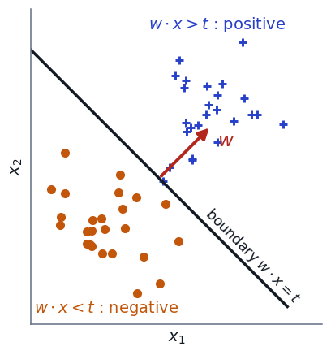
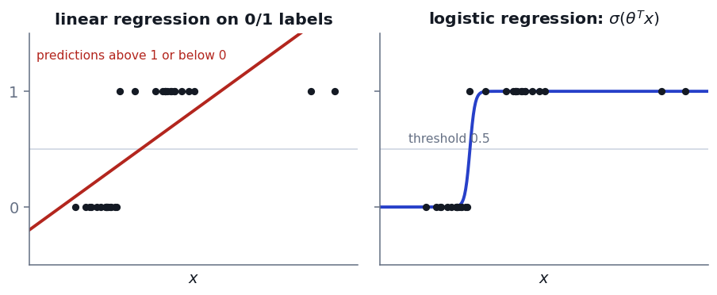
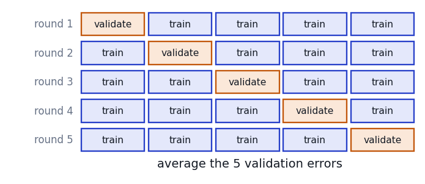
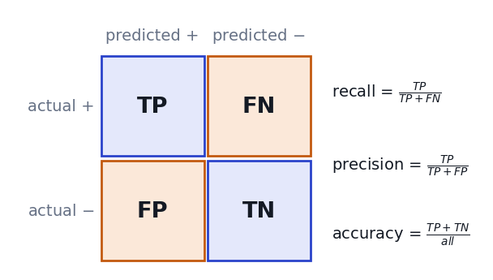
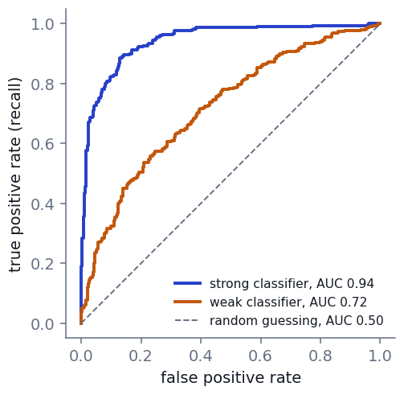
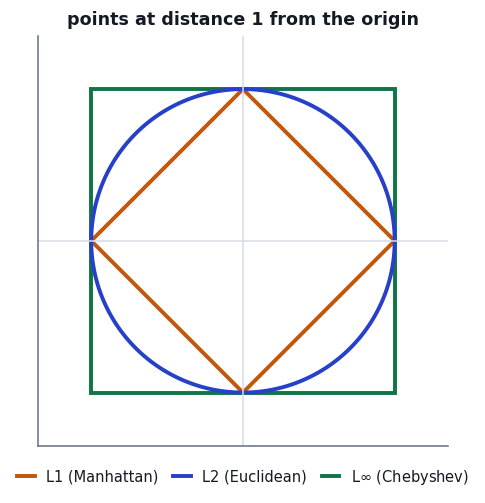
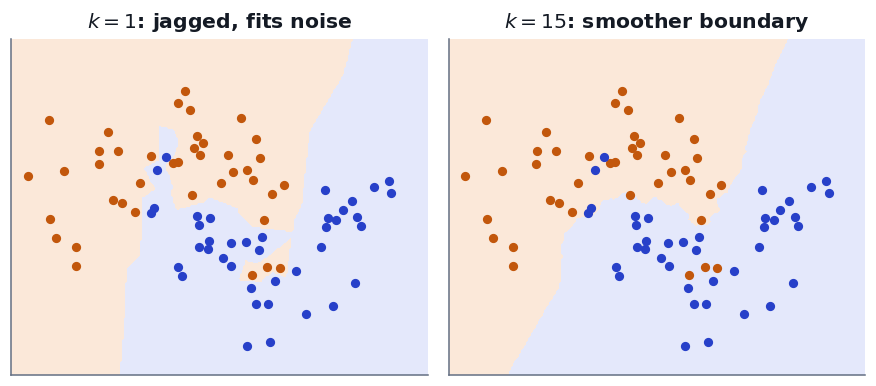
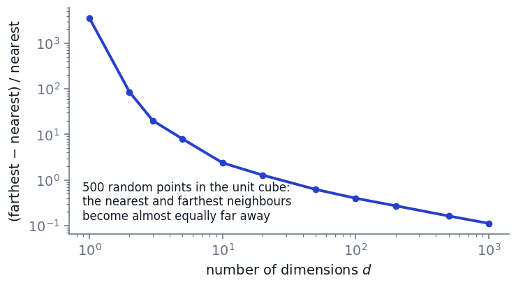

# Classification 1: linear classifiers, logistic regression, evaluation, distance and kNN

Sources: Week 2 slides "Classification (1)" (deck W2, 93 pages), Tutorial "Classification" Question 3 with solution, and the kNN part of Lab 2 (Bias, Variance and k-Nearest Neighbours) with solutions.

## The big picture

> **Where this fits:** W1 and R2 predicted numbers and this unit moves on to predicting classes, but the deck hops between models, evaluation tools and data preparation, so each line below names its workflow stage to show why that topic is there.
>
> - **Frame the task, Choose a model:** the output is now a class, and the simplest classifier is a straight line with a score on each side. The first decision is whether to model each class or only the boundary (generative or discriminative).
> - **Choose a model:** a line needs actual numbers, and the basic linear classifier gives the simplest recipe: join the two class centres and cut half-way.
> - **Choose a model, Define the loss, Fit the model:** that line gives no sense of confidence, so logistic regression turns the same kind of score into a probability, measures it with cross-entropy and fits it with gradient descent.
> - **Evaluate and select:** a fitted model is only useful if it works on new data, so we define generalisation, then use holdout and cross-validation to estimate it and to choose settings.
> - **Prepare the data:** models mostly need numbers, so there is a short stop on the kinds of data you can be handed.
> - **Evaluate and select:** held-out data needs something to measure, and accuracy can mislead, so the confusion matrix, precision, recall, $F_1$ and ROC/AUC show which mistakes a classifier makes.
> - **Prepare the data:** real tables have gaps, so there are five ways to deal with missing values.
> - **Choose a model:** now comes the second way of classifying, by what a point is close to. That needs a definition of distance (Minkowski, metric conditions) and of a class representative (centroid, medoid).
> - **Choose a model:** one representative per class gives nearest centroid, whose boundary, with Euclidean distance, turns out to be the basic linear classifier's line, so the two halves of the unit meet.
> - **Choose a model:** one centre fails for complex classes, so kNN keeps every example and lets the nearest ones decide.
> - **Prepare the data:** those decisions depend on distance, so features must be normalised or the one with the largest range dominates.
> - **Choose a model, Evaluate and select:** $k$ trades bias against variance, distance weighting refines the vote, and because 1-NN's training error tells you nothing, LOOCV measures it instead.
> - **Understand the limits:** kNN is slow at query time, and with many features all distances look alike, which is the curse of dimensionality.
> - Regrouped in workflow order: **Prepare the data** is data types, missing values and normalisation. **Choose a model** is the linear classifiers, logistic regression, distances, nearest centroid and kNN. **Define the loss** and **Fit the model** are cross-entropy and gradient descent. **Evaluate and select** is generalisation, cross-validation, the metrics and LOOCV. **Understand the limits** is the cost of kNN and the curse of dimensionality.

A **classifier** is a function that maps an input data point to one of a set of discrete outputs, the classes (W2 p.3). This week gives you two ways of thinking about that function, plus the tools to judge any classifier.

The first way is **probabilistic and boundary-based**. Find a line that separates the classes, or model the probability of each class. Logistic regression is the main method. The second way is **distance-based**. Classify a new point by what it is close to: the nearest class centre (nearest centroid) or the nearest stored examples (kNN). The two ways meet in one place: the basic linear classifier and the Euclidean nearest centroid classifier have exactly the same boundary.

In the middle of the deck sit topics that apply to every classifier. These are generalisation, cross-validation, data types, the confusion matrix and its metrics, ROC/AUC, and missing values. The deck ends with what goes wrong for distance-based methods when there are many features, the curse of dimensionality.

## Classification: first ideas

> **Where this fits:** We want to sort items into groups, such as fish into sea bass and salmon, instead of predicting a number as in W1. Recognising that is **Frame the task**, and the separating line below is the first answer to **Choose a model**. The line's weighted sum of features is the same kind of linear score as W1 linear regression, and it returns in logistic regression below, the W5 perceptron and SVM, and the W8 neuron.

Running example (W2 p.4-7): sort fish into sea bass and salmon using features such as width and lightness. Each fish is a point in feature space.

A **linear classifier** finds a line $ax_1 + bx_2 + c = 0$ that separates the two classes. Choose $a, b, c$ so that points above the line have $ax_1 + bx_2 + c > 0$ and points below have $ax_1 + bx_2 + c < 0$. Prediction is then just a sign check. This is a **discriminative** learning algorithm (W2 p.7).

## Generative vs discriminative

> **Where this fits:** Before picking a classifier you decide what it should learn: how each class produces its data, or only where one class ends and the other begins. This belongs to **Choose a model**, and it sorts model families rather than being a model itself. Logistic regression below is discriminative, and W3 returns to this split with the generative side: Bayes' rule and Naive Bayes.

| | Generative algorithm | Discriminative algorithm |
|---|---|---|
| Idea | Build a model of each class, then see which model a test example resembles more | Build no class models; focus on a decision boundary that separates the classes |
| Learns | $p(x \mid y)$ and the class prior $p(y)$ | $p(y \mid x)$ |
| Also gives | The joint $p(x, y) = p(x \mid y)\,p(y)$: the mechanism that generated the data | Nothing about how $x$ itself is distributed |

(W2 p.9-10)

Both end with the same decision rule (W2 p.11): if $p(y=0 \mid x) > p(y=1 \mid x)$ then predict class 0, otherwise class 1.

A discriminative method has $p(y \mid x)$ directly. A generative method must compute it with Bayes' rule:

$$p(y = 0 \mid x) = \frac{p(x \mid y = 0)\,p(y = 0)}{p(x)}, \qquad p(y = 1 \mid x) = \frac{p(x \mid y = 1)\,p(y = 1)}{p(x)}$$

Here $p(x \mid y)$ is the class-conditional likelihood, $p(y)$ the prior and $p(x)$ a normaliser, which equals the sum of the two numerators. A strong prior can overturn a likelihood that favours the other class.

> **In plain words:** This is how a generative method turns "what does each class look like?" into "which class is this item?". For each class, take how typical the item is of that class (the likelihood) and multiply by how common the class is overall (the prior). Then divide each result by the total of the two, so the answers add to 1. The bottom is the same for both classes, so the class with the larger top wins, which is how a very common class can beat a rarer class that fits the item better.

## Linear classification in two dimensions



> **Where this fits:** The line needs a compact form before we can reason about it, and the vector form gives its parts a meaning: a direction and a threshold. This is **Choose a model**: it defines the family of straight boundaries that a linear classifier picks from. Logistic regression below uses the same idea with its boundary at score 0, and W5 writes the same kind of boundary as $w\cdot\mathbf{x}-t=0$.

Write the line in vector form (W2 p.12). Let $w^T = [a, b]$ and $x^T = [x_1, x_2]$. The line becomes

$$x^T w = -c = t$$

- $w$ is the **weight vector**. It is perpendicular to the decision boundary and points in the direction of the positive class.
- $t$ is the **decision threshold**. If $x^T w > t$, then $x$ is positive. If $x^T w < t$, then $x$ is negative.

Watch the sign: $t = -c$. Compare the score with $t$, not with 0. Multiplying $(w, t)$ by a positive number changes nothing. Multiplying by $-1$ keeps the same line but swaps which side is positive.

> **In plain words:** This is the rule that turns a point into a class. Multiply each feature by its weight and add up, which gives the point one score. Compare that score with the threshold $t$: above it is positive, below it is negative, and exactly equal means the point sits on the boundary. The weights $w$ set which way the boundary faces and $t$ sets where it sits, so doubling both changes nothing, because every comparison comes out the same.

## Basic linear classifier

> **Where this fits:** The vector rule needs actual values for $w$ and $t$, and this is the simplest way to get them: two class averages, with no iterative fitting. It sits at **Choose a model**, and its fitting is only computing those means. Logistic regression, next, is the alternative that learns the boundary by minimising a loss. This same boundary comes back later in this unit as the Euclidean nearest centroid classifier.

The **basic linear classifier** places the boundary half-way along the line joining the positive and negative centres of mass, $p$ and $n$, perpendicular to that line (W2 p.13-14).

$$w = p - n, \qquad t = \left(\frac{p + n}{2}\right)^T (p - n) = \frac{\lVert p \rVert^2 - \lVert n \rVert^2}{2}$$

Here $\lVert x \rVert$ is the length of vector $x$. The threshold comes from the fact that the midpoint $(p+n)/2$ lies on the boundary. Note that $p$ and $n$ here are mean vectors, not probabilities.

> **In plain words:** This is the simplest way to draw a boundary between two groups. Find the average point of each class, $p$ and $n$, and imagine a straight segment joining them. The weight vector $w$ is the direction along that segment, from the negative centre to the positive centre. The boundary cuts the segment at its midpoint at a right angle, so the threshold $t$ is the score of that midpoint. A new point then takes the class of whichever side of the cut it lands on.

## Logistic regression

> **Where this fits:** A bare line gives a class but no sense of how sure it is, so logistic regression outputs a probability instead. This section takes one method through three stages: **Choose a model** (a sigmoid of a linear score), **Define the loss** (cross-entropy, from maximum likelihood) and **Fit the model** (gradient descent). It is W1's recipe with a different output and loss, plus R2's maximum likelihood applied to 0/1 labels. The sigmoid and cross-entropy return in W8, and W3 sets it against Naive Bayes, the generative alternative.

Logistic regression is a **probabilistic linear classifier** (W2 p.15).

### Why not ordinary linear regression

Three reasons are given (W2 p.17):

- Regression predicts a real-valued output.
- Binary data does not have a normal distribution, which most regression methods need.
- We expect an output of 0 or 1, but linear regression can produce values beyond that range.

The tutorial puts it this way: $w^T x$ is unbounded, but a probability lies in $[0, 1]$. The sigmoid is a **squashing function** that maps the score into that interval (Tutorial Q3(a)).

### The model



$$P(y = 1 \mid x) = \frac{1}{1 + e^{-f(x)}}, \qquad f(x) = x^T \beta, \qquad P(y = 0 \mid x) = 1 - P(y = 1 \mid x)$$

$\beta$ is the weight vector. The S-shaped curve is the sigmoid (W2 p.18). Logistic regression seeks to model the probability of a class given the inputs, estimate the probability that a class occurs, and classify from those probabilities (W2 p.19).

> **In plain words:** This turns a linear score into a probability. First compute the score $f(x)$ as in any linear model, which can be any number at all. Then pass it through the sigmoid, a squashing curve: a large positive score comes out near 1, a large negative score comes out near 0, and a score of 0 comes out as exactly 0.5. The result is read as the chance that the item is class 1, and the chance of class 0 is whatever is left over.

### Decision rule and why it is a linear model

(W2 p.20)

- If $\hat{P}(y=1 \mid x) \ge 0.5$, which is the same as $x^T\beta \ge 0$, predict class 1.
- If $\hat{P}(y=1 \mid x) < 0.5$, which is the same as $x^T\beta < 0$, predict class 0.

The decision boundary is $x^T\beta = 0$, which is linear in the feature space. This is what makes logistic regression a **linear model**, even though the sigmoid is non-linear. A probability of 0.5 corresponds to a score of 0, not to a score of 0.5.

> **In plain words:** To turn the probability into a class, ask whether it is at least one half. The sigmoid gives exactly one half at a score of 0 and only ever rises as the score rises, so "probability at least 0.5" and "score at least 0" are the same test. The boundary is therefore the set of points with score 0, which is linear (a straight line when there are two features), even though the curve producing the probability is bent. The sigmoid changes how confident the output looks, not where the boundary is.

### Parameter estimation

> **Where this fits:** The model's shape is fixed, but we still need the weights $\beta$, so we need a number that says how good any $\beta$ is, then a way to find the best one. This subsection moves from **Define the loss** (the likelihood and the cost $J$) to **Fit the model** (the gradient). The loss comes from R2's maximum likelihood. The fitting is W1's gradient descent, needed here because logistic regression has no closed-form answer.

Define $\hat{P}(y = 1 \mid x) = h_\beta(x)$. Both labels fit in one line for $y \in \{0, 1\}$ (W2 p.21):

$$\hat{P}(y \mid x) = h_\beta(x)^{y}\,(1 - h_\beta(x))^{1 - y}$$

> **In plain words:** This writes "the probability the model gave to the label that actually happened" as one expression instead of two cases. The powers act as a switch. If the true label is 1, the second factor turns into 1 and you are left with $h_\beta(x)$. If the true label is 0, the first factor turns into 1 and you are left with $1 - h_\beta(x)$.

Apply maximum likelihood over $m$ examples:

$$\ell(\beta) = \log \mathcal{L}(\beta) = \log \prod_{i=1}^m \hat{P}(y^{(i)} \mid x^{(i)}) = \sum_{i=1}^m \left[ y^{(i)} \log h_\beta(x^{(i)}) + (1 - y^{(i)}) \log (1 - h_\beta(x^{(i)})) \right]$$

> **In plain words:** This scores a candidate $\beta$ by how well it would have predicted the training labels. For each example, take the probability the model gave to the true label, and multiply these together across all examples, which treats them as independent. Taking the log turns that product into a sum, and it does not change which $\beta$ is best. Each example adds a negative amount: close to zero if the model was confident and right, and very negative if it was confident and wrong. The best $\beta$ is the one that makes this total as high as possible.

Maximising $\ell$ is the same as minimising the cost (W2 p.22):

$$J(\beta) = -\frac{1}{m}\sum_{i=1}^m \left[ y^{(i)} \log h_\beta(x^{(i)}) + (1 - y^{(i)}) \log (1 - h_\beta(x^{(i)})) \right]$$

Key facts from W2 p.22:

- $J$ is **convex** (single global minimum), but there is **no closed-form solution**.
- We use **gradient descent**.
- We cannot use a cost like the one from linear regression, because it gives a **non-convex** function with many local minima.

> **In plain words:** This is the same score flipped into a cost, so that learning means going downhill. The minus sign turns "make the log-likelihood big" into "make the cost small", and dividing by $m$ gives the average cost per example, which does not change the best $\beta$. A confident right answer costs almost nothing, and a confident wrong answer costs a lot. Convex means the cost is one bowl, so a downhill search cannot get stuck in a worse dip. There is still no formula that jumps straight to the bottom, so we have to walk there step by step.

The gradient is not on the slides, but it is short to derive and useful for hand computation. Using $\sigma'(z) = \sigma(z)(1 - \sigma(z))$:

$$\nabla J(\beta) = \frac{1}{m}\sum_{i=1}^m \left(h_\beta(x^{(i)}) - y^{(i)}\right) x^{(i)}$$

> **In plain words:** This tells gradient descent which way to move $\beta$. For each example, take the error, meaning the predicted probability minus the true label, multiply the example's features by that error, then average over all examples. An example the model already gets right with confidence has an error near zero and barely counts, while a confidently wrong one pulls hard. Each step subtracts a small multiple of this average from $\beta$, the same downhill move as in W1, and the error-times-features shape matches W1's update for linear regression.

### Pros and cons

(W2 p.23)

| Pros | Cons |
|---|---|
| Relatively easy to implement | Binary-class classifier |
| Easy to interpret | Prone to overfitting in high-dimensional data (one remedy: regularisation) |
| Relatively fast at training, very fast at testing | Linear decision boundary; non-linear boundaries need feature transformation |
| Provides probabilistic predictions | Requires moderate or no correlation (collinearity) between inputs; dimensionality reduction is useful |
| | Sensitive to outliers |

### Two perspectives (Tutorial Q3)

> **Where this fits:** Why this cost, and not the squared error that worked in W1? This subsection answers from two directions, both at **Define the loss**: assume a Bernoulli distribution for the labels and use maximum likelihood, or pick a loss directly using KL divergence. Both land on cross-entropy. It mirrors R2, where Gaussian noise leads to least squares, and W8 uses cross-entropy as the preferred loss for classification.

The tutorial reaches the same estimator from two directions.

- **Statistical view:** assume $y \mid x \sim \text{Bernoulli}(p)$ with $p = \sigma(x^T w)$, then maximise the log-likelihood. Compare linear regression, which assumes $y \mid x \sim N(x^T\beta, \sigma^2)$.
- **Optimisation view:** pick a loss and minimise it. Squared error can be written down, $\frac{1}{n}\sum_i (y_i - \sigma(w^T x_i))^2$, but it is a poor way to compare a binary $y_i$ with a real-valued prediction, and it is not convex in $w$. A better loss comes from the KL divergence.

The **KL divergence** measures how far an estimate $Q$ is from a true distribution $P$:

$$D_{KL}(P \Vert Q) = \sum_{x} P(x) \ln \frac{P(x)}{Q(x)}$$

It is not symmetric. Using it between Bernoulli($y_i$) and Bernoulli($\hat{p}_i$) gives the **cross-entropy** loss:

$$\mathcal{L}_{XE}(a, b) = -a \ln b - (1 - a)\ln(1 - b)$$

Minimising the total cross-entropy is the same as maximising the Bernoulli log-likelihood. The tutorial's summary is worth remembering: **MSE is to Gaussians as XE is to Bernoullis.**

> **In plain words:** KL divergence scores how far an estimated set of probabilities is from the true one. For each outcome, compare the two probabilities as a ratio, take the log, weight it by how likely that outcome truly is, and add up. If the two sets match everywhere, every log is 0 and the total is 0. Cross-entropy is what this becomes when the truth is a single 0/1 label $a$ and the estimate is a predicted probability $b$: only one of its two terms survives, leaving minus the log of the probability you gave to the true label. It is near 0 when that probability is near 1, and it grows without limit as that probability falls towards 0.

**Notation warning.** Slides use $\beta$, $h_\beta$, $m$ examples, superscripts $x^{(i)}$ and $\log$. The tutorial uses $w$, $\sigma$, $\hat{p}_i$, $n$ examples, subscripts $x_i$ and $\ln$. They are the same objects. The slides do not state a log base. The base does not change the minimiser, and the tutorial's natural log is the safe default when a number is needed.

## How to solve a task with machine learning

> **Where this fits:** The next topics are not new classifiers, so it helps to step back and name the parts of any machine learning job. This is **Frame the task** vocabulary: features describe the objects, a model maps features to outputs, and learning means finding that mapping from data. From here until the Distances section, every topic applies to any classifier and belongs to **Evaluate and select** or **Prepare the data**.

(W2 p.24) Domain objects are described by features. A **task** requires an appropriate mapping, a **model**, from data described by features to outputs. Obtaining that mapping from training data, using a learning algorithm, is the **learning problem**.

## Generalisation

> **Where this fits:** A model can do well on its training data and still fail on new data, and new data is what we care about. Generalisation names that goal, so it is what **Evaluate and select** tries to estimate: this section is the aim, and the next ones are the tools. The three assumptions say when past data can tell us about future data at all. R2 explains failures through bias and variance, and W10's theory also works with examples drawn from one fixed distribution.

Generalisation is how well a trained model classifies or forecasts **unseen** data, and it is a key objective of machine learning (W2 p.25). Example: a dog/cat classifier trained on only two dog breeds may do well in training but badly on other breeds.

Three basic assumptions (W2 p.26):

1. Examples are drawn independently and identically (i.i.d.) at random from the distribution.
2. The distribution is stationary: it does not change within the data set.
3. We always pull from the same distribution, for training, validation and test samples.

In practice we sometimes violate these. The i.i.d. assumption is about separate **examples**. It says nothing about features within an example being independent.

## Train-and-test and cross-validation



> **Where this fits:** You can't judge a model on data it has already seen, so you hold some back. These are tools for **Evaluate and select**, not models, and they work with any model. Holdout costs one training run, K-fold costs $K$ and LOOCV costs $m$, and the last two give every example a turn as test data. The same procedure picks settings, such as $\lambda$ in W1, $k$ in kNN below and $C$ in W5, and in that role the held-out fold acts as validation data inside the training set.

Train-and-test, also called **out-of-sample testing**, assesses a model on an independent data set (W2 p.27).

| Method | How it works | Iterations with $m$ examples |
|---|---|---|
| Holdout | One split into train and test | 1 |
| Leave-one-out cross-validation (LOOCV) | Each example in turn is the test set; train on the other $m - 1$ | $m$ |
| K-fold cross-validation | Split into $K$ folds; each fold in turn is the test set; train on the rest | $K$ |

(W2 p.27-29)

**Validation set.** Some parameters have to be estimated during learning, such as hyperparameters. We use data for this, but **not the training set and not the test set** (W2 p.30). A separate validation (or development) set is defined within the train set, so that hyperparameter tuning and model selection are independent of the test set (W2 p.31). If you choose $k$ by test accuracy and report that accuracy, the figure is optimistic.

## Data types

> **Where this fits:** Algorithms mostly need numbers, but real data arrives as names, categories, ranks, counts and dates, so you need to know what each column is before you use it. This is **Prepare the data**: there is no model here, only vocabulary. It matters later in this unit, because a nominal attribute has no numeric distance and gets simple matching instead (see Normalisation). W1 brings categories into a linear model with indicator variables, and W4 trees can take categorical attributes directly.

Broadly there are two types (W2 p.32): **numerical** (anything represented by numbers, such as integers or floats) and **categorical** (everything else, such as discrete labelled groups). In general, machine learning algorithms need data in numeric form.

Another taxonomy (W2 p.33-34):

| Type | Meaning | Examples from the slides |
|---|---|---|
| Irrelevant | Strings or numbers with no relationship to the outcome | Participant's name or code |
| Nominal | Discrete values with no numerical relationship between categories | Animal types, colours, nationality |
| Binary | Discrete data with only two possibilities | Cancerous vs non-cancerous |
| Ordinal | Discrete integers that can be ranked, but the relative distance between two values cannot be defined | Students' rank based on GPA |
| Count | Discrete whole numbers without negatives | |
| Time | A cyclical, repeating, continuous form of data | Days, weeks |
| Interval | Distance between values can be measured, against a scale | Temperature, income |

## Evaluating binary classifiers

> **Where this fits:** Cross-validation says how to split the data, but not what to compute on the held-out part. This section supplies those numbers, so it is **Evaluate and select**: tools that work on the output of any classifier. A loss such as cross-entropy guides fitting, while these metrics judge the finished classifier. Which metric to use depends on which mistake costs more, as the cancer example shows.

In binary classification we define one class as positive ($y = 1$) and the other as negative ($y = 0$). Sometimes the classes are equally important, as with dog vs cat. Sometimes one kind of error costs more, as with cancer, and we may accept more errors in one class to do better in the other (W2 p.35).

### Confusion matrix



> **Where this fits:** Before you can say how a classifier goes wrong, you need to count each kind of right and wrong answer. This table is that count, and it is the raw material for every metric below (**Evaluate and select**).

Also called the **contingency table** (W2 p.36-37):

| | Predicted positive | Predicted negative |
|---|---|---|
| **Actual positive** | True Positive (TP) | False Negative (FN) |
| **Actual negative** | False Positive (FP) | True Negative (TN) |

The second word says what was predicted. The first says whether that prediction was right. A false positive is a class-0 instance predicted as 1.

### Metrics

> **Where this fits:** No single number suits every task, because tasks differ in which mistakes hurt. This is **Evaluate and select**, and the metrics are alternatives: accuracy when classes are balanced and errors cost about the same, precision when false alarms are the costly mistake, recall when missed positives are, and $F_1$ for one number that balances those two. W9 returns to this idea with the F-measure for scoring clusters against known labels.

**Accuracy** (W2 p.38), where $c(x)$ is the true class, $\hat{c}(x)$ the predicted class and $I[\cdot]$ the indicator:

$$acc = \frac{1}{\lvert Test \rvert}\sum_{x \in Test} I[\hat{c}(x) = c(x)], \qquad \text{Classification Error} = 1 - acc$$

> **In plain words:** Accuracy is the share of test items the classifier got right. Give each test item a 1 if the prediction matches the truth and a 0 if it does not, then average those marks. Classification error is the share it got wrong, so the two always add to 1. Every mistake counts the same, whichever class it came from, which is why accuracy can look good on unbalanced data.

**Precision** (also called correctness) and **recall** (also called sensitivity, completeness, or true positive rate, TPR) (W2 p.39):

$$Precision = \frac{TP}{TP + FP}, \qquad Recall = \frac{TP}{TP + FN}$$

Precision asks: of what I called positive, how much really is? Recall asks: of what really is positive, how much did I find?

> **In plain words:** Both put the true positives on top and differ only in what they divide by. Precision divides by everything the classifier flagged, so false alarms drag it down. Recall divides by everything that really is positive, so misses drag it down. Flagging every item gives perfect recall, but precision then falls to the share of positives in the data, which is why you read the two together.

**$F_1$ score** (W2 p.40), the harmonic mean of precision and recall:

$$F_1 = 2\,\frac{precision \times recall}{precision + recall}$$

It gives equal importance to precision and recall, which is sometimes undesirable, so choose the metric to suit the task. It does not use $TN$.

> **In plain words:** $F_1$ squeezes precision and recall into one number that rewards having both. A harmonic mean is pulled towards the smaller of the two, so high precision cannot make up for poor recall the way it would in an ordinary average. It reaches 1 only when both are 1, and it falls towards 0 as soon as either one does. True negatives never enter, so it says nothing about how well the negative class was handled.

Accuracy can mislead when classes are unbalanced. If 10 of 1000 patients are sick, predicting "healthy" for everyone gets accuracy 0.99 and recall 0.

### ROC and AUC



> **Where this fits:** A scoring classifier such as logistic regression only gives a class once you pick a threshold, and the metrics above change with that choice. ROC shows performance across all thresholds, and AUC sums it up in one number, so you can judge a model without committing to a threshold. This is **Evaluate and select**, and it needs scores or probabilities, not only hard labels.

The **ROC curve** evaluates the model at different threshold settings and shows how well it distinguishes the classes (W2 p.41). It plots TPR (vertical) against FPR (horizontal), where

$$TPR = \frac{TP}{TP + FN}, \qquad FPR = \frac{FP}{FP + TN}$$

The slide's plot labels the axes as sensitivity and 1 − specificity. The ideal point is the top-left corner: FPR 0, TPR 1. The diagonal has no predictive value. **AUC** is the area under the curve. A good model has AUC close to 1, and AUC = 0.5 means random ranking.

> **In plain words:** These are the two rates you trade against each other as the threshold moves. TPR is the share of real positives you catch, and FPR is the share of real negatives you wrongly flag, so each is worked out inside one actual class. A very strict threshold flags almost nothing, so both are near 0, and a very lenient one flags almost everything, so both are near 1. A good model catches positives well before it starts flagging negatives, which bends the curve towards the top-left corner and raises the area under it.

To draw an ROC by hand, sort examples by decreasing score. Start at $(0, 0)$. Each positive moves you up by $1/P$ and each negative moves you right by $1/N$, where $P$ and $N$ count actual positives and negatives. Lowering the threshold moves you along the curve towards $(1, 1)$: TPR and FPR can only stay the same or rise, while precision can go either way. AUC itself does not depend on any one threshold.

Not on the slides, but a useful shortcut: AUC equals the fraction of positive-negative pairs in which the positive has the higher score.

> **In plain words:** This gives AUC a meaning you can picture. Pair every real positive with every real negative, and ask whether the model scored the positive higher. AUC is the share of pairs where it did, so 1 means every positive outranks every negative, and 0.5 is what random ranking gives. Only the order of the scores matters, which is why no single threshold appears.

## Missing values

> **Where this fits:** Real data has gaps, and very few algorithms can work around them on their own. This is **Prepare the data**, and the decision has to cover gaps in test data as well as training data. The five approaches are alternatives: delete attributes if performance does not suffer, fill in a simple value or (for categorical features) a new category for an easy fix, predict the value for a more careful estimate, or use a model that copes natively. W3 shows how Naive Bayes does this, and W4 shows how decision trees do.

Data is rarely complete. Causes include human errors, sensor errors, software bugs and faulty preprocessing (W2 p.43). There are five common approaches (W2 p.44-49):

| Approach | Pros | Cons |
|---|---|---|
| Delete attributes or examples | Deleting attributes is fine if performance is not affected | Deleting examples is dangerous for data missing not completely at random; gives no solution for missing test data; works poorly when many values are missing |
| Replace with mean, median or mode | Easy; gives a solution for missing test data; can prevent data loss | Adds bias to the model (it reduces the variance of the variable); more sophisticated methods do better |
| Assign a unique category (categorical features) | Easy; no loss of data | Works only for categorical features; the extra category may give higher variance in the model |
| Predict the missing values | An improvement when its bias is smaller than the omitted variable bias; the same model works for training and test data | Reduces the variance of the attributes; only a proxy for the true values |
| Use algorithms that support missing values | No predictive model to create; each model handles it in line with its assumptions | Very few algorithms do this natively (decision trees and Naive Bayes are two examples) |

Why mean imputation shrinks variance: an imputed mean adds zero to the sum of squared deviations but adds one to the count.

> **In plain words:** Variance is the average squared gap between each value and the mean. A filled-in mean sits exactly on the mean, so its gap is zero: it adds nothing to the total, but it still counts as one more value when you divide. The total stays the same while the count grows, so the variance comes out smaller, and the column looks less spread out than it really is.

## Distances

> **Where this fits:** The deck now turns to its second way of classifying: label a point by what it is close to. That needs a number for "close", so this section is a building block for **Choose a model**, not a model: the distance you pick decides what counts as similar. It feeds nearest centroid and kNN below. W1's local regression already relied on nearness, and the idea returns in W5 (kernels as similarity) and W9 (clustering).

Nearest neighbour predicts the output value of the data point nearest to the query (W2 p.51). The slide's figure shows the resulting regions: each training point owns the cell of space closest to it. So we need to decide what "distance" means.

### Minkowski distance

> **Where this fits:** There is no single correct distance, so instead of separate formulas you get one family with a dial, the order $p$. This is a setting inside **Choose a model**: sklearn's kNN exposes it directly as `p`. The unit circles below show how $p$ changes who counts as close. R2 meets the same norms in ridge and LASSO, and this $p$ has nothing to do with the class centre $p$ used earlier.

For $x, y \in \mathbb{R}^d$, the Minkowski distance of order $p > 0$ is (W2 p.52):

$$Dis_p(x, y) = \left( \sum_{j=1}^d \lvert x_j - y_j \rvert^p \right)^{1/p} = \lVert x - y \rVert_p$$

$\lVert z \rVert_p$ is the $p$-norm, or $L_p$ norm, of $z$.

| Name | $p$ | Formula | Note |
|---|---|---|---|
| Manhattan (cityblock) | 1 | $\sum_j \lvert x_j - y_j \rvert$ | W2 p.53 |
| Euclidean | 2 | $\sqrt{\sum_j (x_j - y_j)^2} = \sqrt{(x - y)^T(x - y)}$ | W2 p.53 |
| Chebyshev | $\infty$ | $\max_j \lvert x_j - y_j \rvert$ | As $p$ grows the largest coordinate difference dominates (W2 p.54) |
| "0-norm" | 0 | $\sum_j I[x_j \neq y_j]$ | Counts positions that differ, using $x^0 = 0$ for $x = 0$ and 1 otherwise. Not strictly a Minkowski distance (W2 p.54) |

For a fixed pair of points, $Dis_p$ does not increase as $p$ increases, so $Dis_\infty \le Dis_2 \le Dis_1$.

> **In plain words:** This compares two points one feature at a time and combines the gaps into a single distance. Take each feature's gap, raise it to the power $p$, add them up, then undo the power with a $p$-th root so the answer is back in the original units. With $p = 1$ you add the gaps as if walking along city blocks, and with $p = 2$ you get the straight-line distance. As $p$ grows the biggest gap takes over, until at infinity it is the only one that counts. So $p$ sets how much one large difference matters compared with many small ones.

### Unit circles



The "unit circle" is the set of points at distance 1 from the origin (W2 p.55). For $p = 1$ it is a diamond with corners on the axes. For $p = 2$ it is the round circle. For $p = \infty$ it is an axis-aligned square. For $p < 1$ it pinches in towards the axes, like a star.

- For points on the coordinate axes all distances agree.
- If we require a rotation invariant distance metric, Euclidean distance is the only choice.

### Distance metric

> **Where this fits:** Not every formula that outputs a number behaves like a distance, so these four conditions are the test for which ones qualify. This is theory behind **Choose a model**, not a step you run. Its main use here is explaining why Minkowski with $p < 1$ is ruled out.

A **distance metric** on instance space $\mathcal{X}$ is a function $Dis: \mathcal{X} \times \mathcal{X} \to [0, \infty)$ such that for any $x, y, z$ (W2 p.56):

1. $Dis(x, x) = 0$.
2. If $x \neq y$ then $Dis(x, y) > 0$.
3. $Dis(y, x) = Dis(x, y)$ (symmetry).
4. $Dis(x, z) \le Dis(x, y) + Dis(y, z)$ (triangle inequality: detours cannot shorten the distance).

The triangle inequality does not hold for $p < 1$. So Minkowski "distances" with $p < 1$ are not metrics. If condition 2 is weakened so that $Dis(x, y)$ may be 0 when $x \neq y$, the function is a **pseudo-metric**.

## Exemplars: centroids and medoids

> **Where this fits:** If a whole class is going to be summed up by one point, which point should it be? This is a building block for **Choose a model**: it leads straight to nearest centroid in the next section, and W9's $k$-means uses the same idea when it moves each centroid to the mean of its points. A centroid can sit anywhere, and a medoid is the choice when the representative must be a real data point.

An **exemplar** is a point used to represent a larger group of data (W2 p.57). Exemplars can be chosen by their proximity to other points, aiming to minimise the distance between the exemplar and each point in its cluster.

- The **arithmetic mean** is the unique point that minimises the sum of **squared** Euclidean distances to the data (W2 p.58).
- The **geometric median** is the point that minimises the sum of Euclidean distances (W2 p.58). In one dimension this is the ordinary median.
- A **centroid** is an exemplar that does not have to occur in the data.
- A **medoid** is restricted to be one of the given data points (W2 p.59).

> **In plain words:** The best representative depends on how you charge for distance. If each point charges its squared distance, the winner is the mean, and far-away points count heavily because squaring inflates them. If each point charges its plain distance, the winner is the geometric median, which is pulled less by far-away points. Whether the representative must be a real data point is a separate choice: that is the centroid and medoid distinction.

Finding a medoid means calculating, for each data point, the total distance to all other points, and choosing the smallest. This is $O(n^2)$ for $n$ points whichever metric is used, so there is no computational reason to prefer one metric. There may be more than one medoid.

## Nearest centroid classifier

> **Where this fits:** This is the quickest distance-based classifier: shrink each class to one point, then compare new points only with those. It is **Choose a model**, and its fitting is only computing one mean per class. Pick it over kNN when classes are compact and far apart, and pick kNN when class shapes are complex. W9's $k$-means repeats the same "assign to the nearest centroid" step, but without labels.

A classifier based on the minimum distance principle, where the class exemplars are the centroids (W2 p.61).

- **Training:** for each class $k$, with $C_k$ the set of its samples, compute $\mu_k = \frac{1}{\lvert C_k \rvert}\sum_{j \in C_k} x_j$.
- **Test:** assign a new $x$ to the class whose mean vector is nearest.

**Link to the basic linear classifier** (W2 p.62). The basic linear classifier is distance-based. The rule "if $x$ is nearest to $\mu^{\oplus}$ classify as positive, otherwise negative" gives exactly the same decision boundary when the distance is Euclidean. So the basic linear classifier can be read as constructing exemplars that minimise squared Euclidean distance within each class, then applying a nearest-exemplar rule. The proof is in Worked examples below.

> **In plain words:** Training is averaging: each class's points are averaged to give one centre, $\mu_k$. Testing is measuring: a new point takes the label of the closest centre. With two classes and Euclidean distance, the points equally far from both centres form a straight boundary, half-way along the segment joining the centres and perpendicular to it. That is exactly where the basic linear classifier cuts, so the two methods are one classifier seen two ways: as a line, or as "go to the closer centre".

**Multimodal classes** (W2 p.63). If a class has more than one mode, one centroid per class performs poorly, because the centroid falls between the modes. If the modes can be found, use one centroid per mode.

| Advantages (W2 p.64) | Disadvantages (W2 p.65) |
|---|---|
| Simple | May give very poor results for complex classes, such as multimodal or non-spherical ones |
| Fast | Cannot handle outliers and noisy data well |
| Works well when classes are compact and far from each other | Cannot handle missing data |

## Nearest neighbour classification

> **Where this fits:** One centre per class fails for complex class shapes, so kNN keeps every training example and lets the nearest ones decide. This is **Choose a model** with almost nothing at **Fit the model**: training only stores the data, and the work happens when a query arrives. It is the alternative to a linear classifier when you need to approximate a complex target, and the price is slow queries and a need for comparable feature scales. W1 used the same idea for regression, and R2 uses kNN to show the bias-variance tradeoff.

Nearest neighbour is related to the simplest form of learning, **rote learning** or memorisation (W2 p.67). Training instances are searched for the one that most closely resembles the query. The instances themselves are the knowledge. It is called **instance-based**, **memory-based** or **case-based** learning, and is often a form of **local** learning. The similarity or distance function is what takes it beyond memorisation.

The intuition is that instances close by should be classified similarly. Instance-based learning is **lazy learning** (W2 p.68): no work is done until a query arrives.

### The algorithm



**Training:** add each example $\langle x_j, f(x_j) \rangle$ to the list of training examples (W2 p.70).

**Prediction** for query $x_q$:

- 1-NN: find the nearest training example $x_n$ and return $f(x_n)$.
- kNN, discrete target: let $x_1, \dots, x_k$ be the $k$ nearest and return the majority vote (W2 p.70), where $\delta(a, b) = 1$ if $a = b$ and 0 otherwise, and $V$ is the set of classes:

$$\hat{f}(x_q) \leftarrow \arg\max_{v \in V} \sum_{j=1}^k \delta(v, f(x_j))$$

- kNN, real-valued target: return the mean (W2 p.69):

$$\hat{f}(x_q) \leftarrow \frac{\sum_{j=1}^k f(x_j)}{k}$$

> **In plain words:** Both rules ask the $k$ closest stored examples and combine their answers. For a class label, each neighbour casts one vote for its own class and the class with the most votes wins: the $\delta$ term is the ballot, 1 if the neighbour belongs to the class being counted and 0 if not. For a number, you average the neighbours' values instead. Only the $k$ nearest have a say, and they all count equally, however near or far each one is.

The prediction can change with $k$. In the slide's example (W2 p.71), the 3 nearest points are mostly class B, while most of the 12 nearest are class A.

The lab writes the same thing as $\hat{y}(x) = \frac{1}{k}\sum_{i \in \mathcal{N}_k(x)} Y_i$, where $\mathcal{N}_k(x)$ is the set of $k$ nearest points. kNN works with any way of measuring distance between objects, for example edit distance between words.

### Advantages, disadvantages and bias-variance

> **Where this fits:** kNN's main setting is $k$, and this section explains what it trades off. Choosing it is **Evaluate and select**, for example by cross-validation. The reason it matters is the bias-variance tradeoff defined in R2: a small $k$ follows every training point, and a large $k$ averages over many. W7 builds its ensembles on the same tradeoff.

| Advantages (W2 p.75) | Disadvantages (W2 p.76) |
|---|---|
| Can be very accurate | Slow at query time: the basic algorithm scans all the training data |
| No training time | Curse of dimensionality |
| Can approximate complex target functions | Assumes all attributes are equally important, so is easily fooled by irrelevant attributes (remedy: attribute selection or weights) |
| | Noisy instances (remedy: increase the number of neighbours) |
| | Needs homogeneous feature type and scale |
| | Finding the optimal $k$ requires search |

Bias and variance (W2 p.77):

- 1-NN perfectly separates the training data, so it has **low bias but high variance**.
- Increasing $k$ **increases bias and decreases variance**.
- With unweighted voting, when $k = m$ all training points vote on every query, so every prediction is the same: the majority class (or the overall mean for regression). This does not apply to distance-weighted kNN, where Shepard's method uses $k = m$ and the prediction still depends on the query.
- kNN adapts easily to real-valued targets and structured objects.
- For $k > 1$ it can output probability estimates, but of poor resolution: only multiples of $1/k$.

The slides' plots (W2 p.90) show a jagged 1-NN boundary with small islands, and a smoother 15-NN boundary.

## Normalisation

> **Where this fits:** A distance adds up gaps across features, so a feature with a large range can drown out one with a small range, whichever actually matters. This is **Prepare the data**, needed before any distance-based method such as nearest centroid or kNN. Min-max and z-score are two alternative ways to do it. W1 standardises before ridge and LASSO for a related reason, and in code you fit the scaling on training data only (see Code you should recognise).

If one attribute ranges over $[0, 100]$ and another over $[-1, 1]$, the first dominates any distance. So attributes have to be normalised (W2 p.72).

For attribute $r$ of example $j$ (W2 p.73):

$$\text{Min-max: } x'_{jr} = \frac{x_{jr} - \min(x_{jr})}{\max(x_{jr}) - \min(x_{jr})} \qquad\qquad \text{Z-score: } x'_{jr} = \frac{x_{jr} - \mu_r}{\sigma_r}$$

Here $\mu_r$ and $\sigma_r$ are the mean and standard deviation of attribute $r$. For nominal attributes with no ordering, simple matching is usual: distance 1 if the values differ, 0 otherwise.

Do not confuse $\sigma_r$ (a standard deviation) with the sigmoid $\sigma(z)$.

> **In plain words:** Both rescale one feature so that different features can be compared fairly. Min-max finds where each value sits between that feature's smallest and largest values: the smallest becomes 0 and the largest becomes 1. Z-score counts how many standard deviations a value sits from that feature's mean: the mean becomes 0 and values below it turn negative. Either way, a feature no longer dominates the distance purely because of the size of its numbers.

## When to consider nearest neighbour

> **Where this fits:** Now that you know how kNN works, when should you reach for it? This is a checklist for **Choose a model**. The limit on attributes comes from the curse of dimensionality later in this unit, and the last point is the contrast with logistic regression, which is easy to interpret.

(W2 p.74)

- Instances map to points in $\mathbb{R}^d$.
- Fewer than 20 attributes per instance, or the number can be reduced.
- Lots of training data.
- No requirement for an "explanatory" model.

## Distance-weighted kNN

> **Where this fits:** The plain vote gives the $k$th neighbour the same say as the nearest, even though we have already measured how far each one is. Distance weighting is the alternative that uses those distances. It is still **Choose a model**, as a variant of the same model. The linear smoothing idea at the end of this section returns in W4, and it is also covered in R2.

Nearer neighbours can be given more weight (W2 p.78). For classification:

$$\hat{f}(x_q) \leftarrow \arg\max_{v \in V}\sum_{i=1}^k w_i\,\delta(v, f(x_i)), \qquad w_i = \frac{1}{Dis(x_q, x_i)^2}$$

For real-valued targets (W2 p.79):

$$\hat{f}(x_q) \leftarrow \frac{\sum_{i=1}^k w_i f(x_i)}{\sum_{i=1}^k w_i}$$

The denominator normalises the contribution of the weights. Using all the training examples, $k = m$, with this rule is **Shepard's method**.

> **In plain words:** Each neighbour's say now depends on how close it is. The weight is one over the squared distance, so a neighbour twice as far away gets a quarter of the say. For classes, add up the weights behind each class and the largest total wins. For numbers, take a weighted average: multiply each neighbour's value by its weight, add these up, then divide by the total weight so the weights only set each neighbour's share. Since far points count for little, you can let every training point join in, which is Shepard's method.

The lab's optional material generalises this idea as **linear smoothing**: $\hat{y}(x) = \sum_i w_i(x) Y_i$. Here $w_i(x)$ is a kernel $K(\lVert x - X_i \rVert_2 / h)$ divided by the sum of the kernels, so the weights add to 1. kNN regression is the special case with weight $1/k$ on the neighbours and 0 elsewhere, which is why its fit is jagged. The bandwidth $h$ plays a role like $k$: larger $h$ brings in points further away. The kernels are box-car $K(u) = \mathbf{1}\{\lvert u \rvert \le 1/2\}$, Gaussian $K(u) = \frac{1}{\sqrt{2\pi}}e^{-u^2/2}$ and Epanechnikov $K(u) = \frac34(1 - u^2)\mathbf{1}\{\lvert u \rvert \le 1\}$.

> **In plain words:** Linear smoothing predicts with a weighted average of the training targets, and the only question is how to set the weights. The kernel $K$ is the rule that turns a point's distance from the query into a raw weight, and dividing by the total makes the weights add to 1. kNN regression is the blunt version, with the same weight on $k$ points and nothing on the rest. A larger bandwidth $h$ reaches further, so it averages over more points, much as a larger $k$ does.

## Evaluating lazy learners

> **Where this fits:** The usual sanity check fails for 1-NN: training error is zero (as long as no identical points have different labels), because each point is its own nearest neighbour, so it tells you nothing. This is **Evaluate and select**, and it applies the LOOCV from earlier in this unit. LOOCV suits kNN because there is no model to rebuild for each left-out example.

Lazy learners build no explicit model, so how do we evaluate them (W2 p.80)?

- For 1-NN, training set error is always zero, because each training example is closest to itself. (This assumes no identical points with different labels.)
- For kNN, overfitting may be hard to detect.

The solution is **LOOCV**: leave out each example and predict it from the rest. The error is the mean over all predicted examples. It is fast here because there are no models to build.

## Computational cost of kNN

> **Where this fits:** kNN skips training, so its whole cost lands on prediction, and this section asks whether that is affordable. This is **Understand the limits**: a practical limit of the model, not a step in the workflow. The last point leads into the curse of dimensionality.

(W2 p.81)

- Simple search for a prediction is $O(m)$.
- Some algorithms search in $O(\log m)$, but they do not work very well above 10 dimensions.
- Above 10 dimensions, approximate nearest neighbour methods can improve computation by orders of magnitude.
- In high dimensions (for example above 20), kNN does not work well even with such algorithms, because everything is far from everything and pairwise distances are uninformative.

> **In plain words:** $O(m)$ means the work per prediction grows in step with the size of the training set, because the query is compared with every stored example. $O(\log m)$ means the work grows far more slowly as the training set gets bigger, but those faster searches lose their advantage as the number of dimensions rises.

## Curse of dimensionality



> **Where this fits:** Every distance-based method here assumes that nearby points are similar, so what happens when distance stops telling points apart? This is **Understand the limits**: it explains when kNN must struggle, and it is not a step you run. The remedies at the end go back to **Prepare the data** by weighting or removing features, with cross-validation to set the weights, and normalising does not cure the problem. R2 runs the same lab experiment, W5 meets the curse with large feature maps, and W9's PCA is one way to reduce the number of features.

The slide "When is KNN meaningful?" (W2 p.82) shows a query in the centre of a ring of points of both classes. Every point is about the same distance from the query, so the idea of a "nearest" point means little. The slide warns that this is not an exceptional case.

Effects (W2 p.83-85):

- As dimensions increase, distance metrics become less effective, and all points look equidistant.
- It becomes polynomially harder to estimate many parameters, such as covariances.
- It becomes harder to visualise data.
- An exponential amount of data is needed to train a model. The number of "cells" in the instance space grows exponentially in the number of features, so exponentially many points are needed to populate each cell.
- With 20 attributes of which only 2 are relevant, "similar" examples will appear "distant": the problem of irrelevant attributes.
- The term was coined by Bellman (1960) in the context of dynamic programming.

The lab demonstrates this by sampling points uniformly from the unit cube $[0,1]^d$ and plotting a histogram of all pairwise Euclidean distances. As $d$ grows, the distances concentrate around one value. The maximum possible distance is $\sqrt{d}$. For MNIST (784 features), this means an image of a 0 can have a similar distance to an 8 as to another 0.

> **In plain words:** Two things go wrong as features are added. First, space fills up too slowly: cut each feature into a few ranges and every extra feature multiplies the number of cells, so the data needed to populate them grows exponentially. Second, distances lose their contrast: in the lab, the pairwise distances bunch up around one value as $d$ grows. When all distances are nearly equal, the nearest neighbour is barely nearer than any other point, so its vote carries little information.

Remedies (W2 p.86-87):

- Stretch the $j$th axis by a weight $z_j$, with $z_1, \dots, z_d$ chosen to minimise prediction error, using cross-validation to choose them. Setting $z_j = 0$ removes that dimension altogether.
- Use Euclidean distance with attribute weights: $Dis(x_q, x_i) = \sqrt{\sum_{r=1}^d z_r (x_{qr} - x_{ir})^2}$.
- Update the weights from nearest neighbour classification error: increase the weight when the class is correct and decrease it when incorrect. This helps if not all features are used in classification.

> **In plain words:** The weighted distance lets you say how much each feature should count. Before adding up the squared gaps, multiply each one by that feature's weight $z_r$: a bigger weight makes the feature matter more, and a weight of 0 removes it from the distance. That tackles irrelevant attributes directly, because useless features can be turned down or off. The slide's "stretch the axis" wording does not exactly match this formula (see the errors list near the end), so use the formula as given.

## Practical problems and noise

> **Where this fits:** This is the deck's recap of what goes wrong with kNN in practice, so it belongs to **Understand the limits**. The fixes reach back to earlier stages: **Prepare the data** (remove or weight features, remove noisy instances) and **Evaluate and select** (find a good $k$ by cross-validation). The deck gives two different messages about noise, which the errors list near the end sorts out.

Recap (W2 p.88):

| Problem | Note | Remedy |
|---|---|---|
| Slow | Fast k-dimensional tree-based approaches exist | Remove irrelevant data or features |
| Noise | kNN copes quite well with noise | Remove noisy instances |
| All attributes deemed equally important | | Attribute weighting or selection |

Dealing with noise (W2 p.89):

- Use larger $k$, since a few mislabelled neighbours can be outvoted. Finding the right $k$ can be done with a cross-validation-based kNN classifier, which is slow.
- **IB3** (Instance-Based Learning 3) stores classification performance information with each instance, and uses an instance in prediction only if its record is above a threshold.

Application example (W2 p.91): automated MS-lesion segmentation by kNN, trained on manually labelled images, with 4 features: intensity and voxel location $(x, y, z)$. The output is a probability per voxel, and thresholding that gives a binary segmentation.

## Worked examples

### Tutorial Q3: Binary logistic regression, two perspectives (official solution exists)

**(a) Role of the sigmoid.** If we model $\hat{p}(x) = \hat{w}^T x$, the score can be any real number, but a probability must be in $[0, 1]$. The sigmoid squashes the raw score into that interval. For example, scores $-2, 0, 2$ become about $0.119, 0.5, 0.881$.

**(b) Statistical view.** Assume $y \mid x \sim \text{Bernoulli}(p)$ with $p = \sigma(x^T w)$. Then $P(y \mid x) = p^y(1 - p)^{1-y}$, and

$$\ln L(w) = \ln \prod_{i=1}^n P(y_i \mid x_i) = \sum_{i=1}^n \ln\left(p_i^{y_i}(1 - p_i)^{1 - y_i}\right) = \sum_{i=1}^n \left[ y_i \ln p_i + (1 - y_i)\ln(1 - p_i) \right]$$

Substituting $p_i = \sigma(w^T x_i)$ and collecting terms:

$$\ln L(w) = \sum_{i=1}^n \left[ y_i \ln\left(\frac{\sigma(w^T x_i)}{1 - \sigma(w^T x_i)}\right) + \ln(1 - \sigma(w^T x_i)) \right]$$

The MLE objective is $\hat{w}_{\text{MLE}} = \arg\max_{w \in \mathbb{R}^p} \ln L(w)$. It cannot be solved by hand, so numerical methods are needed. Note that $\ln\frac{\sigma(z)}{1 - \sigma(z)} = z$: the log-odds is the linear score.

**(c) Optimisation view with MSE.**

$$\arg\min_w \frac{1}{n}\lVert y - \sigma(Xw) \rVert_2^2 = \arg\min_w \frac{1}{n}\sum_{i=1}^n (y_i - \sigma(w^T x_i))^2$$

This makes sense mathematically, but $y_i$ is binary and the prediction is real-valued, so squared error is not a natural measure. It is also not convex in $w$, which makes it harder to optimise.

**(d) KL between Bernoullis (optional).** Summing over $x = 0, 1$:

$$D_{KL}(P \Vert Q) = (1 - p)\ln\frac{1 - p}{1 - q} + p\ln\frac{p}{q}$$

With $p = 0.5$, $q = 0.25$: $0.5\ln(0.5/0.75) + 0.5\ln 2 = -0.2027 + 0.3466 = 0.1438$.

**(e) KL loss (optional).** Define $\mathcal{L}_{KL}(w) = \sum_i D_{KL}(\text{Bernoulli}(y_i) \Vert \text{Bernoulli}(\hat{p}_i))$. Each term expands to

$$(1 - y_i)\ln(1 - y_i) - (1 - y_i)\ln(1 - \hat{p}_i) + y_i\ln y_i - y_i\ln\hat{p}_i$$

Only the terms with $\hat{p}_i$ depend on $w$, so up to constants in $w$:

$$\mathcal{L}_{KL}(w) \propto -\sum_{i=1}^n \left[ (1 - y_i)\ln(1 - \hat{p}_i) + y_i \ln\hat{p}_i \right]$$

**(f) Cross-entropy (optional).** $\mathcal{L}_{XE}(y_i, \hat{p}_i) = -y_i\ln\hat{p}_i - (1 - y_i)\ln(1 - \hat{p}_i)$, which is exactly the term above. So $\arg\min_w \mathcal{L}_{KL} = \arg\min_w \mathcal{L}_{XE}$. Comparing with (b), the negative log-likelihood is the same expression, so $\hat{w}_{\text{MLE}} = \arg\min_w \mathcal{L}_{XE}(w)$. The statistical and optimisation views agree.

### Lab 2: kNN regression toy example (official solution exists)

Data $X = [-1, 0, 1, 2, 3, 4]$, $y = [0.5, 0.25, 1, 0.2, 0.8, 3]$, $k = 3$, query $x = 0.25$. Distances are $1.25, 0.25, 0.75, 1.75, \dots$, so $\mathcal{N}_3(0.25) = \{-1, 0, 1\}$. Then $\hat{y}(0.25) = \frac13(0.5 + 0.25 + 1) \approx 0.58$.

### Basic linear classifier equals Euclidean nearest centroid (derivation; not worked on the slides)

Predict positive when $\lVert x - p \rVert^2 < \lVert x - n \rVert^2$. Expanding: $\lVert x \rVert^2 - 2x^T p + \lVert p \rVert^2 < \lVert x \rVert^2 - 2x^T n + \lVert n \rVert^2$. Cancel $\lVert x \rVert^2$ and rearrange: $2x^T(p - n) > \lVert p \rVert^2 - \lVert n \rVert^2$. Divide by 2:

$$x^T(p - n) > \frac{\lVert p \rVert^2 - \lVert n \rVert^2}{2}$$

That is $x^T w > t$ with the basic linear classifier's $w$ and $t$.

Numbers: $p = (3, 4)$, $n = (1, 0)$ gives $w = (2, 4)$ and $t = (25 - 1)/2 = 12$. The point $(2, 3)$ has score $4 + 12 = 16 > 12$, so it is positive. Check: its squared distances are $2$ to $p$ and $10$ to $n$.

### One gradient descent step (extra example, not from the course)

Data: $x^{(1)} = (1, 2)$, $y^{(1)} = 1$; $x^{(2)} = (1, -1)$, $y^{(2)} = 0$. Start at $\beta = (0, 0)$, $\alpha = 0.4$. Both outputs are $\sigma(0) = 0.5$, so the errors $h - y$ are $-0.5$ and $0.5$. The gradient is $\frac12[-0.5(1, 2) + 0.5(1, -1)] = (0, -0.75)$. New $\beta = (0, 0) - 0.4(0, -0.75) = (0, 0.3)$.

### Metrics from a confusion matrix (extra example, not from the course)

$TP = 40$, $FN = 10$, $FP = 20$, $TN = 30$.

- Accuracy $= 70/100 = 0.7$.
- Precision $= 40/60 \approx 0.667$.
- Recall (TPR) $= 40/50 = 0.8$.
- FPR $= 20/50 = 0.4$.
- $F_1 = 2(0.667)(0.8)/(1.467) \approx 0.727$.

### ROC and AUC by hand (extra example, not from the course)

Labels by decreasing score: $+, +, -, +, -, -$, so $P = N = 3$. The path is $(0, 0) \to (0, \tfrac13) \to (0, \tfrac23) \to (\tfrac13, \tfrac23) \to (\tfrac13, 1) \to (\tfrac23, 1) \to (1, 1)$. The area is $\tfrac13 \cdot \tfrac23 + \tfrac13 \cdot 1 + \tfrac13 \cdot 1 = \tfrac89$.

### Distance-weighted vote (extra example, not from the course)

Neighbours at distances $1$ (red), $2$, $2$, $4$ (blue). Unweighted: blue wins by 3 to 1. With $w_i = 1/Dis^2$: red $= 1$, blue $= 0.25 + 0.25 + 0.0625 = 0.5625$, so red wins.

### LOOCV for 1-NN (extra example, not from the course)

Points $1, 2, 4, 5, 7, 10$ with classes P, P, N, N, P, N. Training error is 0. In LOOCV, point 7's nearest other point is 5 (N, wrong) and point 10's is 7 (P, wrong). The others are right. LOOCV error is $2/6 = 1/3$.

## Code you should recognise

kNN regression from scratch (Lab 2). `np.sqrt((X - x0)**2)` is the Euclidean distance in one dimension. `np.argsort` sorts ascending, so `[:k]` takes the $k$ nearest, and `[-k:]` would take the $k$ farthest.

```python
def kNNRegression_(x0, X, y, k):
    kNearestIdx = np.argsort(np.sqrt((X - x0)**2))[:k]   # indices of k nearest
    return y[kNearestIdx].mean()                          # average their targets
```

kNN classification with sklearn (Lab 2). `p` is the Minkowski order, so `p=2` is Euclidean and `p=1` is Manhattan.

```python
from sklearn.neighbors import KNeighborsClassifier, KNeighborsRegressor
model = KNeighborsClassifier(n_neighbors=7, p=2)
model.fit(X, y)
model.predict(X_new)         # majority vote
model.predict_proba(X_new)   # vote fractions, multiples of 1/k
```

`weights='distance'` in sklearn uses $1/d$, not the course's $1/d^2$, and the two can give different predictions.

Curse of dimensionality experiment (Lab 2):

```python
X = np.random.uniform(low=0., high=1., size=(n, d))    # n points in [0,1]^d
pdists = np.array([np.linalg.norm(X[i]-X[j], ord=2)    # all pairwise distances
                   for i in range(n) for j in range(i+1, n)])
```

Scaling without leakage. `StandardScaler` uses the population standard deviation (divide by $n$). Fit on training data only.

```python
sc = StandardScaler().fit(X_tr)
X_tr_s, X_te_s = sc.transform(X_tr), sc.transform(X_te)
```

Choosing $k$ by cross-validation on the training data. `scores` has one entry per fold.

```python
scores = cross_val_score(KNeighborsClassifier(n_neighbors=k), X_tr, y_tr, cv=5)
scores.mean()
```

Logistic regression in numpy, matching the slides:

```python
h = 1 / (1 + np.exp(-X @ beta))                            # h_beta(x) for all rows
J = -np.mean(y * np.log(h) + (1 - y) * np.log(1 - h))      # cost J(beta)
pred = (h >= 0.5).astype(int)                              # decision rule
grad = X.T @ (h - y) / len(y)                              # gradient of J
```

sklearn's `confusion_matrix(y_true, y_pred)` has actual classes as rows and predicted classes as columns, sorted ascending. For labels 0 and 1 that is [[TN, FP], [FN, TP]], which is the opposite corner order to the slide's table. `roc_auc_score` needs scores or probabilities: given hard 0/1 predictions, it measures a single operating point.

## Formula sheet

| Name | Formula | Note | In words |
|---|---|---|---|
| Bayes for classes | $p(y \mid x) = p(x \mid y)\,p(y) / p(x)$ | Generative route to the posterior | How typical for the class, times how common the class, rescaled |
| Linear classifier | $x^T w = t$, with $t = -c$ | $w$ perpendicular to boundary, towards positive class | Score the point, then compare with the threshold |
| Basic linear classifier | $w = p - n$, $t = (\lVert p \rVert^2 - \lVert n \rVert^2)/2$ | $p, n$ are class centres of mass | Cut half-way between the two class centres |
| Sigmoid model | $P(y=1 \mid x) = 1/(1 + e^{-x^T\beta})$ | Class 1 if $x^T\beta \ge 0$ | Squash the linear score into a probability |
| Bernoulli in one line | $\hat{P}(y \mid x) = h^y (1 - h)^{1 - y}$ | $y \in \{0, 1\}$ | Probability the model gave to the label that happened |
| Log-likelihood | $\ell(\beta) = \sum_i [y^{(i)}\log h_i + (1 - y^{(i)})\log(1 - h_i)]$ | Maximise | How well $\beta$ explains the training labels; higher is better |
| Cost | $J(\beta) = -\ell(\beta)/m$ | Convex, no closed form | Average penalty per example; lower is better |
| Gradient (derived) | $\nabla J = \frac{1}{m}\sum_i (h_i - y^{(i)})x^{(i)}$ | Not on the slides | Average of error times features; step against it |
| Log-odds | $\ln\frac{\sigma(z)}{1 - \sigma(z)} = z$ | From the tutorial's expression | The linear score is the log of the odds |
| KL divergence | $D_{KL}(P \Vert Q) = \sum_x P(x)\ln\frac{P(x)}{Q(x)}$ | Not symmetric | How far estimate $Q$ is from truth $P$ |
| Cross-entropy | $\mathcal{L}_{XE}(a, b) = -a\ln b - (1 - a)\ln(1 - b)$ | Equivalent to Bernoulli MLE | Minus the log of the probability given to the true label |
| Accuracy | $(TP + TN)/(TP + TN + FP + FN)$ | Error $= 1 - acc$ | Share of all predictions that are right |
| Precision | $TP/(TP + FP)$ | | Of those flagged positive, the share truly positive |
| Recall = TPR | $TP/(TP + FN)$ | Sensitivity | Of the actual positives, the share found |
| FPR | $FP/(FP + TN)$ | Horizontal ROC axis | Of the actual negatives, the share wrongly flagged |
| $F_1$ | $2 \cdot precision \cdot recall/(precision + recall)$ | Harmonic mean | One score that needs precision and recall both high |
| Minkowski | $Dis_p(x, y) = (\sum_j \lvert x_j - y_j \rvert^p)^{1/p}$ | $p > 0$; metric only for $p \ge 1$ | Combine per-feature gaps; larger $p$ favours the biggest gap |
| Chebyshev | $Dis_\infty = \max_j \lvert x_j - y_j \rvert$ | | Only the largest per-feature gap counts |
| 0-"norm" distance | $Dis_0 = \sum_j I[x_j \ne y_j]$ | Counts differing positions | How many features differ |
| Class centroid | $\mu_k = \frac{1}{\lvert C_k \rvert}\sum_{j \in C_k} x_j$ | | Average of the class's points |
| kNN vote | $\arg\max_{v \in V}\sum_{j=1}^k \delta(v, f(x_j))$ | | Class with the most votes among the $k$ nearest |
| kNN mean | $\sum_{j=1}^k f(x_j)/k$ | Real-valued target | Average target of the $k$ nearest |
| Distance weight | $w_i = 1/Dis(x_q, x_i)^2$ | Squared distance | Twice as far away means a quarter of the say |
| Weighted regression | $\sum_i w_i f(x_i)/\sum_i w_i$ | Shepard's method if $k = m$ | Weighted average of the neighbours' values |
| Min-max | $(x - \min)/(\max - \min)$ | Result in $[0, 1]$ on the training data | Position between the feature's smallest and largest values |
| Z-score | $(x - \mu)/\sigma$ | | Standard deviations above or below the feature's mean |
| Weighted Euclidean | $\sqrt{\sum_r z_r (x_{qr} - x_{ir})^2}$ | $z_j = 0$ removes a dimension | Euclidean distance with a dial on each feature |
| kNN search cost | $O(m)$ simple, $O(\log m)$ tree-based | Tree-based degrades above about 10 dimensions | How query time grows with the training set |
| Medoid cost | $O(n^2)$ | Any metric | Total distance from every point to all others |

## Exam traps

- In $x^T w = t$, the threshold is $t = -c$. Compare the score with $t$, not 0.
- Logistic regression is a **linear** model even though the sigmoid is non-linear: the boundary is $x^T\beta = 0$.
- Probability 0.5 is score 0. Do not solve $x^T\beta = 0.5$.
- At exactly $x^T\beta = 0$ the rule gives class 1, because the test is $\ge 0.5$.
- The cross-entropy cost is convex with **no** closed form. Convex does not mean a formula exists.
- The squared-error cost on sigmoid outputs is non-convex. Squared error is only convex for plain linear regression.
- KL divergence is not symmetric. Cross-entropy arguments are ordered too: true label first.
- i.i.d. is about examples, not about features.
- Never tune on the test set. The validation set sits inside the training data.
- Precision divides by predicted positives, recall by actual positives, and FPR by actual negatives. FPR is not $1 -$ precision.
- $F_1$ is a harmonic mean, not an arithmetic one, and it ignores $TN$.
- ROC has FPR on the horizontal axis. AUC 0.5 is random ranking, not "half the predictions are right".
- Changing the threshold moves along the ROC curve and does not change AUC.
- Accuracy can be high on unbalanced data for a useless classifier.
- Mean imputation reduces variance. A unique category works only for categorical features.
- Decision trees and Naive Bayes natively support missing values. Nearest centroid cannot handle missing data.
- $Dis_p$ for $p < 1$ violates the triangle inequality, so it is not a metric. The 0-"norm" is not strictly a Minkowski distance.
- Only Euclidean distance is rotation invariant. All Minkowski distances agree on the axes.
- Mean: minimises sum of **squared** distances. Geometric median: minimises sum of distances. Centroid need not be a data point; medoid must be, and may not be unique.
- Medoid cost is $O(n^2)$ for any metric. kNN query cost is $O(m)$.
- 1-NN has low bias and high variance. Larger $k$ means more bias and less variance. Do not swap them.
- 1-NN training error is zero, so it says nothing about generalisation. Use LOOCV.
- With unweighted voting, $k = m$ predicts the majority class everywhere. Distance-weighted $k = m$ (Shepard's method) does not.
- Course weight is $1/Dis^2$, with squared distance. sklearn's `weights='distance'` is $1/d$.
- Normalise before kNN. Normalising does not cure the curse of dimensionality.
- `argsort(...)[:k]` is nearest; `[-k:]` is farthest.
- `StandardScaler` divides by the population standard deviation.
- sklearn's confusion matrix is [[TN, FP], [FN, TP]] for labels 0 and 1.

### Errors and inconsistencies in the course material

None of these affects the question bank, because no question depends on a disputed point.

- **"Convex (single global minimum)" (W2 p.22).** W1 flags the same phrase for linear regression. The useful part is convex: the cost is one bowl with no misleading local minima, so downhill search is safe. "Single" needs more. Redundant features can give many equally good solutions, and on perfectly separable data the cost keeps falling as the weights grow, so no finite best point exists.

- **Tutorial Q3(b) solution** writes $P(y = 1 \mid x) = p^y(1 - p)^{1 - y}$. It should be $P(y \mid x)$, since the formula covers both labels.
- **Tutorial Q3(c) solution** calls the non-convexity of MSE "beyond the scope of the course", yet W2 p.22 states it directly. Treat it as examinable.
- **Noise in kNN:** W2 p.76 lists noisy instances as a disadvantage (remedy: increase $k$), while W2 p.88 says kNN "copes quite well with noise" (remedy: remove noisy instances). The practical reading is that larger $k$ gives some robustness, and that 1-NN is the fragile case.
- **W2 p.78:** the weighted vote sums over $i$ but writes $\delta(v, f(x_j))$. It should be $f(x_i)$.
- **W2 p.61:** "if it is much closer to the mean vector" should just be "closer". The rule picks the nearest mean, with no margin.
- **W2 p.52-53:** the sum runs to $d$ on p.52 and to $n$ on p.53. Both mean the number of features. "$\mathcal{X} \to \mathbb{R}^d$" on p.52 should read $\mathcal{X} = \mathbb{R}^d$.
- **W2 p.80:** "training set error is always zero" assumes no identical points with different labels.
- **W2 p.86-87:** p.86 says to stretch the $j$th axis by $z_j$, which would put $z_j^2$ on the squared difference, while the p.87 formula has $z_r$ on the squared difference. Use the formula as given. The bank's weighted-distance question states it in the stem.
- **Lab 2** says `np.random.random(low=0.0, high=1.0, size=(n, d))`, which raises an error. The lab's code correctly uses `np.random.uniform`.
- **Lab 2** has the comment "kNN with 5 neighbours" above `n_neighbors=7`. The value used is 7.

## Self-check

1. Given $p(x \mid y)$ and $p(y)$ for two classes, compute $p(y \mid x)$ and name the predicted class.
2. Convert $ax_1 + bx_2 + c = 0$ into $x^T w = t$, and find $w$ and $t$ for the basic linear classifier from two centroids.
3. Compute a logistic regression probability, find its decision boundary, and evaluate $J(\beta)$ on a few points.
4. Derive the log-likelihood from the Bernoulli assumption, and explain why minimising cross-entropy gives the MLE.
5. State the three generalisation assumptions, and say how many models K-fold and LOOCV train.
6. Compute accuracy, precision, recall, FPR and $F_1$ from a confusion matrix, and draw an ROC curve from sorted scores.
7. List the five ways of handling missing values with one pro and one con each.
8. Compute $Dis_1$, $Dis_2$, $Dis_\infty$ and $Dis_0$, state the four metric conditions, and show that $p = \tfrac12$ breaks the triangle inequality.
9. Find a centroid and medoid of a small data set, and explain when nearest centroid fails.
10. Run kNN by hand with and without distance weighting, compute a LOOCV error for 1-NN, and explain what happens as $k$ goes from 1 to $m$.
