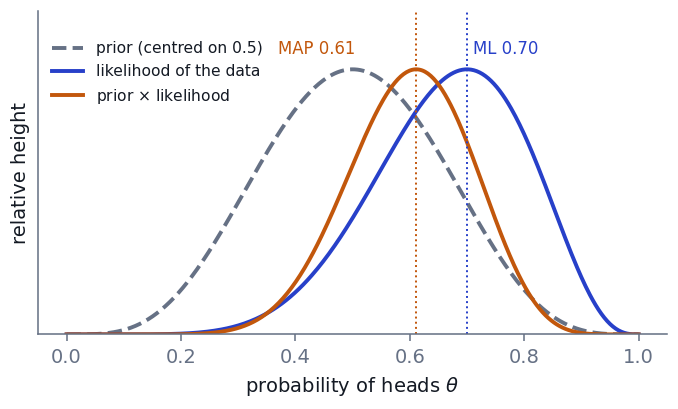
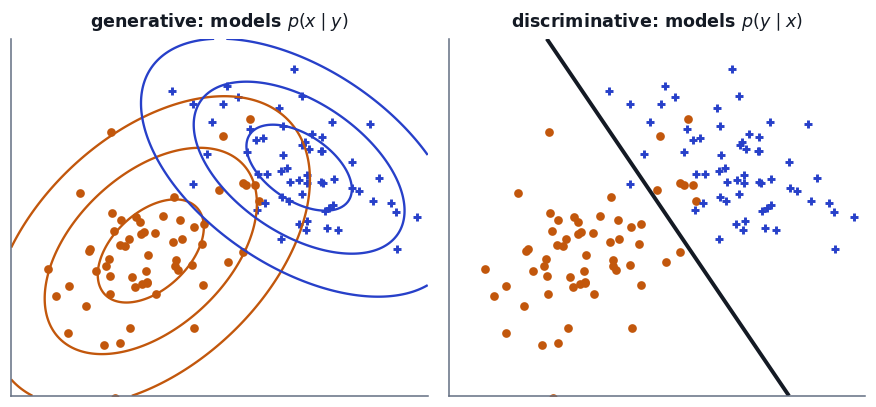
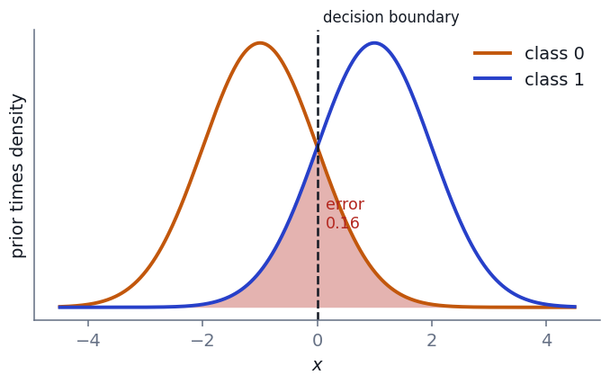
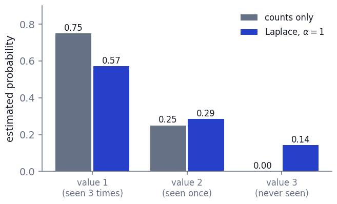
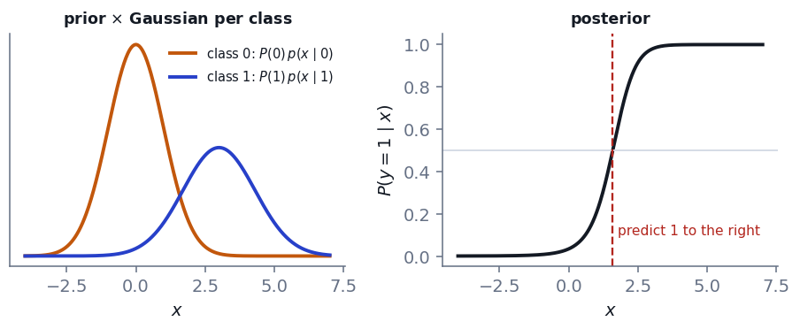
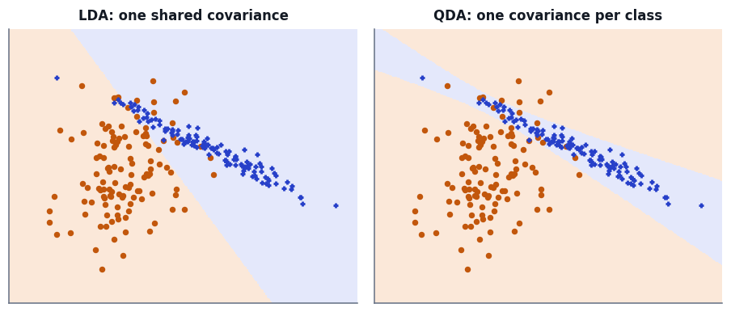

# Week 3: Classification 2 (inductive bias, Bayesian learning, Naive Bayes)

Sources: slide deck W3 (86 pages), Tutorial "Classification" Questions 1-2 with solutions, Lab 3 Naive Bayes notebooks (questions and solutions).

## The big picture

> **Where this fits:** W2 classified points by geometry, and this unit is the other major framework of the classification weeks: it classifies by probability, builds on the maximum likelihood ideas from R2, and comes back in W4 (misclassification costs) and W9 (mixture models and EM).
>
> - Every learner has to assume something to generalise from limited data, so we start by naming those assumptions: inductive bias.
> - Our assumption this week is that we can reason with probabilities. If we knew how probable each class is given $x$, classifying would be a lookup, so we need a way to get that number.
> - Bayes theorem gives us that way: it turns "which class, given these features?" into things we can estimate, namely how common each class is and how the features look inside each class.
> - Bayes theorem scores hypotheses, so we need a rule for choosing one: MAP uses the prior, and ML leaves it out.
> - MAP treats every mistake as equally bad, so expected loss handles the cases where one kind of mistake costs more.
> - The same ML idea, applied to a numeric target, explains where least squares comes from: it is ML under Gaussian noise.
> - Stepping back, modelling how each class produces its data is the generative route, and it is the alternative to the discriminative route of W2's logistic regression.
> - The most probable hypothesis does not always give the most probable class, so the Bayes optimal classifier combines all hypotheses. It is the theoretical best and it is impractical, and the Bayes error is the mistake rate nothing can get under.
> - That creates the need for something usable, so Naive Bayes assumes features are independent given the class, which reduces learning to estimating simple one-feature distributions.
> - Estimating from counts can produce a zero that wipes out a whole score, so next comes smoothing.
> - Counts do not suit numeric features, so Gaussian Naive Bayes fits a bell curve per class, and the lab's LDA and QDA show what changes if we keep the correlations it ignores.
> - Text needs a way to turn a document into features, which gives two versions of Naive Bayes: Bernoulli (is the word present?) and multinomial (how often?).
> - Finally, missing values and a list of pros and cons say how to use the method in practice.

Week 2 classified points by geometry (distances, boundaries). This week classifies them by probability. The core question is: given features $x$, which class is most probable? Bayes theorem turns that question into things we can estimate from data: how common each class is (the prior) and how the features look inside each class (the likelihood).

The topic builds in this order. First, every learner needs assumptions, called inductive bias. Then Bayes theorem gives the MAP and ML ways of choosing a hypothesis, and expected loss handles unequal costs. The same machinery explains why least squares is maximum likelihood under Gaussian noise. The Bayes optimal classifier is the theoretical best, but it is impractical. Naive Bayes is the practical method: it assumes features are independent given the class, so it only has to estimate simple one-feature distributions. The rest of the deck covers how to use it: zero counts (smoothing), numeric features (Gaussians), text (Bernoulli and multinomial models) and missing values.

**Notation warning.** The same things get different letters in different places.

| Thing | Slides | Tutorial | Lab |
|---|---|---|---|
| Class value | $\nu_j$, $C_i$, $c_i$, $y$ | $c_k$, $c_+$, $c_-$ | $y$, $c_i$ |
| Number of features | $n$ (attributes $x_1, \ldots, x_n$) | $p$ | $n$ |
| Number of training points | $m$ or $n$ (depends on the slide) | $n$ | $N$ |
| Word parameter in the Bernoulli model | $\theta^\oplus$, $\theta^\ominus$ | $p_j^k$ | not used |
| Word parameter in the multinomial model | $\theta^\oplus$, $\theta^\ominus$ | $\theta_j^k$ | not used |
| Spam and ham | $\oplus$, $\ominus$ | $+$, $-$ | not used |

## Inductive bias

> **Where this fits:** Limited training data cannot settle what to predict on a point nobody has seen, so every method has to bring assumptions of its own, and inductive bias is the name for them. This is theory that sits behind the Choose a model stage, because picking a model family means picking its assumptions, and it helps you Understand the limits of a method. It connects to the bias-variance tradeoff from R2 without being the same thing as that "bias". You will meet it again in W4, applied to decision trees.

"All models are wrong, but some models are useful" (Box and Draper) (W3 p.3).

**Inductive bias** is the combination of assumptions and restrictions placed on the models and algorithms used to solve a learning problem. It is the set of assumptions a model makes to generalise from limited training data (W3 p.4, p.6). Success in ML requires understanding the inductive bias of a method and choosing it to suit the task. For most algorithms it is not easy to say exactly what the inductive bias is.

Two examples (W3 p.5):

- **Linear regression:** the target function has the form $y = ax + b$, and it is approximated by fitting with MSE.
- **Nearest neighbour:** the target function is a complex non-linear function of the data, and we predict using the nearest neighbour by Euclidean distance in feature space.

**Inductive bias is NOT the "bias" of the bias-variance decomposition** (W3 p.4). That bias is the systematic error in predictions due to incorrect assumptions about the true function (W3 p.6). They are connected, though, because inductive bias influences the tradeoff:

- A **strong** inductive bias (for example assuming linearity) gives **high bias, low variance** (simpler models).
- A **weaker** inductive bias (complex models, minimal constraints) gives **lower bias, higher variance**.

## A probabilistic approach and decision rules

> **Where this fits:** W2 mostly asked where the boundary between classes lies. This section asks a different question: how probable is each class at this $x$? That is the Frame the task stage for the probabilistic view, and if we knew the posterior, classifying would be a lookup, so the rest of the unit is about getting it. The generative idea at the end picks up the split W2 introduced and leads to Naive Bayes later in this unit.

Example model (W3 p.8), with two Boolean features and class $Y$ in {spam, ham}:

| Viagra | lottery | $P(\text{spam} \mid \cdot)$ | $P(\text{ham} \mid \cdot)$ |
|---|---|---|---|
| 0 | 0 | 0.31 | **0.69** |
| 0 | 1 | **0.65** | 0.35 |
| 1 | 0 | **0.80** | 0.20 |
| 1 | 1 | 0.40 | **0.60** |

If we know the posterior $P(y \mid x)$, classifying is a lookup: predict spam if $P(\text{spam} \mid x) > 0.5$, else ham. A recipe that predicts $y$ from $x$ and the posterior is called a **decision rule** (W3 p.9).

**Two roles for Bayesian methods** (W3 p.11):

- Practical algorithms: Naive Bayes, Bayesian network learning. They combine prior knowledge (prior probabilities) with observed data.
- Conceptual framework: a "gold standard" for evaluating other learning algorithms, plus some insight into Occam's razor.

**Generative idea** (W3 p.12-13). Instead of finding a boundary between two groups, model one class at a time: describe how each class looks with $P(x \mid y)$ and $P(y)$. These are **generative learning algorithms**.

## Bayes theorem


> **Where this fits:** We want the probability of a class given the features, but data more readily tells us the reverse: how the features look inside each class. Bayes theorem converts one into the other. It is theory rather than a method, the tool underneath the Choose a model and Fit the model stages for everything probabilistic in this unit. W2 already used it as the generative route to the posterior, and every section below rests on it.

$$P(h \mid D) = \frac{P(D \mid h)\,P(h)}{P(D)}$$

- $P(h)$: prior probability of hypothesis $h$.
- $P(D)$: prior probability of the training data $D$.
- $P(h \mid D)$: probability of $h$ given $D$ (the posterior).
- $P(D \mid h)$: probability of $D$ given $h$ (the likelihood) (W3 p.16).

> **In plain words:** This is how to update a belief when evidence arrives. Take how plausible the hypothesis was beforehand (the prior) and multiply it by how well the hypothesis predicted the data you actually saw (the likelihood). Then divide by how probable that data was overall, so the answer is a proper probability (the posterior). A hypothesis that explains the data well can still end up unlikely if it was rare to begin with, which is why the positive test in the figure means only about a 16% chance of infection.

For classes $y \in \{C_1, \ldots, C_k\}$ (W3 p.17):

$$P(y = C_i \mid x) = \frac{P(x \mid C_i)\,P(C_i)}{P(x)}, \qquad P(x) = \sum_i P(x \mid C_i)P(C_i)$$

Names: posterior, class conditional (class likelihood), prior, marginal. The decision rule is to pick the class with the largest posterior.

> **In plain words:** This is the same update, with the classes as the hypotheses and one example's features as the evidence. For each class, multiply how common the class is by how typical these features are inside that class. The bottom line is those same products added up over all the classes, so dividing by it makes the posteriors sum to 1. That bottom line is identical for every class, so you can find the winner by comparing the products alone, which is what the fish example does.

**Fish example** (W3 p.14-15, p.20). Priors: salmon 0.3, sea bass 0.7.

- Deciding from the prior alone always gives sea bass. This "decision rule based on prior" can behave very poorly, because it never predicts the other class.
- With class conditionals for length (50-100 cm: salmon 0.4, sea bass 0.5), a 70 cm fish scores $0.4 \times 0.3 = 0.12$ for salmon and $0.5 \times 0.7 = 0.35$ for sea bass. Predict sea bass.

**Basic probability rules** (W3 p.26-27):

- Product rule: $P(A \wedge B) = P(A \mid B)P(B) = P(B \mid A)P(A)$.
- Addition rule: $P(A \vee B) = P(A) + P(B) - P(A \wedge B)$, which rearranges to $P(A \wedge B) = P(A) + P(B) - P(A \vee B)$.
- Total probability: if $A_1, \ldots, A_n$ are mutually exclusive with $\sum_i P(A_i) = 1$, then $P(B) = \sum_i P(B \mid A_i)P(A_i)$.
- Conditional probability: $P(A \mid B) = P(A \wedge B)/P(B)$.

> **In plain words:** These are the four moves behind the calculations in this unit. The product rule gets the chance of both things: take the chance of one, then multiply by the chance of the other once the first is known. The addition rule gets the chance of at least one: add the two chances, then take off the overlap, because it was counted twice. Total probability splits a chance into separate cases that cannot happen together and whose probabilities add to 1, then adds up each case's contribution, weighted by how likely that case is. Conditional probability zooms in on the situations where $B$ happened and asks what fraction of them also have $A$.

## MAP and ML



> **Where this fits:** Bayes theorem can score every hypothesis, but we still need a rule for picking one, which makes this part of the Fit the model stage. MAP and ML are the two standard rules: MAP weighs prior belief against the data, and ML goes by the data alone. ML here is the same maximum likelihood idea you saw in R2, and W2 uses it to fit logistic regression. Use MAP when the hypotheses are not equally likely beforehand, and ML when you treat them as equally likely.

We want the most probable hypothesis given the data (W3 p.18):

$$h_{MAP} = \arg\max_{h \in H} P(h \mid D) = \arg\max_{h \in H} \frac{P(D \mid h)P(h)}{P(D)} = \arg\max_{h \in H} P(D \mid h)P(h)$$

$P(D)$ is dropped because it does not depend on $h$, so it cannot change which $h$ wins. It does change the values: the scores no longer sum to 1.

> **In plain words:** MAP is the rule "pick the hypothesis that is most believable now that you have seen the data". For each candidate, multiply how plausible it was beforehand by how well it explains the data, and keep the candidate with the biggest product. Dividing by $P(D)$ can be skipped because it is the same number for every candidate, like dividing every contestant's score by 10: the ranking stays the same. What you are left with are scores for ranking, not probabilities.

If all hypotheses are equally likely a priori, $P(h_i) = P(h_j)$, the prior also drops out (W3 p.19):

$$h_{ML} = \arg\max_{h_i \in H} P(D \mid h_i)$$

> **In plain words:** ML is MAP with the prior left out: pick whichever hypothesis makes the observed data most probable, and ignore how plausible each one was to begin with. If all hypotheses really are equally plausible, the prior multiplies every candidate by the same number, so ML and MAP give the same answer. If they are not, the two can disagree, as the cancer example below shows. The coin in the figure shows the difference: ML goes with the 7 heads in 10 flips, and MAP is pulled towards its prior belief.

**Cancer example** (W3 p.21-24). $P(\text{cancer}) = 0.008$, $P(\oplus \mid \text{cancer}) = 0.98$, $P(\oplus \mid \text{not cancer}) = 0.03$. After a positive test:

- $P(\oplus \mid \text{cancer})P(\text{cancer}) = 0.98 \times 0.008 = 0.00784$
- $P(\oplus \mid \text{not cancer})P(\text{not cancer}) = 0.03 \times 0.992 = 0.02976$

So $h_{MAP}$ = not cancer, even though the test was positive and the test is accurate. The disease is simply rare. ML would say cancer, because $0.98 > 0.03$.

**To get an actual posterior**, normalise (W3 p.25):

$$P(h \mid D) = \frac{P(D \mid h)P(h)}{\sum_{h_i \in H} P(D \mid h_i)P(h_i)}$$

Here $P(\text{cancer} \mid \oplus) = 0.00784/(0.00784 + 0.02976) \approx 0.21$. The sum works because the hypotheses are mutually exclusive and cover every case, so exactly one of them is true.

> **In plain words:** This turns ranking scores back into real probabilities. Work out the prior-times-likelihood score for every hypothesis, add the scores up, and divide each one by that total, so each hypothesis gets its share of the whole. In the cancer example the two scores are 0.00784 and 0.02976, and cancer's share is about 0.21. The shares can be added like this because the hypotheses are mutually exclusive.

To compute $P(D \mid h)$ and $P(h)$, we can use an empirical method based on the data, or assume a parametric model and estimate its parameters from the data (W3 p.33).

## Bayesian expected loss

> **Where this fits:** MAP picks the most probable answer, but that is not always the wise answer: missing a cancer can be far worse than a false alarm. Expected loss lets the decision take those costs into account, so it belongs to the Define the loss stage, applied when you turn a posterior into an action. Use it instead of MAP whenever mistakes have different costs. It comes back in W4 as misclassification costs.

So far: decide $h_1$ if $P(h_1 \mid D) > P(h_2 \mid D)$. If mistakes have different costs, use a loss instead (W3 p.28-30). Let $\lambda(\alpha_i \mid h)$ be the loss of action $\alpha_i$ when $h$ is true. The expected loss (risk) is

$$E[L(\alpha_i)] = R(\alpha_i \mid x) = \sum_{h \in H} \lambda(\alpha_i \mid h)\, P(h \mid x)$$

The optimal Bayesian strategy is to **minimise the expected loss**. If all misclassifications cost the same, this equals MAP. With 0-1 loss, $R(\alpha_i \mid x) = \sum_{j \neq i} P(h_j \mid x) = 1 - P(h_i \mid x)$, so the smallest risk belongs to the largest posterior.

> **In plain words:** This gives each possible action one number: how bad is it, on average? For an action, go through each way the world might be, take what the action would cost if that were the truth, weight that cost by how probable that truth is, and add up. Then choose the action with the smallest number. A large cost can outweigh a small probability, so the best action need not be the most probable class. When every mistake costs the same (0-1 loss), an action's risk is the probability that it is wrong, so the smallest risk goes to the largest posterior and you are back at MAP.

**Example** (W3 p.31). Loss table: predicting cancer for a healthy patient costs 1, and predicting not cancer for a cancer patient costs 10.

- $R(\text{predict cancer} \mid \oplus) \propto 0 + 1 \times 0.02976 = 0.02976$
- $R(\text{predict not cancer} \mid \oplus) \propto 10 \times 0.00784 + 0 = 0.0784$

So we predict cancer, the opposite of MAP. The slides use $\propto$ because they use unnormalised scores. That is safe, because both risks share the factor $1/P(\oplus)$. Note what changes: the posterior is the same, and only the decision moves.

## Learning a real-valued function: why least squares is ML

> **Where this fits:** Why square the errors at all? W1 chose squared error as its loss, and this section shows it comes out of ML once you assume a particular kind of noise. This is theory that justifies a Define the loss choice: W1 and R2 did this for a linear model, and the new point here is that $f$ can be any real-valued target. W2 makes the matching link for classification, where cross-entropy plays this role for Bernoulli outcomes.

Assume $y_i = f(x_i) + \varepsilon_i$, where $f$ is **any** real-valued target and each $\varepsilon_i$ is drawn independently from a Gaussian with mean zero and variance $\sigma^2$ (W3 p.34). Then

$$h_{ML} = \arg\max_{h \in H} \prod_{i=1}^{m} \frac{1}{\sqrt{2\pi\sigma^2}} e^{-\frac{1}{2}\left(\frac{y_i - h(x_i)}{\sigma}\right)^2}$$

Take the natural log, which is monotone, so the argmax does not change (W3 p.35):

$$h_{ML} = \arg\max_{h \in H} \sum_{i=1}^{m} \left[\ln\frac{1}{\sqrt{2\pi\sigma^2}} - \frac{1}{2}\left(\frac{y_i - h(x_i)}{\sigma}\right)^2\right]$$

The first term and the positive factor $\frac{1}{2\sigma^2}$ do not depend on $h$, so we drop them and flip the sign:

$$h_{ML} = \arg\min_{h \in H} \sum_{i=1}^{m} (y_i - h(x_i))^2$$

So the ML hypothesis minimises the sum of squared errors. What makes it work is the noise model (independent, Gaussian, zero mean, same variance). It does not need $f$ to be linear. A different noise model gives a different loss: for example, Laplace noise $\propto e^{-\lvert\varepsilon\rvert/b}$ gives the sum of absolute errors.

> **In plain words:** This chain shows where squared error comes from. If the noise is a bell curve centred on zero, the observed value follows a bell centred on the prediction, so each point's likelihood is the height of that bell at the observed value, which drops quickly as the miss grows, and independent noise means these heights multiply across points. Taking logs turns the product into a sum of squared misses with a minus sign, and it does not change which hypothesis wins. Drop the parts that do not depend on $h$, flip the sign, and "maximise the likelihood" becomes "minimise the total squared error". The result rests on the noise assumptions, not on $f$ being linear.

## Discriminative versus generative models



> **Where this fits:** There are two routes to the posterior: model it directly, or model how the data is generated and derive it with Bayes theorem. Choosing between them is a Choose a model decision, and W2 introduced the split. Logistic regression from W2 is the discriminative route, and Naive Bayes, coming next, is the generative one. The generative route gives you more, since you can also sample new data, and W9's mixture models tell the same kind of story: choose a Gaussian, then sample from it.

(W3 p.36; Tutorial Q2(a))

- **Discriminative** models model the posterior $P(y \mid x)$ directly. Example: logistic regression.
- **Generative** models model the joint $P(y, x)$. From it we can derive any conditional or marginal, because $P(x) = \sum_c P(y = c, x)$ and $P(y \mid x) = \frac{P(y, x)}{\sum_c P(y = c, x)}$. Examples: Naive Bayes, Gaussian discriminant analysis.

They are called generative because we can sample from the joint to get new data points with labels. Alternatively, sample a class from $P(y)$, then an instance from $P(x \mid y)$.

> **In plain words:** Picture the joint as one big table, with a cell for every combination of class and feature values, holding how probable that combination is. To get $P(x)$, add up the cells for that $x$ across all the classes. To get the posterior, take the cell for the class you care about and divide it by that same total, which gives the class's share at that $x$. A discriminative model never builds this table. It only holds the answer to "which class, given $x$?", which is why it cannot generate new $x$ values.

The tutorial adds this framing. In classification we want the "best" class. For kNN, which is not a probabilistic method, best means agreement with the $k$ neighbours. In the probabilistic approach best means most probable: $c^* = \arg\max_k p(c_k \mid x^*)$. In a generative model we choose forms for the class conditional $p(x \mid c_k)$ and the class prior $p(c_k)$. We do not need to model $p(x)$ separately, since $p(x) = \sum_k p(x \mid c_k)p(c_k)$.

What should a hypothesis $h$ be? Either a collection of possible predictions, or a collection of functions mapping $x$ to a prediction $y$ (W3 p.37).

## Bayes optimal classifier, Gibbs, Bayes error



> **Where this fits:** MAP stakes everything on one hypothesis, yet the question we care about is which class a new point should get. The Bayes optimal classifier answers it by letting all hypotheses vote, and this is the Understand the limits stage: a gold standard to measure against, not a method you would run. Gibbs is a cheaper alternative, and the Bayes error is the error no classifier can avoid, which W7 quotes as a benchmark in its bagged trees simulation. Because the ideal is impractical, the next section turns to Naive Bayes.

**MAP finds the most probable hypothesis, but we usually want the most probable classification of a new $x$.** These can differ (W3 p.38).

**Example** (W3 p.39-41). $P(h_1 \mid D) = 0.4$, $P(h_2 \mid D) = 0.3$, $P(h_3 \mid D) = 0.3$, with $h_1(x) = +$, $h_2(x) = -$, $h_3(x) = -$. Then $h_{MAP} = h_1$ says $+$. But the two others together outweigh it:

$$\sum_i P(+ \mid h_i)P(h_i \mid D) = 0.4, \qquad \sum_i P(- \mid h_i)P(h_i \mid D) = 0.6$$

**Bayes optimal classification** combines ALL hypotheses, weighted by their posteriors (W3 p.40, p.42):

$$P(\nu_j \mid D) = \sum_{h_i \in H} P(\nu_j \mid h_i)P(h_i \mid D), \qquad \text{prediction} = \arg\max_{\nu_j \in V} P(\nu_j \mid D)$$

Here $\nu_j$ is a class value from the set $V$. No other classification method using the same hypothesis space and the same prior knowledge can outperform it on average (W3 p.43).

> **In plain words:** This is a weighted vote. Every hypothesis gives its prediction for the new point, each vote counts for as much as that hypothesis's posterior, and the class with the most total weight wins. In the example, the single best hypothesis has weight 0.4 and says $+$, but the other two together have 0.6 and say $-$, so the vote goes against $h_{MAP}$. That is how the most probable hypothesis and the most probable class can differ.

**Why use anything else?** The Bayes rule depends on unknown quantities, so we have to use data to approximate them (W3 p.45). It is also very inefficient (W3 p.46).

**Gibbs algorithm** (W3 p.46), a cheaper and less optimal alternative:

1. Choose one hypothesis at random, according to $P(h \mid D)$.
2. Use it to classify the new instance.

Surprising fact: assuming target concepts are drawn at random from $H$ according to the priors on $H$,

$$E[\text{error}_{Gibbs}] \leq 2 \times E[\text{error}_{Bayes\ Optimal}]$$

> **In plain words:** Gibbs replaces the full vote with one random draw: a hypothesis with more posterior weight is more likely to be picked, and whichever is picked decides alone. You might expect that to be far worse, but this bound says its expected error is at most twice that of Bayes optimal. It is a statement about expected error, and it holds only under the stated assumption that target concepts are drawn from $H$ according to the priors.

**Bayes error** (W3 p.47). For a two-class problem, $P(\text{error} \mid x)$ is the posterior of the class we did not predict. Averaging over $x$ gives $P(\text{error}) = \sum_x P(\text{error} \mid x)P(x)$. The rule "predict class 1 if $\hat P(\text{class}_1 \mid x) > \hat P(\text{class}_2 \mid x)$" makes this as small as possible at every $x$, so on average it minimises the probability of classification error.

> **In plain words:** With two classes, the chance you are wrong at any $x$ is the posterior of the class you did not pick. So picking the class with the larger posterior leaves the smaller posterior as your error at that point, and no other choice there does better. The overall error averages those leftovers across all $x$, giving more weight to the $x$ values that occur more often. In the figure this is the shaded overlap: where both classes can produce the same $x$, even the best choice is sometimes wrong.

## Naive Bayes classifier

> **Where this fits:** The Bayes optimal classifier is out of reach, and the full MAP rule needs a distribution over all features at once in each class, which takes a lot of data. Naive Bayes is the practical answer: a Choose a model decision that makes one strong assumption so that Fit the model becomes estimating simple one-feature distributions. It is a generative model and an alternative to W2's logistic regression and kNN. It comes back in W7, listed as a typically stable learner and as an example of a weak learner.

**When to use it** (W3 p.48): a moderate or large training set, and attributes that are conditionally independent given the class. Successful uses: classifying text, and Gaussian Naive Bayes for real-valued data.

**Derivation** (W3 p.49-50). An instance has attributes $\langle x_1, \ldots, x_n \rangle$. The most probable class is

$$\nu_{MAP} = \arg\max_{\nu_j \in V} P(\nu_j \mid x_1, \ldots, x_n) = \arg\max_{\nu_j \in V} P(x_1, \ldots, x_n \mid \nu_j)\,P(\nu_j)$$

> **In plain words:** This is the MAP rule again, with classes in place of hypotheses. Score each class by how common it is times how probable this exact combination of attribute values is inside that class, and take the winner. The combination term is the hard part: it is a distribution over every attribute at once, and estimating it needs a lot of data when there are many attributes. The next step is the assumption that gets around this.

**Naive Bayes assumption:** attributes are statistically independent given the class:

$$P(x_1, \ldots, x_n \mid \nu_j) = \prod_i P(x_i \mid \nu_j)$$

That is, if the class is known, the value of one attribute tells us nothing about the value of another. This gives

$$\nu_{NB} = \arg\max_{\nu_j \in V} P(\nu_j) \prod_i P(x_i \mid \nu_j)$$

> **In plain words:** The assumption lets us treat attributes one at a time: once the class is known, the chance of the whole combination is each attribute's own chance, multiplied together. The $x_i$ are the different features of one instance, not a sample of separate data points, and the independence is only claimed inside a class, so the lab's recap is wrong to call them i.i.d. historical data (see the errors section).

> **In plain words:** The classifier then works like this. For each class, start with how common the class is, multiply in one factor per attribute saying how probable that attribute's value is within that class, and predict the class with the largest result. A value that is rare in a class pulls that class's score down. The prior is included, so by the slides' definitions this is a MAP rule, even though the lab calls it "maximum likelihood".

**Why we need it** (Tutorial Q2(b)). Without any assumption, the chain rule gives $p(x \mid c_k)p(c_k) = p(x_1 \mid x_2, \ldots, x_p, c_k)\,p(x_2 \mid x_3, \ldots, x_p, c_k) \cdots p(x_p \mid c_k)\,p(c_k)$. A $p$-dimensional distribution per class needs a lot of data when $p$ is large. Under the assumption, we estimate $p$ one-dimensional distributions per class, which is much easier. For 10 binary features and 2 classes, this is 21 free parameters instead of 2047. The tutorial's intuition: if a patient is known to be diabetic, Naive Bayes says that high blood pressure tells us nothing about their weight. That is unrealistic, but it is what makes the problem tractable.

> **In plain words:** The long chain-rule line shows what the full model would need: each attribute's distribution given all the others after it, so the numbers to estimate multiply with every feature added. Without the assumption you need about one number for every combination of the 10 features in each class, which is where 2047 comes from. With it you need one number per feature per class, plus one for the class prior, which gives 21. The cost now grows with the number of features rather than with the number of combinations, and the price is the unrealistic assumption.

**Algorithm** (W3 p.51):

- Learn: for each class $\nu_j$, estimate $\hat P(\nu_j)$. For each attribute value $x_i$, estimate $\hat P(x_i \mid \nu_j)$.
- Classify $x$: $\nu_{NB} = \arg\max_{\nu_j} \hat P(\nu_j) \prod_i \hat P(x_i \mid \nu_j)$.

> **In plain words:** For categorical attributes, learning is counting. The prior estimate is the fraction of training rows in each class. Each conditional estimate looks only inside one class and asks what fraction of that class's rows have this attribute value, so you divide by the class count, not by all training rows, as the PlayTennis table's 2/9 and 3/5 show. The lab's code divides by all rows, which is a bug (see the errors section).

**PlayTennis example** (W3 p.52-56). There are 14 days, 9 yes and 5 no. The conditional estimates are:

| Value | Yes | No |
|---|---|---|
| outlook sunny / overcast / rainy | 2/9, 4/9, 3/9 | 3/5, 0/5, 2/5 |
| temperature hot / mild / cool | 2/9, 4/9, 3/9 | 2/5, 2/5, 1/5 |
| humidity high / normal | 3/9, 6/9 | 4/5, 1/5 |
| windy false / true | 6/9, 3/9 | 2/5, 3/5 |

For $\langle$sunny, cool, high, true$\rangle$:

- Yes: $\frac{9}{14} \cdot \frac{2}{9} \cdot \frac{3}{9} \cdot \frac{3}{9} \cdot \frac{3}{9} = 0.0053$
- No: $\frac{5}{14} \cdot \frac{3}{5} \cdot \frac{1}{5} \cdot \frac{4}{5} \cdot \frac{3}{5} = 0.0206$

Normalise: $P(\text{yes} \mid x) = 0.205$, $P(\text{no} \mid x) = 0.795$. The classification is "no".

**Subtleties** (W3 p.57). The independence assumption is often violated, but Naive Bayes works surprisingly well anyway. The estimated posteriors do not need to be correct. We only need the correct class to get the maximum:

$$\arg\max_{\nu_j} \hat P(\nu_j) \prod_i \hat P(x_i \mid \nu_j) = \arg\max_{\nu_j} P(\nu_j)\,P(x_1, \ldots, x_n \mid \nu_j)$$

> **In plain words:** This line is a condition, not something that always holds: it says what Naive Bayes needs in order to classify correctly. The left side is the Naive Bayes calculation, and the right side is the true MAP rule. They only have to pick the same class, not produce the same numbers. That is why Naive Bayes can classify well even when its probabilities are poor, so treat its predicted class with more trust than its stated confidence.

Naive Bayes posteriors are often unrealistically close to 1 or 0. Adding too many redundant attributes causes problems, because identical attributes are counted as independent evidence. For example, with likelihoods 0.8 and 0.4 and equal priors, one attribute gives a posterior of $2/3$; an identical copy pushes it to $0.64/0.80 = 0.8$, although nothing new was learned. And if features only help jointly (XOR), every $\hat P(x_i \mid \nu_j)$ can be 0.5, so Naive Bayes cannot separate the classes at all.

## The zero-frequency problem and smoothing



> **Where this fits:** Naive Bayes multiplies, so a single zero count destroys a class's score however strong the other evidence is. Smoothing is the fix, and it belongs to the Fit the model stage: the model stays the same, and only the way probabilities are estimated from counts changes. It is used again below in the Bernoulli and multinomial text models, where the same idea appears as pseudo-documents and pseudo-counts.

If no training instance of class $\nu_j$ has attribute value $x_i$, then $\hat P(x_i \mid \nu_j) = 0$, and so the whole product $\hat P(\nu_j) \prod_i \hat P(x_i \mid \nu_j)$ is 0, no matter what the other attributes say (W3 p.58). One feature overrides the entire model.

**Pseudo-counts:** add 1 to each count, a version of the Laplace estimator. Sometimes a constant other than 1 is more appropriate.

$$\hat P(x_i = v \mid \nu_j) = \frac{\text{count}(v, \nu_j) + 1}{\text{count}(\nu_j) + \text{number of values of attribute } i}$$

> **In plain words:** This stops a value that never turned up in a class from counting as impossible. Pretend you saw every possible value of this attribute one extra time in this class: add 1 to this value's count, and add the number of possible values to the class total, so the estimates for the attribute still sum to 1. Both counts come from inside the class. The add-on at the bottom is the number of values of this attribute, not the number of features, so it can differ between attributes. The lab's formula and code do not match this, so use this version (see the errors section).

For PlayTennis, $\hat P(\text{overcast} \mid \text{no})$ goes from $0/5$ to $(0 + 1)/(5 + 3) = 1/8$.

A larger constant pulls every estimate towards the uniform distribution. With a constant $\alpha$, $\frac{5 + \alpha}{17 + 3\alpha}$ goes from $0.294$ at $\alpha = 0$ to $0.3$ at $\alpha = 1$ and tends to $1/3$.

> **In plain words:** The constant is a dial for how much weight the pretend counts get. At 0 you have the raw frequency. As it grows, the pretend counts swamp the real ones and every value's estimate drifts towards an equal share. The example here is the word $a$ in spam from the e-mail data below (5 of 17 word occurrences, 3 words in the vocabulary), so its estimate creeps towards $1/3$.

In the Bernoulli model, an estimate of exactly 1 is just as damaging as 0, because a word that is absent contributes $1 - p$ (Tutorial Q2(d)).

## Numeric attributes: Gaussian Naive Bayes



> **Where this fits:** Counting value by value suits categories, but it does not suit a numeric attribute: the lab's real-valued `Fare`, matched exactly as if it were categorical, leaves far more test rows with every class scoring zero. Gaussian Naive Bayes keeps the same classifier and replaces the count table with one bell curve per attribute per class. This is a Choose a model decision (which distribution to assume), and Fit the model reduces to a mean and a variance. The normal assumption is a strong one, and the next section gives the alternatives that also capture correlation between features.

Usual assumption: given the class, each numeric attribute is normal, $x \mid \nu_j \sim N(\mu, \sigma^2)$ (W3 p.59). The parameters are estimated **for each class separately**:

$$\mu = \frac{1}{n}\sum_{i=1}^{n} x_i, \qquad \sigma^2 = \frac{1}{n-1}\sum_{i=1}^{n}(x_i - \mu)^2$$

(The slide prints the right-hand formula with $\sigma$ on the left and calls it the standard deviation. See the errors section below.)

> **In plain words:** These two numbers summarise one attribute within one class, so you work them out separately for each class, using only that class's rows ($n$ is the number of those rows). The mean is the typical value. The variance is roughly the average squared distance from the mean, so it is big when values are scattered and small when they cluster. This formula gives the variance, and you take its square root to get the standard deviation. The course divides by $n - 1$, while `GaussianNB` divides by $n$.

The density is (W3 p.60):

$$f(x) = \frac{1}{\sqrt{2\pi}\,\sigma}\, e^{-\frac{(x - \mu)^2}{2\sigma^2}}$$

Example: temperature with mean 73 and standard deviation 6.2 for class "yes": $f(66 \mid \text{yes}) = \frac{1}{\sqrt{2\pi} \times 6.2} e^{-\frac{(66 - 73)^2}{2 \times 6.2^2}} = 0.0340$.

The density value is used in the Naive Bayes product in place of a probability. Missing values during training are not included in the mean and standard deviation.

> **In plain words:** This curve scores how typical a value is for a class. It peaks at the class mean and falls away on both sides, and the standard deviation sets how fast: a narrow class marks down a distant value much harder than a wide class does. The fraction in front keeps the total area under the curve equal to 1. The result is a height, not a probability, so it can exceed 1, and it goes into the Naive Bayes product in the slot where a counted probability would otherwise go.

## LDA and QDA (lab extension only)



> **Where this fits:** Gaussian Naive Bayes cannot capture correlation between features inside a class. LDA and QDA are generative alternatives that can, because each class gets a full multivariate Gaussian, so this is a Choose a model decision. They are different models from `GaussianNB`, whatever the lab's wording suggests (see the errors section). Pick LDA for one shared covariance and a linear boundary, or QDA for a covariance per class and a quadratic boundary; W9 meets multivariate normals with a covariance matrix again when extending mixture models.

LDA and QDA are not in the W3 slides. They appear only in the extension section of Lab 3 and in one line of the tutorial solution, which names Gaussian discriminant analysis as a generative method.

Both assume a Gaussian class conditional and pick the class with the largest log posterior.

- **LDA:** $P(x \mid y = c_i) \sim \mathcal{N}(\mu_i, \Sigma)$, with a different mean for each class but the **same** covariance $\Sigma$. Score: $-\frac{1}{2}(x - \mu_{c_i})^T \Sigma^{-1} (x - \mu_{c_i}) + \ln P(y = c_i) + C$.
- **QDA:** each class has its own $\Sigma_{c_i}$. Score: $-\frac{1}{2}\ln\lvert\Sigma_{c_i}\rvert - \frac{1}{2}(x - \mu_{c_i})^T \Sigma_{c_i}^{-1} (x - \mu_{c_i}) + \ln P(y = c_i) + C$.

> **In plain words:** Each score is the log of a class's posterior, plus a constant that does not affect which class wins, so you compute it for each class and take the largest. (The lab labels this $\ln P(x \mid y = c_i)$, which is wrong; see the errors section.) The term containing $x - \mu_{c_i}$ measures how far $x$ sits from the class mean, with distance judged against the covariance, so this term is highest at the mean and gets more negative as you move away. The $\ln P(y = c_i)$ term gives common classes a head start. QDA has one extra term, which lowers the score of a class with a larger overall spread, and it matters only there because in LDA that spread is the same for every class.

$C$ collects the constants from the normal density and from $P(x)$. In LDA, the term $x^T \Sigma^{-1} x$ is the same for every class and cancels between classes, which leaves a boundary that is linear in $x$. In QDA it does not cancel, so the boundary is quadratic. In 1-D with two classes, LDA's boundary is
$$x^* = \frac{\mu_0 + \mu_1}{2} + \frac{\sigma^2}{\mu_1 - \mu_0}\ln\frac{P(y = c_0)}{P(y = c_1)}$$

> **In plain words:** A boundary is where two class scores tie. In LDA both classes share one covariance, so the curved part of their scores is identical and cancels, and the tie falls on a straight line. This formula finds that tie point in 1-D: start halfway between the two class means, which is the answer when the classes are equally common, because the log term is then zero. If one class is more common, the boundary shifts away from it towards the rarer class, which gives the common class more room. The shift is bigger when the shared variance is large compared with the gap between the means.

**Comparison with Gaussian Naive Bayes.** Multiplying one-dimensional Gaussians is the same as a multivariate Gaussian with a diagonal covariance per class. So:

| Model | Covariance | Can capture within-class correlation? |
|---|---|---|
| LDA | one full $\Sigma$, shared by all classes | yes |
| QDA | one full $\Sigma_{c}$ per class | yes |
| Gaussian Naive Bayes | diagonal per class (a variance per attribute per class) | no |

The lab's data uses `cov0 = [[0.5, 0.28], [0.28, 0.5]]` and `cov1 = [[1, -0.8], [-0.8, 1]]`, so the features are correlated within each class. `GaussianNB` cannot fit this, and the lab's code comment says QDA would, since it does not make the same independence assumption. `GaussianNB` resembles the true distribution when the covariance matrices are diagonal.

> **In plain words:** A covariance matrix records each feature's own spread on its diagonal, and how pairs of features move together in the other entries. `GaussianNB` keeps only the diagonal, so it pictures each class as a cloud with no tilt. The lab's data has non-zero off-diagonal entries (0.28 and -0.8), so its clouds are tilted, and `GaussianNB` cannot draw them however much data it gets. LDA and QDA keep the full matrix, LDA with one shared by all classes and QDA with one per class, which is why neither of them is the same model as `GaussianNB`.

## Categorical variables and text classification

> **Where this fits:** Classifying text is one of the successful uses of Naive Bayes, but a document has to become features first. So this section covers Prepare the data (bit vectors or count vectors, with stop words removed) and Choose a model (Bernoulli or multinomial). Both are Naive Bayes with a different view of a document: Bernoulli asks only whether each word occurs, and multinomial also lets the number of occurrences influence the answer. The two can disagree on the same e-mail, as the worked numbers below show, and the smoothing section's idea returns here.

Two document models (W3 p.61-62):

- **Multivariate Bernoulli.** For the $i$-th vocabulary word, $X_i$ says whether the word occurs in the document. A document is a bit vector. Bits are assumed independent, so the joint is the product of $P(X_i = x_i)$.
- **Multinomial.** Each word position is a categorical variable with $k$ outcomes, where $k$ is the vocabulary size. A document is a count vector, a histogram of word occurrences. The number of occurrences of a word therefore influences the classification. Independence follows from the distribution itself, since word positions are drawn independently from the same categorical distribution.

Both assume independence between word occurrences (the Naive Bayes assumption). That is often false: an e-mail containing "Viagra" probably contains "pill". Violated independence reduces the quality of the probability estimates but may still allow good classification.

**Text setup** (W3 p.65-66). Target $Interesting?: Document \to \{+, -\}$. Represent a document by a vector of words, with one attribute per word position. Estimate $P(+)$, $P(-)$, $P(doc \mid +)$, $P(doc \mid -)$. The Naive Bayes assumption gives

$$P(doc \mid \nu_j) = \prod_{i=1}^{length(doc)} P(x_i = w_k \mid \nu_j)$$

One more assumption is that a word's probability does not depend on position: $P(x_i = w_k \mid \nu_j) = P(x_m = w_k \mid \nu_j)$ for all $i, m$. This is the **bag of words** assumption.

> **In plain words:** To score a document against a class, walk through its words and multiply together each word's probability under that class. The bag of words assumption then says position does not matter: a word has the same probability wherever it appears, so the document behaves like a shuffled bag of words. That means one probability per word per class, instead of a separate one for every position. The independence assumption is often false, but as noted above that may still allow good classification.

**20 Newsgroups** (W3 p.67-69). Classifying a document by which of 20 newsgroups it came from, Naive Bayes reaches 89% accuracy. The learning curve shows accuracy rising steadily with training set size (1/3 withheld for test).

**Training on the e-mail data** (W3 p.71-75). There are eight e-mails: e1-e4 spam, e5-e8 ham. $d$ and $e$ are **stop words**, too common to carry class information, so the vocabulary is $\{a, b, c\}$.

| E-mail | Text | Bits $(a, b, c)$ | Counts $(\#a, \#b, \#c)$ | Class |
|---|---|---|---|---|
| e1 | b d e b b d e | 0 1 0 | 0 3 0 | + |
| e2 | b c e b b d d e c c | 0 1 1 | 0 3 3 | + |
| e3 | a d a d e a e e | 1 0 0 | 3 0 0 | + |
| e4 | b a d b e d a b | 1 1 0 | 2 3 0 | + |
| e5 | a b a b a b a e d | 1 1 0 | 4 3 0 | - |
| e6 | a c a c a c a e d | 1 0 1 | 4 0 3 | - |
| e7 | e a e d a e a | 1 0 0 | 3 0 0 | - |
| e8 | d e d e d | 0 0 0 | 0 0 0 | - |

| | Multivariate Bernoulli | Multinomial |
|---|---|---|
| Sum per class | spam $(2, 3, 1)$, ham $(3, 1, 1)$ | spam $(5, 9, 3)$, ham $(11, 3, 3)$ |
| Divide by | documents in class (4) | word occurrences in class (17) |
| Parameter means | probability a document contains the word | probability a random word is this word |
| Smoothing | add 2 pseudo-documents per class: one with every word, one with none. So +1 on top, +2 below | add 1 pseudo-count per vocabulary word. So +1 on top, $+\lvert V\rvert$ below |
| Smoothed spam | $(3/6, 4/6, 2/6) = (0.5, 0.67, 0.33)$ | $(6/20, 10/20, 4/20) = (0.3, 0.5, 0.2)$ |
| Smoothed ham | $(4/6, 2/6, 2/6) = (0.67, 0.33, 0.33)$ | $(12/20, 4/20, 4/20) = (0.6, 0.2, 0.2)$ |
| Do parameters sum to 1? | no | yes |
| Absent word contributes | $1 - \theta$ | $\theta^0 = 1$ |

**Bernoulli prediction** (W3 p.76). For $x = (1, 1, 0)$: $P(x \mid \oplus) = 0.50 \times 0.67 \times (1 - 0.33) = 0.222$ and $P(x \mid \ominus) = 0.67 \times 0.33 \times (1 - 0.33) = 0.148$. The ML classification is spam.

> **In plain words:** The Bernoulli model goes through every word in the vocabulary and asks "present or absent?". A present word contributes its parameter, the chance that a document of this class contains it. An absent word contributes one minus that, the chance that it does not. So leaving a word out is evidence too, while repeats of a word change nothing. "ML classification" here means the priors are left out, so only the two likelihoods are compared.

**Likelihood ratio and odds** (W3 p.77). With two classes:

$$\underbrace{\frac{P(\oplus \mid x)}{P(\ominus \mid x)}}_{\text{posterior odds}} = \underbrace{\frac{P(x \mid \oplus)}{P(x \mid \ominus)}}_{\text{likelihood ratio}} \times \underbrace{\frac{P(\oplus)}{P(\ominus)}}_{\text{prior odds}}$$

Here the likelihood ratio is $3/2$, so MAP says spam if the prior odds exceed $2/3$, which means $P(\oplus) > 0.4$. With 33% spam and 67% ham, the prior odds are about $1/2$, so the posterior odds are $3/4 < 1$ and MAP says ham. The likelihood ratio was not strong enough to overcome the prior.

> **In plain words:** This is Bayes theorem for two classes, written as a ratio so that the bottom line $P(x)$ cancels. Start from how much you favoured spam over ham beforehand, multiply by how many times better the evidence fits spam than ham, and you have how much you favour spam now. Above 1 means spam and below 1 means ham. Here the evidence favours spam by 3/2, but prior odds of about 1/2 lean the other way by more, so ham wins. Odds are not probabilities: odds of $2/3$ mean a probability of $0.4$.

**Multinomial prediction** (W3 p.78). For a count vector with $n$ vocabulary-word occurrences,

$$P(x \mid \theta) = n! \prod_j \frac{\theta_j^{x_j}}{x_j!}$$

With $x = (3, 1, 0)$ and $n = 4$: $P(x \mid \oplus) = 4!\,\frac{0.3^3}{3!}\frac{0.5^1}{1!}\frac{0.2^0}{0!} = 0.054$ and $P(x \mid \ominus) = 4!\,\frac{0.6^3}{3!}\frac{0.2^1}{1!}\frac{0.2^0}{0!} = 0.1728$. The likelihood ratio is $(0.3/0.6)^3(0.5/0.2)^1(0.2/0.2)^0 = 5/16$. The coefficient cancels. The ML classification is ham, the opposite of the Bernoulli model, mainly because the three occurrences of $a$ are strong evidence for ham.

> **In plain words:** This gives the probability of seeing a particular set of word counts. Each word's parameter is multiplied in once per occurrence, which is the chance of one specific ordering of those words, so repeats count every time and a word with count zero contributes a factor of 1 (no effect). The factorials count how many different orderings give the same counts. That coefficient depends only on the document, not the class, so it cancels when you compare classes, but you need it for an actual likelihood value.

## Missing values

> **Where this fits:** Real data has gaps, and W2 listed the general options for the Prepare the data stage: delete, impute, or use a method that copes natively. Naive Bayes is one of the few methods that copes natively, so no separate imputation step is needed. Decision trees (W4) are the other example W2 names. The basic approach leaves the attribute out, and the better approach averages over the values it might have had.

**Basic approach** (W3 p.79):

- Training: the instance is not included in the frequency count for that attribute value-class combination.
- Classification: the attribute is omitted from the calculation.

**Doing better** (W3 p.80-83): average over the unknown value. Suppose an e-mail contains "lottery", but we do not know about "Viagra". The two candidate rows give different predictions: row 2 (Viagra = 0) says spam, and row 4 (Viagra = 1) says ham. Average them:

$$P(y \mid \text{lottery}) = P(y \mid \text{Viagra} = 0, \text{lottery})P(\text{Viagra} = 0) + P(y \mid \text{Viagra} = 1, \text{lottery})P(\text{Viagra} = 1)$$

With $P(\text{Viagra} = 1) = 0.10$: $P(\text{spam} \mid \text{lottery}) = 0.65 \times 0.90 + 0.40 \times 0.10 = 0.625$ and $P(\text{ham} \mid \text{lottery}) = 0.35 \times 0.90 + 0.60 \times 0.10 = 0.375$. Because "Viagra" is rare, the result stays close to row 2.

> **In plain words:** When a feature is unknown, consider each value it might have had, take the prediction for each, and blend them, giving more weight to the likelier value. Here the two rows disagree, but Viagra = 0 gets weight 0.90, so the blend stays close to row 2. Strictly, the weights should be the chance of each value given that "lottery" is present. Using plain $P(\text{Viagra})$ as the slides do is exact only if the two words occur independently (see the errors section).

## Naive Bayes pros and cons

> **Where this fits:** Now that the method is built, the question is when to choose it, which is a Choose a model decision. This section is a summary rather than new theory, and it compares Naive Bayes with alternatives such as W2's logistic regression. The cons point back to this unit: zero counts to smoothing, and over-confident probabilities to the independence assumption. It also closes the two classification weeks, and W4 moves on to decision trees.

Pros (W3 p.84):

- Easy and fast at prediction, and performs well in multi-class prediction.
- When independence holds, it performs better than models such as logistic regression with less training data.
- Performs well with categorical inputs compared to numerical ones. Numerical variables need the normal assumption, which is strong.
- Can handle missing data in a principled way.

Cons:

- The zero-frequency case makes it unable to make a prediction. The solution is smoothing.
- It is a bad estimator: probability outputs are often over-confident.
- It makes a strong assumption of independent attributes, which is almost never completely true.

**Summary of the classification weeks** (W3 p.85): two major frameworks, distance-based (geometric ideas) and probabilistic (Bayesian ideas).

## Errors and inconsistencies in the material

No question in the bank depends on a disputed point. Where a question touches one, the stem states the convention explicitly.

**Slides**

- **W3 p.59, standard deviation formula.** The slide writes $\sigma = \frac{1}{n-1}\sum (x_i - \mu)^2$ and calls it the standard deviation. That expression is the sample **variance**. There should be a square root, or $\sigma^2$ on the left. The p.60 example does use $6.2$ as a real standard deviation.
- **W3 p.80 and p.82, reversed wording.** The text says we would predict spam if the e-mail contained "Viagra" (second row) and ham if it did not (fourth row). The table shows the reverse: row 2 is Viagra = 0 (spam) and row 4 is Viagra = 1 (ham). The numbers on p.83 use the table correctly.
- **W3 p.80, formula.** It uses $P(\text{Viagra})$. Strictly it should be $P(\text{Viagra} \mid \text{lottery})$. The formula is exact only if the two words occur independently. Our bank states that assumption in the stem.
- **W3 p.80 and p.82, reference.** "Slide 9" should be printed slide 7 (PDF p.8). The table is repeated on PDF p.81.
- **W3 p.47.** The stray $\sum$ in front of $P(\text{error})$ on the left is a typo. It should read $P(\text{error}) = \sum_x P(\text{error} \mid x)P(x)$.
- **W3 p.67.** "20000 training documents from each group" looks wrong: the axis of the learning curve on p.69 ends at around $10^4$ to $2 \times 10^4$ documents in total. It probably means 20000 in total.
- **W3 p.76.** With the rounded parameters, $0.50 \times 0.67 \times 0.67 = 0.224$, not $0.222$. The value $0.222$ comes from the exact fractions. This is rounding, not an error in the method.

**Tutorial solutions**

- **Q2(d), pseudo-document table.** It is built on the altered data where $a$ never occurs in spam, while the smoothed estimates just above it use the original data. It also labels the rows ep1, ep2 twice, where the text says ep1 to ep4.
- **Q2(d), (e), (f).** The solutions stop before giving a final classification. See the worked examples below, which complete them. All three give spam.
- **Q2(e).** The parameter list repeats $\theta_b^-$ where it should have $\theta_c^-$.

**Lab 3**

- **Bug in `_conditional`.** It returns `count / n`, where `count` counts rows with the feature value **and** the class, and `n` is all training rows. That is the joint $P(x_i, c)$, not $P(x_i \mid c)$. The code then also multiplies by the prior, so each class score is $P(c)^{d+1}\prod_i P(x_i \mid c)$ for $d$ features, which favours the majority class. I re-ran it on the real data: the lab's 0.7436 test accuracy becomes **0.7949** with the denominator `np.sum(y_train == c)`.
- **Laplace formula.** The lab's formula is $P_L(x_i \mid y) = \frac{P(x_i \mid y) + \alpha}{N + \alpha n}$, with $n$ the number of features. This does not match the slides or the tutorial. The numerator should be a count, the denominator should use the class count, and the multiplier of $\alpha$ should be the number of values of that feature. The lab's code does put a count in the numerator, unlike its own formula, but it keeps the wrong denominator: `(count + alpha) / (n + alpha * feature_n)`, with `n` all training rows and `feature_n` the number of columns. So the smoothed estimates for a feature do not sum to 1. For `Embarked` in class 1 with $\alpha = 3$ they sum to about $0.40$.
- **"Maximum likelihood hypothesis".** The lab uses this name for $\arg\max_c P(y)\prod_i P(x_i \mid y)$, which includes the prior. By the slides' definitions that is MAP.
- **Conflating features with samples.** The recap describes $x_1, \ldots, x_n$ as i.i.d. historical data. In Naive Bayes, the $x_i$ are the features of one instance, and they are conditionally independent given the class. They are not an i.i.d. sample.
- **"Continuous Naive Bayes: LDA and QDA".** The lab says continuous Naive Bayes models are commonly known as LDA or QDA, and that we apply LDA/QDA using `GaussianNB`. These are different models: `GaussianNB` has diagonal covariances, while LDA and QDA have full ones. The lab's own code comment says QDA does not make the Naive Bayes independence assumption. Also, the lab writes $\ln P(x \mid y = c_i)$ for what is really the log posterior up to a constant.
- **Smaller points.** `Shape of test set` prints the training shape (the test set is really 312 rows). The Exercise 2 solution never passes a custom prior, and `benchmark` would ignore one anyway. The lab says Naive Bayes "has very few assumptions", while the slides call its independence assumption strong. The questions notebook includes `Fare` in the features, and the solutions notebook removes it.

## Worked examples

### Tutorial Q1: Bayes rule

$P(D) = 0.01$, $P(T \mid D) = 0.95$, $P(T \mid \bar D) = 0.05$.

**(a)** Total probability: $P(T) = 0.95 \times 0.01 + 0.05 \times 0.99 = 0.0095 + 0.0495 = 0.059$.

**(b)** $P(D \mid T) = \frac{0.0095}{0.059} = 0.16$. Only 16%, because the disease is rare. The prior holds the posterior down.

**(c)** Two positives, conditionally independent given disease status. Note that this means $P(TT \mid D) = P(T \mid D)^2$, and not $P(TT) = P(T)^2$.

$P(TT) = 0.95^2 \times 0.01 + 0.05^2 \times 0.99 = 0.009025 + 0.002475 = 0.0115$.

$P(D \mid TT) = 0.009025/0.0115 = 0.7848$. The evidence now outweighs the prior. Using the one-test posterior $0.161$ as a new prior gives the same answer.

### Tutorial Q2(c): Bernoulli, no smoothing

Uniform priors, test e-mail $e = abbdebb$. Remove stop words: it contains $a$ and $b$ but not $c$, so $x = (1, 1, 0)$. Repeats of $b$ make no difference.

Estimates are documents containing the word over documents in the class: $p^+ = (2/4, 3/4, 1/4)$ and $p^- = (3/4, 1/4, 1/4)$.

- Spam: $\frac{1}{2} \cdot \frac{2}{4} \cdot \frac{3}{4} \cdot \left(1 - \frac{1}{4}\right) = \frac{9}{64}$
- Ham: $\frac{1}{2} \cdot \frac{3}{4} \cdot \frac{1}{4} \cdot \left(1 - \frac{1}{4}\right) = \frac{9}{128}$

Classify as **spam**.

### Tutorial Q2(d): Bernoulli with smoothing

**Why:** estimates of 0 or 1 are dangerous. If $\hat p_a^+ = 0$, any e-mail with $a$ gets $p(x \mid +) = 0$. If $\hat p_a^+ = 1$, any e-mail without $a$ gets zero as well.

$$\hat p_j^k = \frac{\text{documents of class } k \text{ with word } j + 1}{\text{documents in class } k + 2}$$

The 2 is the number of possible values of the feature (0 or 1). Result: $(3/6, 4/6, 2/6)$ for spam and $(4/6, 2/6, 2/6)$ for ham.

The official solution stops here. Finishing it for $x = (1, 1, 0)$:

- Spam: $\frac{1}{2} \cdot \frac{3}{6} \cdot \frac{4}{6} \cdot \frac{4}{6} = \frac{1}{9} \approx 0.111$
- Ham: $\frac{1}{2} \cdot \frac{4}{6} \cdot \frac{2}{6} \cdot \frac{4}{6} = \frac{2}{27} \approx 0.074$

Still **spam**, with posterior $0.6$ instead of the unsmoothed $2/3$. Smoothing moved the posterior towards $0.5$ without changing the class.

### Tutorial Q2(e): Multinomial, no smoothing

Test e-mail $e = abbdebbcc$ gives $x = (1, 4, 2)$, so $n = 7$ (stop words not counted). Parameters are $\theta^+ = (5/17, 9/17, 3/17)$ and $\theta^- = (11/17, 3/17, 3/17)$.

$$p(c_+)p(x \mid c_+) = \frac{1}{2} \cdot \frac{7!}{1!\,4!\,2!} \cdot \frac{5}{17} \cdot \left(\frac{9}{17}\right)^4 \cdot \left(\frac{3}{17}\right)^2$$

The official solution stops here ("and similarly"). Finishing it: the coefficient $105$ and the priors cancel in the ratio, so

$$\frac{p(x \mid c_+)}{p(x \mid c_-)} = \frac{5}{11} \cdot \left(\frac{9}{3}\right)^4 \cdot \left(\frac{3}{3}\right)^2 = \frac{5 \times 81}{11} \approx 36.8$$

Numerically, $p(c_+)p(x \mid c_+) \approx 0.0378$ and $p(c_-)p(x \mid c_-) \approx 0.0010$. Classify as **spam**.

### Tutorial Q2(f): Multinomial with smoothing

$$\hat\theta_j^k = \frac{\text{times word } j \text{ appears in class } k + 1}{\text{words in class } k + \lvert V \rvert}$$

Result: $\theta^+ = (6/20, 10/20, 4/20)$ and $\theta^- = (12/20, 4/20, 4/20)$.

The official solution stops here. Finishing it for $x = (1, 4, 2)$:

$$\frac{p(x \mid c_+)}{p(x \mid c_-)} = \frac{0.3}{0.6} \cdot \left(\frac{0.5}{0.2}\right)^4 \cdot \left(\frac{0.2}{0.2}\right)^2 = 0.5 \times 39.06 \approx 19.5$$

Classify as **spam**.

Tutorial Q3 (logistic regression) belongs with the Week 2 unit.

## Code you should recognise

**Lab: from-scratch categorical Naive Bayes.** `fit` only stores the data, so all the work happens at prediction.

```python
classes = np.unique(y_train)                                   # all class labels
prior = {c: np.sum(y_train == c) / y_train.shape[0] for c in classes}   # P(c)

count = np.sum(np.logical_and(X_train[:, index] == value, y_train == c))
# rows with this feature value AND this class

score = prior[c] * np.prod([...conditionals for each feature...])
```

Correct conditional: `count / np.sum(y_train == c)`. The lab's `count / n` estimates the joint (see the errors section).

Correct smoothing: `(count + alpha) / (np.sum(y_train == c) + alpha * n_values_of_this_feature)`.

**Counting rows with no surviving class:**

```python
num0 = np.sum([1 * (d[0] == 0 and d[1] == 0) for d in results])
```

This counts test rows where every class scored zero, which is the zero-frequency problem. In the lab it is 1 of 312 without smoothing and 0 of 312 with $\alpha = 3$. If the real-valued `Fare` is matched exactly as if it were categorical, it rises to 71 of 312.

**scikit-learn:**

```python
from sklearn.naive_bayes import GaussianNB, MultinomialNB, BernoulliNB

gnb = GaussianNB().fit(X, y)          # real-valued features
gnb.theta_, gnb.var_                  # per-class means and variances, shape (n_classes, n_features)
gnb.predict_proba(points)[:, 1]       # P(class 1 | x); column order follows gnb.classes_

MultinomialNB(alpha=1.0).fit(X, y)    # count vectors; alpha is the pseudo-count
BernoulliNB(alpha=1.0).fit(X, y)      # presence bits; binarize=0.0 turns counts > 0 into 1
np.exp(m.feature_log_prob_)           # parameters, one row per class in classes_ order
```

Facts confirmed by running them on the course's e-mail data:

- `MultinomialNB(alpha=1.0)` reproduces the $(0.3, 0.5, 0.2)$ and $(0.6, 0.2, 0.2)$ parameters.
- `BernoulliNB(alpha=1.0)` reproduces $(0.5, 0.67, 0.33)$ and $(0.67, 0.33, 0.33)$.
- Classes are sorted, so `'ham'` is row 0.
- `GaussianNB.var_` divides by $n$, not $n - 1$ as on the slide.

**Lab plot grid:**

```python
test_points = np.dstack(np.meshgrid(x, y)).reshape(-1, 2)   # (10000, 2) for 100 by 100
z = gnb.predict_proba(test_points)[:, 1].reshape(len(x), len(y))
```

Contouring `z` at 0.5 draws the decision boundary.

**Log-space scoring.** This is not in the lab, but it is how a multinomial score is usually computed, and sums of logs avoid tiny products:

```python
scores = np.log(prior) + x @ np.log(theta).T    # one score per class; coefficient omitted
scores.argmax()
```

## Formula sheet

| Name | Formula | Note | In words |
|---|---|---|---|
| Bayes theorem | $P(h \mid D) = \dfrac{P(D \mid h)P(h)}{P(D)}$ | Posterior = likelihood $\times$ prior / marginal | Update a belief: prior times fit to the data, rescaled |
| Marginal | $P(x) = \sum_i P(x \mid C_i)P(C_i)$ | Total probability | Add each class's contribution to get the overall chance of $x$ |
| Product rule | $P(A \wedge B) = P(A \mid B)P(B)$ | Also $= P(B \mid A)P(A)$ | Chance of both: one, then the other given the first |
| Addition rule | $P(A \vee B) = P(A) + P(B) - P(A \wedge B)$ | Rearrange for the joint | Chance of either: add both, take off the overlap |
| Normalised posterior | $P(h \mid D) = \dfrac{P(D \mid h)P(h)}{\sum_i P(D \mid h_i)P(h_i)}$ | Scores sum to 1 | Each hypothesis's share of the total score |
| MAP | $h_{MAP} = \arg\max_h P(D \mid h)P(h)$ | Uses the prior | Most believable hypothesis, counting both prior and data |
| ML | $h_{ML} = \arg\max_h P(D \mid h)$ | Equal priors | Hypothesis that makes the data most probable, ignoring the prior |
| Expected loss | $R(\alpha_i \mid x) = \sum_h \lambda(\alpha_i \mid h)P(h \mid x)$ | Pick the smallest | Average cost of an action, weighted by how probable each truth is |
| 0-1 loss risk | $R(\alpha_i \mid x) = 1 - P(h_i \mid x)$ | Same as MAP | Risk is the chance this action is wrong |
| ML under Gaussian noise | $h_{ML} = \arg\min_h \sum_i (y_i - h(x_i))^2$ | Any real-valued target | Most likely hypothesis is the one with the smallest squared misses |
| Generative posterior | $P(y \mid x) = \dfrac{P(y, x)}{\sum_c P(y = c, x)}$ | From the joint | This class's share of the joint at this $x$ |
| Bayes optimal | $\arg\max_{\nu_j} \sum_i P(\nu_j \mid h_i)P(h_i \mid D)$ | All hypotheses, weighted | Vote of all hypotheses, weighted by their posteriors |
| Gibbs bound | $E[\text{error}_{Gibbs}] \leq 2E[\text{error}_{Bayes\ Optimal}]$ | Targets drawn from the prior | One random hypothesis has at most twice the expected error |
| Error probability | $P(\text{error}) = \sum_x P(\text{error} \mid x)P(x)$ | Smallest posterior at each $x$ | Error at each $x$, averaged by how often $x$ occurs |
| Naive Bayes | $\nu_{NB} = \arg\max_{\nu_j} P(\nu_j)\prod_i P(x_i \mid \nu_j)$ | Independence given the class | Class frequency times one factor per attribute; biggest wins |
| Laplace (categorical) | $\dfrac{\text{count}(v, \nu_j) + 1}{\text{count}(\nu_j) + \#\text{values}}$ | Constant can differ from 1 | Pretend each value of this attribute appeared once more in the class |
| Bernoulli likelihood | $\prod_j \theta_j^{x_j}(1 - \theta_j)^{1 - x_j}$ | Absent words count | Multiply the word's chance if present, one minus it if absent |
| Bernoulli smoothed | $\dfrac{\text{docs with word} + 1}{\text{docs in class} + 2}$ | Two pseudo-documents | Pretend one extra document with the word and one without |
| Multinomial likelihood | $n! \prod_j \dfrac{\theta_j^{x_j}}{x_j!}$ | $n$ = vocabulary-word occurrences | Chance of these word counts, in any order |
| Multinomial smoothed | $\dfrac{\text{word count} + 1}{\text{words in class} + \lvert V\rvert}$ | One pseudo-count per word | Pretend each vocabulary word appeared once more in the class |
| Odds form | posterior odds = likelihood ratio $\times$ prior odds | Spam if greater than 1 | Start from prior odds, scale by how well the evidence fits |
| Gaussian density | $f(x) = \dfrac{1}{\sqrt{2\pi}\sigma}e^{-\frac{(x - \mu)^2}{2\sigma^2}}$ | Per class, per attribute | Bell-curve height: how typical this value is for the class |
| Sample variance | $\sigma^2 = \dfrac{1}{n - 1}\sum_i (x_i - \mu)^2$ | Slide omits the square on the left | Spread of one attribute around its mean, within one class |
| Missing value average | $P(y \mid l) = \sum_v P(y \mid V = v, l)P(V = v)$ | Assumes $V$ independent of $l$ | Blend predictions over the possible values, weighted by their probability |
| LDA score | $-\frac{1}{2}(x - \mu_c)^T\Sigma^{-1}(x - \mu_c) + \ln P(c)$ | Shared $\Sigma$, linear boundary | Closeness to the class mean plus log prior, one shared covariance |
| QDA score | $-\frac{1}{2}\ln\lvert\Sigma_c\rvert - \frac{1}{2}(x - \mu_c)^T\Sigma_c^{-1}(x - \mu_c) + \ln P(c)$ | Own $\Sigma_c$, quadratic boundary | As LDA with each class's own covariance, marking down wide spread |

## Exam traps

- Inductive bias and the bias of bias-variance are different things. Strong inductive bias means high bias and low variance.
- $P(D \mid T)$ is not $P(T \mid D)$. A rare condition keeps the posterior low after a positive test.
- Conditional independence does not mean $P(TT) = P(T)^2$. It means $P(TT \mid D) = P(T \mid D)^2$. Naive Bayes assumes independence **given the class**, not marginal independence.
- MAP uses the prior and ML does not. The two can disagree. If a stem says "ML classification", ignore the priors.
- Unnormalised scores like $0.0053$ are not posteriors. Normalise when asked for a probability.
- $h_{MAP}$ gives the most probable hypothesis, not necessarily the most probable classification. Bayes optimal can disagree with $h_{MAP}$.
- Loss changes the decision, not the posterior. With unequal costs, the best action need not be the MAP class. With equal costs, it is.
- Least squares equals ML needs Gaussian, independent, zero-mean, equal-variance noise. It does not need a linear target.
- Discriminative models cannot generate $x$. Logistic regression is discriminative. Naive Bayes is generative.
- The Gibbs bound is a factor of 2 on **expected** error, under the stated assumption. Bayes optimal is best **on average**, with the same hypothesis space and prior knowledge.
- Bernoulli denominators add 2, whatever the vocabulary size. Multinomial denominators add $\lvert V \rvert$. Categorical denominators add the number of values of that attribute, so they differ between attributes.
- In the Bernoulli model, absent words count, through $1 - \theta$. In the multinomial model they do not, because $\theta^0 = 1$.
- Bernoulli divides by documents. Multinomial divides by word occurrences, and only vocabulary words count, not stop words.
- Bernoulli parameters do not sum to 1. Multinomial parameters do.
- The multinomial coefficient cancels in a likelihood ratio, but it is needed for an actual likelihood value.
- The threshold on prior **odds** is not a threshold on prior **probability**: odds of $2/3$ mean a probability of $0.4$.
- An estimate of 1 is as harmful as 0 in the Bernoulli model.
- Smoothing often leaves the class unchanged, but it always pulls probabilities towards uniform. A large constant swamps the data.
- Compute Gaussian parameters per class. Use a density, which can exceed 1, not a probability. Do not put $\sigma^2$ in the front factor, and keep the 2 in $2\sigma^2$.
- The course uses $n - 1$ for the variance, but `GaussianNB` uses $n$.
- Missing values: leave the attribute out of the product. Do not treat them as zero, either in the product or in a mean.
- Naive Bayes is a good classifier and a poor probability estimator. It is over-confident, and redundant attributes make this worse.
- `GaussianNB` cannot represent within-class correlation, however much data it gets. QDA can. LDA shares one covariance across classes.

## Self-check

You should now be able to do the following.

1. Define inductive bias and say how a strong or weak bias affects bias and variance.
2. Solve a two-step diagnostic test problem with Bayes theorem, with one and with two tests.
3. Compute $h_{MAP}$ and $h_{ML}$ from a table, and explain why they can differ.
4. Choose an action by minimum expected loss from a loss table and posteriors.
5. Derive that ML under Gaussian noise gives least squares, and name what can be dropped at each step.
6. Compute a Bayes optimal prediction and explain how it differs from $h_{MAP}$ and from Gibbs.
7. Run Naive Bayes by hand on a categorical data set, with and without Laplace smoothing.
8. Compute a Gaussian density for a numeric attribute and use it in a Naive Bayes score.
9. Build bit vectors and count vectors from e-mails, estimate both sets of parameters, and classify with each model.
10. Use likelihood ratios and prior odds to find when the MAP decision flips.
