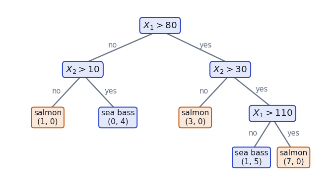
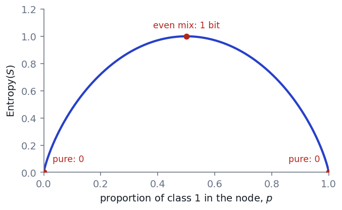
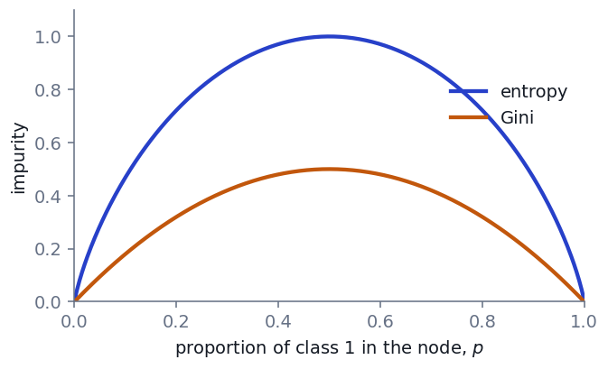
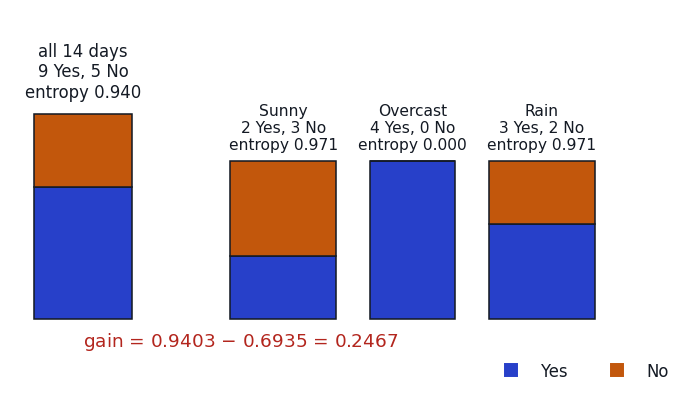
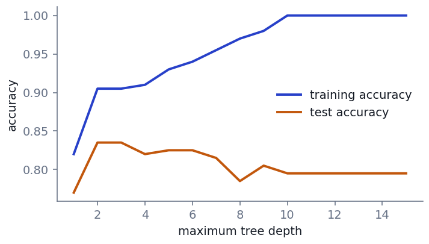
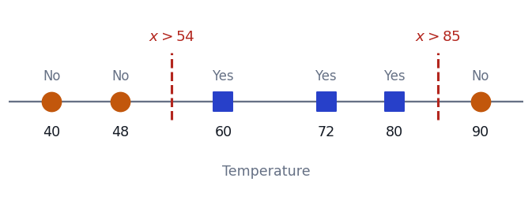
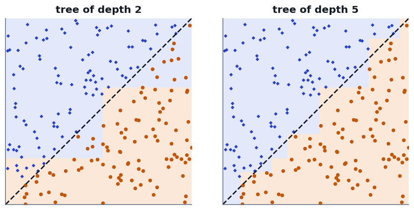
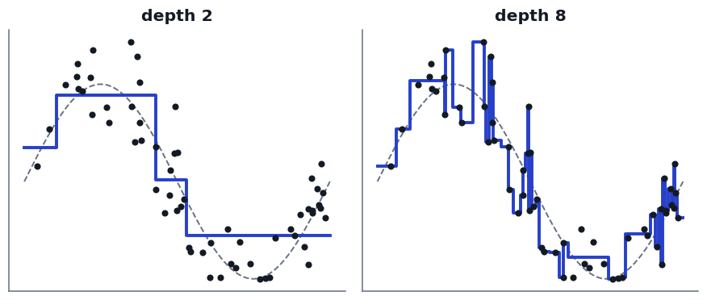

# Week 4: Tree Learning

Sources: W4 deck (94 pages), Tutorial "Nonparametric Modelling" (questions and solutions), Lab 4 Tree Learning (questions and solutions), and the Linear Smoothing section of Lab 2, which Tutorial Q3 relies on.

## The big picture

> **Where this fits:** After the linear scorers, nearest neighbours and probabilistic classifiers of W1 to W3, this unit adds a model that predicts by asking questions. It matters beyond this week because trees are the building block of W7's bagging, random forests and boosting.
>
> - A tree is a series of questions that ends in a leaf, so learning a tree means choosing which question to ask at each point.
> - There are exponentially many possible trees, so we grow one top down and greedily, taking the best question at each node.
> - "Best" needs a number, so entropy (or Gini) measures how mixed the classes are at a node.
> - Information gain then scores a question by how much it reduces that mix.
> - Gain is fooled by attributes with many values, so gain ratio adds a penalty for them.
> - Even with good questions, a tree can keep splitting until it memorises noise, so pruning limits growth or cuts the tree back.
> - With the core in place, the deck handles practical matters: rules, numeric attributes, slanted boundaries, costs and missing values.
> - It then steps back to ask what a greedy search can and cannot find, and weighs up the pros and cons.
> - The same machinery handles numeric targets: a regression tree scores splits by variance and predicts a mean, and a model tree puts a linear model in each leaf.
> - The tutorial ends with linear smoothing, another nonparametric method, which predicts by a weighted average of nearby points instead of splitting the input space.

A decision tree predicts by asking a short series of questions about an example. Each answer sends the example down one branch until it reaches a leaf, and the leaf gives the prediction. Learning a tree means choosing which question to ask at each point.

The learner works top down and greedily. At each node it picks the attribute that best separates the classes, splits the data, and repeats on each part. Entropy measures how mixed a set is, and information gain measures how much a split reduces that mix.

The main risk is overfitting. Trees are so expressive that they can memorise noise, so we limit growth (pre-pruning) or cut back afterwards (post-pruning). The same machinery handles numeric targets: a regression tree scores splits by variance and predicts a mean at each leaf, and a model tree puts a linear model in each leaf.

The tutorial adds linear smoothing, another nonparametric method. It predicts by a weighted average of nearby points rather than by splitting the input space.

## Decision tree representation



> **Where this fits:** Sometimes you want a classifier that handles a mix of numeric and discrete attributes and that a person can read and check, as in medical diagnosis or credit risk. A decision tree is the model for this, so this section belongs to the Choose a model stage: it says what family of functions a tree can represent. Its named drawback, high variance, links back to the bias-variance ideas in R2 and is why W7 combines many trees into ensembles.

A tree has three parts (W4 p.14):

- Each **internal node** tests an attribute.
- Each **branch** corresponds to an attribute value (or an outcome of a test such as $X_1>80$).
- Each **leaf** assigns a classification.

To classify a new example, start at the root, answer each test, and follow the branch to a leaf (W4 p.4).

**Fish example (W4 p.3-4).** Features are $X_1$ (length) and $X_2$ (width). The tree tests $X_1>80$, then $X_2>10$ on the no side, or $X_2>30$ and then $X_1>110$ on the yes side. Leaf counts are (salmon, sea bass). Each test is a horizontal or vertical line in the plane, so the tree cuts the plane into rectangles. $X_1$ appears twice on one path, which is allowed for numeric features.

**Why use trees (W4 p.5).** They are easy to understand, implement and use, and they are computationally cheap. A named drawback is **high variance**. There are decision trees for classification and regression trees for regression.

**PlayTennis (W4 p.6-10).** The dataset has 14 days with 9 Yes and 5 No. Trees work by divide and conquer: split into subsets, stop on pure subsets (only one class), and keep splitting the others (W4 p.7). Splitting on Outlook gives Sunny $[2+,3-]$, Overcast $[4+,0-]$ (pure) and Rain $[3+,2-]$. Sunny then splits on Humidity (High: No, Normal: Yes), and Rain splits on Wind (Strong: No, Weak: Yes). The new example $\langle$Rain, High, Weak$\rangle$ follows Rain then Weak, so the answer is Yes. Humidity is never tested on that path.

**Other example trees.**

- C-section risk (W4 p.11): built from 1000 medical records. Negative examples are C-sections, so $[34+,21-]$ means 21 C-sections out of 55. Some counts are fractional (10.6, 36.4), which fits the fractional treatment of missing values on W4 p.63.
- Credit rating (W4 p.12): a tree that splits on income level. The output shows a chi-square statistic, so that software chose splits by a significance test, not by information gain.
- Fisher's Iris (W4 p.13): a scikit-learn tree showing `gini`, `samples`, `value` and `class` at each node.

**Expressiveness (W4 p.15-16).** Trees can represent Boolean functions.

- $X\land Y$: test $X$; $X=f$ gives false straight away; $X=t$ needs a test of $Y$.
- $X\lor Y$: $X=t$ gives true straight away; $X=f$ needs a test of $Y$.
- $X\oplus Y$: both variables must be tested on every path, so 4 leaves are needed.

In general, a tree is a **disjunction of conjunctions** of constraints on attribute values. Each root-to-leaf path is a conjunction of tests, and the tree is the disjunction of these (Mitchell 1997, W4 p.16). For PlayTennis, Yes is $(\text{Sunny}\land\text{Normal})\lor\text{Overcast}\lor(\text{Rain}\land\text{Weak})$.

> **In plain words:** You can read a tree as a list of if-rules. Follow one path down to a Yes leaf and join its tests with AND: that is one way of earning a Yes. Do this for every Yes leaf and join the results with OR, because an example gets Yes if it satisfies any one of those paths. In the PlayTennis expression, the three parts joined by $\lor$ are the three paths that end in Yes.

Trees can represent any Boolean function, but the tree may be very large. When an expression has several separate parts, the same subtree may have to appear in several places. This is the **replication effect** (Tutorial Q1). Large trees are hard to learn and need a lot of data. Parity is the extreme case: $n$-variable parity needs all $2^n$ leaves, because flipping any input flips the output.

**When to consider trees (W4 p.17).** Instances are a mix of numeric features and discrete attribute-value pairs. The target is discrete (otherwise use regression trees). The data may be noisy. Interpretability matters. Examples: equipment or medical diagnosis, credit risk, modelling scheduling preferences.

## Top-down induction (TDIDT)

> **Where this fits:** Knowing what a tree looks like does not tell you how to build one from data, and there are exponentially many trees to choose from. TDIDT is the fitting method (the Fit the model stage): instead of W1's gradient descent adjusting numbers, it makes one discrete choice per node and never revisits it. Like W1's stepwise regression and W9's $k$-means, it is a greedy search, so it can miss the best answer. The "best" attribute in step 1 needs a score, and the next sections supply one.

The main loop (W4 p.18):

1. $A\leftarrow$ the "best" decision attribute for the next node.
2. Assign $A$ as the decision attribute for the node.
3. For each value of $A$, create a child node.
4. Split the training examples among the children.
5. If the examples are perfectly classified (pure), stop. Otherwise repeat on the child nodes.

TDIDT was found independently by Ross Quinlan (ID3 1986, C4.5 1993) and by Breiman et al. (CaRT 1984, from statistics).

| Algorithm | Attributes | Target |
|---|---|---|
| ID3 | categorical | categorical |
| C4.5 | successor of ID3, without the restriction to categorical attributes | categorical |
| CaRT | categorical and numerical | categorical and numerical |

The deck focuses on ID3 for classification (W4 p.19). The lab calls this recursive partitioning, because each level partitions the previous partition.

## Entropy



> **Where this fits:** To pick the best question, the learner needs a number for how mixed the classes are at a node. Entropy is that number, so it does the job of the Define the loss stage for classification trees, with the difference that it scores one node at a time, not the whole tree. On its own it only describes a set, and information gain, two sections on, turns it into a score for a split. Gini, in the next section, is the alternative measure.

We want splits that leave us more certain of the class. A set with one class is 100% pure. A 50/50 set is completely uncertain (W4 p.22). Entropy puts a number on this. From the statistical view it measures uncertainty, and from the information theory view it is the information needed to specify the state of a system (W4 p.23).

For two classes (W4 p.24):

$$\text{Entropy}(S)=H(S)=-p_\oplus\log_2 p_\oplus-p_\ominus\log_2 p_\ominus$$

- $S$ is a subset of training examples.
- $p_\oplus$ and $p_\ominus$ are the proportions of positive and negative examples in $S$.
- By convention $0\log_2 0=0$.

The curve of entropy against $p_\oplus$ is an upside-down bowl: 0 at $p_\oplus=0$ and $p_\oplus=1$, and a peak of 1 at $p_\oplus=0.5$ (W4 p.25). It is symmetric, and it is steep near the ends, so $[3+,1-]$ already has entropy 0.811.

> **In plain words:** This turns "how mixed is this set?" into a single number. Take the share of positives and the share of negatives. Each share produces a term that is zero when that class is absent or is the whole set, and positive in between, and you add the two terms. So a pure set scores 0, an even split scores the maximum of 1, and everything else falls between. The minus signs are there because the log of a share below 1 is negative, and they make the result positive.

**General case (W4 p.26).** The optimal code length for a symbol of probability $p$ is $-\log_2 p$ bits. If $X$ takes $k$ values with probabilities $p_1,\dots,p_k$, the smallest possible average number of bits per symbol is

$$H(X)=-\sum_{j=1}^k p_j\log_2 p_j$$

With $k$ classes the maximum is $\log_2 k$, so entropy can exceed 1 when $k>2$. Entropy of $S$ is the expected number of bits to encode the class of a random member of $S$ under the optimal code (W4 p.27).

> **In plain words:** This is the same meter for any number of classes, now read as a cost in bits. Under the best code, something with share $p$ costs $-\log_2 p$ bits to write down, so rare things cost many bits and common things few. Multiply each cost by how often it comes up and add, and you get the average bits needed per item. If one class dominates, you nearly always pay the cheap price, so the average is low. If all $k$ classes are equally common there is no cheap option, so the average reaches its peak of $\log_2 k$, which is why entropy can exceed 1 once there are more than two classes.

**Reading the words on W4 p.28.** "High entropy" or "impure" means the class distribution is near uniform ("boring"), such as $[3+,3-]$ with $H=1$. "Low entropy" or "pure" means it is not uniform ("interesting"), such as $[6+,0-]$ with $H=0$.

Example (W4 p.29): $[29+,35-]$ gives $H=0.9936$. This is entropy of one set only. To compare attributes we need the drop in entropy caused by a split.

## Gini impurity



> **Where this fits:** Gini is an alternative to entropy for the same job, scoring how mixed a node is, so it also sits at the Define the loss stage. You will meet it because it is scikit-learn's default `criterion`, and its curve has the same shape as entropy's. The deck gives no rule for choosing between them and shows Gini only on a figure, so the formula here was worked out from that figure's numbers.

The deck never defines Gini. It only appears on the Iris tree on W4 p.13, and a lab comment mentions `criterion = gini`. The formula that reproduces every number in that figure is

$$\text{Gini}(S)=1-\sum_{j=1}^k p_j^2$$

Checks against the figure: $[49,49,49]$ gives $0.6667$, $[0,49,49]$ gives $0.5$, and $[0,48,5]$ gives $0.1709$. Gini is 0 for a pure node and has maximum $1-1/k$. It plays the same role as entropy. It is scikit-learn's default `criterion`. To score a split, take the size-weighted average of the children, just as for entropy.

> **In plain words:** This is a second meter for "how mixed is this node?". Square each class's share, add the squares, and subtract the total from 1. If one class dominates, its share is near 1, so the total is near 1 and Gini is near 0. If the classes are evenly mixed, every share is small, so the squares add up to little and Gini is high, reaching $1-1/k$ with $k$ classes. As with entropy, a lower value means a purer node.

## Information gain



> **Where this fits:** Entropy describes one set, but the learner has to compare questions. Information gain is the score that does this (Define the loss), and it answers step 1 of the TDIDT loop: ask the question with the highest gain. It is the criterion the deck uses for ID3. The same "before minus weighted after" pattern returns below for model trees, and W7 can use a weighted version to pick AdaBoost's stumps.

$\text{Gain}(S,A)$ is the expected reduction in entropy from sorting on $A$ (W4 p.30):

$$\text{Gain}(S,A)=\text{Entropy}(S)-\sum_{\nu\in\text{Values}(A)}\frac{\lvert S_\nu\rvert}{\lvert S\rvert}\,\text{Entropy}(S_\nu)$$

- $\nu$ ranges over the possible values of attribute $A$.
- $S$ is the set of examples being split.
- $S_\nu$ is the subset of examples with $X_A=\nu$.

Choose the attribute that **maximises** the gain. Gain is also called the **mutual information** between $A$ and the class labels of $S$. It lies between 0 and $\text{Entropy}(S)$. An irrelevant attribute has gain 0 (W4 p.69).

> **In plain words:** This measures how much a question helped. Measure the mix at the node before splitting. Split on the attribute, measure the mix in each child, and average those with each child weighted by its share of the examples, since a big messy child matters more than a tiny one. Subtract that average from the starting mix. A result of 0 means the question told you nothing about the class, and the largest possible result, the parent's entropy, means every child came out pure.

To pick the best attribute at a branch (W4 p.33): take each remaining attribute, compute its gain on the examples at this node only, and select the highest.

**Slide example (W4 p.31-33).** $S=[29+,35-]$. $A_1$ gives $[21+,5-]$ and $[8+,30-]$. $A_2$ gives $[18+,33-]$ and $[11+,2-]$.

$$\text{Gain}(S,A_1)=0.9936-(0.2869+0.4408)\approx0.266,\qquad\text{Gain}(S,A_2)=0.9936-(0.7464+0.1258)=0.1214$$

Choose $A_1$. See the worked examples for PlayTennis.

> **In plain words:** Both lines start from the same parent entropy, 0.9936, and subtract what is left after the split. The two numbers in each bracket are the children's entropies, already scaled by each child's share of the examples. $A_1$ leaves less uncertainty behind than $A_2$, so it has the higher gain.

## Gain ratio

> **Where this fits:** Plain gain has a blind spot: an attribute that chops the data into many tiny groups can look excellent even when it is useless, as the Day attribute shows. Gain ratio is an alternative split score (Define the loss) that you would pick over plain gain when attributes differ a lot in how many values they have. It builds directly on information gain and the entropy formula, and the problem it tackles is a small case of the overfitting covered next.

Information gain is biased towards attributes with many values (W4 p.37). Subsets are more likely to be pure when there are many of them, even when the attribute is useless for prediction. An attribute like Day, with a different value for each example, gets the maximum possible gain and has no predictive value. This is a form of overfitting.

The fix penalises splits into many branches (W4 p.38):

$$\text{SplitEntropy}(S,A)=-\sum_{\nu\in\text{Values}(A)}\frac{\lvert S_\nu\rvert}{\lvert S\rvert}\log_2\frac{\lvert S_\nu\rvert}{\lvert S\rvert},\qquad\text{GainRatio}(S,A)=\frac{\text{Gain}(S,A)}{\text{SplitEntropy}(S,A)}$$

Split entropy looks only at branch sizes, not at class labels. It is the entropy of the attribute itself. It takes both the number and the size of branches into account. For $m$ equal branches it is $\log_2 m$.

> **In plain words:** Split entropy measures how finely an attribute chops the data, and it ignores the class labels completely. Take the share of examples going down each branch and put those shares through the entropy meter: many similar-sized branches score high, and few or lopsided branches score low. Dividing gain by this value means an attribute keeps a high score only if its gain is large for how finely it chops. The penalty is heaviest for attributes like Day, but it may not be heavy enough, as the next paragraph shows.

Gain ratio reduces the bias but does not remove it. On PlayTennis, Day has gain ratio $0.9403/\log_2 14=0.247$ while Outlook has $0.2467/1.577=0.156$, so Day still wins.

## Overfitting in decision trees



> **Where this fits:** A tree that keeps growing tends to get better on the training data and, past a point, worse on new data. This section belongs to Understand the limits: it is the same overfitting as W1's too-high polynomial degree, which R2 explains through variance. It sets up pruning in the next section, and W7 attacks the same weakness with ensembles.

A tree can keep splitting until each leaf holds one example. A singleton is pure by definition, but you have no confidence in a decision based on one example (W4 p.39). The plot on W4 p.40 shows accuracy against tree size. Training accuracy keeps rising, to about 0.86 at 90 nodes. Test accuracy peaks near 0.75 at around 10 to 20 nodes, then falls to about 0.68.

## Pruning

> **Where this fits:** We need to keep a tree only as large as the data can support, the job ridge and LASSO do for W1's regression. Pre-pruning acts during Fit the model: it is faster but can stop too soon. Post-pruning acts at Evaluate and select: it grows the full tree, then cuts it back, in this deck's main methods by judging on validation or cross-validation error (W2). W7 takes a different route, since random forests grow trees without pruning and combine them by vote or average.

Pruning is the way to avoid overfitting (W4 p.41).

- **Pre-pruning:** stop growing when a split is not statistically significant.
- **Post-pruning:** grow the full tree, then remove subtrees that overfit, judged on a validation set. This avoids the early stopping problem.

**Pre-pruning options and their scikit-learn names (W4 p.42-43).**

| Rule | Parameter |
|---|---|
| Fewer than some number of examples at a leaf | `min_samples_leaf` |
| Entropy change smaller than a lower bound | `min_impurity_decrease` |
| Maximum number of leaf nodes | `max_leaf_nodes` |
| Minimum number of samples needed to split a node | `min_samples_split` |
| Maximum depth | `max_depth` |

**Early stopping (W4 p.44).** Pre-pruning may stop too soon. The classic example is XOR or parity: no single attribute is associated with the class, so the root split has no gain and pre-pruning will not expand the root. The structure only shows up in the fully expanded tree. However, XOR-type problems are not common in practice, and pre-pruning is faster than post-pruning.

**Post-pruning (W4 p.45).** It builds the full tree first, so attribute interactions are visible. The problem is identifying subtrees that are due to chance. Strategies include error estimation, significance testing and the MDL principle. The deck examines reduced-error pruning, minimum error and smallest tree.

**Reduced-error pruning (W4 p.46).** Split the data into training and validation sets. Until further pruning is harmful: evaluate the effect on the validation set of replacing each bottom-level node with a leaf, then greedily remove the one that most improves validation accuracy.

- Good: simple, and produces the smallest version of the most accurate subtree.
- Not so good: it reduces the effective size of the training set.

W4 p.47 shows the effect: during pruning, test accuracy stays higher as the tree shrinks than it did for the unpruned tree of the same size.

**Subtree replacement (W4 p.48).** This is the pruning operator. It is bottom-up: a tree is considered for replacement once all its subtrees have been considered. A subtree is replaced by a single leaf.

**Minimum error (W4 p.49).** Keep the cross-validation error during growth. Prune back to the point where it is smallest. In the example, the first 36 nodes are kept.

**Smallest tree (W4 p.50).** Prune back to the smallest tree within 1 standard error of the minimum error. In the example, 26 nodes are kept. This is never larger than the minimum error tree.

## Rules from trees

> **Where this fits:** A large tree can be hard to read, and the pruning above replaces whole subtrees at a time. Converting a fitted tree into rules lets you read each path on its own and delete conditions from one rule without touching the others. This is a step after Fit the model, and it rests on the "disjunction of conjunctions" view from the start of this unit.

Each root-to-leaf path gives one rule, for example: if $(\text{Outlook}=\text{Sunny})\land(\text{Humidity}=\text{High})$ then $\text{PlayTennis}=\text{No}$ (W4 p.51). So the number of rules equals the number of leaves. Rules can be simplified **independently** by deleting conditions, so they can be generalised while keeping accuracy. Rules can be simpler than the tree and just as accurate (W4 p.52).

## Continuous attributes



> **Where this fits:** The tests so far assumed a few discrete values, but real attributes are often numbers such as temperature. This section extends Fit the model: turn the number into a yes/no test at a threshold, then use information gain or another measure to choose among the candidate thresholds. This is what takes us beyond ID3, which was limited to categorical attributes. The same threshold search comes back later in this unit for regression trees.

Trees began with discrete attributes. A numeric attribute is handled by creating a test such as $(\text{Temperature}>72.3)\in\{t,f\}$ (W4 p.53). The usual method is a binary split.

- A discrete attribute: one split exhausts all values, so it is not tested again on that path.
- A continuous attribute: it can be split many times in a tree.

**Choosing the threshold (W4 p.54-56).**

- Split points are evaluated across the possible values. With $n$ values there are $n-1$ possible splits.
- Fayyad (1991): sort the examples on the attribute and keep the midway boundaries where the class changes. For Temperature 40, 48, 60, 72, 80, 90 with classes No, No, Yes, Yes, Yes, No, the candidates are $(48+60)/2=54$ and $(80+90)/2=85$.
- Choose the best split point by information gain or another measure.
- C4.5 uses actual data values rather than midpoints. Between 11.8 and 13.0 you can use the midpoint $x>12.4$ or the data value $x>11.8$ (W4 p.56).

In the 9-point example on W4 p.56, 8 possible splits drop to 4 when class labels are used.

## Axis-parallel splits and linear combinations



> **Where this fits:** Because each test looks at one feature, a tree struggles with a slanted class boundary. This is a Choose a model question: a test on a linear combination is the alternative to the standard test, for when the boundary is diagonal. It borrows the weighted sum of features from W1 and W2, and "only axis-aligned splits" reappears as a con below.

Standard tests use one feature, so boundaries are parallel to the axes. A diagonal class boundary then needs a staircase of many splits (W4 p.57). Allowing a test on a linear combination, such as $-1.2x_1+x_2<0.1$, can reduce the tree to one test (W4 p.58).

## Costs

> **Where this fits:** So far every test costs the same and every mistake counts the same, which is often false in practice. This section adjusts Define the loss, and there are two separate problems: the cost of measuring an attribute goes into the split score, and the cost of a wrong prediction goes into post-pruning. The second one reuses the expected loss from W3.

**Attributes with costs (W4 p.59-60).** A blood test might cost money and a robot sensor might cost time. To learn a consistent tree with low expected cost, evaluate gain relative to cost, for example

$$\frac{\text{Gain}^2(S,A)}{\text{Cost}(A)}$$

This gives a preference for trees using lower-cost attributes.

> **In plain words:** This score asks how much you learn for what you pay. Gain on top rewards a useful test, and the attribute's cost underneath marks down an expensive one, such as a blood test. Because the gain is squared, doubling the gain multiplies the score by four, while doubling the cost only halves it. So a more expensive test can still win, but only if it is clearly more informative.

**Misclassification costs (W4 p.61-62).** False positives and false negatives can have different costs. As in Classification 2, define a loss and the expected loss

$$R(\alpha_i\mid x)=\sum_{h\in H}\lambda(\alpha_i\mid\text{predicted class})\,P(\text{predicted class}\mid x)$$

Using this to choose splits does not necessarily lead to the best long-term growth of the tree. Instead, grow the tree with information gain (or another impurity measure) to full depth, then apply cost minimisation when post-pruning, or minimise a cost-complexity measure that also counts tree size.

> **In plain words:** This formula is for when mistakes are not equally bad. Take one possible action. For each class the example might belong to, take the cost of that action if that class is the true one, weight it by how probable that class is given $x$, and add up. The result is the action's expected loss, so a very costly error can make an action look bad even when it is unlikely. Read the sum as running over the classes, as in W3: the slide's wording "predicted class" is loose (see the errors section).

## Missing values and windowing

> **Where this fits:** Two practical problems: real data has gaps, and early training sets did not fit in memory. Missing values belong to Prepare the data, and W2 lists decision trees as one of the few algorithms that support them natively, so here the handling happens as examples are sorted down the tree. Windowing is a Fit the model trick: build a tree from a subset, then grow that subset with misclassified examples. It is related to the ensemble learning of W7.

**Unknown attribute values (W4 p.63).** Use the example anyway and sort it through the tree. Two approaches when node $n$ tests $A$:

1. Assign the most common value of $A$ among the other examples at node $n$.
2. Assign probability $p_i$ to each value $v_i$ of $A$, and send fraction $p_i$ of the example down each branch.

New examples must be classified in the same fashion.

**Windowing (W4 p.64).** Early training sets did not fit in memory. ID3's answer:

1. Select a subset of instances, the window.
2. Build a tree from the window.
3. Classify the training instances not in the window.
4. If all are correct, halt.
5. Otherwise add selected misclassified instances to the window.
6. Go to step 2.

C4.5 kept windowing because it can lead to more accurate trees. It is related to ensemble learning.

## Hypothesis space search and inductive bias

> **Where this fits:** Is the tree ID3 returns the best one, and why should we trust it? This is Understand the limits: it steps back from the algorithm and treats it as a search, asking what it can represent and what it favours. It applies W3's inductive bias to trees, and hypothesis spaces return in W10, which asks whether the space of decision trees is finite. The deck's use of "restriction bias" here is questioned in the errors section.

ID3 searches the space of possible trees, from the empty tree (a single leaf) to more complex ones, by greedy hill-climbing on information gain (W4 p.65-67). W4 p.66 also gives a more general view: greedy or beam search that picks the option with the greatest increase in posterior probability.

- The hypothesis space is **complete**: it contains all finite discrete-valued functions of the attributes.
- It outputs a **single** hypothesis and cannot tell how many other viable ones there are.
- There is **no backtracking**, so it is unlikely to find the best tree and ends in a local optimum.

**Inductive bias (W4 p.68)** is the set of assumptions needed, beyond the training data, to justify a learner's classifications deductively.

- Restriction bias: the set of hypotheses that decision trees can model.
- Preference biases: ID3 prefers trees with good splits near the top (highest gain first), and prefers shorter trees (a natural result of good top splits and of pruning).

## Pros and cons

> **Where this fits:** This table answers "should I use a tree here?", so it sums up the classification half of the unit under Understand the limits. The overfitting con is what pruning tackles here and what W7's ensembles tackle further. The axis-aligned con is the one the linear-combination test tackles.

| Pros (W4 p.69) | Cons (W4 p.69) |
|---|---|
| Interpretability | Only axis-aligned splits |
| Handles irrelevant attributes (Gain = 0) | Tends to overfit |
| Handles categorical and numerical data | Greedy, may not find the best tree (exponentially many trees) |
| Handles missing data | |
| Very compact (nodes much fewer than examples) | |
| Very fast at test time | |

## Regression trees



> **Where this fits:** What if the target is a number and a straight line fits badly? A regression tree is a new choice at Choose a model that reuses the whole growing procedure, swapping entropy for variance as the score (Define the loss) and a class label for a mean at each leaf. It is an alternative to W1's nearest-neighbour and local regression, and it shows its advantage with several variables, especially a mix of categorical and real-valued ones. Regression trees return in W7, where gradient boosting fits small trees to residuals.

When the target is numeric and clearly nonlinear, a straight line fits badly. The dosage example has low effectiveness at low and high doses and high effectiveness in the middle (W4 p.70). A regression tree splits the input range into regions and predicts the average target in each (W4 p.71):

- Dosage $<20$: 10%.
- Otherwise Dosage $\ge45$: 12%.
- Otherwise Dosage $\ge37$: 70%, else 95%.

kNN or local regression could also fit this curve. The advantage of a tree shows with several variables, especially a mix of categorical and real-valued ones (W4 p.72).

**Finding a threshold (W4 p.73-74).** Try each threshold in turn from the first point to the last. For each, predict the mean on each side and compute the error. For a subset $Y_i$ with $m$ examples and mean $\bar y$,

$$\text{MSE}(Y_i)=\frac1m\sum_{j=1}^m(y_j-\bar y)^2$$

This equals the **variance** of the subset, with divisor $m$, not $m-1$. Then compute

$$\text{weighted average variance}=\sum_{i}^{l}\frac{\lvert Y_i\rvert}{\lvert Y\rvert}\,\text{MSE}(Y_i)$$

Choose the threshold that minimises this. Note that we minimise here, while we maximise gain for classification.

> **In plain words:** These two formulas score a candidate split of a numeric target. On each side of the split, find the mean target, see how far each example sits from that mean, square those gaps and average them. That is the side's MSE, and it is small when the values on that side sit close together, so their mean is a good prediction for them. Then combine the sides, weighting each by its share of the examples, as gain weights its children. A score of 0 means every group holds one repeated value, and the best threshold is the one with the lowest score.

**Why the mean.** The derivative of $\sum_j(y_j-c)^2$ is $-2\sum_j(y_j-c)$, which is 0 at $c=\bar y$. So the mean is the best constant under squared error.

> **In plain words:** A leaf has to give one number for every example in it. Imagine sliding that number up and down: the total squared miss falls, reaches a lowest point, then rises again. The lowest point is where the misses above and below cancel out, and that happens at the mean. So the mean is the best a single number can do under squared error, the same loss as W1.

**Why variance reduction is never negative.** $\text{MSE}(Y)=\sum_i w_i\text{MSE}(Y_i)+\sum_i w_i(\bar y_i-\bar y)^2$ with $w_i=\lvert Y_i\rvert/\lvert Y\rvert$. The reduction from a split is the second term.

> **In plain words:** The spread of the parent always breaks into two parts: the spread inside the groups, and the spread of the group means around the overall mean. After a split, the first part is the error that remains, and the second part is what the split removed. That second part is a weighted sum of squares, so it cannot go below zero. At worst all the groups have the same mean and the split achieves nothing, but it can never make the score worse.

**Several attributes (W4 p.75).** For each attribute find its best split by minimum weighted average variance. Then pick the attribute with the lowest value.

**Overfitting (W4 p.76).** If we split every node with MSE above zero, the tree fits the training data perfectly and generalises badly. Remedies: require a minimum number of examples to split (the slide says a usual default is 20), a maximum depth, or a maximum number of leaves. W4 p.78 shows this on noisy sine data: `max_depth=2` gives a few broad steps, and `max_depth=5` gives many steps with narrow spikes that chase outliers.

**Prediction surface (W4 p.77).** With two features the regions are rectangles $R_1,\dots,R_5$, and the prediction is a flat level on each one.

**Hammond organ example (W4 p.79-83).** See the worked examples.

**Differences from classification trees (W4 p.84).**

- Splitting criterion: minimise intra-subset variance.
- Pruning criterion: a numeric error measure.
- A leaf predicts the average target value of the training instances reaching it.

Regression trees approximate piecewise constant functions and are easy to interpret. The more sophisticated version is the model tree.

## Model trees

> **Where this fits:** A regression tree predicts a flat level in each region, which can be a crude fit. A model tree is the alternative at Choose a model: it keeps the tree's splitting but puts a model such as W1's linear regression in each leaf. You would pick it when a straight-line trend within each region describes the data better than a constant, as in the cosine example. Its splits use standard deviation reduction, and it tends to overfit too, so it also gets pruned.

Model trees are like regression trees, but with linear regression functions, or any model of your choice, at the nodes (W4 p.85).

- Linear regression is applied to the instances reaching a node after the full tree has been built.
- Only a subset of attributes is used: those in the subtree, and maybe those on the path to the root.
- This is fast, as the overhead is small when few attributes are used.

**Example (W4 p.87-88).** Approximate $y=\cos\pi x$ on $[-1,1]$. The best single line is $y=0$, which is useless. Splitting at $x=0$ gives $\hat y=2x+1$ for $x<0$ and $\hat y=-2x+1$ for $x\ge0$. Here $x$ is both the splitting feature and the regression variable.

**Building the tree (W4 p.89).** The splitting criterion is **standard deviation reduction**:

$$\text{SDR}=\text{sd}(T)-\sum_i\frac{\lvert T_i\rvert}{\lvert T\rvert}\times\text{sd}(T_i)$$

where $T_1,T_2,\dots$ are the sets from splitting the data at the node. Maximise it. Termination criteria:

- The standard deviation becomes smaller than a certain fraction of the sd of the full training set (e.g. 5%).
- Too few instances remain (e.g. fewer than four).

> **In plain words:** This is the "before minus weighted after" idea of information gain, with standard deviation as the measure of spread. Find the standard deviation of the target at the node, find it again in each subset after the split, and average those with each subset weighted by its share of the examples. Subtract that average from the starting value. A large result means the subsets are much tighter than the parent, so you choose the split that maximises it. Because it uses standard deviations, its value differs from variance reduction.

**Pruning (W4 p.90).** Model trees also tend to overfit.

- Pruning is based on the estimated absolute error of the linear regression models.
- Linear models are pruned by greedily removing terms to minimise estimated error.
- Heavy pruning is possible: often a single linear model can replace a whole subtree.
- Pruning goes bottom up: the error of the linear model at an internal node is compared with the error of the subtree.

## Nominal attributes

> **Where this fits:** Some attributes, such as colours, are categories with no numbers attached. Trees can split on them directly, as ID3 and the Hammond organ example do, but anything that treats attributes as numeric, such as the linear models in a model tree, needs them converted first. This is a Prepare the data step, and it builds on W2's data types and W1's indicator variables. Which encoding you pick depends on the attribute: ordinal encoding works well if the categories have an inherent order.

Nominal attributes are converted to binary attributes and treated as numeric (W4 p.91):

- One-hot encoding (dummy variables).
- Ordinal (integer) encoding: assigns integers, works well if the categories have an inherent order.
- Binary encoding: a hybrid of the two that stores binary representations of categories across several columns.

**Deck summary (W4 p.92-93).** Tree learning is a practical "top 10" method. ID3 searches a complete hypothesis space. Overfitting is inevitable with an expressive space and noisy data, so pruning is important. Trees are often the "try-first" method, and ensembles can improve them. See `sklearn.tree.DecisionTreeRegressor` for a basic version of CaRT regression trees.

## Linear smoothing

> **Where this fits:** kNN regression gives its neighbours equal weight and everyone else none, and that hard cut-off makes a jagged fit. A linear smoother is a Choose a model alternative that sets the weights with a kernel, and it is also an alternative to a regression tree, since it averages nearby points instead of splitting the input space. You have met it in R2 and W2: its bandwidth plays a role similar to $k$, and it shares kNN's curse of dimensionality. The word kernel returns in W5, where a kernel is a similarity function.

This appears in Tutorial Q3 and Lab 2, not in the W4 deck. kNN regression is a weighted average $\hat y(x)=\sum_i w_i(x)Y_i$ with weight $1/k$ on the $k$ nearest points and 0 elsewhere. That cut-off is crude and gives a jagged fit. A linear smoother, also called kernel smoothing, uses a kernel function to set the weights:

$$\hat f(x_0)=\sum_{i=1}^n\frac{K\left(\dfrac{\Vert X_i-x_0\Vert_2}{h}\right)}{\sum_{j=1}^nK\left(\dfrac{\Vert X_j-x_0\Vert_2}{h}\right)}\,Y_i$$

The weights add to 1 because of the denominator. $h>0$ is the **bandwidth**. It plays a role similar to $k$ in kNN: larger $h$ brings in points further away.

> **In plain words:** To predict at a query point $x_0$, you let the training points vote on the answer, and each point's say depends on how close it is. Measure each point's distance from the query, divide by the bandwidth $h$, and let the kernel $K$ turn that into a raw weight. Divide each raw weight by the total of all the raw weights, so the weights add to 1. The prediction is then the weighted average of the training $Y$ values.

| Kernel | $K(u)$ | Points used |
|---|---|---|
| Box-car | $\mathbf 1\{\lvert u\rvert\le 1/2\}$ | distance at most $h/2$, all equal weight |
| Epanechnikov | $\frac34(1-u^2)\,\mathbf 1\{\lvert u\rvert\le1\}$ | distance at most $h$, weight falls with distance |
| Gaussian (Lab 2) | $\frac{1}{\sqrt{2\pi}}e^{-u^2/2}$ | all points, weight falls with distance |

Small $h$ gives a jagged fit (low bias, high variance). Large $h$ gives a smooth fit (higher bias, lower variance). As $h\to\infty$ the fit tends to the overall mean of $Y$. Linear smoothers share kNN's weakness in high dimensions, the curse of dimensionality, because they rely on distances.

> **In plain words:** Each kernel is a different rule for turning distance into weight. Box-car gives equal weight inside a window and none outside, Epanechnikov gives more weight nearer the query and none past the window, and the Gaussian lets weight fade with distance without ever cutting a point off. The bandwidth $h$ sets the reach: with a tiny $h$ only a few points count, so the fit follows the noise, and with a huge $h$ the weights even out, so the prediction tends to the overall mean of $Y$. A box-car window has a fixed width, while a kNN window holds a fixed number of points, so the two are similar but not the same.

## Errors and disagreements in the course material

- **W4 p.39 against Tutorial Q2(a).** The slide says trees "can always classify training examples perfectly". That fails when two examples have identical attributes and different labels, which is exactly the tutorial's point (answer 2 of 12). The slide's claim needs "if no such conflicts exist".
- **Gini.** It is not defined in the deck. The formula above is confirmed only by matching the numbers on W4 p.13.
- **W4 p.67.** "We will end in a local minima" is loose: the search climbs on gain, so it stops at a local optimum.
- **W4 p.66 and p.67.** The greedy choice is described by "greatest increase in posterior probability" and also by information gain. For ID3 use information gain.
- **W4 p.67 and p.68.** The space is called complete, and a restriction bias is also listed. Mitchell's book, the source of these slides, says ID3 has a preference bias and an unrestricted space for discrete attributes. No question in the bank depends on this.
- **W4 p.76.** A "default" of 20 for the minimum number of examples to split is not scikit-learn's default, which is `min_samples_split=2` (checked by running it).
- **W4 p.82.** The slide says to give an empty child the parent's variance. Under the weighted formula on W4 p.74 an empty child has weight 0, so that value has no effect. No question depends on this.
- **W4 p.73 and p.54.** Regression thresholds are set "to the value of" each point, while classification uses midpoints. Questions state which convention to use.
- **Rounding.** W4 p.32 gives 0.2658 (exact 0.2659). W4 p.35 gives 0.151 for Humidity (exact 0.1518). W4 p.36 gives 0.570 and 0.019 (exact 0.571 and 0.020). These come from rounding early. The bank uses exact values.
- **Typos.** W4 p.83 has E122 for model E112. W4 p.84 says "average class values" for a numeric target. W4 p.30 says "attribution" for attribute. W4 p.91 equates binary encoding with hashing encoding, and these are usually different things.
- **W4 p.61.** The sum is written over $h\in H$ but the summand says "predicted class". It means a sum over the classes.
- **Table of Contents document.** It lists the gain of $A_2$ as 0.164. The slide and the exact value are 0.1214.
- **Tutorial Q3.** It says linear smoothing was in "the lab this week", but the Lab 4 notebook has no such section. It is at the end of Lab 2 as advanced material. The tutorial also treats the "Nearest-Neighbor" panel as the box-car kernel. They look alike, but a kNN window holds a fixed number of points, while a box-car window has a fixed width.
- **Tutorial Q2(b) solution.** "$\frac1k$ examples of each class" means a fraction $1/k$. The worst case also needs attributes that cannot separate the classes, such as all examples having identical attributes.
- **Lab comments.** "When we increase the depth by 2" means to depth 2. "If root node, return the predicted value" means leaf node. `np.bincount` needs non-negative integers, not strictly positive ones.

## Worked examples

**Tutorial Q1: trees for Boolean functions (official solution).**

(a) $A\land\neg B$:

```
A = t:
|   B = f: True
|   B = t: False
A = f: False
```

(b) $A\lor[B\land C]$:

```
A = t: True
A = f:
|   B = f: False
|   B = t:
|   |   C = t: True
|   |   C = f: False
```

(c) $A$ XOR $B$:

```
A = t:
|   B = t: False
|   B = f: True
A = f:
|   B = t: True
|   B = f: False
```

(d) $[A\land B]\lor[C\land D]$:

```
A = t:
|   B = t: True
|   B = f:
|   |   C = t:
|   |   |   D = t: True
|   |   |   D = f: False
|   |   C = f: False
A = f:
|   C = t:
|   |   D = t: True
|   |   D = f: False
|   C = f: False
```

The $C\land D$ subtree appears twice. This is the replication effect. Trees can fit any Boolean function, but the tree may need to be very complex, which makes it hard to learn and needs a lot of data.

**Tutorial Q2(a): training error (official solution).** The rows $A,B,C=0,1,1$ have labels 0 and 1. The rows $1,1,1$ have labels 0 and 1. Identical attributes reach the same leaf, so one example from each pair must be wrong. The rows 001 and 110 repeat but agree on the label, so they cause no error. The training error is **2 of 12**.

**Tutorial Q2(b): maximum training error (official solution).** Suppose all $k$ classes are equally common and the tree predicts a single class. It gets $1/k$ right and makes a fraction $1-\frac1k=\frac{k-1}{k}$ of mistakes. If any class has more than $1/k$ of the data, predicting it reduces the error. So the maximum is $\frac{k-1}{k}$.

**Tutorial Q3: reading the linear smoother figure (official solution).** Data: $y=\sin(4x)+\epsilon$, $\epsilon\sim N(0,1/3)$.

| Item | Meaning |
|---|---|
| Blue curve | True function $f(x)=\sin(4x)$ |
| Black scatter | Sampled noisy points; those outside the kernel's window have no effect on $\hat f(x_0)$ |
| Red scatter | Points that meet the kernel's condition, so they are used for $\hat f(x_0)$ |
| Yellow region | Weights on the red points: flat for box-car, higher near $x_0$ for Epanechnikov |
| Horizontal red line | Side length of the largest rectangle containing the neighbourhood of $x_0$ |
| Red point on that line | The prediction $\hat f(x_0)$ |
| Green curve | The smoother run over all points in the domain |

**PlayTennis root (W4 p.35).** $\text{Entropy}(S)=H(9/14)=0.940$ (0.9403 to four places). The gains below are exact values. Using the rounded entropies shown can change the third decimal.

- Humidity: High $[3+,4-]$ has $E=0.985$, Normal $[6+,1-]$ has $E=0.592$. Gain $=0.940-\frac{7}{14}(0.985)-\frac{7}{14}(0.592)$, which is 0.152 exactly (the slide's rounded figures give 0.151).
- Wind: Weak $[6+,2-]$ has $E=0.811$, Strong $[3+,3-]$ has $E=1$. Gain $=0.940-\frac{8}{14}(0.811)-\frac{6}{14}(1)=0.048$.
- Outlook: Sunny and Rain have $E=0.971$, Overcast has $E=0$. Gain $=0.9403-\frac{10}{14}(0.9710)=0.2467$, so 0.247 (the rounded 0.940 and 0.971 would give 0.246).
- Temperature: gain 0.029.

Outlook is the root.

**Sunny branch (W4 p.36).** $S_\text{sunny}=[2+,3-]$ has entropy 0.971. Humidity gives pure children, gain 0.971. Temperature: gain $0.971-\frac25(0)-\frac25(1)-\frac15(0)=0.571$. Wind: gain $0.971-\frac25(1)-\frac35(0.918)=0.020$. Choose Humidity.

**Best threshold on Temperature.** Using the data above, $\text{Entropy}(S)=1$. For 54: $[0Y,2N]$ and $[3Y,1N]$, gain $=1-\frac46(0.811)=0.459$. For 85: $[3Y,2N]$ and $[0Y,1N]$, gain $=1-\frac56(0.971)=0.191$. Choose 54.

**Hammond organ regression tree (W4 p.79-83).** Nine auction sales, with price as the target.

| # | Model | Condition | Leslie | Price |
|---|---|---|---|---|
| 1 | B3 | excellent | no | 4513 |
| 2 | T202 | fair | yes | 625 |
| 3 | A100 | good | no | 1051 |
| 4 | T202 | good | no | 270 |
| 5 | M102 | good | yes | 870 |
| 6 | A100 | excellent | no | 1770 |
| 7 | T202 | fair | no | 99 |
| 8 | A100 | good | yes | 1900 |
| 9 | E112 | fair | no | 77 |

Root:

| Split | Groups | Means | Weighted MSE |
|---|---|---|---|
| Model | [1051, 1770, 1900] [4513] [77] [870] [99, 270, 625] | 1574, 4513, 77, 870, 331 | $6.25\times10^4$ |
| Condition | [1770, 4513] [270, 870, 1051, 1900] [77, 99, 625] | 3142, 1023, 267 | $5.9\times10^5$ |
| Leslie | [625, 870, 1900] [77, 99, 270, 1051, 1770, 4513] | 1132, 1297 | $1.72\times10^6$ |

Branch on Model. This gives three single-example leaves, plus three A100s and three T202s.

- A100s: Condition gives [1770] [1051, 1900] [ ], weighted variance 120134. Leslie gives [1900] [1051, 1770], weighted variance 86160. Choose Leslie.
- T202s: Condition gives [ ] [270] [99, 625], weighted variance 46113. Leslie gives [625] [99, 270], weighted variance 4874. Choose Leslie.

Final leaves: A100 with Leslie yes 1900, no 1410.5 (slide 1411). B3 4513. E112 77. M102 870. T202 with Leslie yes 625, no 184.5 (slide 185).

## Code you should recognise

**Fitting and comparing classifiers (Lab 4).**

```python
from sklearn.tree import DecisionTreeClassifier, DecisionTreeRegressor
from sklearn.neighbors import KNeighborsClassifier

model0 = KNeighborsClassifier(n_neighbors=5, p=2)
model1 = DecisionTreeClassifier(max_depth=3, criterion='entropy', random_state=3)
```

`criterion='entropy'` gives information gain. The default is `'gini'`. kNN regions are jagged, and tree regions are built from straight axis-parallel lines. `tree.plot_tree(model, feature_names=..., class_names=..., filled=True)` draws the tree. Each node shows the split, `entropy`, `samples` and `value` (the class counts). The colour shows the majority class and darker means purer.

**Regression tree (Lab 4).**

```python
X = fsamples[:, 0].reshape(-1, 1)   # sklearn needs a 2-D X
dt = DecisionTreeRegressor(max_depth=3).fit(X, y)
```

A 1-D `X` raises `ValueError`. The default criterion is `'squared_error'`. The prediction is a step function, and it stays flat outside the training range.

**Recursive partitioning (Lab 4).** Depth 1 is a decision stump, one if/else, giving two rectangles. A depth $d$ tree has at most $2^d$ leaves. Each level partitions the previous partition.

**Titanic pipeline (Lab 4).**

```python
df = (df.drop(columns=['PassengerId','Name','Ticket','Cabin','Embarked'])
        .dropna()
        .assign(Sex=lambda x: (x['Sex'] != 'male').astype(int)))
X = df.iloc[:, 1:].to_numpy()   # first column is Survived
y = df.iloc[:, 0].to_numpy()
X_train, X_test, y_train, y_test = train_test_split(X, y, test_size=0.3, shuffle=True)
```

The raw file has 891 rows and 12 columns, with missing Age 177, Cabin 687, Embarked 2. Dropping columns first keeps 714 rows. Calling `dropna()` first would keep only 183 rows, because it would count missing Cabin values. The result is `X` of shape `(714, 6)`, a train set of 499 and a test set of 215.

Train and test error against depth (Lab Q7): training error keeps falling toward 0, while test error stops improving at a shallow depth and then rises. In one run the best test error was at depth 3.

Depth-3 tree on all the data (Lab Q8): the root is Sex. Men in classes 2 and 3 older than 9.5 are the large group that mostly died $[286,36]$. Women in classes 1 and 2 mostly survived. Women in class 3 depend on Fare. Your exact tree can differ a little with library version.

**Helpers from the lab's tree from scratch.**

```python
def divide_data(X, y, col_idx, cutoff):
    filter_right = X[:, col_idx] > cutoff     # strict: equal values go left
    filter_left = ~filter_right
    return X[filter_left], X[filter_right], y[filter_left], y[filter_right]

def entropy(y):
    if len(np.unique(y)) == 1:
        return 0.
    p = np.bincount(y) / len(y)    # needs non-negative integer labels
    p = p[p != 0.0]                # without this, 0 * log2(0) gives nan
    return -1. * np.sum(p * np.log2(p))
```

`information_gain` returns `cur_ent - (left_n/total_n)*left_ent - (right_n/total_n)*right_ent`. The class version stores `self.left` and `self.right` as further `DecisionTree` objects. `train` returns early if the node is pure or `cur_depth >= max_depth`, and sets `self.target = np.bincount(y).argmax()`, which breaks ties toward the smaller label. To keep things simple, the lab always splits at the **mean** of a feature, even a categorical one. An outlier can therefore move the cutoff well away from the class boundary. With the mean cutoff on Titanic, Sex has the highest gain, 0.216, and Age has almost none, $2.7\times10^{-8}$. That does not mean Age is useless, only that its mean is a poor cutoff.

**Linear smoother (Lab 2).**

```python
def LS_(x0, X, y, kernel, h):
    K = kernel(np.sqrt((X - x0)**2) / h)
    Ksum = K.sum()
    weights = K / Ksum if Ksum > 0 else np.zeros_like(y)
    return weights @ y
```

If no point falls in the window, the function returns 0.

**Variance gotcha.** `np.var(y)` divides by $m$, which matches the MSE. `pd.Series(y).var()` divides by $m-1$.

## Formula sheet

| Name | Formula | Note | In words |
|---|---|---|---|
| Entropy, two classes | $-p_\oplus\log_2p_\oplus-p_\ominus\log_2p_\ominus$ | In bits; $0\log_20=0$; maximum 1 | How mixed a two-class set is: 0 pure, 1 even split |
| Entropy, $k$ classes | $-\sum_{j=1}^kp_j\log_2p_j$ | Maximum $\log_2k$ | Average bits to name a member's class; highest when classes are equally common |
| Gini | $1-\sum_jp_j^2$ | Not defined in deck; maximum $1-1/k$ | One minus the squared class shares added up; 0 means pure |
| Information gain | $\text{Entropy}(S)-\sum_\nu\frac{\lvert S_\nu\rvert}{\lvert S\rvert}\text{Entropy}(S_\nu)$ | Maximise; equals mutual information | Mix before the split minus size-weighted mix after it |
| Split entropy | $-\sum_\nu\frac{\lvert S_\nu\rvert}{\lvert S\rvert}\log_2\frac{\lvert S_\nu\rvert}{\lvert S\rvert}$ | Branch sizes only | How finely the attribute chops the data, ignoring labels |
| Gain ratio | $\text{Gain}(S,A)/\text{SplitEntropy}(S,A)$ | Reduces bias to many-valued attributes | Gain divided by how finely the attribute chops the data |
| Cost-aware gain | $\text{Gain}^2(S,A)/\text{Cost}(A)$ | Attribute measurement cost | Usefulness of a test, marked down by what it costs to measure |
| Expected loss | $R(\alpha_i\mid x)=\sum\lambda(\alpha_i\mid\text{class})P(\text{class}\mid x)$ | Used in post-pruning, not for splitting | Action's cost under each class, weighted by that class's probability |
| Candidate thresholds | $n-1$ for $n$ values | Keep class-change midpoints | One test between each neighbouring pair; only class changes matter |
| Subset MSE | $\frac1m\sum_{j=1}^m(y_j-\bar y)^2$ | Equals variance with divisor $m$ | Average squared gap between each target and the group mean |
| Weighted variance | $\sum_i\frac{\lvert Y_i\rvert}{\lvert Y\rvert}\text{MSE}(Y_i)$ | Minimise | Spread left after a split, with bigger groups counting more |
| Regression leaf | $\bar y$ of examples in the leaf | Minimises squared error | A leaf predicts the mean of the examples reaching it |
| SDR | $\text{sd}(T)-\sum_i\frac{\lvert T_i\rvert}{\lvert T\rvert}\text{sd}(T_i)$ | Model trees; maximise | Standard deviation before minus size-weighted standard deviation after |
| Worst training error, $k$ classes | $\frac{k-1}{k}$ | Tutorial Q2(b) | Equally common classes, one class predicted, so only $1/k$ right |
| Maximum leaves at depth $d$ | $2^d$ | Binary splits | Each level can at most double the leaves |
| Linear smoother | $\sum_i\frac{K(\Vert X_i-x_0\Vert_2/h)}{\sum_jK(\Vert X_j-x_0\Vert_2/h)}Y_i$ | Weights sum to 1 | Weighted average of targets, weights set by distance from the query |
| Box-car | $\mathbf 1\{\lvert u\rvert\le1/2\}$ | Window half-width $h/2$ | Equal weight inside the window, none outside |
| Epanechnikov | $\frac34(1-u^2)\mathbf 1\{\lvert u\rvert\le1\}$ | Window half-width $h$ | Weight falls with distance, reaching zero at the window's edge |

## Exam traps

- Use $\log_2$, not natural log. A value that looks too small may be in nats.
- Entropy can exceed 1 with more than two classes.
- High entropy means impure and uniform, not "informative". We want low entropy after a split.
- Gain uses the size-weighted average of the children. Equal weights or a plain sum are the common slips.
- Compute gain at a node on the examples at that node only, not on the whole dataset.
- Do not report the weighted child entropy as the gain.
- Gain cannot be negative, even if one child is less pure than the parent.
- A child with entropy 0 does not mean gain 0. Pure children mean high gain.
- Gain ratio divides by split entropy, and split entropy ignores the labels.
- Gain ratio reduces the many-values bias, but an ID attribute can still win.
- Classification trees maximise gain. Regression trees minimise weighted variance. Model trees maximise SDR.
- MSE at a node divides by $m$. Using $m-1$ gives a different number.
- SDR uses standard deviations. Variance reduction is a different quantity.
- Training error is not always 0, since identical attributes with different labels cannot be separated.
- The maximum training error is $(k-1)/k$, not 1.
- A complete hypothesis space does not mean ID3 finds the best tree. The search is greedy with no backtracking.
- Restriction bias is what can be represented. Preference bias is what the search favours.
- Pre-pruning fails on XOR, since the root has zero gain, so it never splits.
- `min_samples_split` limits which nodes can split. `min_samples_leaf` limits the size of children.
- `min_samples_split` defaults to 2 in scikit-learn, not 20.
- Reduced-error pruning uses validation accuracy. Pruning can never raise training accuracy.
- The smallest tree rule picks the smallest tree within 1 standard error of the minimum, not the next size up.
- Gain$^2$/Cost is for attribute costs. Misclassification costs go in post-pruning.
- A discrete attribute is used at most once on a path. A numeric attribute can be reused.
- $n$ values give $n-1$ splits. Class-change boundaries are far fewer.
- Trees cannot extrapolate. Outside the training range they give the value of an end leaf.
- A regression tree leaf is a constant. A model tree leaf is a linear model.
- The box-car window is $\lvert X_i-x_0\rvert\le h/2$, because of the $1/2$ in the kernel. Epanechnikov uses $\lvert X_i-x_0\rvert\le h$.
- In the smoother figure, blue is the truth and green is the fit.
- Picking `max_depth` on the test set and then quoting that test error is optimistic.
- `dropna()` before dropping unused columns throws away rows needlessly.

## Self-check

1. Draw trees for $A\land\neg B$, $A\lor[B\land C]$, $A$ XOR $B$ and $[A\land B]\lor[C\land D]$, and read off the rules.
2. Compute entropy for $[9+,5-]$ and for a three-class node, and compute Gini for the same nodes.
3. Compute the gain of each attribute at the PlayTennis root and on the Sunny and Rain branches.
4. Compute gain ratio for Outlook and for Day, and explain the result.
5. Find candidate thresholds for a numeric attribute and choose the best by gain.
6. Explain why pre-pruning fails on XOR, and run one step of reduced-error pruning on given validation counts.
7. Apply the minimum error and smallest tree rules to a table of cross-validation errors.
8. Choose a regression split by weighted variance, state the leaf predictions, and rebuild the Hammond tree.
9. Compute SDR, and state how a model tree differs from a regression tree.
10. Compute a box-car and an Epanechnikov prediction by hand, and describe the effect of bandwidth.
11. Trace `entropy`, `information_gain` and the lab's `DecisionTree` on a small array, and say what each scikit-learn pre-pruning parameter does.
