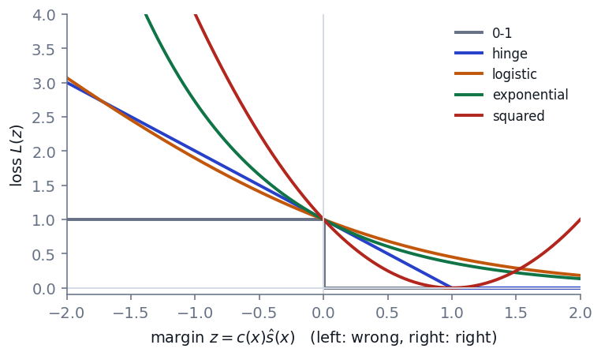
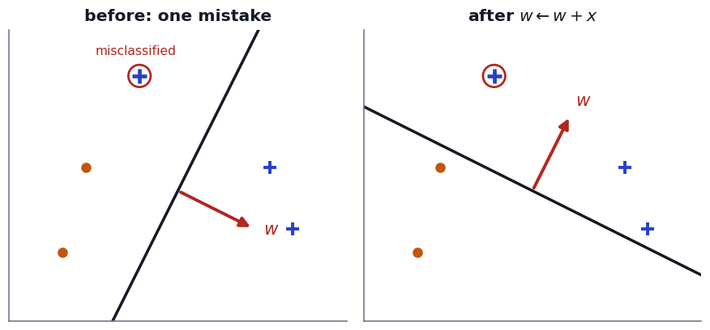
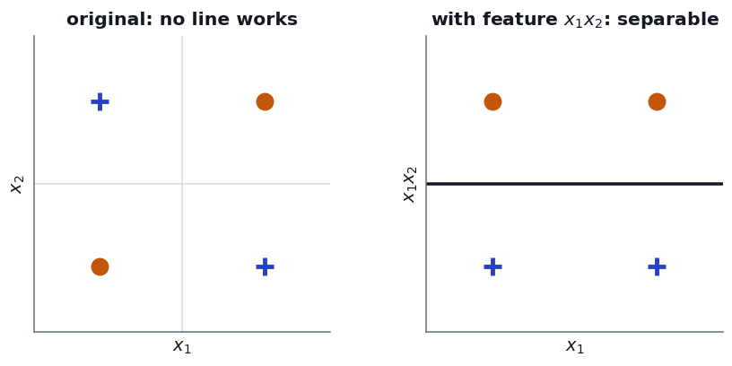
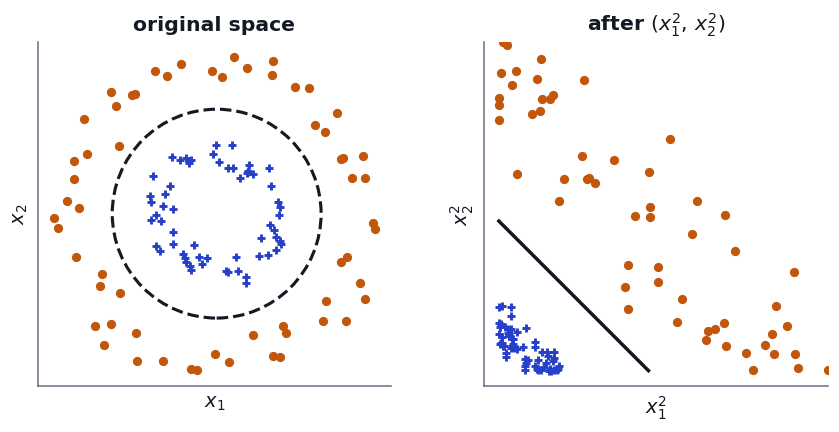
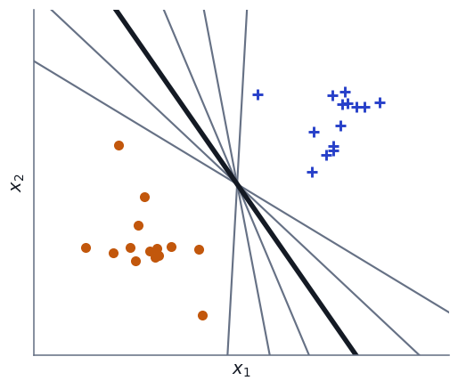
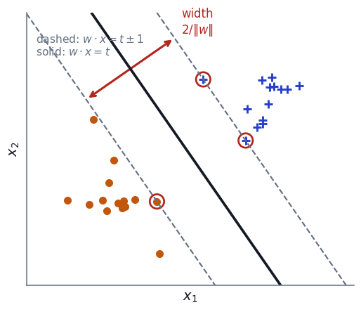
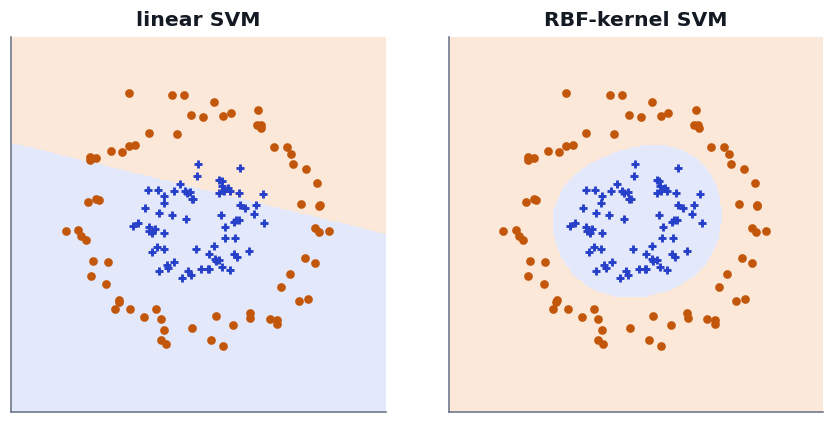
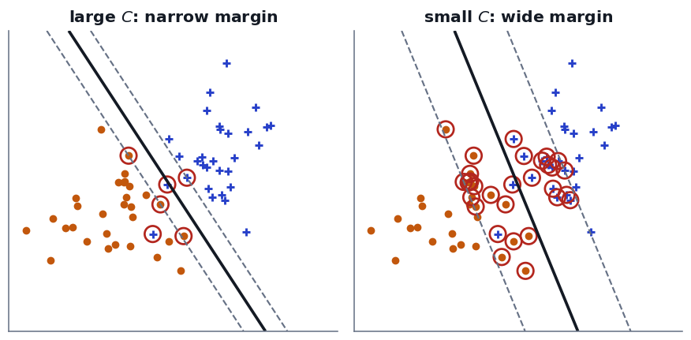

# Kernel Methods

Sources: W5 slide deck "Kernel Methods" (88 pages, all viewed), Tutorial "Kernel Methods" questions and official answers (Q1 to Q7). There is no lab for this topic.

## The big picture

> **Where this fits:** This unit sits mid-course and spends most of its time in Choose a model and Fit the model. It takes the linear scoring from W1 and W2 and asks how to get curved boundaries, how to pick the best line, and how to cope with noise. The story runs like this.
>
> - We need a way to score a classifier, so each example first gets a margin (right or wrong, and by how much) and a loss. One of these, hinge loss, charges for being right by too little.
> - With that language we meet the simplest learner of a straight boundary, the perceptron, which nudges its weights after each mistake.
> - A straight line cannot solve XOR, so we add new features until one can, but the number of features explodes.
> - To dodge that explosion we look for another way to state the problem, which is the idea of duality.
> - Applied to the perceptron, duality swaps one weight per feature for one weight per example, and the data now appear only as dot products between examples.
> - Since only dot products are needed, a kernel can supply them directly, so we get the big feature space without ever building it.
> - A separate question follows: many lines can separate the data, so which is best? The one with the widest margin, which leads to the support vector machine.
> - Turning "widest margin" into maths gives the SVM's primal problem: keep $w$ short while every example clears its margin.
> - Lagrange multipliers turn that into a dual, repeating the perceptron's move: one number per example, and only dot products.
> - Solving it shows that most multipliers are zero, so a few support vectors fix the boundary.
> - Because that dual uses only dot products, kernels drop straight in, which gives nonlinear SVMs.
> - Noise can leave the hard-margin problem with no solution, so the soft margin lets points break the margin at a price $C$, and that charge turns out to be the hinge loss from the start.
> - Last, the pros and cons say when an SVM is the right tool.

A linear classifier is simple and fast, but it can only draw a straight boundary. This topic answers three questions about it.

1. **What if the data are not linearly separable?** Map the data into a new feature space where they are. The cost is that the new space can be huge. The fix is the **kernel trick**. Some algorithms only ever use dot products between examples, so if a function $K(\mathbf{x},\mathbf{x}')$ gives the dot product in the new space directly, we never build the new features. To expose those dot products we rewrite the algorithm in its **dual form**, which learns one weight $\alpha_i$ per training example instead of one weight per feature.
2. **Of all the separating lines, which is best?** The one with the largest **margin**. That is the **support vector machine (SVM)**. Its dual form uses only dot products, so it can be kernelised too.
3. **What if the data are noisy?** Allow some points to break the margin at a price. That is the **soft margin SVM**, with parameter $C$ setting the price.

The route through the deck is: margins and losses, then the perceptron, then its dual, then feature maps and kernels, then the hard-margin SVM and its dual, then nonlinear SVMs, then the soft margin.

**Notation warning.** The slides and the tutorial use different letters.

| Thing | Slides | Tutorial answers |
|---|---|---|
| Number of training examples | $m$ | $n$ |
| Number of features | $n$ (also $d$ on p.35) | $p$ |
| Dot product | $\mathbf{x}\cdot\mathbf{x}'$ | $\langle\mathbf{x},\mathbf{x}'\rangle$ |
| Kernel | $K$ | $k$ |
| Second data point | $\mathbf{x}'$ | $\mathbf{y}$ in Q4 and Q5, where it is not a label |
| Polynomial kernel | $(\mathbf{x}\cdot\mathbf{x}'+c)^q$ on p.34, $(\mathbf{x}\cdot\mathbf{x}'+1)^p$ on p.35 | $(m+\langle\mathbf{x}_1,\mathbf{x}_2\rangle)^d$ |
| RBF kernel | "RBF kernel" | "Gaussian kernel" |

Other clashes inside the deck:

- $m$ is the number of examples, but on p.44 it is also the scaled margin in $w\cdot\mathbf{x}=t\pm m$.
- $z$ is the margin of an example on p.8, but a mapped point in feature space $\mathcal{Z}$ from p.29.
- The bias is $b$ on p.11 ($w^Tx+b$), $w_0$ on p.14, and $-t$ from p.46 on ($w\cdot\mathbf{x}-t$). So $b=w_0=-t$.
- $x_i$ means feature $i$ on p.15 but bold $\mathbf{x}_i$ means example $i$ from p.16 on. On p.30 the kernel is written $K(\mathbf{x}_1,\mathbf{x}_2)$ with $\mathbf{x}_1,\mathbf{x}_2$ meaning two data points.

## Scoring classifiers, margins and loss functions

> **Where this fits:** To train or compare classifiers we need a number saying how good each prediction was, and that number should notice how right or wrong it was, not only which side it fell on. This is the Define the loss stage, the classification counterpart of W1's squared error. The margin $z$ puts every example on one scale, and each loss is a different way of charging for it: the logistic loss links to W2, the exponential loss returns in W7 for AdaBoost, and the hinge loss is what the SVM uses later in this unit.

**Prediction tasks (p.3).** The deck lists four tasks.

| Task | Output space | Model output |
|---|---|---|
| Classification | $\mathcal{Y}=\mathcal{C}$ | a class label |
| Scoring and ranking | $\mathcal{Y}=\mathbb{R}^{\lvert\mathcal{C}\rvert}$ | a score vector over classes |
| Probability estimation | $\mathcal{Y}=[0,1]^{\lvert\mathcal{C}\rvert}$ | a probability vector over classes |
| Regression | $\mathcal{Y}=\mathbb{R}$ | a real number |

**Classifier (p.4).** A classifier is a mapping $\hat{c}:\mathcal{X}\to C$, where $C=\{C_1,\dots,C_k\}$ is a finite, usually small, set of labels. The hat means it estimates the true unknown function $c(x)$. We want it to match $c$ on the whole instance space, not only on the training set.

**Scoring classifier (p.6).** A mapping $\hat{S}:\mathcal{X}\to\mathbb{R}^k$. It outputs a vector $(\hat{s}_1(x),\dots,\hat{s}_k(x))$, where $\hat{s}_i(x)$ says how likely class $C_i$ is. With two classes we usually keep one number, $\hat{s}(x)$, the score of the positive class.

**Example (p.7).** A tree leaf with 20 spam and 5 ham gets the score $\log_2(20/5)=+2$, with spam positive. Leaves with 10 spam and 5 ham, and 20 spam and 40 ham, get $+1$ and $-1$.

**Margin of an example (p.8).** Code the true class $c(x)$ as $+1$ or $-1$. Then
$$z(x)=c(x)\times\hat{s}(x).$$
$z(x)$ is positive for a correct prediction and negative for an incorrect one. In a linear classifier the score can be the signed distance from the line.

> **In plain words:** This turns "was the prediction right?" into one signed number. Take the classifier's score and multiply it by the true label, coded as $+1$ or $-1$. If the score's sign agrees with the label the product is positive, and if they disagree it is negative, whichever class the example belongs to. The size says how strongly the classifier committed: a large positive $z$ is confidently right, a large negative $z$ is confidently wrong, and zero sits on the boundary.

**Loss function (p.9).** A loss $L:\mathbb{R}\to[0,\infty)$ maps a margin to a penalty. The conventions are $L(0)=1$ for an example on the boundary, $L(z)\ge1$ for $z<0$, and usually $0\le L(z)<1$ for $z>0$. The average loss over a test set is $\frac{1}{\lvert Test\rvert}\sum_{x\in Test}L(z(x))$.

**The five losses (p.10).**

| Loss | Formula | Note |
|---|---|---|
| 0-1 | $L_{01}(z)=1$ if $z\le0$, else 0 | counts errors; flat, so no gradient to follow |
| Hinge | $L_h(z)=1-z$ if $z\le1$, else 0 | used by SVMs; note the kink is at $z=1$, not 0 |
| Logistic | $L_{log}(z)=\log_2(1+\exp(-z))$ | base 2 is what makes $L_{log}(0)=1$ |
| Exponential | $L_{exp}(z)=\exp(-z)$ | grows fast for negative $z$ |
| Squared | $L_{sq}(z)=(1-z)^2$ | rises again for $z>1$ unless truncated to 0 there, as hinge is |

Hinge loss penalises correct examples with $0<z<1$: being right is not enough, you must be right by a margin. That idea becomes the SVM.

> **In plain words:** Every loss answers one question: given an example's margin, how much should it cost? The 0-1 loss charges 1 for any mistake and nothing otherwise, which is an honest count of errors but, being flat, gives no hint which way to improve. The logistic, exponential and squared losses all charge more the further wrong an example is, each with a different curve, and squared also rises again past $z=1$ unless cut off. Hinge is the SVM's choice: it charges in a straight line until the margin reaches 1, then stops. So a confidently right example is free, a barely right example still pays a little, and a wrong example pays more the further wrong it is.

## Linear classification and the perceptron

> **Where this fits:** We want the simplest possible learner for a straight boundary: a scoring rule, plus a recipe for fixing it when it is wrong. The perceptron is a Choose a model decision (a linear scorer, as in W1 and W2) with its own Fit the model recipe, which nudges the weights after each mistake. Almost everything later in this unit builds on it: the dual form, the kernel perceptron, and the contrast with the SVM. It comes back in W8 as the single neuron.

**Linear classifier (p.11 to p.13).** $f(x)=\text{sign}(w^Tx+b)$. The decision boundary is the hyperplane $w^Tx+b=0$. If the data are separable there are many possible boundaries, which raises the question of which one to pick.

**Perceptron (p.14 to p.16).** An algorithm for binary classification with a linear prediction function. For $n$ attributes,
$$f(\mathbf{x})=\begin{cases}+1 & \text{if } w_0+w_1x_1+\dots+w_nx_n>0\\-1 & \text{otherwise.}\end{cases}$$
Adding a constant feature $x_0=1$ (**homogeneous coordinates**) folds the bias in, so the test is just $w\cdot\mathbf{x}>0$ and $\hat{y}=\text{sgn}(w\cdot\mathbf{x})$. The training set is $\mathbf{x}_1,\dots,\mathbf{x}_m$ with labels $y_1,\dots,y_m\in\{+1,-1\}$.

> **In plain words:** This is a yes-or-no decision made by a weighted sum. Multiply each feature by its weight, add them up with the bias $w_0$, and answer $+1$ if the total is above zero and $-1$ otherwise. A large positive weight means that feature pushes towards the positive class, and a negative weight pushes the other way. The constant feature $x_0=1$ is a bookkeeping trick: the bias becomes one more weight, so the whole rule shrinks to one dot product compared with zero.

**Update rule (p.17, p.18).** Start from $w=0$. For example $j$,
$$w:=w+\tfrac12\left(y_j-f(\mathbf{x}_j)\right)\mathbf{x}_j.$$
The bracket is 0 when the prediction is right, $+2$ when $y=+1,f=-1$, and $-2$ when $y=-1,f=+1$. So a correct example changes nothing, and for a misclassified example the rule simplifies to
$$w:=w+y_j\mathbf{x}_j.$$

> **In plain words:** This is how the perceptron learns from a mistake. If the prediction was right, leave the weights alone. If it was wrong, add the example to the weight vector when it is truly positive and subtract it when it is truly negative, which is what multiplying by the label $y_j$ does. That turns the boundary towards classifying that example correctly, as in the figure above. The half in the first form is there because the bracket is $\pm2$ on a mistake, so each step comes out as exactly one copy of the example.

**Algorithm (p.19).**

1. Set $w\leftarrow0$ and $converged\leftarrow false$.
2. While not converged: set $converged\leftarrow true$. For each $i=1,\dots,\lvert D\rvert$: if $y_i\,w\cdot\mathbf{x}_i\le0$, set $w\leftarrow w+y_i\mathbf{x}_i$ and $converged\leftarrow false$.

The test $y_iw\cdot\mathbf{x}_i\le0$ says "wrong side, or exactly on the boundary". With $w=0$ the value is 0, so the first example always triggers an update.

> **In plain words:** The test $y_i\,w\cdot\mathbf{x}_i\le0$ is the margin from the previous section, with $w\cdot\mathbf{x}_i$ as the score. Multiply the score by the true label. A positive result means the example is on the correct side, so nothing happens. Zero or negative means "wrong, or undecided", so the weights get updated. This test and the update rule above differ only on the exact tie at zero, as flagged in the list of where the course material disagrees.

The loop only stops after a whole pass with no updates, which means zero training errors. So on data that are not linearly separable it never stops. On separable data it does stop, but where it stops depends on the order of the examples and the starting point (p.37).

## When a linear classifier is not enough

> **Where this fits:** Some problems have no straight line that separates them, XOR being the smallest example, so a perceptron or any other linear scorer fails however long it trains. The fix is a Prepare the data step: build new features so that a straight line in the new space is a curve in the old one, the same move as W1's polynomial features. The catch is that the number of features explodes, and the next few sections are about keeping the benefit without paying that cost. W8 reaches nonlinear boundaries a different way, with hidden layers.

**XOR (p.20).** AND is linearly separable and XOR is not. Linear classifiers cannot model nonlinear boundaries.

**Feature construction, or basis expansion (p.21).** Map the attributes into a new space built from combinations of attribute values, for example all products of $n$ factors. For two attributes and $n=3$ the model is $y=w_1x_1^3+w_2x_1^2x_2+w_3x_1x_2^2+w_4x_2^3$. The model is linear in the new features but nonlinear in the original ones.

> **In plain words:** Instead of changing the learner, change what you feed it. Compute new columns such as $x_1^3$ and $x_1^2x_2$, then fit an ordinary weighted sum of those columns. The weights still combine the columns in a straight-line way, so the learning method needs no change. But each new column is a curved function of the original attributes, so the result looks curved when drawn in the original space.

**Two problems (p.22).**

- **Efficiency.** With 10 attributes and order 5, more than 2000 coefficients must be learned. Linear regression's run time is cubic in the number of attributes.
- **Overfitting.** The model becomes "too nonlinear": the number of coefficients is large relative to the number of training instances, and the curse of dimensionality applies.

**Counting features** (not on the slides, but it explains the 2000). The number of products of exactly $p$ factors from $d$ attributes, with repeats allowed and order ignored, is $\binom{d+p-1}{p}$. For $d=10$, $p=5$ this is $\binom{14}{5}=2002$. For $d=2$, $p=3$ it is 4, matching the four terms above. Including all lower orders and a constant gives $\binom{d+p}{p}$.

> **In plain words:** This counts how many new columns the feature map creates. Building one product means picking $p$ factors from $d$ attributes, with repeats allowed, and the number of ways to do that climbs very quickly as either number rises. That is why a modest 10 attributes at order 5 already needs about 2000 columns. This growth is the problem the kernel trick will solve.

## Duality

> **Where this fits:** Feature maps make the weight vector huge, because the original form of a method keeps one weight per feature. Duality is the way out: a Fit the model idea that restates an optimisation problem so that you solve for different unknowns. This unit uses it twice, first on the perceptron in the next section and then on the SVM in the Lagrange section. Both times the payoff is that the data show up only through dot products, which is what makes kernels possible.

An optimisation problem (the **primal**) can be paired with a second one (the **dual**) that is useful for solving it (p.24). Sometimes the dual is much easier to solve (p.23). For convex problems the optimal values of the primal and dual are equal under a constraint qualification condition (p.24). Duality is what exposes the dot products that the kernel trick needs.

> **In plain words:** The primal is the problem as you first wrote it, and the dual is a partner problem built from it, with different unknowns. You would take that extra step for one reason: the partner can be easier to solve, or can show structure that the original hides. For convex problems, under the condition above, both have the same best value, so moving to the dual loses nothing. In this unit the hidden structure is that only dot products between examples matter.

## The perceptron in dual form

> **Where this fits:** The perceptron as first written keeps one weight per feature, which is hopeless if a feature map makes the features huge. Because every update adds a copy of an example, we can keep a count per example instead and get the same classifier. This changes Fit the model, not the model: same algorithm, same mistakes, different bookkeeping. It sets up the kernel trick in the next section, and the same formula for $w$ reappears in the SVM.

Each mistake on $\mathbf{x}_i$ adds $y_i\mathbf{x}_i$ to $w$. So after training, with $\alpha_i$ the number of mistakes on example $i$ (p.25):
$$w=\sum_{i=1}^m\alpha_iy_i\mathbf{x}_i.$$
We now learn **instance weights** $\alpha_i$ rather than **feature weights** $w_j$. Substituting into the prediction:
$$\hat{y}=\text{sgn}(w\cdot\mathbf{x})=\text{sgn}\left(\sum_{i=1}^m\alpha_iy_i(\mathbf{x}_i\cdot\mathbf{x})\right).$$

> **In plain words:** The first formula says the finished weight vector is a record of training: it started at zero and each mistake added one signed copy of an example, so $w$ is the signed examples, each counted $\alpha_i$ times. The second formula uses this to predict without ever forming $w$. Take the new point, compare it with each training example using a dot product, let each example vote for its own label with strength $\alpha_i$, and take the sign of the total. An example the perceptron never got wrong has $\alpha_i=0$ and gets no vote.

**Algorithm (p.26).** Same as the primal, with two changes. Start with $\alpha_i\leftarrow0$. The test is $y_i\sum_{j=1}^{\lvert D\rvert}\alpha_jy_j\mathbf{x}_j\cdot\mathbf{x}_i\le0$, and the update is $\alpha_i\leftarrow\alpha_i+1$.

> **In plain words:** This is the same mistake test as the primal's, with $w$ written out as its sum over examples. To check example $i$, add up the votes of all the examples, multiply by its label, and see whether the result is positive. On a mistake there is no weight vector to change, so you add one to that example's count.

**How they relate (Tutorial Q1).** They are the same algorithm in different coordinates. With the same start and order they make the same mistakes, and $w=\sum_i\alpha_iy_i\mathbf{x}_i$ holds at each step. The $\alpha_i$ are non-negative integers.

**Gram matrix (p.27).** During training the only thing needed from the data is all pairwise dot products. These form the $m\times m$ **Gram matrix** $G=XX^T$ with $G_{ij}=\mathbf{x}_i\cdot\mathbf{x}_j$, where $X$ has one row per example. Its size depends on the number of examples, not the number of features.

> **In plain words:** Look at what dual training actually touches: to score an example it needs that example's dot product with the training examples, and nothing else about the data. So work out every pair once and keep the results in a table with one row and one column per example. Adding more features does not make this table any bigger. This is the key step: if we can fill the table some other way, the algorithm never has to see the features at all.

## The kernel trick

> **Where this fits:** We want a linear learner in a huge feature space, without ever building that space. The dual form needs only dot products, so a function that delivers those dot products directly is all we need. Picking a kernel is a Choose a model decision, because it picks the feature space and so the shapes of boundary available, while the fitting algorithm stays as it was. This comes back in Nonlinear SVMs later in this unit and links to the similarity idea behind W2's kNN, but note that the smoothing kernels in R2 and W4 are a different use of the word: there a kernel weights nearby points for an average, and here it stands in for a dot product.

**The key observation (p.28).** A dual perceptron on mapped data $\mathbf{x}\to\varphi(\mathbf{x})$ predicts
$$\hat{y}=\text{sign}\left(\sum_{i=1}^m\alpha_iy_i\,\varphi(\mathbf{x}_i)\cdot\varphi(\mathbf{x})\right).$$
The only thing we need is the dot product in the new space.

> **In plain words:** This is the dual perceptron's prediction, run on mapped data. Look at how the mapped points appear: always in pairs, joined by a dot product, and never on their own. So we do not need the map itself, only a way to get one number for each pair of points. That is the opening the kernel trick uses.

**Example (p.29, Tutorial Q5).** Take $\varphi(x_1,x_2)=(x_1^2,x_2^2,\sqrt2x_1x_2)$, mapping $\mathcal{X}$ to a 3-dimensional $\mathcal{Z}$. Then
$$\mathbf{z}\cdot\mathbf{z}'=x_1^2x_1'^2+x_2^2x_2'^2+2x_1x_1'x_2x_2'=(x_1x_1'+x_2x_2')^2=(\mathbf{x}\cdot\mathbf{x}')^2.$$
Squaring the original dot product gives the new-space dot product, without building the feature vectors.

> **In plain words:** This is the whole trick in miniature. The long route builds the three new coordinates for both points, then multiplies them pairwise and adds. The short route takes the ordinary dot product of the two original points and squares the answer. Both give the same number, because squaring a sum creates exactly the products that the new features would have produced. The $\sqrt2$ is in the map so that the cross term comes out with the 2 it needs.

**Definition (p.30, p.31, p.33, p.34).** A **kernel** is a function that calculates the dot product in the new feature space directly from the vectors in the original space:
$$K(\mathbf{x},\mathbf{x}')=\varphi(\mathbf{x})\cdot\varphi(\mathbf{x}').$$
A **valid kernel** is equivalent to a dot product in some space. A kernel is also a **similarity function**. The kernel trick lets us work in a high-dimensional space without paying the price, because we never map the features explicitly. At order 2 the saving is small. At order 20 it is large.

> **In plain words:** A kernel is a shortcut. You hand it two points in their original form and it returns what their dot product would be after mapping, so the mapped points never need to exist. Here is where the saving comes from: the long route has to build and multiply every new feature, and that count explodes with the order, while a polynomial kernel costs one dot product in the original attributes and one power. Because the dot product measures how much two vectors agree, you can also read the kernel as a similarity score for two points. "Valid" means a feature map behind it really exists, even if you never write it down.

**Showing that a function is a valid kernel (p.32).** The course's method is to expand it and read off a $\varphi$. For $K(\mathbf{x},\mathbf{x}')=(1+\mathbf{x}\cdot\mathbf{x}')^2$ in two dimensions:
$$(1+\mathbf{x}\cdot\mathbf{x}')^2=1+x_1^2x_1'^2+x_2^2x_2'^2+2x_1x_1'+2x_2x_2'+2x_1x_1'x_2x_2'.$$
This is the dot product of $(1,x_1^2,x_2^2,\sqrt2x_1,\sqrt2x_2,\sqrt2x_1x_2)$ with the same vector in the primed variables. A term with coefficient $c$ comes from coordinates $\sqrt{c}\,(\cdot)$ on each side. The order of the coordinates does not matter: p.35 lists the same six in a different order.

> **In plain words:** To prove a function is a kernel, show that it is a dot product in disguise. Multiply it out, then read each term as one piece that depends only on $\mathbf{x}$ times the matching piece that depends only on $\mathbf{x}'$. Collect those pieces into a list, and that list is the feature map. A term with coefficient 2 has to be shared equally between the two sides, so each side carries $\sqrt2$, and the two multiply back to 2.

**Quick tests for an invalid kernel** (these follow from the definition; the slides do not state them). If $K$ is a dot product then:

- $K(\mathbf{x},\mathbf{x}')=K(\mathbf{x}',\mathbf{x})$.
- $K(\mathbf{x},\mathbf{x})=\Vert\varphi(\mathbf{x})\Vert^2\ge0$. So $-\mathbf{x}\cdot\mathbf{x}'$ is not valid.
- $K(\mathbf{x},\mathbf{x}')^2\le K(\mathbf{x},\mathbf{x})K(\mathbf{x}',\mathbf{x}')$ (Cauchy-Schwarz). So no valid kernel can give the matrix with 1 on the diagonal and 2 off it.

A valid kernel can be negative for two different points. The linear kernel and $(\mathbf{x}\cdot\mathbf{x}')^3$ both are.

> **In plain words:** These tests rule a function out by checking things every dot product must obey. A dot product ignores order, so swapping the two points cannot change the value. A point dotted with itself is a squared length, so it cannot be negative. The third rule caps the value for a pair: its size is limited by what the two points score against themselves. These tests can only reject, so a function that passes still needs a feature map before you can call it valid.

**Common kernels (p.34, p.35, Tutorial Q3).**

- **Polynomial:** $K(\mathbf{x},\mathbf{x}')=(\mathbf{x}\cdot\mathbf{x}'+c)^q$. Without the constant, each new feature is a product of exactly $q$ terms, possibly repeated. With a constant you also get all lower-order terms.
- **RBF (Gaussian):** $K(\mathbf{x},\mathbf{x}')=\exp\left(-\frac{\Vert\mathbf{x}-\mathbf{x}'\Vert^2}{2\sigma^2}\right)$. A Taylor expansion shows this corresponds to an infinite-dimensional feature map. Its value is 1 when $\mathbf{x}=\mathbf{x}'$ and falls towards 0 as the points move apart. A larger $\sigma$ makes $K$ closer to 1 for a given pair (follows from the formula).
- **Laplace (tutorial only):** $K(\mathbf{x},\mathbf{x}')=\exp\left(-\frac1b\Vert\mathbf{x}-\mathbf{x}'\Vert_1\right)$ with $b>0$.

> **In plain words:** The polynomial kernel builds products of features: the power $q$ sets how many factors each product has, and the constant $c$ lets the shorter products in as well. The RBF kernel is a closeness score instead. Measure how far apart the two points are, then turn that distance into a number that is 1 when they coincide and fades towards 0 as they separate. The $\sigma$ sets what counts as far: the bigger it is, the more distant a pair can be and still score near 1. The Laplace kernel has the same shape of idea, but it measures distance by adding up the absolute differences (Manhattan distance, from W2), with $b$ setting the scale.

**Kernel perceptron (p.36, Tutorial Q3).** Take the dual perceptron and replace every $\mathbf{x}_j\cdot\mathbf{x}_i$ with $K(\mathbf{x}_j,\mathbf{x}_i)$. The prediction is
$$\hat{y}=\text{sign}\left(\sum_{i=1}^m\alpha_iy_iK(\mathbf{x}_i,\mathbf{x})\right).$$
The Gram matrix becomes the kernel matrix $K_{ij}=K(\mathbf{x}_i,\mathbf{x}_j)$. It contains the same numbers as the Gram matrix of the mapped data but is cheaper to compute. To predict you must keep the training points with $\alpha_i>0$, since there is no finite $w$ to store for the RBF kernel. In practice you choose a kernel and do not think about $\varphi$: if you want polynomial features up to degree 8, use a polynomial kernel with $d=8$ (Tutorial Q3).

> **In plain words:** This is the dual perceptron's prediction with the dot product swapped for the kernel. Each stored training point votes for its own label, and its vote is scaled by its count $\alpha_i$ and by its kernel value with the new point. With the RBF kernel, that means points close to the new one have the most say, which has the flavour of W2's distance-weighted kNN. As with kNN, you have to keep those training points to make a prediction. Changing the kernel changes the shapes of boundary you can get, while the algorithm stays the same.

## Which line is best? The margin idea

> **Where this fits:** When the data can be separated, many lines do it perfectly on the training set, and the perceptron stops at the first one it finds. We need a rule for choosing among them that favours doing well on new data, which makes this part of Define the loss and of the course-long fight against overfitting. The answer here is the largest margin. The alternatives are other criteria for placing a line, such as W2's basic linear classifier and logistic regression, and W10 takes up why any of this generalises.

**Different algorithms use different criteria (p.37).**

- The **basic linear classifier** finds the class means, joins them with a line, and uses the perpendicular bisector as the separating hyperplane.
- **Logistic regression** models the probability of class membership with the sigmoid.
- **Perceptron** training uses iterative reweighting, and may find different models depending on starting conditions.

Among separating lines, the course prefers the one with the bigger margin (p.38, p.39): the more separated the classes, the better the generalisation (p.59).

**SVM in Vapnik's framework (p.40).** An SVM defines the empirical risk, finds the maximum margin separating hyperplane, minimises empirical risk, allows a trade-off between model complexity and error, has a **unique solution**, and follows structural risk minimisation.

## The support vector machine: geometry and primal problem

> **Where this fits:** "Widest margin" is a picture, and to compute it we need a precise optimisation problem. This section builds one: it is the SVM's Define the loss stage, turning the margin into a quantity that depends only on $w$ and ending at the primal problem. It is the alternative to the perceptron when the data are separable and you want one best line rather than any line. The next section solves this problem, and the soft margin later relaxes it.

SVMs learn linear classifiers (p.43). They can avoid overfitting by learning the **maximum margin hyperplane**, and they are fast for mappings to nonlinear spaces because the kernel creates that space implicitly. For a linearly separable two-class data set, the maximum margin hyperplane correctly classifies all examples and has the greatest separation between classes (p.45). The **support vectors** are the training examples nearest the decision boundary (p.44).

**Geometry (p.44).** The boundary is $w\cdot\mathbf{x}=t$ and the two margin lines are $w\cdot\mathbf{x}=t\pm m$. The margin is $m/\Vert w\Vert$ and the distance between the two margin lines is $2m/\Vert w\Vert$.

**Setting up (p.46 to p.48).**

1. Pull the bias out of $w$: $w=[w_1,\dots,w_n]$ and $w_0=-t$, so the hyperplane is $w\cdot\mathbf{x}-t=0$. From now on $w$ does not contain the bias, so $\Vert w\Vert$ does not include $t$.
2. Normalise. Scaling $w$ and $t$ together does not move the hyperplane, so choose the scale with $\lvert w\cdot\mathbf{x}_s-t\rvert=1$ for the closest point $\mathbf{x}_s$. This means $m=1$.
3. $w$ is perpendicular to the hyperplane. For two points on it, $w\cdot\mathbf{x}'-t=0$ and $w\cdot\mathbf{x}''-t=0$, so $w\cdot(\mathbf{x}'-\mathbf{x}'')=0$.
4. The distance from $\mathbf{x}_s$ to the hyperplane is $\lvert w\cdot\mathbf{x}_s-t\rvert/\Vert w\Vert=1/\Vert w\Vert$. This is the **margin**.

So we want $\max\frac1{\Vert w\Vert}$ subject to $\min_i\lvert w\cdot\mathbf{x}_i-t\rvert=1$, which is awkward because of the min in the constraint.

> **In plain words:** This list turns "the widest street between the classes" into a formula. The score $w\cdot\mathbf{x}-t$ is not itself a distance, because doubling $w$ and $t$ doubles every score without moving the line, and dividing by $\Vert w\Vert$ is what turns a score into a true distance. We use that freedom to pick the scale where the closest point's score has size exactly 1. That point's distance to the line is then $1/\Vert w\Vert$, so a shorter $w$ means a wider margin, which is why the rest of the derivation is about making $w$ small.

**Primal problem (p.49).** For correctly classified points, $\lvert w\cdot\mathbf{x}_i-t\rvert=y_i(w\cdot\mathbf{x}_i-t)$. Replace the constraint by inequalities and turn the max into a min:
$$\min_{w,t}\ \frac12\Vert w\Vert^2\quad\text{subject to}\quad y_i(w\cdot\mathbf{x}_i-t)\ge1,\quad i=1,\dots,m.$$
Maximising $1/\Vert w\Vert$ and minimising $\frac12\Vert w\Vert^2$ have the same solution, because both favour the smallest $\Vert w\Vert$.

Compare with the perceptron, which only needs each point on the correct side (Tutorial Q7). The constraint $\ge1$ alone does not pick the widest line: any strictly separating hyperplane can be rescaled to meet it. Minimising $\Vert w\Vert$ is what does the choosing.

> **In plain words:** This is the whole hard-margin SVM in one line. The constraints are the rule: every example must land on its correct side with a score of at least 1, and multiplying by the label lets one inequality cover both classes. The objective is the aim: among all the lines obeying the rule, take the one with the shortest $w$, because that has the widest margin. The square and the half do not change the winner, and they make the calculus cleaner later. Picture widening a street between two groups of houses until it touches the nearest ones.

## Lagrange multipliers and the dual problem

> **Where this fits:** The primal is a minimisation with one constraint per example, and its unknown $w$ lives in feature space, so nothing in it lets a kernel in. This is the Fit the model stage: Lagrange multipliers fold the constraints into one function, and eliminating $w$ and $t$ leaves a dual in the multipliers alone. It repeats the perceptron's move formally, with the same payoff: only dot products remain, so kernels can be used. The soft margin later in this unit extends this derivation, and W9 uses a Lagrangian too, in the maths behind PCA.

**General method (p.50, p.51).** To minimise $f(x_1,\dots,x_n)$ subject to $g_j(x_1,\dots,x_n)\le0$, add the constraints to the objective with multipliers $\alpha_j\ge0$:
$$\mathcal{L}=f+\sum_j\alpha_jg_j.$$
Then solve $\max_\alpha\min_x\mathcal{L}$ with $\alpha_j\ge0$: first minimise over the $x$ variables, then maximise over the $\alpha$.

> **In plain words:** A constraint is awkward because the search has to stay inside a fence. This formula swaps the fence for a fine: each constraint gets a non-negative rate $\alpha_j$, and the term $\alpha_jg_j$ adds cost when the constraint is broken ($g_j>0$) and takes cost away when it is kept with room to spare ($g_j<0$). With the rates fixed, minimising over $x$ is an ordinary problem with no fence, and because points that obey the constraints can only get cheaper, its answer can never be above the true constrained minimum. So every choice of rates gives an underestimate of the true answer, and the outer max hunts for the rates that make that underestimate as high as possible. For convex problems, under the condition in the Duality section, the best underestimate equals the true answer, which is why we may solve the problem this way round.

**For the SVM (p.52).** The constraint is $g_i=1-y_i(w\cdot\mathbf{x}_i-t)\le0$, so
$$\mathcal{L}(w,t,\alpha)=\frac12\Vert w\Vert^2-\sum_{i=1}^m\alpha_i\left(y_i(w\cdot\mathbf{x}_i-t)-1\right)=\frac12w\cdot w-w\cdot\left(\sum_i\alpha_iy_i\mathbf{x}_i\right)+t\left(\sum_i\alpha_iy_i\right)+\sum_i\alpha_i.$$

> **In plain words:** This is the fine system applied to the SVM, with one multiplier per training example. The bracket $y_i(w\cdot\mathbf{x}_i-t)-1$ is how far example $i$ clears its required score of 1: positive if it has room to spare, zero if it sits on its margin line, negative if it breaks the rule. The minus sign in front makes a breach add to the total, as a fine should. The second expression is the same thing multiplied out and regrouped, so that $w$ and $t$ each stand apart, ready for the next step.

**Minimise over $w$ and $t$ (p.53).**
$$\frac{\partial\mathcal{L}}{\partial t}=0\Rightarrow\sum_{i=1}^m\alpha_iy_i=0,\qquad\nabla_w\mathcal{L}=0\Rightarrow w=\sum_{i=1}^m\alpha_iy_i\mathbf{x}_i.$$
The second is the same expression as for the perceptron.

> **In plain words:** With the rates fixed, this step finds the lowest point over $w$ and $t$ the usual way, by setting the slopes to zero. The $t$ condition is a balance rule: the multipliers on positive examples must add up to the same total as those on negative examples, otherwise pushing $t$ far enough would drive the Lagrangian down without limit. The $w$ condition is the big result: the best $w$ is a signed, weighted sum of training examples, the same shape the perceptron gave us. So we no longer have to search for $w$ at all: once we know the $\alpha_i$, we know $w$.

**Substitute back (p.54).** The second term becomes $-w\cdot w$ and the $t$ term vanishes, so
$$\mathcal{L}(\alpha)=-\frac12\sum_{i=1}^m\sum_{j=1}^m\alpha_i\alpha_jy_iy_j\,\mathbf{x}_i\cdot\mathbf{x}_j+\sum_{i=1}^m\alpha_i.$$

> **In plain words:** Now put those two results back in, so that $w$ and $t$ disappear and the multipliers are the only unknowns left. The double sum is $w\cdot w$ with $w$ written out as its sum over examples, so this formula reads as "the total of the multipliers, minus half the squared length of the $w$ they build". Notice how the data now appear: only as a dot product between a pair of examples, with the labels as signs. That is the same position the perceptron's dual reached.

**The dual problem (p.56, p.57).**
$$\alpha^*=\arg\max_\alpha\ -\frac12\sum_i\sum_j\alpha_i\alpha_jy_iy_j\,\mathbf{x}_i\cdot\mathbf{x}_j+\sum_i\alpha_i\quad\text{subject to}\quad\alpha_i\ge0,\quad\sum_i\alpha_iy_i=0.$$
This has positivity constraints and one equality constraint. The equivalent form is $\arg\min\ \frac12\sum\sum(\cdot)-\sum_i\alpha_i$. It is a constrained quadratic optimisation problem, solved by standard algorithms or faster special-purpose ones such as Platt's sequential minimal optimisation (SMO) or LibSVM.

The data appear only through dot products, so this is ready for kernels. If we define $X'$ with rows $y_i\mathbf{x}_i^T$ and $G'=X'(X')^T$, then $G'_{ij}=y_iy_j\mathbf{x}_i\cdot\mathbf{x}_j$ and the objective is $-\frac12\alpha^TG'\alpha+\sum_i\alpha_i$.

> **In plain words:** This is the problem we actually solve, and it shows why the dual was worth the effort. The unknowns are one number per training example, however many features there are. The constraints are simple: each multiplier is non-negative, and the positive and negative totals balance. The data enter only through the table of dot products, signed by the labels (the $G'$ above), so a kernel can replace them with no other change. The primal's min has become a max, and the argmin form is the same problem with the sign flipped.

**Perceptron $\alpha$ versus SVM $\alpha$ (p.55).** For the perceptron, $\alpha_i$ are non-negative integers counting mistakes. For the SVM they are non-negative reals. In both, if $\alpha_i=0$ then example $i$ could be removed without affecting the learned boundary.

> **In plain words:** So what is a multiplier? It measures how much an example shapes the boundary. In the perceptron that weight is earned by mistakes, and in the SVM it is the strength of the fine needed to hold that example's constraint. An example that clears its margin with room to spare needs no fine, because raising one would only lower the quantity being maximised, so its $\alpha_i$ is 0 and it drops out of $w$. Only examples pressed right up against the margin can have a positive $\alpha_i$.

## Reading off the solution

> **Where this fits:** The dual solver hands back only multipliers, but a classifier needs a line. This step, the end of Fit the model, converts the $\alpha_i$ into $w$, $t$ and the margin. It is also where the sparseness pays off: most examples turn out not to matter, which is the memory advantage listed in SVMs in practice. Tutorial Q7 and the slide example in Worked examples run these steps by hand.

After solving the dual, most $\alpha_i$ are zero. The non-zero ones belong to the support vectors (p.58). Then:

1. $w=\sum_{\mathbf{x}_i\in\text{SV}}\alpha_iy_i\mathbf{x}_i$.
2. Solve $y_i(w\cdot\mathbf{x}_i-t)=1$ for $t$ using any support vector. Since $y_i=\pm1$, this gives $t=w\cdot\mathbf{x}_i-y_i$.
3. The margin is $1/\Vert w\Vert$.

> **In plain words:** This is the recipe for getting from multipliers back to a line. Add up the support vectors, each scaled by its label and multiplier, to get the direction $w$. Then use the fact that a support vector sits on a margin line, so its score is exactly its own label, $+1$ or $-1$, and that fixes the offset $t$. Once $w$ is known, the margin is one over its length, as before.

Key facts:

- It can be shown that error is bounded by the number of support vectors, irrespective of dimensionality (p.58).
- All of the above assumes separable data (p.58).
- Support vectors define the maximum margin hyperplane. All other instances can be deleted without changing its position and orientation (p.59).

**Being on the margin is not enough to have $\alpha_i>0$.** In the slide example (p.60 to p.63), $\mathbf{x}_1=(1,2)$ lies exactly on the margin line, yet $\alpha_1=0$. A support vector must be on the margin, but a point on the margin need not be a support vector.

> **In plain words:** Think of support vectors as the examples holding the boundary in place. A point can touch the margin line and still be unneeded, because other points are already holding the line there, so deleting it changes nothing and its multiplier is 0. The logic runs one way only: a positive multiplier puts a point on the margin, but being on the margin does not guarantee a positive multiplier. The deck's looser "nearest points" wording is flagged in the list of where the course material disagrees.

The worked SVM examples from p.60 to p.64 are in the Worked examples section.

## Nonlinear SVMs

> **Where this fits:** The hard-margin SVM only draws a flat boundary, which fails on data such as rings. Because its dual uses only dot products, the kernel trick from earlier in this unit applies with no new derivation, and this is where the unit's two halves join: the best line, in a feature space we never build. It is a Choose a model step, since the kernel picks the family of boundaries while the fitting stays the same. It avoids the feature explosion of hand-built features such as W1's polynomials, and W8 reaches curved boundaries another way, with hidden layers.

**Mapping (p.65, p.66).** Replace $\mathbf{x}$ by $\mathbf{z}\in\mathcal{Z}$ in the dual:
$$\mathcal{L}(\alpha)=-\frac12\sum_i\sum_j\alpha_i\alpha_jy_iy_j\,\mathbf{z}_i\cdot\mathbf{z}_j+\sum_i\alpha_i.$$

- The number of $\alpha_i$ is still $m$, however high the dimension of $\mathcal{Z}$.
- As long as we can supply $\mathbf{z}_i\cdot\mathbf{z}_j$, the complexity of the optimisation is the same.
- Support vectors are defined in $\mathcal{Z}$, and the margin is maintained in $\mathcal{Z}$.
- They are recognised by non-zero $\alpha_i$, and they correspond to some of the points in the original space. In the original space the boundary is curved.

> **In plain words:** This is the same dual as before with each point replaced by its mapped version. The important part is what did not change: there is still one multiplier per example, so moving to a much bigger space adds no unknowns. All the new space touches is the numbers in the dot-product table. The flat boundary and its margin live in the new space, and drawn back in the original space that boundary is curved.

**With a kernel (p.67).** If $K(\mathbf{x}_i,\mathbf{x}_j)=\varphi(\mathbf{x}_i)\cdot\varphi(\mathbf{x}_j)$ then
$$\mathcal{L}(\alpha)=-\frac12\sum_i\sum_j\alpha_i\alpha_jy_iy_jK(\mathbf{x}_i,\mathbf{x}_j)+\sum_i\alpha_i.$$

> **In plain words:** This is the last step: each dot product is swapped for a kernel value, so the mapped points never appear and we solve the same problem with a different table of numbers. It works because the dual asks for nothing else about the data. So we can find a maximum-margin boundary in a space too big to build, even the infinite-dimensional one behind the RBF kernel.

**The model (p.68).**
$$\hat{y}=\text{sign}\left(\sum_{\alpha_i>0}\alpha_iy_iK(\mathbf{x}_i,\mathbf{x})-t\right),\qquad t=\sum_{\alpha_i>0}\alpha_iy_iK(\mathbf{x}_i,\mathbf{x}_j)-y_j\ \text{ for any support vector }\mathbf{x}_j.$$
Different kernels give different models from the same algorithm, so you can try any valid kernel and compare (p.69). SVMs are a popular kernel method because they naturally promote sparsity in the support vectors (p.69).

> **In plain words:** This is how a trained kernel SVM labels a new point. Compare it with each support vector using the kernel, let each one vote for its own label with weight $\alpha_i$, subtract the threshold $t$, and take the sign. The sum stays as a sum over support vectors because the $w$ it stands for lives in the new space, which we never build. The formula for $t$ is the same idea as before: a support vector must score exactly its own label, so any one of them tells you what $t$ has to be. Only points with $\alpha_i>0$ appear, so the fewer support vectors there are, the less work each prediction takes.

**Picture (p.70, Tutorial Q6).** Under $(x_1,x_2)\mapsto(x_1^2,x_2^2,\sqrt2x_1x_2)$, a circle $x_1^2+x_2^2=r^2$ becomes the plane $z_1+z_2=r^2$.

> **In plain words:** This shows how a curve can become a flat boundary. The first two new coordinates are $x_1^2$ and $x_2^2$, so the circle's equation, curved in the original variables, turns into a plain sum of two coordinates. A sum of coordinates set equal to a constant is a flat plane. So this flat boundary in the new space is a circle when drawn in the original one.

## Soft margin SVM

> **Where this fits:** Real data are noisy, and a few awkward points can leave the hard-margin problem with no solution at all. The soft margin changes Define the loss: points may break the margin at a price, and that price turns out to be the hinge loss from the start of this unit. Its setting $C$ belongs to the fight against overfitting and is chosen in Evaluate and select, for example by cross-validation (W2). Use it rather than the hard margin whenever the data may not be separable.

**Why (p.71).** Noisy or misclassified examples can break the separability assumption, and then the hard-margin problem has no solution. Slack variables $\xi_i$ allow violations.

**Primal (p.72, p.74).**
$$w^*,t^*,\xi^*=\arg\min_{w,t,\xi}\ \frac12\Vert w\Vert^2+C\sum_{i=1}^m\xi_i\quad\text{subject to}\quad y_i(w\cdot\mathbf{x}_i-t)\ge1-\xi_i,\quad\xi_i\ge0.$$
There is one slack per example. $\sum_i\xi_i$ is the total violation. Examples with $\xi_i>0$ are **margin errors**.

> **In plain words:** This keeps the SVM's aim and relaxes its rule. Each example gets a slack $\xi_i$, an allowance for how far it may fall short of the required score of 1. Slack is not free: the objective adds $C$ times the total, so the fit now balances a wide margin (a short $w$) against total violation. An example with zero slack obeys the original rule, and the bigger the slack, the further it has broken it.

**Reading the slack.** At the optimum $\xi_i=\max(0,1-y_i(w\cdot\mathbf{x}_i-t))$.

| $y_i(w\cdot\mathbf{x}_i-t)$ | $\xi_i$ | Where the point is |
|---|---|---|
| $\ge1$ | $0$ | on or outside the margin, correct side |
| between 0 and 1 | between 0 and 1 | inside the margin, correct side |
| $0$ | $1$ | on the decision boundary |
| $<0$ | $>1$ | wrong side, misclassified |

This $\xi_i$ is exactly the hinge loss $L_h(z_i)$ of the example, with $z_i=y_i(w\cdot\mathbf{x}_i-t)$. So the soft margin SVM minimises $\frac12\Vert w\Vert^2$ plus $C$ times total hinge loss. The slides do not state this link, but it follows from p.10 and p.72.

> **In plain words:** Slack costs money, so the optimiser never buys more than it needs. An example's slack is therefore exactly its shortfall from a score of 1, or zero if it has no shortfall. That shortfall is the hinge loss from the start of this unit, so the soft margin objective reads as "keep $w$ short, plus $C$ times the total hinge loss". This closes the loop: the SVM has the same loss-plus-penalty shape as W1's ridge regression.

**The parameter $C$ (p.73, p.75, p.79).**

- $C$ trades off margin maximisation against slack minimisation.
- High $C$: margin errors are expensive. As $C\to\infty$ you get the hard margin back, provided the data can be separated.
- Low $C$: more margin errors are allowed, possibly including misclassifications, in order to get a large margin.
- $C$ bounds the influence of any one training instance on the boundary, because $\alpha_i\le C$.
- $C$ is called the complexity parameter, and it must be found by, for example, cross-validation.
- The problem is still quadratic.

> **In plain words:** $C$ is the price per unit of violation. Set it high and violations are expensive, so the SVM narrows its margin to avoid them, and as $C$ goes to infinity it refuses them altogether, provided the data can be separated. Set it low and violations are cheap, so the SVM accepts some in exchange for a wider margin. Notice where the dial sits: $C$ multiplies the loss, while W1's $\lambda$ multiplies the penalty on the weights, which is why the two work in opposite directions.

**Dual (p.76 to p.78).** Add multipliers $\beta_i\ge0$ for $\xi_i\ge0$:
$$\mathcal{L}(w,t,\xi_i,\alpha_i,\beta_i)=\frac12\Vert w\Vert^2+C\sum_i\xi_i-\sum_i\alpha_i\left(y_i(w\cdot\mathbf{x}_i-t)-(1-\xi_i)\right)-\sum_i\beta_i\xi_i=\mathcal{L}(w,t,\alpha_i)+\sum_i(C-\alpha_i-\beta_i)\xi_i.$$
Setting derivatives to zero gives
$$w=\sum_i\alpha_iy_i\mathbf{x}_i,\qquad\sum_i\alpha_iy_i=0,\qquad C-\alpha_i-\beta_i=0.$$
Since $\beta_i=C-\alpha_i\ge0$, we get $0\le\alpha_i\le C$. The $\xi_i$ terms vanish. So **the only change from the hard-margin dual is the upper bound $C$ on each $\alpha_i$.**

> **In plain words:** This is the same derivation with one extra kind of fine: $\beta_i$ enforces the rule that slack cannot be negative, and $\alpha_i$ is the same fine as before. Setting the slope in $\xi_i$ to zero says $\alpha_i$ and $\beta_i$ must add up to $C$, and since neither can be negative, $\alpha_i$ can never exceed $C$. There is a sensible reason: an example can always get out of its constraint by buying slack at $C$ per unit, so the fine on it has no reason to go above that price. The slack terms then cancel, so the rest of the dual stays the same, dot products included. That cap is how $C$ limits the influence of any one example on the boundary.

**Three cases (p.79).**

| Multiplier | Position | Name |
|---|---|---|
| $\alpha_i=0$ | outside or on the margin | not used in $w$ |
| $0<\alpha_i<C$ | on the margin | support vectors on the margin |
| $\alpha_i=C$ | on or inside the margin | non-margin support vectors |

All points that violate the margin have $\alpha_i=C$ and contribute to $w$. Both the second and third cases help span the boundary.

> **In plain words:** Because of the cap, the size of a multiplier tells you where the point sits. A point with room to spare needs no fine, so $\alpha_i=0$ and it has no effect on $w$. A point with a fine strictly between the limits sits exactly on the margin. A point breaking the margin has hit the cap at $\alpha_i=C$, and its slack covers the rest. The table says "or on" because a point exactly on the margin can also land at either limit, and the deck counts "support vectors" in two ways here, as flagged in the list of where the course material disagrees.

**Example of decreasing $C$ (p.80 to p.83).** See the Worked examples section. As $C$ gets very small, every $\alpha_i$ reaches $C$ and $w$ is proportional to the difference of the class sums. With equal class sizes this is parallel to the line joining the class means. So a minimal-complexity soft margin classifier summarises the classes by their means, much like the basic linear classifier (p.83). All $\alpha_i$ can only be equal when the classes have equal size, because $\sum_i\alpha_iy_i=0$ must still hold.

> **In plain words:** Push $C$ down far enough and, with equal class sizes, every multiplier sits at the cap, so no example counts for more than another. Then $w$ points along the sum of one class minus the sum of the other, which is the direction between the two class means. That is why the simplest soft-margin SVM behaves much like W2's basic linear classifier, which also works from the class means.

## SVMs in practice

> **Where this fits:** Now that you know how an SVM works, this section answers when to reach for one, which is part of Choose a model. Read the pros and cons as a comparison: if you need probabilities directly, W2's logistic regression models them, and if interpretability matters, W4's trees are a natural candidate. SVMs suit problems with few examples and many features, and they struggle as examples grow, because of the Gram matrix. The kernel idea is also wider than SVMs: any algorithm that can be kernelised can swap kernels the same way, and W9 mentions kernel PCA.

**Sparse data (p.84).** SVM algorithms compute many dot products, and a sparse dot product only needs the non-zero values. So SVMs can be sped up dramatically and can process sparse data sets with tens of thousands of attributes.

**Applications (p.85).** Machine vision (lowest error before deep learning), handwritten digit recognition, bioinformatics, text classification. The algorithm can be modified for numeric prediction, giving **support vector regression**.

**Pros and cons (p.86).**

| Pros | Cons |
|---|---|
| Effective in high-dimensional spaces | Does not scale well to big data: it needs the Gram matrix for all pairs of points |
| Effective when dimensions exceed samples | No direct probabilistic explanation: uses expensive cross-validation to estimate probabilities |
| Memory efficient: decision function uses only the support vectors | Hard to interpret, especially with kernels |
| Works really well if classes are separable, even non-linearly | As samples increase, the number of support vectors grows and prediction slows |
| Gains flexibility from kernels | |

**Summary (p.87).** Kernelisation is a "modular" approach: algorithms that can be kernelised learn different model classes simply by changing the kernel. SVMs do this mostly for classification, but also for regression and one-class classification. They are one of the most widely used off-the-shelf classifier learners, especially for "small $m$ (examples), large $n$ (dimensionality)" problems.

## Worked examples

Tutorial Q1 to Q7 all have official solutions. The numbers below were also rechecked in Python.

### Tutorial Q1: dual perceptron

The primal adds $y_i\mathbf{x}_i$ to $w$ on each mistake. So $w=\sum_i\alpha_iy_i\mathbf{x}_i$, with $\alpha_i$ the mistake count. The dual stores the $\alpha_i$, and needs only the Gram matrix. See the section on the perceptron in dual form.

### Tutorial Q2: XOR with a feature map

Data: $(1,1)$ and $(-1,-1)$ have class $-1$, while $(-1,1)$ and $(1,-1)$ have class $+1$. Use
$$\phi(\mathbf{x})=(1,\sqrt2x_1,\sqrt2x_2,x_1^2,x_2^2,\sqrt2x_1x_2).$$

| $\mathbf{x}$ | $\phi(\mathbf{x})$ | class |
|---|---|---|
| $(1,1)$ | $(1,\sqrt2,\sqrt2,1,1,\sqrt2)$ | $-1$ |
| $(-1,-1)$ | $(1,-\sqrt2,-\sqrt2,1,1,\sqrt2)$ | $-1$ |
| $(-1,1)$ | $(1,-\sqrt2,\sqrt2,1,1,-\sqrt2)$ | $+1$ |
| $(1,-1)$ | $(1,\sqrt2,-\sqrt2,1,1,-\sqrt2)$ | $+1$ |

The sixth coordinate alone separates the classes. The smaller map $\gamma(\mathbf{x})=(\sqrt2x_1,\sqrt2x_1x_2)$ would also do, and is cheaper. To learn XOR with the dual perceptron, run it on the Gram matrix of the mapped points.

### Tutorial Q3: kernel perceptron on XOR

$\langle\phi(\mathbf{x}),\phi(\mathbf{x}')\rangle=(1+\langle\mathbf{x},\mathbf{x}'\rangle)^2$, the polynomial kernel with constant 1 and degree 2, so we never need to compute the 6-dimensional vectors. On the four XOR points $K=9$ on the diagonal and $K=1$ off it.

Run with the test $\le0$, in the order $(1,1),(-1,1),(1,-1),(-1,-1)$. (This trace is mine; the official answer does not run it.)

- Example 1: test value 0, update.
- Example 2: $(+1)(-1)=-1$, update.
- Example 3: $(+1)(-1+1)=0$, update.
- Example 4: $(-1)(-1+1+1)=-1$, update.

Now $\alpha=(1,1,1,1)$. On the second pass every test value is $+8$, so training stops.

### Tutorial Q4(a): feature map of a polynomial kernel

$k(\mathbf{x},\mathbf{y})=(2\langle\mathbf{x},\mathbf{y}\rangle+3)^3$. Let $s=x_1y_1+x_2y_2$. Then $(2s+3)^3=8s^3+36s^2+54s+27$, which expands to
$$8x_1^3y_1^3+8x_2^3y_2^3+24x_1^2y_1^2x_2y_2+24x_1y_1x_2^2y_2^2+36x_1^2y_1^2+36x_2^2y_2^2+72x_1y_1x_2y_2+54x_1y_1+54x_2y_2+27.$$
So
$$\phi(\mathbf{x})=(\sqrt8x_1^3,\sqrt8x_2^3,\sqrt{24}x_1^2x_2,\sqrt{24}x_1x_2^2,\sqrt{36}x_1^2,\sqrt{36}x_2^2,\sqrt{72}x_1x_2,\sqrt{54}x_1,\sqrt{54}x_2,\sqrt{27}).$$

### Tutorial Q4(b): the Gaussian kernel is infinite dimensional

For $x,y\in\mathbb{R}$:
$$k(x,y)=\exp\left(-\frac{(x-y)^2}{2\sigma^2}\right)=\exp\left(-\frac{x^2}{2\sigma^2}\right)\exp\left(-\frac{y^2}{2\sigma^2}\right)\sum_{k=0}^\infty\frac{(xy)^k}{\sigma^{2k}k!}.$$
Split each term as $\frac{x^k}{\sigma^k\sqrt{k!}}\cdot\frac{y^k}{\sigma^k\sqrt{k!}}$. So
$$\phi(x)=\exp\left(-\frac{x^2}{2\sigma^2}\right)\left[1,\ \frac{x}{\sigma\sqrt{1!}},\ \frac{x^2}{\sigma^2\sqrt{2!}},\ \frac{x^3}{\sigma^3\sqrt{3!}},\ \dots\right]^T.$$

### Tutorial Q5: checking the trick with numbers

$\mathbf{x}=(1,2)$, $\mathbf{y}=(3,2)$. $\langle\mathbf{x},\mathbf{y}\rangle=7$, and $7^2=49$. The map is $\phi(x_1,x_2)=(x_1^2,x_2^2,\sqrt2x_1x_2)$, so $\phi(\mathbf{x})=(1,4,2\sqrt2)$ and $\phi(\mathbf{y})=(9,4,6\sqrt2)$. Their dot product is $9+16+24=49$.

### Tutorial Q6: circle to plane

The map $(x_1^2,x_2^2,\sqrt2x_1x_2)$ lets a linear classifier separate classes that are split by a circle. Example points: $x^\circ=(\sqrt2,\sqrt2)\mapsto(2,2,2\sqrt2)$ and $x^\times=(2\sqrt2,2\sqrt2)\mapsto(8,8,8\sqrt2)$.

### Tutorial Q7: SVM by hand

Data: $\mathbf{x}_1=(1,3)$, $\mathbf{x}_2=(2,1)$ with $y=+1$, and $\mathbf{x}_3=(0,1)$ with $y=-1$.

1. Labelled data and Gram matrix: $X'$ has rows $(1,3),(2,1),(0,-1)$, so
$$G'=X'(X')^T=\begin{pmatrix}10&5&-3\\5&5&-1\\-3&-1&1\end{pmatrix}.$$
2. Objective: $-\frac12\left(10\alpha_1^2+10\alpha_1\alpha_2-6\alpha_1\alpha_3+5\alpha_2^2-2\alpha_2\alpha_3+\alpha_3^2\right)+\alpha_1+\alpha_2+\alpha_3$. The constraint $\alpha_1+\alpha_2-\alpha_3=0$ gives $\alpha_3=\alpha_1+\alpha_2$, so it becomes $-\frac12\left(5\alpha_1^2+4\alpha_1\alpha_2+4\alpha_2^2\right)+2\alpha_1+2\alpha_2$.
3. Partial derivatives: $-5\alpha_1-2\alpha_2+2$ and $-2\alpha_1-4\alpha_2+2$.
4. Set to zero: $\alpha_1=\frac14$, $\alpha_2=\frac38$, so $\alpha_3=\frac58$. All are non-zero, so all three points are support vectors.
5. $w=\frac14\mathbf{x}_1+\frac38\mathbf{x}_2-\frac58\mathbf{x}_3=(1,\frac12)$.
6. Using $\mathbf{x}_3$: $-1\cdot(\frac12-t)=1$, so $t=\frac32$.
7. Margin: $1/\Vert w\Vert=1/\sqrt{1+\frac14}=2/\sqrt5\approx0.894$.

Extension: adding $\mathbf{x}_4=(10,10)$ with $y=+1$ changes nothing, because $w\cdot\mathbf{x}_4-t=13.5\ge1$, so $\alpha_4=0$.

### Slide example: two maximum-margin classifiers (p.60 to p.64)

Data: $\mathbf{x}_1=(1,2)$, $\mathbf{x}_2=(-1,2)$ with $y=-1$, and $\mathbf{x}_3=(-1,-2)$ with $y=+1$.

$$X'=\begin{pmatrix}-1&-2\\1&-2\\-1&-2\end{pmatrix},\qquad X'X'^T=\begin{pmatrix}5&3&5\\3&5&3\\5&3&5\end{pmatrix}.$$

The dual is $-\frac12(5\alpha_1^2+6\alpha_1\alpha_2+10\alpha_1\alpha_3+5\alpha_2^2+6\alpha_2\alpha_3+5\alpha_3^2)+\alpha_1+\alpha_2+\alpha_3$ with $-\alpha_1-\alpha_2+\alpha_3=0$. Eliminating $\alpha_3$ gives $-\frac12(20\alpha_1^2+32\alpha_1\alpha_2+16\alpha_2^2)+2\alpha_1+2\alpha_2$. Setting derivatives to zero: $-20\alpha_1-16\alpha_2+2=0$ and $-16\alpha_1-16\alpha_2+2=0$, so $\alpha_1=0$ and $\alpha_2=\alpha_3=\frac18$.

Then $w=\frac18(\mathbf{x}_3-\mathbf{x}_2)=(0,-\frac12)$, the margin is $1/\Vert w\Vert=2$, and $t=0$ from $\mathbf{x}_2$.

Adding a positive at $\mathbf{x}_4=(3,1)$ violates the old constraints. The new solution is $w=(\frac35,-\frac45)$, $t=0$, margin 1, with $\alpha=(\frac12,0,\frac1{10},\frac25)$. Only $\mathbf{x}_3$ is a support vector in both data sets.

### Slide example: soft margins on the four points (p.80 to p.82)

The hard-margin multipliers are $(\frac12,0,\frac1{10},\frac25)$. The largest is $\frac12$, so as long as $C>\frac12$ no margin errors are tolerated.

| $C$ | $w$ | $t$ | margin | $\alpha$ | slack |
|---|---|---|---|---|---|
| $\ge\frac12$ | $(\frac35,-\frac45)$ | $0$ | $1$ | $(\frac12,0,\frac1{10},\frac25)$ | none |
| $\frac5{16}$ | $(\frac38,-\frac12)$ | $-\frac38$ | $1.6$ | $(\frac5{16},0,\frac1{16},\frac14)$ | $\xi_1=\frac68$ |
| $\frac1{10}$ | $(\frac15,-\frac12)$ | $-\frac15$ | $1.86$ | all $\frac1{10}$ | $\xi_1=\frac4{10}$, $\xi_4=\frac7{10}$ |

The values $t=0$ (hard margin, four points) and $t=-\frac38$ are not on the slides; I computed them and confirmed them with scikit-learn.

For $C<\frac12$, $\mathbf{x}_1$ becomes a margin error, and the boundary and upper margin move upward while the lower margin stays. At $C=\frac5{16}$ the upper margin reaches $\mathbf{x}_2$. At $C=\frac1{10}$ all multipliers equal $C$ and $w=C(\mathbf{x}_3+\mathbf{x}_4-\mathbf{x}_1-\mathbf{x}_2)$. Below that, the boundary stays where it is, $\Vert w\Vert$ keeps shrinking and all points become margin errors.

## Formula sheet

| Name | Formula | Note | In words |
|---|---|---|---|
| Margin of an example | $z(x)=c(x)\hat{s}(x)$ | $c(x)=\pm1$; negative means wrong | Score times true label: positive is right, negative is wrong |
| Hinge loss | $L_h(z)=1-z$ for $z\le1$, else 0 | | Free once the margin reaches 1, rising in a straight line below that |
| Logistic loss | $L_{log}(z)=\log_2(1+\exp(-z))$ | base 2 | Smooth penalty that shrinks as the margin grows |
| Perceptron prediction | $\hat{y}=\text{sgn}(w\cdot\mathbf{x})$ | homogeneous, $x_0=1$ | Sign of the weighted sum of features |
| Perceptron update | $w\leftarrow w+y_i\mathbf{x}_i$ if $y_iw\cdot\mathbf{x}_i\le0$ | start at $w=0$ | On a mistake, add the signed example to the weights |
| Dual weight vector | $w=\sum_i\alpha_iy_i\mathbf{x}_i$ | perceptron and SVM | The weights are a signed, weighted sum of training examples |
| Dual perceptron update | $\alpha_i\leftarrow\alpha_i+1$ if $y_i\sum_j\alpha_jy_j\mathbf{x}_j\cdot\mathbf{x}_i\le0$ | | On a mistake, add one to that example's count |
| Gram matrix | $G=XX^T$, $G_{ij}=\mathbf{x}_i\cdot\mathbf{x}_j$ | $m\times m$ | Table of dot products between all pairs of examples |
| Kernel | $K(\mathbf{x},\mathbf{x}')=\varphi(\mathbf{x})\cdot\varphi(\mathbf{x}')$ | | The new-space dot product, computed without building the new space |
| Polynomial kernel | $(\mathbf{x}\cdot\mathbf{x}'+c)^q$ | a constant adds the lower-order terms | Dot product plus a constant, raised to a power: builds feature products |
| RBF kernel | $\exp\left(-\Vert\mathbf{x}-\mathbf{x}'\Vert^2/2\sigma^2\right)$ | infinite-dimensional feature map | Closeness score: 1 for identical points, towards 0 far apart |
| Laplace kernel | $\exp\left(-\Vert\mathbf{x}-\mathbf{x}'\Vert_1/b\right)$ | tutorial only | Closeness score using summed absolute differences |
| Map for $(\mathbf{x}\cdot\mathbf{x}')^2$ in 2D | $(x_1^2,x_2^2,\sqrt2x_1x_2)$ | | Feature list whose dot product equals the squared dot product |
| Map for $(1+\mathbf{x}\cdot\mathbf{x}')^2$ in 2D | $(1,x_1^2,x_2^2,\sqrt2x_1,\sqrt2x_2,\sqrt2x_1x_2)$ | | The same, plus a constant and the scaled original features |
| Number of degree-$p$ products | $\binom{d+p-1}{p}$ | not on slides | How many new columns the feature map creates |
| Distance to hyperplane | $\lvert w\cdot\mathbf{x}-t\rvert/\Vert w\Vert$ | | Size of the score, divided by the length of $w$ |
| SVM margin | $1/\Vert w\Vert$ | lines $t\pm1$ are $2/\Vert w\Vert$ apart | Shorter $w$ means a wider margin |
| Hard-margin primal | $\min\frac12\Vert w\Vert^2$ s.t. $y_i(w\cdot\mathbf{x}_i-t)\ge1$ | | Shortest $w$ with every example correct by a score of at least 1 |
| Lagrangian | $\frac12\Vert w\Vert^2-\sum_i\alpha_i(y_i(w\cdot\mathbf{x}_i-t)-1)$ | $\alpha_i\ge0$ | The objective plus a fine for each constraint |
| Stationarity | $w=\sum_i\alpha_iy_i\mathbf{x}_i$, $\sum_i\alpha_iy_i=0$ | | $w$ is built from examples; class multiplier totals balance |
| Hard-margin dual | $\max-\frac12\sum_i\sum_j\alpha_i\alpha_jy_iy_j\mathbf{x}_i\cdot\mathbf{x}_j+\sum_i\alpha_i$ | $\alpha_i\ge0$, $\sum_i\alpha_iy_i=0$ | Solve for one multiplier per example, using only dot products |
| Threshold | $t=w\cdot\mathbf{x}_j-y_j$ | any support vector $\mathbf{x}_j$ on the margin | A support vector on the margin must score exactly its own label |
| Kernel SVM | $\hat{y}=\text{sign}\left(\sum_{\alpha_i>0}\alpha_iy_iK(\mathbf{x}_i,\mathbf{x})-t\right)$ | | Support vectors vote, weighted by $\alpha_i$ and kernel value |
| Kernel threshold | $t=\sum_{\alpha_i>0}\alpha_iy_iK(\mathbf{x}_i,\mathbf{x}_j)-y_j$ | any support vector $\mathbf{x}_j$ on the margin | The same threshold, with kernels replacing dot products |
| Soft margin primal | $\min\frac12\Vert w\Vert^2+C\sum_i\xi_i$ s.t. $y_i(w\cdot\mathbf{x}_i-t)\ge1-\xi_i$, $\xi_i\ge0$ | | Short $w$ plus $C$ times the total margin violation |
| Slack | $\xi_i=\max(0,1-y_i(w\cdot\mathbf{x}_i-t))$ | equals hinge loss | How far an example falls short of a score of 1 |
| Soft margin dual | same as hard-margin, with $0\le\alpha_i\le C$ | | The same problem, but no multiplier can exceed $C$ |

## Exam traps

- **Two meanings of margin.** $z(x)=c(x)\hat{s}(x)$ belongs to one example and can be negative. The SVM margin $1/\Vert w\Vert$ belongs to the classifier.
- **Margin versus gap.** The boundary to closest point distance is $1/\Vert w\Vert$. The distance between the lines $w\cdot\mathbf{x}=t\pm1$ is $2/\Vert w\Vert$.
- **Bigger margin means smaller $\Vert w\Vert$**, not larger.
- **$1/\Vert w\Vert$ only holds after scaling** so that the closest point has $\lvert w\cdot\mathbf{x}_s-t\rvert=1$. For an unscaled $w$ the margin is $\lvert w\cdot\mathbf{x}_s-t\rvert/\Vert w\Vert$.
- **Sign of $t$.** The course writes $w\cdot\mathbf{x}-t$, so $t=-b$. scikit-learn's `intercept_` is $-t$.
- **$w$ in the SVM has no bias inside it**, unlike the perceptron in homogeneous coordinates.
- **Hinge kink is at $z=1$**, so correctly classified points inside the margin still pay.
- **Forgetting labels.** $w=\sum_i\alpha_iy_i\mathbf{x}_i$ needs $y_i$. The labelled Gram matrix has entries $y_iy_j\mathbf{x}_i\cdot\mathbf{x}_j$.
- **Gram matrix shape.** It is $m\times m$ (examples), not features by features. The dual has $m$ variables whatever the feature dimension.
- **The $\sqrt2$.** In $\varphi$ the coefficient goes under a square root, because it is shared between $\mathbf{x}$ and $\mathbf{x}'$.
- **The constant in the polynomial kernel** is what brings in the lower-order terms.
- **RBF denominator is $2\sigma^2$ and the distance is squared.**
- **A kernel can be negative off the diagonal.** Only $K(\mathbf{x},\mathbf{x})\ge0$ is required.
- **Kernel perceptron and kernel SVM need the training points at prediction time.**
- **Support vectors in a kernel SVM are defined in $\mathcal{Z}$**, and the margin is in $\mathcal{Z}$, not $\mathcal{X}$.
- **On the margin does not imply $\alpha_i>0$.** See $\mathbf{x}_1$ in the slide example.
- **Effect of $C$.** Large $C$ gives a narrower margin and fewer errors, tending to hard margin. Small $C$ gives a wider margin and more errors. It is not like the regularisation parameter $\lambda$, which works in the opposite direction.
- **$\alpha_i\le C$ applies to each $\alpha_i$**, not to the sum. The hard-margin solution survives exactly when $C\ge\max_i\alpha_i$.
- **$\xi_i>1$ means misclassified**; $0<\xi_i<1$ means correct but inside the margin.
- **Perceptron versus SVM.** The perceptron stops at any separator and its result depends on order. The SVM has a unique solution. Perceptron $\alpha_i$ are integers; SVM $\alpha_i$ are reals.
- **Tutorial Q4 and Q5 use $\mathbf{y}$ for a data point**, not a label.

### Where the course material disagrees with itself

- **Is perceptron training gradient descent?** W5 p.37 calls it "iterative reweighting (gradient descent)". W8 p.25 instead names gradient descent as what the linear unit uses, under a heading that contrasts it with the perceptron, and treats the perceptron rule as mistake-driven. This is a clash of wording, not of maths. Go with W8's reading: the perceptron updates only on mistakes, and gradient descent follows the slope of a smooth error. If a question quotes W5's phrase, take it in that loose sense. "Reweighting" there means updating the feature weights, not W7's reweighting of examples.
- **Perceptron tie at $w\cdot\mathbf{x}=0$.** By p.16 and p.17, $f(\mathbf{x})=-1$ when $w\cdot\mathbf{x}=0$, so a negative example on the boundary gets no update under $w:=w+\frac12(y-f)\mathbf{x}$. The algorithm on p.19 tests $y_iw\cdot\mathbf{x}_i\le0$ and does update. They differ only on this tie. The questions in the bank state the rule they use.
- **$\le0$ versus $<0$.** The slides (p.19, p.26) and tutorial Q1 use $\le0$. The tutorial answers to Q2 and Q3 write $<0$ for the dual and kernel perceptron. With $<0$ and $\alpha=0$ the test can never fire, so nothing would be learned. Use $\le0$.
- **"Fewer support vectors".** p.75 says allowing more margin errors needs fewer support vectors, and p.82 says "only $\mathbf{x}_2$ and $\mathbf{x}_3$ are support vectors". Those statements count only the $0<\alpha_i<C$ points. But p.79 calls the $\alpha_i=C$ points "non-margin support vectors" that contribute to $w$. In the deck's own example the number of points with $\alpha_i>0$ goes up from 3 to 4 as $C$ falls to $\frac1{10}$. Check which meaning a question intends. The bank avoids this point.
- **When the boundary starts rotating.** p.82 says that if $C$ is decreased below $\frac5{16}$ the boundary starts to rotate. Solving the problem shows it does not move at first. For $\frac3{16}\le C\le\frac5{16}$, $w$ stays at $(\frac38,-\frac12)$ while $\alpha_2$ grows from 0, and rotation begins only when $\alpha_4$ reaches $C$ at $C=\frac3{16}$. The values the deck gives at $C=\frac5{16}$ and $C=\frac1{10}$ are correct. The bank avoids this point.
- **Margin width.** The tutorial answer to Q7 says the margin between the lines $\langle\mathbf{x}_i,w\rangle=t\pm1$ "has width $1/\Vert w\Vert$". Those lines are $2/\Vert w\Vert$ apart, as the figure on p.44 shows. $1/\Vert w\Vert$ is the distance from the boundary to one line, which is what the course calls the margin.
- **Support vectors "on the decision boundary".** The tutorial answer to Q7 says "any $\mathbf{x}_i$ on the decision boundary (any $\mathbf{x}_i$ that is a support vector)". Support vectors lie on the margin lines, not on the decision boundary.
- **"Nearest" versus non-zero.** p.55 and p.58 describe support vectors as the nearest points, but p.63 has a nearest point with $\alpha_1=0$. p.79 has it right: $\alpha_i=0$ covers "outside or on the margin".
- **"Dual Lagrangian".** p.50 uses this name for the augmented function $\mathcal{L}(x,\alpha)$, while p.54 uses it for $\mathcal{L}(\alpha)$ after eliminating $w$ and $t$. The second is the usual meaning.
- **Stale references and slips.** The tutorial points to "slides 30-35" and "slide 30" for the SVM dual, but in this deck that material is on p.52 to p.64. p.57 has $\alpha_1,\dots,\alpha_n$ under the argmin and p.79 sums to $n$, both of which should be $m$. p.78 says $\alpha_i$ and $\beta_i$ are "positive", meaning non-negative. In the tutorial answer to Q3, the line "which can be written simply as" drops the term $x_2^2x_2'^2$; the full expansion on the line before it is correct.

## Self-check

You should now be able to:

1. Compute the margin $z(x)$ of an example and evaluate all five losses at it.
2. Trace the perceptron and the dual perceptron by hand on three points, and convert between $\alpha$ and $w$.
3. Explain why XOR needs a feature map, and name one that works.
4. Expand a polynomial kernel and write down its feature map, with the right square roots.
5. Evaluate an RBF kernel, and explain why its feature space is infinite dimensional.
6. Say whether a simple function or a small matrix can be a valid kernel.
7. Derive the margin $1/\Vert w\Vert$, the primal problem, the Lagrangian, the two stationarity conditions and the dual.
8. Solve a three-point SVM by hand: Gram matrix, eliminate one $\alpha$, solve, then find $w$, $t$ and the margin.
9. Predict with a kernel SVM from its $\alpha_i$, $y_i$ and $t$.
10. Compute slacks, classify a point by its $\alpha_i$ using the three cases, and describe what happens as $C$ rises or falls.
