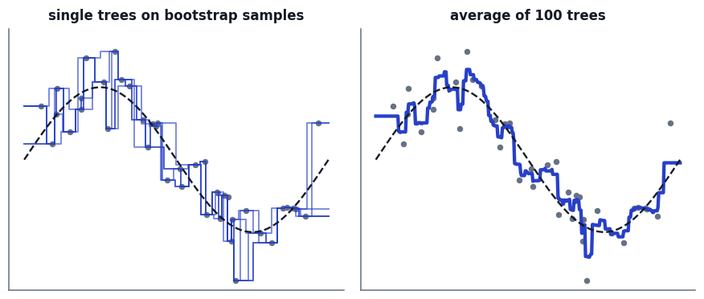
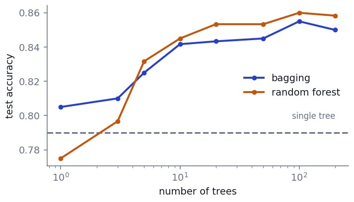
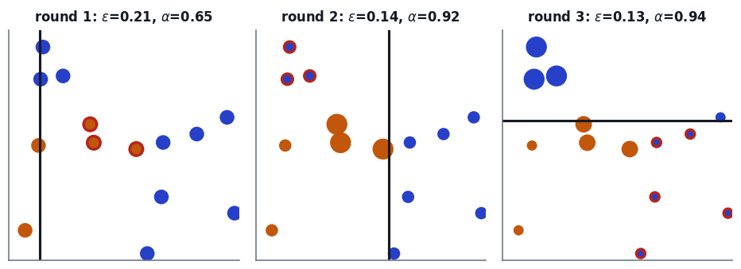
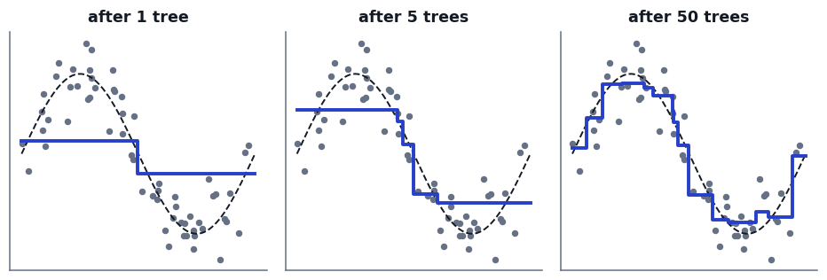

# Week 7: Ensemble Learning

Sources: Week 7 slides (W7, 83 pages), Tutorial: Ensemble Learning (Q1 and Q2), lab notebook EnsembleLearning. **Neither the tutorial nor the notebook has official solutions. Every worked solution here is my own, checked by running code, and is not official.**

## The big picture

> **Where this fits:** Earlier units each built one model at a time: a line in W1, a classifier in W2, a tree in W4, an SVM in W5. This unit keeps those models and asks how to combine many of them into something better, so it sits in the "Choose a model" stage, with its reasoning taken from R2's bias-variance split ("Understand the limits").
>
> - A model's error has two main parts, bias and variance, so we first need to say which one is hurting us, because each method below targets one of them.
> - Stability shows where variance comes from: learners like trees change a lot when the data changes a little, so they have the most to gain from averaging.
> - That suggests combining several models, so next come the ways to do it: a vote, a weighted vote, a model trained on the outputs, and weights that depend on the input.
> - Combining only helps if the models differ, and we have one dataset, so bagging makes different training sets by resampling and averages the results. This cuts variance.
> - Bagged trees can still come out alike, so random forests also give each tree a random subset of the features.
> - Randomization is the general version of that idea: add chance to a learner to get diversity.
> - All of these models train side by side and could all be wrong in the same region, so boosting trains them in sequence, each one working on the earlier ones' errors. This cuts bias.
> - AdaBoost is boosting made concrete for classification: exact rules for re-weighting the data and for each model's say, which come from minimising exponential loss.
> - Gradient boosting carries the idea to regression: each new model predicts what is still missing, which turns out to be gradient descent on the predictions.
> - The comparison at the end ties it together: use bagging on high-variance models and boosting on high-bias models.

One model is rarely perfect, and its error has two main parts: bias (the model class cannot capture the target) and variance (the fit depends on which training set you happened to get). An ensemble trains several base models and combines them into one model. The two big families attack different parts of the error:

- **Bagging** and **random forests** train many low-bias, high-variance models independently on randomised versions of the data, then average them. This cuts variance and leaves bias alone.
- **Boosting** (AdaBoost, gradient boosting) trains many high-bias weak models in sequence, each one concentrating on what the earlier ones got wrong. This cuts bias.

The deck builds up in this order: why bias and variance matter, stability, simple ways to combine models, bagging, random forests, randomization, boosting, AdaBoost, gradient boosting. The AdaBoost weight formula is not arbitrary: the tutorial derives it by minimising exponential loss one step at a time.

**Letters change between sources. Check which one a question uses.**

| Quantity | Slides | Tutorial | Notebook |
|---|---|---|---|
| Number of training examples | $m$ (also $\lvert D \rvert$) | $n$ | $n$ |
| Number of models | $k$ (also $T$ in the pseudocode) | rounds counted by $m$ | $T$ or $K$ |
| Round index | $j$ | $m$ | $t$ |
| Base model | $L_j$ (also $M_t$) | $h_m$ | $M_t$ or $h$ |
| Model weight | $\lambda_j$ | $\alpha_m$ | $\alpha_t$ |
| Instance weight | $w_i^{(j)}$ | $w_i^{(m)}$ | $w_{ti}$ |
| Ensemble so far | not named | $C_m$ | $M(x)$ |
| Bootstrap sample size | $m'$ | not used | $m$ (`sComponents`) |

Note that $m$ means "number of examples" in the slides, "round number" in the tutorial, and "bootstrap sample size" in the notebook. In the slides $\alpha$ is the gradient boosting step size and $\alpha_i(x)$ is a mixture-of-experts weight, so it is not the AdaBoost weight there.

## Bias and variance as a tool


> **Where this fits:** Before you can fix a model's error, you need to know what kind of error it is. This section is theory ("Understand the limits") and it is the reason the rest of the unit exists: bagging goes after variance and boosting goes after bias. The definitions come from R2, and W2 uses the same idea to explain how $k$ changes kNN. The diagnosis table at the end of the section is the practical side ("Evaluate and select"): it tells you which kind of fix to reach for.

This is reviewed briefly because it motivates ensembles. The full treatment belongs to the earlier bias-variance material.

Imagine infinitely many classifiers, each built from a different training set of the same size (W7 p.5).

- **Bias**: expected error due to mismatch between the hypothesis space and the target concepts. It is the inability of the learner to capture the true relationship (W7 p.7).
- **Variance**: expected error due to differences between training sets. It is how much the prediction at a given point varies between models (W7 p.5).
- Total expected error $\approx$ bias$^2$ + variance (W7 p.5). The notebook adds the noise term: $\mathbb{E}[(y-\hat f(x))^2] = \text{Bias}^2 + \text{Var} + \sigma^2$.

> **In plain words:** This splits a model's average squared error into separate causes, so you can see which one to fix. Imagine repeating the whole experiment many times, each with a fresh training set of the same size, and look at the predictions at one input. Bias is how far the average of those predictions sits from the truth, so it is a consistent miss that more luck with the data would not cure; it is squared here so the direction of the miss doesn't matter. Variance is how much the predictions scatter around their own average, so it measures how much the result depends on which training set you happened to get. The $\sigma^2$ term is the noise in the data itself, which no model can remove.

Dartboard picture (W7 p.6): low bias and low variance is a good fit, low bias and high variance is overfitting, high bias and low variance is underfitting.

Three common ways to find a good trade-off are regularization, bagging and boosting (W7 p.7).

**The four-model figure** (W7 p.9-10). Six noisy training points are sampled from a target $F(x)$, and four model classes are compared:

| Model | Description | Bias | Variance |
|---|---|---|---|
| a | Line, parameters fixed independently of the data | high | zero |
| b | Line, better fixed parameters | slightly lower | zero |
| c | Cubic trained by mean squared error | low | moderate |
| d | Line trained by mean squared error | intermediate | intermediate |

As the data size $m \to \infty$: model c's bias approaches a small value due to noise, model d keeps a large bias, and the variance of every model approaches zero. Fixed parameters give zero variance because the model ignores the data.

**Classification** (W7 p.11). The derivation was for squared-error loss and cannot be reused directly for classification (zero-one loss can be used instead). For an ensemble member, bias is the expected error of the ensemble classifier on new data, and variance is the component of expected error due to the particular training set.

> **In plain words:** The slide's definition of bias reads oddly, so here is the way to take it. Picture one member of the ensemble, trained on one particular training set. Its error splits into two parts. One part is the error that remains for the ensemble as a whole, which does not depend on any single training set, and the slide calls this bias. The other part is the extra error that comes from that member having seen that particular training set, which is variance. It is the same idea as the regression decomposition, stated for classification error.

**Big data** (W7 p.12-15). A low-bias representation, such as all conjunctive concepts (logical ANDs of attribute values), needs each small concept to appear often, and in small datasets they do not. You can raise bias with a Naive Bayes style conditional independence assumption, but that forces averaging of class distributions over the small concepts. High-bias algorithms are often used for efficiency because they are simpler to compute. Big data reduces variance because small concepts occur more often, so low-bias algorithms become usable. How to compute them efficiently remains largely open.

**Diagnosing a real system against human-level error** (W7 p.16-17):

| Observation | Diagnosis | Response |
|---|---|---|
| Training error high compared with human level | Bias too high | More expressive (lower bias) model |
| Training error near human level, validation error high | Variance too high | More data, regularization, ensembles, a different architecture |

## Stability

> **Where this fits:** Averaging many models only helps if those models would have come out differently, so we need a word for how strongly a learner reacts to its training data. Stability is that word, and it is theory ("Understand the limits") about the variance side of the error. It explains why W4's trees are the natural base model for bagging, and why stable learners such as Naive Bayes (W3) and ridge regression (W1) are not much affected by it. The $k$NN example repeats W2: changing $k$ moves you between high variance and high bias, though the slides are inconsistent about whether 1NN counts as stable (see the errors section).

Train algorithm $L$ on training sets $S_1, S_2$ drawn from the same distribution $\mathcal{D}$. If the models are the same or very similar, $L$ is **stable**. Otherwise it is **unstable** (W7 p.18).

- Typical stable: Naive Bayes, ridge regression, $k$NN (for some $k$).
- Typical unstable: decision-tree learning.

**Why trees are unstable** (W7 p.20-22). In the CART example each class has 8 points. Changing one value from $x_2 = 0.36$ to $x_2 = 0.32$ moves the root test from $x_1 < 0.6$ to $x_2 < 0.33$, and both the regions and the tree topology change a lot. A greedy early split decides everything below it, so a small change near a tie can cascade.

**Link to bias and variance** (W7 p.23). Stable algorithms typically have high bias, and unstable algorithms typically have high variance. Parameters matter, though. In $k$NN:

- 1NN separates the training data perfectly: low bias, high variance.
- Raising $k$ raises bias and lowers variance.
- At $k = m$ every test instance has the same neighbours (all of them), so all class probability vectors are the same. The input is ignored.

## Combining models


> **Where this fits:** If several trained models disagree, how do you turn their outputs into one prediction? This is the "Choose a model" stage, where the combined system is the model. The four options run from simplest to most flexible: equal votes, fixed weights, a model trained on the outputs, and weights that change with the input. Plain voting returns in bagging and random forests, and the fixed-weight vote returns in AdaBoost, where the weights come from each model's error.

No single hypothesis is perfect, so maybe combining hypotheses gives a better one (W7 p.27). **Ensemble methods** are meta-algorithms that combine models into one model, and they can decrease variance, decrease bias and improve performance (W7 p.28). The idea relates to the wisdom of crowds: aggregating independent estimates can be very effective.

The deck lists these ways of combining predictors:

1. **Simple ensembles** (W7 p.29): majority vote, or an unweighted average.
2. **Weighted votes or averages** (W7 p.30-31): output $\sum_{i=1}^k \lambda_i \hat y_i$. In practice learners may not be independent and some fit better, so decrease the weight of correlated learners and increase the weight of good learners.
3. **Treat each model's output as a feature and train a model on that** (W7 p.32-33). The deck calls this a fusion model; the usual name is **stacking**, a word the slides do not use.
   - For binary classification with a linear fusion model, this is a weighted vote.
   - Train the fusion model on a validation set, or on training data not used for the base models. Otherwise it is biased towards the models that did best on the training data.
4. **Mixture of experts** (W7 p.34): the weight $\alpha_i(x)$ depends on the input and indicates "expertise". It divides the feature space into homogeneous regions, and may use a weighted average or just pick the model with the largest expertise. It is a kind of local learning.

Key contrast: in option 2 the weights are constants, and in option 4 they are functions of $x$.

> **In plain words:** A weighted vote is a committee where each member has a fixed amount of say. Take each model's prediction, scale it by that model's weight $\lambda_i$, and add the results, so a model with a larger weight moves the final answer more. In a mixture of experts the say is not fixed: $\alpha_i(x)$ is worked out afresh for each input, so a model can dominate in the region it knows well and count for little elsewhere.

## Bagging



> **Where this fits:** A deep tree fits its training set well but changes a lot from one sample to the next, and ideally you would average trees trained on many separate datasets. You only have one dataset, so bagging imitates that by resampling it. It is a way of building the model ("Choose a model"), aimed at high-variance base learners such as W4's trees, and it joins W1's regularisation and W4's pruning as another tool against overfitting. Pick it when your model has low bias and high variance; it cannot rescue a model with high bias.

**Bootstrap** (W7 p.36-37): a resampling technique. Draw $m'$ samples from $m$ with replacement ($m' \le m$). Drawn items go back, so some examples repeat and some are left out.

**Bagging = Bootstrap AGGregation** (W7 p.35-38, pseudocode p.42):

1. For $t = 1, \dots, T$: draw a bootstrap sample $D_t$ of $\lvert D \rvert$ examples with replacement, and run learner $\mathcal{A}$ on $D_t$ to get $M_t$.
2. Return $\{M_t\}$. Predict by majority vote or unweighted average.

**How much of the data does one sample contain?** This is not on the slides but follows directly from sampling with replacement. One draw misses a given example with probability $1 - 1/m$. All $m$ draws miss it with probability $(1 - 1/m)^m \to e^{-1} \approx 0.368$. So about 63.2% of the examples appear in a sample of size $m$. For $m = 5$ the exact miss probability is $0.8^5 = 0.328$.

> **In plain words:** This tells you how much of the data one bootstrap sample really contains. Follow a single example: each draw has a small chance of picking it, and for a large dataset the chance that it escapes all $m$ draws settles at about 37%. So a sample as big as the dataset holds only about 63% of the different examples, and repeats fill the remaining slots. That gap is why each bagged model sees a different version of the data.

**Why it works** (W7 p.39). Bias comes from the model choice, and is reduced by increasing complexity. Variance comes from a small sample or high model complexity, and is reduced by more data or less complexity. Bagging is applied to low-bias, high-variance models. Averaging does not affect the bias but does reduce the variance.

The lab shows this directly: an averaged fit has the same bias as a single fit, but none of the spread between fits. Bagging imitates "average over many datasets" using bootstrap samples of the one dataset you have.

> **In plain words:** Averaging reduces scatter, but it does not remove a consistent miss. Where individual fits scatter high and low, the highs and lows cancel, so the averaged prediction wobbles less than a single fit. The average still sits where the fits sit on average, though, and that place is the same as for a single fit, so the bias stays. This is why bagging starts from low-bias, high-variance models: there is little bias to keep and a lot of scatter to remove.

**Majority vote error** (W7 p.40). Assume the learners are independent and each is wrong with probability $p$. The number of wrong learners is binomial:

$$P(k' \text{ wrong}) = \binom{k}{k'} p^{k'} (1-p)^{k-k'}, \qquad \text{error(majority)} = \sum_{k' > k/2} \binom{k}{k'} p^{k'} (1-p)^{k-k'}$$

With $k = 10$, $p = 0.1$ the deck says the error is below 0.001. The exact value is 0.000147.

> **In plain words:** This works out how likely a committee of independent models is to get the wrong answer as a group. The first formula gives the chance that exactly $k'$ of the models are wrong: count the ways of choosing which ones, then multiply by the chance of that pattern. The second adds up those chances for every case where more than half are wrong, because that is when the vote fails. If each model is usually right, a wrong majority needs many separate mistakes at the same time, so with enough models this chance becomes very small.

Two warnings:

- If $p > 0.5$ the vote makes things worse. With $k = 5$, $p = 0.6$ the error is 0.683.
- Real bagged models are not independent, because they are all built from the same dataset. So this formula is an optimistic estimate of what bagging achieves, not a guarantee.

**Background, not on the slides.** If $k$ models each have variance $\sigma^2$ and pairwise correlation $\rho$, their average has variance

$$\rho\sigma^2 + \frac{(1-\rho)\sigma^2}{k}.$$

More models only shrink the second term. The floor $\rho\sigma^2$ falls only if the models become less correlated. This is the real reason for adding randomness.

> **In plain words:** This says how much averaging calms the scatter in predictions, and why adding models eventually stops paying off. Here $\sigma^2$ is one model's variance, not the noise term from the bias-variance formula. Picture each model's wobble as a part it shares with the other models plus a private part. Averaging cancels the private part more and more as you add models, which is the term divided by $k$, but the shared part $\rho\sigma^2$ pushes all the models the same way and stays however many you add. With uncorrelated models ($\rho = 0$) the floor is zero, and with identical models ($\rho = 1$) averaging gains nothing, so past a point the only way to improve is to make the models less alike.

**Advantages** (W7 p.41): reduces overfitting, since some data are not seen by each model; improves performance in almost all cases, especially for unstable learners; works for numeric prediction and classification; can help a lot if data are noisy.

**Bagging linear classifiers** (W7 p.43): a majority vote of lines gives a piecewise linear, so non-linear, boundary. Turning votes into probabilities gives each segment a slightly different probability.

**Simulated bagged trees** (W7 p.44-48). There are $m = 30$ points, two classes, and 5 standard Gaussian features with pairwise correlation 0.95. $\Pr(Y=1 \mid x_1 \le 0.5) = 0.2$ and $\Pr(Y=1 \mid x_1 > 0.5) = 0.8$, so the Bayes error is 0.2. Unpruned trees are fitted to 200 bootstrap samples, and the trees differ a lot, with different root splits. Test error falls from about 0.45 (one tree) to about 0.36, then stays flat. The curve never approaches 0.2, because averaging reduces variance and leaves bias unchanged. The plot's "Consensus" and "Probability" lines are not explained on the slide. In the source book (Elements of Statistical Learning) they mean majority vote and averaging class probabilities.

**Pros and cons** (W7 p.49). Pros: reduces overfitting, generalizes better. Cons: any simple structure is lost (a bagged tree is a forest, so it is less interpretable); stable models are not much affected; with lots of data you learn nearly the same classifier each time, so averaging does not help.

## Random forests



> **Where this fits:** Bagging's limit is that its trees can still come out alike, for example with lots of data or when the same strong features dominate every tree. A random forest is bagging plus a second source of randomness: in the course's definition, each tree also gets only some of the features. It is a model choice ("Choose a model") built from W4's trees, and it attacks the $\rho\sigma^2$ floor from the bagging section by making the trees less correlated. Pick it over plain bagged trees for that extra diversity; the cost, as with bagging, is a model that is hard to interpret.

With lots of data, bagged trees come out alike. The fix is extra variability: give each model only a subset of the features (W7 p.50).

**Algorithm RandomForest$(D, T, d)$** (W7 p.51). For $t = 1$ to $T$: bootstrap sample $D_t$ of $\lvert D \rvert$ examples; select $d$ features at random and reduce $D_t$ to them; train a tree $M_t$ **without pruning**. Combine by vote or average.

So each tree gets a **bootstrap sample** of the rows (with replacement) and a **subspace sample** of the features (without replacement) (W7 p.58). The advantages are more diversity among the trees and less training time, since fewer features are considered.

**PlayTennis example** (W7 p.52-57): bootstrap the 14 days, pick 2 of the 4 features (Temp, Wind), build an unpruned tree, repeat $k = 5$ times, and take a majority vote. The value of $k$ can be tuned by cross-validation.

**Why feature randomness helps** (notebook). With sample-bagging alone, all the models may rely on the same strong features, so they end up correlated. Randomizing features prevents this and makes the trees closer to independent.

**Advantages and disadvantage** (notebook summary). Advantages: fast training and prediction, which parallelize because the trees are independent; probabilistic classification; a flexible nonparametric model. Primary disadvantage: results are not easily interpretable.

**Regression** (notebook). `RandomForestRegressor` averages tree outputs, so the fit is a jagged step function. It handled the two-frequency sine data with no model assumption. A consequence worth knowing (I checked it by running code): the output is an average of training targets, so a forest cannot extrapolate. With $y \approx 2x$ on $[0, 10]$ it predicts about 19.4 at both $x = 12$ and $x = 20$.

## Randomization

> **Where this fits:** Bagging makes models differ by changing the data, and random forests also change the features, so the general question is how else to get diversity. Randomization is the broader answer: put chance into the learning algorithm itself. It is a way of building ensemble members ("Choose a model") that applies more widely than bagging, for example to W2's nearest-neighbour classifiers, and it can be combined with bagging.

Some algorithms are already random, such as the initial weights of a neural net. Most can be randomized: a greedy algorithm can pick $N$ options at random and choose the best of those, as in attribute selection for trees (W7 p.59). Randomization is more generally applicable than bagging, for example random feature subsets in a nearest-neighbour classifier. It can be combined with bagging, and for trees that gives random forests.

## Boosting

> **Where this fits:** Models trained side by side can all be wrong in the same region, and averaging them leaves bias where it was. Boosting responds by training in sequence, so each new weak model works on what the earlier ones got wrong. It is another way of building the model ("Choose a model"), and it is the alternative to bagging when the base model is too simple (high bias), such as a stump or a linear classifier. The two versions that follow are AdaBoost, which re-weights the data, and gradient boosting, which fits residuals.

**The problem with parallel learners**: what if all of them are mistaken in the same region? (W7 p.61)

**Boosting** (W7 p.61):

- uses weak learners,
- trains them sequentially,
- makes new learners focus on the errors of earlier learners,
- does so through a weighted training set that favours misclassified instances,
- combines all learners at the end.

A **weak learner** is a model slightly better than random (W7 p.66). Examples: perceptron, decision stumps, Naive Bayes.

**Re-weighting** (W7 p.62). Start with equal weights. Misclassified instances gain weight, and correct ones lose weight.

**Two ways to learn with weights** (W7 p.62, p.64, p.73):

1. Weight the loss: minimise $J(\theta) = \sum_i w_i J_i(\theta, x_i)$ instead of $\frac{1}{N}\sum_i J_i(\theta, x_i)$. For stumps, this means weighted information gain.
2. Resample: build a new collection with more copies of high-weight instances, then find the best stump on it.

> **In plain words:** The weighted loss is the usual training scorecard with a dial on each example. The usual version treats every example's loss equally and averages them. Here each example's loss counts in proportion to its weight $w_i$, so getting a heavy example wrong hurts the total more, and the learner is pushed towards getting it right. Resampling pushes the same way by a different route: a heavy example appears several times in the new collection.

**General scheme** (W7 p.63): set $w_i = 1/m$; repeatedly train $L_j$ on the weighted data and increase $w_i$ for its mistakes; output a weighted majority or average of the $L_j$ with weights $\lambda_j$.

## AdaBoost



> **Where this fits:** Boosting needs two exact rules: how much to raise the weight of mistakes, and how much say each weak learner gets. AdaBoost supplies both, for classification with labels $\pm 1$, and it usually uses stumps, the depth-1 trees from W4. The rules are not arbitrary: they come from minimising exponential loss one step at a time (Tutorial Q1 in the worked examples), and that loss also appears in W5's table of margin losses. So AdaBoost is a model, a loss and a fitting method in one: "Choose a model", "Define the loss" and "Fit the model".

AdaBoost usually uses **stumps**: trees with one node and two leaves (W7 p.67). The stumps are built sequentially, each stump's error sets the data weights for the next, and each stump gets a weight $\lambda_j$ in the final vote.

**Algorithm** (W7 p.68), labels in $\{-1, +1\}$:

1. Set $w_i = 1/m$ for all $i$.
2. For $j = 1$ to $k$:
   - Learn $L_j$ with data weights $w$.
   - Weighted error: $\epsilon_j = \dfrac{\sum_i w_i^{(j)} \mathbf{1}[L_j(x_i) \ne y_i]}{\sum_i w_i^{(j)}}$
   - Model weight: $\lambda_j = \frac{1}{2}\log\dfrac{1-\epsilon_j}{\epsilon_j}$ (natural log)
   - Misclassified: $w_i^{(j+1)} = w_i^{(j)} \exp(\lambda_j)$
   - Correct: $w_i^{(j+1)} = w_i^{(j)} \exp(-\lambda_j)$
3. Predict $y(x) = \text{sign}\left(\sum_{j=1}^k \lambda_j L_j(x)\right)$.

> **In plain words:** The model weight decides how much say this stump gets in the final vote, based on how it did. First, $\epsilon_j$ measures the share of the current weight sitting on the stump's mistakes, so missing a heavy point costs more than missing a light one. Then compare the weight it got right with the weight it got wrong, as the ratio $(1-\epsilon_j)/\epsilon_j$, and take the log, so a stump at chance (ratio 1) gets exactly zero say. A stump that is rarely wrong gets a large say, and one that is worse than chance gets a negative say, which flips its vote. The slides call this weight $\lambda_j$ and the tutorial calls it $\alpha_m$.

The worked example normalises the weights each round: $w_i \leftarrow w_i / \sum_i w_i$ (W7 p.72). With normalisation, the update has a neat closed form, used in the lab:

$$w_i^{\text{new}} = \frac{w_i}{2\epsilon} \text{ (misclassified)}, \qquad w_i^{\text{new}} = \frac{w_i}{2(1-\epsilon)} \text{ (correct)}.$$

> **In plain words:** The weight update decides what the next stump should pay attention to. If the stump beats chance, each mistake is multiplied by $\exp(\lambda_j)$, which is above 1, and each correct point by $\exp(-\lambda_j)$, which is below 1, and the better the stump was, the bigger the shift. Normalising then rescales everything so the weights add up to 1 again, and the closed form above does both steps at once. Starting from weights that add up to 1, the mistakes hold a share $\epsilon$, so dividing each by $2\epsilon$ brings their total to one half, and the correct points end up with the other half. The latest stump therefore looks no better than chance on the new weights, so the next one has to find something different.

**What $\lambda$ does:**

| $\epsilon$ | $\lambda$ | Meaning |
|---|---|---|
| near 0 | very large | near-perfect stump, large say in the vote |
| 0.2 | 0.693 | good stump |
| 0.5 | 0 | no better than chance, no say |
| above 0.5 | negative | worse than chance, so its vote is flipped |

> **In plain words:** The final prediction is a weighted vote. Each stump answers $+1$ or $-1$, that answer is scaled by the stump's $\lambda_j$, and the sign of the total picks the class. Because the say is unequal, one strong stump can outvote two weak ones.

**Two facts worth memorising** (derived below):

- After a normalised update, the misclassified points hold exactly half of the total weight, and so do the correct ones. Each misclassified point gets $0.5$ divided by the number of misclassified points when the weights were uniform.
- So the stump just used has error exactly $0.5$ under the new weights, and the next stump is forced to do something different.

**Boosted versus bagged linear classifiers** (W7 p.75). None of five boosted lines has zero training error, but the ensemble does. Five bagged lines nearly coincide, showing little diversity in the bootstrap samples.

**Pros and cons** (W7 p.76). Advantages: no need for complex models, can boost any weak learner, very simple to implement, decreases bias, good generalization. Disadvantages: lack of interpretability, slow during training and potentially testing. Also, it can be susceptible to very noisy data (W7 p.82), because mislabelled points keep gaining weight.

## Gradient boosting



> **Where this fits:** AdaBoost works on mistakes by re-weighting points, but a regression prediction misses by an amount, so here each new model predicts what is still missing. This is the boosting alternative for regression, and it can also be used for classification. It joins "Choose a model" to "Fit the model": the loss is W1's squared error, and the fitting method is W1's gradient descent, applied to the predictions rather than to parameters. It also needs "Evaluate and select", because training error keeps falling while test error can turn back up.

The same idea for regression, though it can also be used for classification (W7 p.77). Weak learners can be simple linear regression or simple regression trees. Repeat:

1. Learn a regression predictor.
2. Compute the residual error.
3. Learn to predict the residual.

The sum of the predictors forms a more complex model (W7 p.78). The plots on W7 p.78-79 show the step-function fit improving and the residuals shrinking to noise by iteration 20.

> **In plain words:** The residual is what the current model still misses on each example: the true value minus the prediction. Train a small new model to predict those misses, add its output to the current prediction, and measure what is left. Each round works only on the part not yet explained, so the leftovers on the training data shrink. The final model is the first rough fit plus all the small corrections, which is how simple predictors add up to a complex one.

**Why this is gradient descent** (W7 p.80). Let $\hat y_i$ be the current predictions and $J = \frac{1}{2}\sum_i (y_i - \hat y_i)^2$. Treat the predictions themselves as the things being optimised:

$$\frac{\partial J}{\partial \hat y_i} = -(y_i - \hat y_i), \qquad \hat y_i \leftarrow \hat y_i - \alpha\frac{\partial J}{\partial \hat y_i} = \hat y_i + \alpha(y_i - \hat y_i).$$

So **the residual is the negative gradient**. We can only apply the step through a model that also works on new inputs, so we fit a learner $f(x_i) \approx y_i - \hat y_i$ and update $\hat y_i \leftarrow \hat y_i + \alpha f(x_i)$.

Gradient descent is a sequence of steps reducing $J$. Gradient boosting is a sum of predictors weighted by a step size $\alpha$.

> **In plain words:** This shows that "fit the residual" is the same gradient descent as in W1, with the predictions in place of the parameters. Treat each prediction as a dial you can turn. The gradient points in the direction that raises the squared error, so the downhill direction is its negative, and that works out to be the residual: move each prediction towards its true value, in proportion to how far it misses. You can only turn dials for the training examples, and you need predictions for new inputs too, so a learner is fitted to the residuals and its output is added instead. The step size $\alpha$ controls how much of each correction you take, so a smaller $\alpha$ needs more predictors.

"The model gets more accurate at each step" (W7 p.78) is true for training error. In a run with depth-3 trees and learning rate 0.1, training MSE fell from 0.58 to 0.002 over 500 trees, while test MSE reached 0.325 at 40 trees and rose to 0.422 at 500. A smaller $\alpha$ needs more predictors: the best tree count was 40 for $\alpha = 0.1$ and 4 for $\alpha = 1$.

## Comparing the methods

> **Where this fits:** With four ensemble methods available, how do you choose? This is the decision guide for "Choose a model": work out which kind of error your base model has, using the diagnosis from the start of this unit, then pick the method that attacks it. It closes the bias-variance thread that began in R2. W10 then steps back and asks why learning generalises at all, and how much data it takes.

Low-bias models tend to have high variance and vice versa. **Bagging is predominantly variance reduction, and boosting is primarily bias reduction** (W7 p.81). So bagging goes with high-variance models such as trees, and boosting goes with high-bias models such as linear classifiers or stumps.

| | Bagging | Random forest | AdaBoost | Gradient boosting |
|---|---|---|---|---|
| Training | parallel | parallel | sequential | sequential |
| Each model sees | bootstrap sample | bootstrap sample, feature subset | all data, re-weighted | all data, residual targets |
| Base learner | low bias, high variance | unpruned tree | weak (stump) | weak (small tree, simple regression) |
| Combination | vote or average | vote or average | weighted vote, $\lambda_j$ | sum with step size $\alpha$ |
| Mainly reduces | variance | variance | bias | bias |
| Noise | can help a lot | as for bagging | susceptible | as for boosting in general |

Boosting has a more theoretically justified basis and may work better in practice, but can be susceptible to very noisy data (W7 p.82).

## Errors and inconsistencies in the course material

None of the questions depends on a disputed point.

**Slides**

- W7 p.5 gives total error $\approx$ bias$^2$ + variance. The notebook has the fuller version with $+\sigma^2$.
- W7 p.19 writes "classes $\mathcal{R}_1, \mathcal{R}_1$". It should be $\mathcal{R}_1, \mathcal{R}_2$.
- W7 p.23 calls 1NN high variance, but W7 p.49 and p.59 call nearest neighbour a stable model that bagging does not help, and W7 p.18 says only "for some $k$". Do not assume a fixed answer about 1NN and stability.
- W7 p.28 credits "James Surowiecki, 1907". Surowiecki's book is much more recent, and 1907 is the date usually given for Galton's ox-weight observation. This is not examinable.
- W7 p.37 allows $m' \le m$, W7 p.42 and p.51 sample $\lvert D \rvert$ examples, and the lab uses 50 from 70.
- W7 p.53 says "select 14 samples", but the table has 15 rows. (There are 10 distinct days in it. D2, D4, D7 and D13 are left out.)
- W7 p.63 says the $\lambda$ are "proportional to the accuracy". The AdaBoost formula on p.68 is not proportional to accuracy.
- W7 p.68 writes the final model with $\lambda_i L_j(x)$ under a sum over $j$. It should be $\lambda_j$. The pseudocode also omits the normalisation that the example performs.
- W7 p.70 says to find the best stump and uses Blood Pressure with 2 errors. The stump Age $> 49.5$ has only 1 error on the same table. It also rounds $\lambda_1 = 0.458$ down to 0.45.
- W7 p.80 calls $\frac{1}{2}\sum_i(y_i-\hat y_i)^2$ "MSE", but it is half the sum of squares, not a mean. It also writes $\nabla J = y_i - \hat y_i$, which is the **negative** gradient.

**Tutorial**

- Q1(f) says $\alpha_m^*$ is "always positive". That holds only if $\epsilon_m < \frac{1}{2}$, which is the weak-learner assumption.
- Q2 says to round to two decimals. Where you round changes later numbers slightly, as shown in the worked example.

**Notebook**

- It says the bootstrap samples are independent of each other. They are all drawn from one dataset, so the trained models are correlated.
- It says "for a formal explanation, see the tutorial", but the tutorial supplied does not contain one.
- It says to assign the negative class if $M(x) < 1$. It should be $M(x) < 0$.
- The pseudocode line for correct instances has mismatched subscripts ($w_{(t+1)j} \leftarrow w_{ti}/\dots$). It should use $w_{tj}$.
- The text says $x$ runs from 1 to 10, Exercise 1 says uniform on $(0, 10)$, and the Advanced Exercise says $n = 100$, $\sigma = 0.1$ while its code uses 25 and 0.2.
- `metrics.classification_report(ypred, ytest)` has the arguments swapped, so precision and recall are exchanged.
- `AdaBoostClassifier(base_estimator=...)` fails on the installed sklearn 1.8 with a `TypeError`. Use `estimator=`.
- It says a majority vote gives `predict_proba`. In sklearn, a forest's `predict_proba` is the mean of the trees' class probabilities, and `predict` takes the argmax of that mean. In a test with leaves that were not pure, this matched a hard vote on 98% of points, not all of them.
- The slides and notebook pick features once per tree. sklearn's `RandomForestClassifier` picks them at each split (see the code section).

## Worked examples

### Tutorial Q1: deriving AdaBoost from exponential loss (no official solution)

Setup: labels $y_i \in \{-1, +1\}$, weak learners $h : \mathcal{X} \to \{-1, +1\}$, and loss $\ell(h(x_i), y_i) = e^{-y_i h(x_i)}$.

**(a)** If $h(x_i) = y_i$ then $y_i h(x_i) = 1$ and the loss is $e^{-1} \approx 0.368$. If $h(x_i) \ne y_i$ then $y_i h(x_i) = -1$ and the loss is $e \approx 2.718$. A mistake costs $e^2 \approx 7.4$ times as much as a correct answer. The loss is never zero.

**(b)** With $C_m = C_{m-1} + \alpha_m h_m$:

$$L(C_m) = \sum_i e^{-y_i(C_{m-1}(x_i) + \alpha_m h_m(x_i))} = \sum_i \underbrace{e^{-y_i C_{m-1}(x_i)}}_{w_i^{(m)}} e^{-\alpha_m y_i h_m(x_i)}.$$

If $C_{m-1}$ is wrong on $x_i$, then $y_i C_{m-1}(x_i) < 0$ and $w_i^{(m)} > 1$. If it is right, then $w_i^{(m)} < 1$. For example, $y_i = -1$ and $C_{m-1}(x_i) = 0.7$ gives $w_i = e^{0.7} = 2.01$. A more confident mistake gets a bigger weight.

**(c)** Split the sum by whether $h_m$ is right. If right, $y_i h_m(x_i) = 1$, and if wrong it is $-1$:

$$L(C_m) = e^{-\alpha_m}\sum_{i: h_m(x_i) = y_i} w_i^{(m)} + e^{\alpha_m}\sum_{i: h_m(x_i) \ne y_i} w_i^{(m)}.$$

**(d)** Write $W = \sum_i w_i^{(m)}$ and $W_{\text{err}} = \sum_{i: h_m(x_i) \ne y_i} w_i^{(m)}$. Since the correct sum is $W - W_{\text{err}}$,

$$L(C_m) = e^{-\alpha_m} W + (e^{\alpha_m} - e^{-\alpha_m}) W_{\text{err}}.$$

$W$ does not depend on $h_m$, and the coefficient is positive for any $\alpha_m > 0$. So the best $h_m$ minimises $W_{\text{err}}$, the weighted classification error, whatever $\alpha_m$ is. Because the weights are largest on points the ensemble gets wrong, the new learner is trying to learn the previous learners' mistakes.

**(e)** Write $W_c$ for the correct sum and $W_e$ for the wrong sum. Then

$$\frac{dL}{d\alpha} = -e^{-\alpha}W_c + e^{\alpha}W_e = 0 \;\Rightarrow\; e^{2\alpha} = \frac{W_c}{W_e} \;\Rightarrow\; \alpha^*_m = \frac{1}{2}\ln\frac{W_c}{W_e}.$$

The second derivative is positive, so this is a minimum.

**(f)** Divide top and bottom by $W = W_c + W_e$. Since $\epsilon_m = W_e/W$ and $1 - \epsilon_m = W_c/W$, we get $\alpha_m^* = \frac{1}{2}\ln\frac{1-\epsilon_m}{\epsilon_m}$. This is positive exactly when $\epsilon_m < \frac{1}{2}$, which holds if the weak learner beats chance. The value of $\alpha_m^*$ sets how much say $h_m$ has: lower error gives a larger say.

**(g)** $w_i^{(m)} = e^{-y_i C_{m-1}(x_i)} = e^{-y_i C_{m-2}(x_i)} e^{-\alpha_{m-1} y_i h_{m-1}(x_i)} = w_i^{(m-1)} e^{-\alpha_{m-1} y_i h_{m-1}(x_i)}$. Since $e^{\alpha} = \sqrt{(1-\epsilon)/\epsilon}$:

$$w_i^{(m)} = w_i^{(m-1)}\sqrt{\frac{\epsilon_{m-1}}{1-\epsilon_{m-1}}} \text{ if correct}, \qquad w_i^{(m)} = w_i^{(m-1)}\sqrt{\frac{1-\epsilon_{m-1}}{\epsilon_{m-1}}} \text{ if wrong}.$$

With $\epsilon < \frac{1}{2}$, the correct factor is below 1 and the wrong factor is above 1. So correct points shrink and mistakes grow, and the better the learner was, the bigger the shift. For $\epsilon = 0.2$, the factors are 0.5 and 2.

**(h)** Normalised previous weights mean the correct points hold $1 - \epsilon$ and the wrong points hold $\epsilon$:

$$Z_m = (1-\epsilon)\sqrt{\frac{\epsilon}{1-\epsilon}} + \epsilon\sqrt{\frac{1-\epsilon}{\epsilon}} = \sqrt{\epsilon(1-\epsilon)} + \sqrt{\epsilon(1-\epsilon)} = 2\sqrt{\epsilon(1-\epsilon)}.$$

(Here $\epsilon = \epsilon_{m-1}$.)

**(i)** Dividing the factors from (g) by $Z_m$:

$$\text{correct: } \frac{w_i}{2(1-\epsilon)}, \qquad \text{wrong: } \frac{w_i}{2\epsilon}.$$

**Consequences (my additions, checked by simulation).**

- New wrong total $= \epsilon \cdot \frac{1}{2\epsilon} = \frac{1}{2}$. So the latest learner has error exactly $\frac{1}{2}$ under the new weights.
- $Z < 1$ unless $\epsilon = \frac{1}{2}$, so exponential loss falls each round. Starting from $w_i^{(1)} = 1/n$: $\sum_i e^{-y_i C_M(x_i)} = n\prod_m Z_m$, where $Z_m$ here uses round $m$'s own error $\epsilon_m$.

### Tutorial Q2: AdaBoost by hand (no official solution; simulated in Python)

The points are read from the plot. Each one sits at the centre of a unit grid cell, and the tutorial's statement that $[x_2 < 1]$ misclassifies only D and F agrees with this reading.

| Point | $x_1$ | $x_2$ | $y$ |
|---|---|---|---|
| A | 0.5 | 2.5 | $-1$ |
| B | 0.5 | 1.5 | $-1$ |
| C | 1.5 | 2.5 | $-1$ |
| D | 1.5 | 1.5 | $+1$ |
| E | 2.5 | 0.5 | $+1$ |
| F | 3.5 | 2.5 | $+1$ |

Each hypothesis predicts $+1$ when its condition holds and $-1$ otherwise. Which points each one gets wrong never changes:

| Hypothesis | Wrong on | $\epsilon_1$ | $\epsilon_2$ | $\epsilon_3$ |
|---|---|---|---|---|
| $[x_1 > 1]$ | C | **1/6** | 0.5 | 5/18 |
| $[x_1 > 2]$ | D | 1/6 | **0.1** | 0.5 |
| $[x_1 > 3]$ | D, E | 1/3 | 0.2 | 5/9 |
| $[x_2 < 1]$ | D, F | 1/3 | 0.2 | 5/9 |
| $[x_2 < 2]$ | B, F | 1/3 | 0.2 | **1/9** |

**(a) Round 1.** Weights are all $1/6$. $[x_1 > 1]$ and $[x_1 > 2]$ tie, and the first listed wins, so $h_1 = [x_1 > 1]$ with $\epsilon_1 = 1/6$ and $\alpha_1 = \frac{1}{2}\ln 5 = 0.80$. New weights: C gets $\frac{1/6}{2(1/6)} = 0.5$, and every other point gets $\frac{1/6}{2(5/6)} = 0.1$. $C_1$ predicts $+1$ for $x_1 > 1$ and misclassifies only C.

**(b) Round 2.** Weights: A $0.1$, B $0.1$, C $0.5$, D $0.1$, E $0.1$, F $0.1$. The best is $h_2 = [x_1 > 2]$ with $\epsilon_2 = 0.1$ and $\alpha_2 = \frac{1}{2}\ln 9 = 1.10$. New weights: D gets $0.1/0.2 = 0.5$, C gets $0.5/1.8 = 5/18 = 0.28$, and A, B, E, F get $0.1/1.8 = 1/18 = 0.06$.

$C_2 = 0.80 h_1 + 1.10 h_2$ takes the values $-1.90$ for $x_1 \le 1$, $-0.30$ for $1 < x_1 \le 2$, and $+1.90$ for $x_1 > 2$. So it predicts the same as $[x_1 > 2]$, because $\alpha_2 > \alpha_1$, and it misclassifies only D.

**(c) Round 3.** The best is $h_3 = [x_2 < 2]$, wrong on B and F, with $\epsilon_3 = 2/18 = 1/9$ and $\alpha_3 = \frac{1}{2}\ln 8 = 1.04$.

| Point | $h_1$ | $h_2$ | $h_3$ | $C_3$ | Sign | True $y$ |
|---|---|---|---|---|---|---|
| A | $-1$ | $-1$ | $-1$ | $-2.94$ | $-1$ | $-1$ |
| B | $-1$ | $-1$ | $+1$ | $-0.86$ | $-1$ | $-1$ |
| C | $+1$ | $-1$ | $-1$ | $-1.34$ | $-1$ | $-1$ |
| D | $+1$ | $-1$ | $+1$ | $+0.74$ | $+1$ | $+1$ |
| E | $+1$ | $+1$ | $+1$ | $+2.94$ | $+1$ | $+1$ |
| F | $+1$ | $+1$ | $-1$ | $+0.86$ | $+1$ | $+1$ |

**(d) What you notice.** $C_3$ classifies all six points correctly, though no single hypothesis in $\mathcal{H}$ does. Its boundary is a staircase: predict $+1$ when $x_1 > 2$, or when $x_1 > 1$ and $x_2 < 2$. Three weak axis-parallel rules combine into a non-linear classifier.

**Rounding note.** The values above use exact fractions. If you round the weights to two decimals after each round as the tutorial suggests, you get $0.06$ and $0.28$ (they then sum to 1.02), so $\epsilon_3 = 0.12$ and $\alpha_3 = 1.00$ rather than $1.04$. The same hypotheses are chosen and all signs of $C_3$ are the same. The exponential loss of $C_3$ is $6 Z_1 Z_2 Z_3 = 1.69$, which matches a direct calculation.

### The deck's heart disease example (W7 p.69-72)

There are 7 patients and all weights are $1/7$. The Blood Pressure stump gets 2 wrong, so $\epsilon = 2/7$ and $\lambda_1 = \frac{1}{2}\ln\frac{5/7}{2/7} = \frac{1}{2}\ln 2.5 = 0.458$. Updated weights: wrong $\frac{1}{7}e^{0.458} = 0.226$, correct $\frac{1}{7}e^{-0.458} = 0.090$. The sum is $2(0.226) + 5(0.090) = 0.904$, which equals $Z = 2\sqrt{(2/7)(5/7)}$. Normalised: wrong $0.25$, correct $0.10$. The fast way: wrong points share $\frac{1}{2}$, so $0.5/2 = 0.25$, and correct points share $\frac{1}{2}$, so $0.5/5 = 0.10$.

### Gradient boosting with three numbers

Take $y = (3, 5, 10)$, $\hat y = (6, 6, 6)$ and $\alpha = 0.5$. Residuals: $(-3, -1, 4)$. If $f$ fits them exactly, $\hat y \leftarrow (4.5, 5.5, 8)$. $J$ falls from 13 to 3.25. With a perfect fit each step scales the residuals by $1 - \alpha$, so $J$ scales by $(1-\alpha)^2$.

### Notebook exercises (no official solutions; run in Python)

**Exercises 1-3, as motivation for bagging.** At $x_0 = 5$ over 2000 simulated datasets of 25 points:

| Features | bias$^2$ | variance |
|---|---|---|
| $x$ | 0.0144 | 0.0024 |
| $x, x^2$ | 0.0000 | 0.0039 |
| $x, \dots, x^6$ | 0.0000 | 0.0099 |

Flexible models have little bias, and their error is mostly variance. That is what averaging can remove. In the Advanced Exercise the single degree-9 fit had a mean squared distance of 0.0013 from the truth, while the average of 80 fits had 0.0004. The notebook's own 9-dataset estimates are much noisier.

**Decision tree exercises.** Averages over 30 datasets of 70 points. Disagreement is the mean fraction of grid points where two trees from different datasets differ.

| `cluster_std` | `max_depth` | train acc. | test acc. | disagreement |
|---|---|---|---|---|
| 0.8 | 3 | 0.89 | 0.76 | 0.23 |
| 0.8 | None | 1.00 | 0.75 | 0.25 |
| 1.5 | 3 | 0.71 | 0.52 | 0.39 |
| 1.5 | None | 1.00 | 0.46 | 0.53 |

1. Increasing `max_depth`: training accuracy goes to 1, test accuracy falls, and trees differ more between datasets. Bias falls and variance rises.
2. Increasing `cluster_std`: this plays the role of $\sigma$. The clusters overlap, accuracy falls, and fits vary more.
3. Combining trees: bag them. With `BaggingTree(100, 50, max_depth=3)` at `cluster_std=0.8`, disagreement fell from 0.23 to 0.09 and test accuracy rose from 0.77 to 0.81.

**Digits, one run on the 450-image test split.** One stump 0.18; one tree 0.84; AdaBoost with 1000 stumps 0.86; AdaBoost with 200 depth-3 trees 0.96; random forest with 1000 trees 0.98. No seed is fixed, so a rerun can differ by a point or two (a seeded rerun gave 0.94 for the depth-3 AdaBoost).

## Code you should recognise

**Bootstrap indices and majority vote** (from `BaggingTree`):

```python
B_idxs = [np.random.choice(np.arange(n), size=self.sComponents, replace=True)
          for _ in range(self.nComponents)]
preds = np.array([mod.predict(x) for mod in self.baseClfs])   # (n_models, n_test)
mvs = np.array([np.bincount(preds[:, i]).argmax() for i in range(nTest)])
```

- `replace=True` is essential. With `replace=False` and `size=n`, every sample is the whole dataset.
- `np.bincount` needs non-negative integers, so it raises a `ValueError` on $\pm 1$ labels.
- `argmax` breaks ties towards the smaller label.

**Feature bagging**: keep each tree's columns and reuse them at prediction time, or the tree raises a `ValueError` for the wrong number of features:

```python
cols = np.random.choice(p, s, replace=False)        # features: no replacement
clf.fit(X[rows][:, cols], y[rows])
clf.predict(x[:, cols])
```

**AdaBoost core** (from `BoostingTrees`):

```python
dt = DecisionTreeClassifier(max_depth=1).fit(X, y, sample_weight=w[t])
yhat = dt.predict(X)
eps_t = np.sum(w[t] * (y != yhat))        # assumes the weights sum to 1
alpha_t = 0.5 * np.log((1 - eps_t) / eps_t)
# misclassified: w / (2 * eps_t)      correct: w / (2 * (1 - eps_t))
preds = np.sign(np.dot(self.alphas, ind_preds))
```

- `sample_weight` is how weights reach the tree. As the notebook notes, the tree picks splits by weighted impurity, so it does not exactly minimise $\epsilon_t$.
- Labels must be coded $\pm 1$. The lab overwrites `y` in place to achieve this.
- `np.sign(0)` is 0, whereas the tutorial defines sign as $+1$ at 0.
- The lab loops over `range(n_points)`, a global. On a larger `X` the extra rows silently keep weight 0, and on a smaller `X` it raises an `IndexError`. It should be `range(n)`.

**Gradient boosting from scratch** (not in the lab; the deck's procedure):

```python
pred = np.full(len(y), y.mean())
for r in range(rounds):
    tree = DecisionTreeRegressor(max_depth=1).fit(X, y - pred)   # fit the residuals
    pred = pred + lr * tree.predict(X)
```

Fitting `y` instead of `y - pred` adds the same tree every round, so the predictions overshoot.

**sklearn** (behaviour checked on version 1.8):

| Call | Key defaults and notes |
|---|---|
| `RandomForestClassifier(n_estimators=100)` | `max_features='sqrt'`, `bootstrap=True`, trees unpruned; features are sampled per split |
| `RandomForestRegressor(200)` | first argument is `n_estimators`; `max_features=1.0`, so all features unless changed; needs 2-D `X`, hence `x[:, None]` |
| `BaggingClassifier(estimator, n_estimators=10, max_features=1.0)` | default base is an unpruned tree; `max_features` is drawn once per estimator, like the course's pseudocode |
| `AdaBoostClassifier(estimator=..., n_estimators=50)` | default base is a depth-1 tree; `learning_rate=1.0` |
| `GradientBoostingRegressor(learning_rate=0.1, n_estimators=100, max_depth=3)` | `staged_predict` gives predictions after each stage |
| `classification_report(y_true, y_pred)` | order matters: swapping exchanges precision and recall |

`train_test_split` holds out 25% by default, so the 1797 digits give 1347 training and 450 test rows.

## Formula sheet

| Name | Formula | Note | In words |
|---|---|---|---|
| Error decomposition | total error $\approx$ bias$^2$ + variance | notebook adds $+\sigma^2$ | Consistent miss, plus scatter between training sets, plus unavoidable noise |
| Weighted combination | $\sum_{i=1}^k \lambda_i \hat y_i$ | constant weights; a mixture of experts uses $\alpha_i(x)$ | Each prediction counts according to its model's fixed weight |
| $k'$ of $k$ wrong | $\binom{k}{k'} p^{k'}(1-p)^{k-k'}$ | independent learners, same $p$ | Chance that exactly this many models are wrong |
| Majority vote error | $\sum_{k' > k/2}\binom{k}{k'} p^{k'}(1-p)^{k-k'}$ | helps only if $p < 0.5$ | Add up the chances that more than half are wrong |
| Miss probability in bootstrap | $(1 - 1/m)^{m'}$ | tends to $e^{-1} \approx 0.368$ when $m' = m$ (not on slides) | Chance one example is never drawn into the sample |
| Variance of correlated average | $\rho\sigma^2 + (1-\rho)\sigma^2/k$ | background (not on slides) | Shared wobble stays; private wobble shrinks as models are added |
| Weighted loss | $J(\theta) = \sum_i w_i J_i(\theta, x_i)$ | versus $\frac{1}{N}\sum_i J_i$ | Usual loss, but heavy examples count for more |
| AdaBoost initial weights | $w_i = 1/m$ | | Every example starts with an equal share |
| AdaBoost error | $\epsilon_j = \sum_i w_i^{(j)}\mathbf{1}[L_j(x_i) \ne y_i] \big/ \sum_i w_i^{(j)}$ | | Share of the current weight sitting on the mistakes |
| AdaBoost model weight | $\lambda_j = \frac{1}{2}\ln\frac{1-\epsilon_j}{\epsilon_j}$ | natural log; tutorial writes $\alpha_m$ | Lower error gives more say; at chance, no say |
| Weight update | $w_i e^{\lambda_j}$ if wrong, $w_i e^{-\lambda_j}$ if correct | then normalise | Mistakes grow and correct points shrink, if the stump beats chance |
| Same factors | $\sqrt{(1-\epsilon)/\epsilon}$ if wrong, $\sqrt{\epsilon/(1-\epsilon)}$ if correct | tutorial Q1(g) | The same multipliers, written using the error instead of $\lambda$ |
| Normaliser | $Z = 2\sqrt{\epsilon(1-\epsilon)}$ | previous weights normalised | Total weight after the update, used to rescale to 1 |
| Normalised update | $w_i/(2\epsilon)$ if wrong, $w_i/(2(1-\epsilon))$ if correct | wrong and correct totals are each $\frac{1}{2}$ | Rescale so mistakes and correct points each hold half |
| AdaBoost prediction | $\text{sign}\left(\sum_j \lambda_j L_j(x)\right)$ | labels $\pm 1$ | Weighted vote; the sign of the total picks the class |
| Exponential loss | $\ell = e^{-y h(x)}$; $L(C) = \sum_i e^{-y_i C(x_i)}$ | tutorial Q1 | Mistakes cost far more than correct answers; the loss is never zero |
| Loss after $M$ rounds | $n\prod_{m=1}^M Z_m$ | with $w^{(1)}_i = 1/n$ | Each round multiplies the loss by that round's $Z$ |
| Best weight from sums | $\alpha^* = \frac{1}{2}\ln(W_c/W_e)$ | gives $L = 2\sqrt{W_c W_e}$ | Compare the weight on correct points with the weight on mistakes |
| Gradient boosting loss | $J = \frac{1}{2}\sum_i (y_i - \hat y_i)^2$ | called "MSE" on the slide | Half the total squared miss over all examples |
| Negative gradient | $-\partial J/\partial \hat y_i = y_i - \hat y_i$ | the residual | The downhill direction for each prediction is its remaining miss |
| Gradient boosting update | $\hat y_i \leftarrow \hat y_i + \alpha f(x_i)$, with $f(x_i) \approx y_i - \hat y_i$ | $\alpha$ is the step size | Move predictions a step along a fitted model of the misses |

## Exam traps

- Bagging reduces variance and boosting reduces bias. Swapping these is the classic wrong option.
- Bagging leaves bias unchanged, so it cannot rescue a high-bias model. Bagging stumps does little.
- Bootstrap sampling is **with** replacement. Random forest feature sampling is **without** replacement.
- Random forest trees are **not** pruned.
- In the course's definition features are selected once per tree. In sklearn they are selected per split. Read which one a question means.
- Majority voting helps only if $p < 0.5$, and the binomial formula assumes independence. Use $k' > k/2$ strictly: exactly half wrong is not counted.
- $\lambda = \frac{1}{2}\ln\frac{1-\epsilon}{\epsilon}$: watch for a dropped $\frac{1}{2}$, an inverted ratio, or a base-10 log.
- Correct instances are multiplied by $e^{-\lambda}$, not left alone. Both groups change.
- Forgetting to normalise gives 0.226 rather than 0.25 in the deck's example.
- $\epsilon$ is the sum of **weights** on the mistakes, not the count of mistakes, once the weights stop being uniform.
- A low-count stump can still have high weighted error if it gets one heavy point wrong. In round 3 of the toy example, $[x_1 > 2]$ makes one mistake but has $\epsilon = 0.5$.
- The final AdaBoost vote is weighted. One strong stump can outvote two weak ones.
- The stump used last has error exactly 0.5 under the new weights, so it is never the immediate next pick. It can return later (the toy example reuses $[x_1 > 1]$ in round 4).
- $w_i^{(m)} = e^{-y_i C_{m-1}(x_i)}$ uses the previous ensemble, not the new learner, and does not contain $\alpha_m$.
- $\alpha^* > 0$ needs $\epsilon < \frac{1}{2}$. At $\epsilon = \frac{1}{2}$, $\alpha^* = 0$.
- The best $h_m$ does not depend on $\alpha_m$, so it can be chosen first.
- The residual is the **negative** gradient of $J$. The slide's $\nabla J$ already includes the minus sign.
- The $\frac{1}{2}$ in $J$ is there to cancel the 2. Without it, the gradient is $-2(y_i - \hat y_i)$.
- A weak learner is slightly better than random, not random.
- "Model gets more accurate at each step" means on the training data. Boosting can overfit, and is susceptible to very noisy data, while bagging can help with noisy data.
- Stacking's fusion model must be trained on held-out data.
- In a mixture of experts the weights depend on $x$, and in a weighted vote they do not.
- A vote over linear classifiers is piecewise linear, not linear.
- Fixed-parameter models have zero variance, however bad they are.
- $k$NN stability depends on $k$. Larger $k$ means more bias and less variance.
- `classification_report(ypred, ytest)` swaps precision and recall but not accuracy.

## Self-check

1. Explain why bagging suits unpruned trees, and why boosting suits stumps.
2. Compute a majority vote error from $k$ and $p$, and say when voting hurts.
3. Compute the probability that an example is missed by a bootstrap sample.
4. State what a random forest adds to bagging, and why that lowers correlation between trees.
5. Run one full round of AdaBoost by hand from a table: $\epsilon$, $\lambda$, new weights, normalised weights.
6. Reproduce the three rounds of the toy example, and evaluate $C_2$ and $C_3$ on all six points.
7. Derive $\alpha^* = \frac{1}{2}\ln\frac{1-\epsilon}{\epsilon}$ from exponential loss without notes.
8. Show that $Z = 2\sqrt{\epsilon(1-\epsilon)}$, and that misclassified points hold half the weight after an update.
9. Show that the residual is the negative gradient of $J$, and do one gradient boosting update with step size $\alpha$.
10. Spot these bugs in code: sampling with `replace=False`, forgetting a tree's feature columns at prediction time, swapped AdaBoost update branches, fitting `y` rather than the residual, and training a fusion model on the base models' training data.
