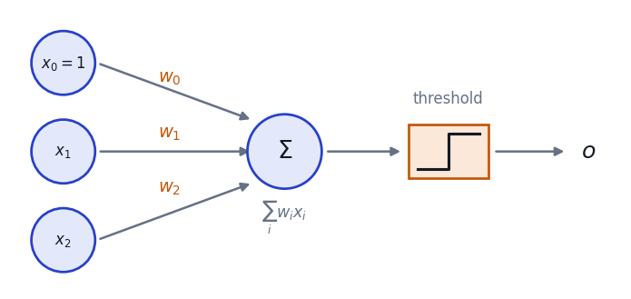
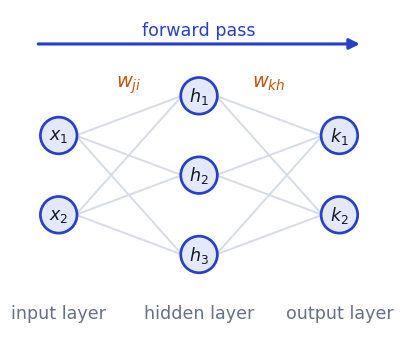
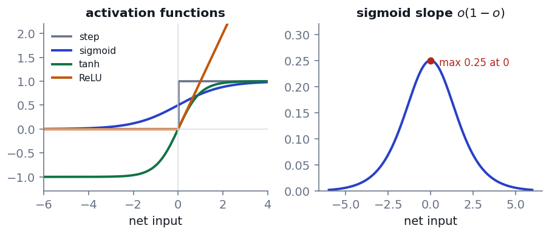
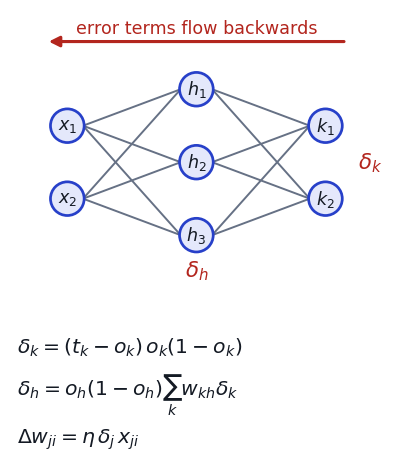
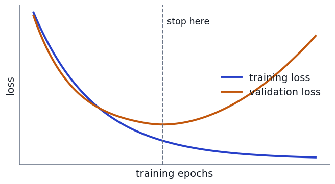
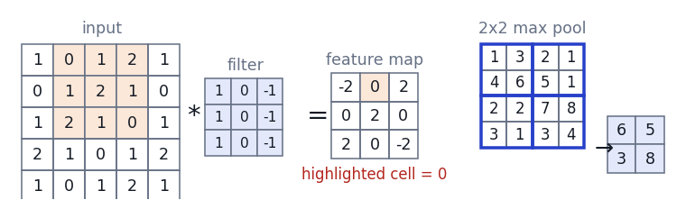

# Week 8: Neural Learning

Sources: W8 slides (113 pages), the lecturer's two-page handwritten backpropagation derivation (cited as "BP notes"), and the Neural Learning lab notebook. The notebook has no official solutions, so every lab solution here is my own, checked by running code. They are not official. The MNIST parts of the lab (the PyTorch `Net` and `ConvNet` training runs, their test accuracy, and the `Mlp` run) were **not** run, because the MNIST data was not downloaded. The `Mlp` class itself was run on small synthetic arrays. Nothing here reports an MNIST result.

## The big picture

> **Where this fits:** W8 is the last new supervised model family in the course: it takes the weighted sum of features from W1, W2 and W5, stacks it into layers, and fits it with W1's gradient descent.
>
> - A perceptron is one weighted sum with a threshold. It learns by nudging its weights on each mistake, but it can only draw a straight boundary and it needs separable data.
> - To cope with noisy data we want a score to minimise, so next comes squared error and gradient descent on a linear unit.
> - A single unit still can't do XOR, so we stack units into layers with non-linear activations.
> - Gradient descent needs slopes and a step function is flat almost everywhere, so the step is replaced by the smooth sigmoid.
> - Hidden units have no target to compare with, so backpropagation starts from the error at the outputs and passes the blame backwards, which gives every weight its gradient.
> - A network this flexible can overfit, so we look at weight penalties, what networks can represent, and learning curves.
> - For classes, the sigmoid output is read as a probability, and cross-entropy replaces squared error as the loss.
> - Fully connected networks don't scale to images, so CNNs use local connections and shared weights, built from convolution, pooling, ReLU, fully connected, dropout and softmax layers.
> - Deep networks need practical care to train, so the deck ends with pre-processing, augmentation, initialisation, balancing and transfer learning.
> - The lab closes the loop: automatic differentiation is the general form of backpropagation, and it is what PyTorch runs.

A perceptron is a linear classifier. It learns by nudging its weights whenever it makes a mistake, and it can only draw a straight boundary. To do better we need two things: a loss we can minimise (gradient descent), and layers of non-linear units (multi-layer networks). Backpropagation is the chain rule applied to such a network, and it gives every weight its gradient at about the cost of one forward pass.

The deck then moves to deep learning. A fully connected network does not scale to images, so a convolutional neural network (CNN) uses local connections and shared weights. The rest of the deck is the CNN building blocks (convolution, pooling, ReLU, fully connected, dropout, softmax) and the practical side of training them.

The expected exam content is: the update rules, the gradient derivations, backpropagation numbers, the CNN size and parameter formulas, and reading PyTorch or numpy code from the lab.

## Neurons and the perceptron



> **Where this fits:** We want one small unit that can turn several inputs into a yes or no, and that can learn to do so. This is the Choose a model stage, and the model is the same weighted-sum scoring as W1 and W2, with a hard threshold on top. You met the perceptron in W5, where it led to the dual form and kernels. Here it is the starting point, and its straight-boundary limit (XOR) is the reason layers are needed later in this unit.

Artificial neural networks are inspired by the nervous system. They are made of many interconnected units called neurons, and they learn a task with supervised error-correcting rules (W8 p.3). A biological neuron sums its inputs from its dendrites and fires along its axon if the total passes a threshold (W8 p.5).

The perceptron (Rosenblatt, late 1950s) is a simplified neuron and a linear classifier (W8 p.4). With a constant input $x_0 = 1$, the weight $w_0$ acts as the bias:

$$o(x_1,\dots,x_n) = \begin{cases} +1 & \text{if } w_0 + w_1x_1 + \dots + w_nx_n > 0\\ -1 & \text{otherwise}\end{cases}$$

In vector form, $o(\mathbf{x}) = +1$ if $\mathbf{w}\cdot\mathbf{x} > 0$, else $-1$ (W8 p.6-7). Writing inputs with the extra 1 is called homogeneous coordinates (W8 p.12).

> **In plain words:** This is the perceptron's whole decision. Multiply each input by its weight, add everything up, and see which side of zero the total lands on: above zero it answers $+1$, otherwise $-1$. The weights say how much each input counts. The bias $w_0$ moves the cut-off, and treating it as one more weight on a constant input of 1 means the formula needs no special case for it.

The decision surface is the hyperplane $\mathbf{w}\cdot\mathbf{x} = 0$. A perceptron can represent only linearly separable functions. AND, OR and NAND are fine. XOR is not, because its positive points sit on opposite corners and no line separates them (W8 p.8, p.17). Perceptrons have no hidden layers (W8 p.30).

## Perceptron learning

> **Where this fits:** The perceptron needs weights and no formula hands them over, so it learns by trial and correction. This is the Fit the model stage for the perceptron, and W5 rewrites the same algorithm in dual form. It stops at any separator rather than the widest one, which is the gap W5's SVM fills, and it needs separable data, which is why the next section brings in gradient descent as the alternative. W10 points back to the bound in this section as the course's only mistake bound.

Learning means finding a good set of weights. The weights change only on misclassified examples (W8 p.9).

- A misclassified positive example has $y_i = +1$ and $\mathbf{w}\cdot\mathbf{x}_i < 0$. Use $\mathbf{w}' = \mathbf{w} + \eta\mathbf{x}_i$. Then $\mathbf{w}'\cdot\mathbf{x}_i = \mathbf{w}\cdot\mathbf{x}_i + \eta\,\mathbf{x}_i\cdot\mathbf{x}_i > \mathbf{w}\cdot\mathbf{x}_i$, so the score rises (W8 p.10).
- A misclassified negative example has $y_j = -1$ and $\mathbf{w}\cdot\mathbf{x}_j > 0$. Use $\mathbf{w}' = \mathbf{w} - \eta\mathbf{x}_j$, and the score falls by $\eta\,\mathbf{x}_j\cdot\mathbf{x}_j$.
- Both cases are one rule: $\mathbf{w}' = \mathbf{w} + \eta y_i\mathbf{x}_i$ (W8 p.11).

Here $\eta$ is the learning rate, given as $0 < \eta \le 1$ on W8 p.10.

> **In plain words:** This is the correction made after a mistake. If a positive example scored too low, add a little of that example to the weights. If a negative example scored too high, subtract a little of it. Multiplying by the label $y_i$, which is $+1$ or $-1$, picks add or subtract, so one rule covers both cases. The score on that example then moves towards the correct side, by an amount set by the learning rate $\eta$, though one nudge may not be enough to fix it.

The training algorithm (W8 p.12):

1. Set $\mathbf{w} \leftarrow \mathbf{0}$ (other starting points are possible).
2. Loop over the data. If $y_i\,\mathbf{w}\cdot\mathbf{x}_i \le 0$, set $\mathbf{w} \leftarrow \mathbf{w} + \eta y_i\mathbf{x}_i$ and note that it has not converged.
3. Stop after a full pass with no updates.

Note the $\le$: at $\mathbf{w} = \mathbf{0}$ the first example always triggers an update.

> **In plain words:** The test $y_i\,\mathbf{w}\cdot\mathbf{x}_i \le 0$ is a quick way to ask "was this wrong?". Multiply the true label by the score: if they have the same sign the product is positive and the example is on the correct side. A negative product means the wrong side, and zero means exactly on the boundary, and both count as mistakes.

The learning rate changes behaviour. In the slide's example, $\eta = 0.2$ is slow, $\eta = 0.5$ converges rapidly, and $\eta = 1$ can update too aggressively and harm convergence (W8 p.13).

**Convergence.** A dataset is linearly separable if a linear boundary separates the classes (W8 p.14). Suppose a unit vector $\mathbf{w}^*$ exists with $y_i\,\mathbf{w}^*\cdot\mathbf{x}_i \ge \gamma$ for all $i$. Here $\gamma$ is the margin. Let $R = \max_i\lVert\mathbf{x}_i\rVert_2$. The Novikoff (1962) theorem says the perceptron makes at most $(R/\gamma)^2$ mistakes (W8 p.15-16). So a wider margin or smaller data radius lowers the cap on mistakes.

> **In plain words:** This bound caps how many corrections the perceptron can need, provided a perfect separator exists. The margin $\gamma$ is the gap that separator leaves around the closest point, and $R$ is how far the furthest point lies from the origin. Their ratio says how tight the gap is compared with the spread of the data. A roomy gap means few mistakes, a tight gap allows many, and because the ratio is squared, halving the margin multiplies the bound by four.

If the data are not separable, the algorithm never terminates, because every pass has a mistake (lab, "Augmenting the Perceptron"). When it does stop, it stops at the first separator it finds, not at a maximum-margin one.

## Optimisation and gradient descent

> **Where this fits:** The perceptron rule only reacts to mistakes and may never stop on noisy data, so we want a rule that steadily lowers a score. This section covers Define the loss (squared error) and Fit the model (gradient descent), on the linear unit. It is W1's gradient descent in W8's symbols, $t$ for target and $o$ for output, and W2 used it for logistic regression too. Backpropagation later in this unit computes the gradients it needs, and the same idea drives W7 gradient boosting.

A general optimisation loop (W8 p.18): start at $\mathbf{x}_0$; choose a search direction $\mathbf{p}$; choose a step length $\eta$; set $\mathbf{x} \leftarrow \mathbf{x} + \eta\mathbf{p}$; repeat until a problem-specific convergence test passes. Minimising an error uses gradient (steepest) descent. Maximising a likelihood uses gradient (steepest) ascent (W8 p.19).

**The linear unit.** It has no threshold: $o = w_0 + w_1x_1 + \dots + w_nx_n$. We minimise squared error over the training set $D$ (W8 p.20):

$$E[\mathbf{w}] \equiv \frac{1}{2}\sum_{d\in D}(t_d - o_d)^2$$

$t_d$ is the target and $o_d$ the output for example $d$. Plotted against the weights, $E$ is a bowl with one minimum (W8 p.21).

> **In plain words:** This is the scorecard for the current weights. For each training example, take the gap between the target and the unit's output, square it, and add up over all the examples. Squaring removes the sign and makes one big miss cost far more than several small ones. Zero means every output hits its target, and learning means finding the weights that make this number as small as possible.

The gradient $\nabla E[\mathbf{w}] = \left[\frac{\partial E}{\partial w_0}, \dots, \frac{\partial E}{\partial w_n}\right]$ points in the direction of steepest **increase**, so we step along its negative (W8 p.22):

$$\Delta\mathbf{w} = -\eta\nabla E[\mathbf{w}],\qquad \Delta w_i = -\eta\frac{\partial E}{\partial w_i}$$

> **In plain words:** This is the rule for one downhill step. The gradient holds one number per weight, saying how fast the error rises if you raise that weight. To lower the error you go the opposite way, and that is the minus sign. The learning rate $\eta$ sets the step length, and each weight moves in proportion to its own slope, so a weight with more effect on the error moves further. Picture a ball on the bowl-shaped error surface, always rolling towards the steepest way down.

Derivation (W8 p.23), which is an explicit aim of the lecture:

$$\frac{\partial E}{\partial w_i} = \frac{1}{2}\sum_d 2(t_d - o_d)\frac{\partial}{\partial w_i}(t_d - \mathbf{w}\cdot\mathbf{x}_d) = \sum_d(t_d - o_d)(-x_{i,d})$$

So $\Delta w_i = \eta\sum_d(t_d - o_d)x_{i,d}$. The $\frac{1}{2}$ exists to cancel the 2.

> **In plain words:** This works out how much one weight is responsible for the error. For each example, take the miss (target minus output), multiply by the input that this weight acts on, and add up over the examples. An input of zero means the weight played no part in that example. The minus in the gradient appears because raising the output lowers the value of target minus output, and the minus in gradient descent then cancels it, which is why the update has a plus sign, as in W1's LMS rule. So if the output was too low and the input is positive, the weight goes up.

The algorithm (W8 p.24): start with small random weights. Repeat: set each $\Delta w_i = 0$; for each example compute $o$ and add $\eta(t - o)x_i$ to each $\Delta w_i$; then set $w_i \leftarrow w_i + \Delta w_i$.

**Perceptron against linear unit (W8 p.25).**

| | Perceptron rule | Linear unit (gradient descent) |
|---|---|---|
| Driven by | mistakes only | a loss, on every example |
| Guarantee | finds a separator | minimum squared error |
| Needs | linearly separable data | sufficiently small $\eta$ |
| Noisy data | may never stop | still converges |

**Batch and stochastic gradient descent (W8 p.26-27).**

- Batch mode: compute $\nabla E_D[\mathbf{w}]$ over all of $D$, then update once. $E_D = \frac{1}{2}\sum_{d\in D}(t_d - o_d)^2$.
- Stochastic (incremental) mode: for each example $d$, compute $\nabla E_d[\mathbf{w}]$ and update at once. $E_d = \frac{1}{2}(t_d - o_d)^2$.

SGD can approximate batch descent arbitrarily closely if $\eta$ is small enough. It is very useful for large networks and online learning from data streams. "Stochastic" implies that examples should be picked at random. A mini-batch of size $m \ll n$ sits between the two: less noisy than one example, and much cheaper per update than the whole dataset.

> **In plain words:** $E_D$ and $E_d$ are the same scorecard, and the only difference is how much data you look at before taking a step. Batch mode adds up the error over every example and takes one step per pass. Stochastic mode looks at one example and steps straight away, so the steps are noisier but there are many more of them. A mini-batch looks at a small group each time, which sits between the two. Dropping the sum over examples is the "for SGD" move you will see again in the handwritten derivation.

## Multi-layer networks



> **Where this fits:** One unit can only draw a straight boundary, so it cannot even do XOR. This is the Choose a model stage: stack units in layers with non-linear activations, so the network can represent curved boundaries. It is the alternative to W5's approach, where you choose a feature map or kernel yourself, because hidden layers learn their features during training. The next two sections make this trainable (a smooth unit, then backpropagation), and a network comes back in W9 as the autoencoder.

Multi-layer networks can represent arbitrary functions, and a typical one has an input, a hidden and an output layer, each fully connected to the next, with activation feeding forward (W8 p.29). The weights determine the function computed. Properties: many neuron-like units, many weighted connections, highly parallel distributed processing, and automatic tuning of weights (W8 p.31).

In the figure on W8 p.28, a "two-layer" network (input and output only) gives a linear boundary, and "three-layer" and deeper networks give arbitrary boundaries, which need not be convex or connected. The layer count there includes the input layer.

Non-linearity is essential. Without activation functions $W_2(W_1\mathbf{x}) = (W_2W_1)\mathbf{x}$, which is still one linear map.

> **In plain words:** Take a network with no activations: apply one weight matrix, then another. Those two steps merge into a single matrix, so the second layer adds nothing and the whole thing is still one linear map, however many layers you stack. The non-linear activation between layers is what stops the merge, and that is where a deeper network's extra power comes from.

**When to consider a neural network (W8 p.32):** input is high-dimensional, discrete or real-valued (raw sensor data); output is discrete, real or a vector; data may be noisy; the form of the target function is unknown; interpretability is not important. Examples: speech recognition, image classification.

Two early applications: ALVINN drove at 70 mph with a $30\times 32$ sensor input, 4 hidden units and 30 output units for steering direction (W8 p.33-34). A vowel recogniser from formants F1 and F2 learned curved decision boundaries (W8 p.35).

## The sigmoid unit



> **Where this fits:** Gradient descent needs a slope to follow, and the perceptron's step function is flat almost everywhere. The sigmoid is the fix: a Choose a model decision made for the sake of Fit the model. It is the same S-curve as W2's logistic regression, and a single sigmoid unit is that logistic model. Its slope comes back as the $o(1-o)$ factor in backpropagation, and how small that slope can be is the diminishing-gradient problem in Training deep networks, where ReLU is the alternative.

A sigmoid unit is a perceptron with the step replaced by a smooth function (W8 p.36-37):

$$net = \sum_{i=0}^n w_ix_i,\qquad o = \sigma(net) = \frac{1}{1 + e^{-net}}$$

> **In plain words:** A sigmoid unit works in two steps. First it adds up its weighted inputs as a perceptron does, and $net$ is that total. Then, instead of a hard yes or no, it squashes the total smoothly into the range 0 to 1. A large positive total gives an output near 1, a large negative total gives an output near 0, and a total of zero gives exactly 0.5. With no jump in the curve, a small change in a weight gives a small change in the output, which is what gradient descent needs.

The key property is that the derivative comes straight from the output (W8 p.39):

$$\frac{d\sigma(x)}{dx} = \sigma(x)(1 - \sigma(x))$$

The largest slope is $0.25$, at $x = 0$. In practice, especially in deep networks, other activations are easier to train, but sigmoids are mathematically convenient (W8 p.39).

> **In plain words:** This tells you how responsive a sigmoid unit is right now, and you can read it from the output alone: take the output and multiply by one minus the output. The result is largest, 0.25, when the output is 0.5, in the steep middle of the curve. When the output is near 0 or 1, one of the two factors is close to zero, so the curve is nearly flat and a change in the total hardly moves the output. This is the $o(1-o)$ factor in the sigmoid delta formulas below, except where cross-entropy cancels it at the output.

A step function cannot be used with gradient descent because it is flat almost everywhere. The sigmoid can.

**Gradient of one sigmoid unit under squared error (W8 p.40-41).** Using the chain rule through $net_d$, with $\frac{\partial o_d}{\partial net_d} = o_d(1-o_d)$ and $\frac{\partial net_d}{\partial w_i} = x_{i,d}$:

$$\frac{\partial E}{\partial w_i} = -\sum_{d\in D}(t_d - o_d)\,o_d(1-o_d)\,x_{i,d}$$

> **In plain words:** This is the sigmoid unit's version of "how much is this weight responsible?". It is the linear unit's recipe with one extra factor: for each example, take the miss, multiply by the sigmoid's slope at that output, multiply by the input on this weight, and add up. The slope is there because the weight now acts through the squashing curve, so on a flat part of the curve even a big miss gives a small gradient. The leading minus means the same as before: this is the uphill direction, and the update will flip it.

## Backpropagation



> **Where this fits:** Gradient descent needs a slope for every weight, but a hidden unit has no target, so nothing says directly how wrong it was. Backpropagation solves this by starting from the error at the outputs, where targets exist, and passing the blame backwards along the same wires the forward pass used. This is the Fit the model stage: backpropagation computes the gradients, and the update is still the gradient descent from W1. It builds on the sigmoid unit gradient above, it trains every network in the rest of this unit, CNN filters included, and Automatic differentiation at the end of the unit is the general version.

The notation below is from W8 p.42 and the BP notes. $x_{ji}$ is the input from unit $i$ to unit $j$, and $w_{ji}$ is the weight on that connection, so the **destination comes first**. So $w_{kh}$ runs from hidden unit $h$ to output unit $k$. In the BP notes, $h$ and $k$ are labelled "num. of hidden/output layer", but they are unit indices. Starred symbols ($net_k^*$, $o_k^*$) in the notes mark output-layer quantities.

> **In plain words:** Read the subscripts as a wiring label: "into this unit, from that unit". So $w_{kh}$ is the wire into output $k$ from hidden unit $h$, and $x_{ji}$ is whatever arrives along the wire into $j$ from $i$. That means the $x$ on a hidden-to-output wire is the hidden unit's output $o_h$, it is a network input only on the first layer, and a bias wire always carries 1. For each unit, $net$ is its weighted total before squashing and $o$ is its output after. The new symbol is $\delta$, one number per unit, which carries that unit's blame: its size says how strongly the unit's total affects the error, and its sign says which way that total should move.

**The algorithm (W8 p.42).** Start with small random weights. Until satisfied, for each training example:

1. Forward pass: compute all outputs.
2. For each output unit $k$: $\delta_k \leftarrow o_k(1-o_k)(t_k - o_k)$

    > **In plain words:** Blame starts at the outputs, because they are the only units with a target to compare against. Take the miss, target minus output, in that order: a positive $\delta_k$ means the output was too low and should rise, and a negative one means it was too high. Then multiply by the sigmoid's slope $o_k(1-o_k)$, because a unit on a flat part of its curve can hardly respond to any change. So a unit gets a large $\delta_k$ when it missed by a lot and is still in the responsive part of its curve.

3. For each hidden unit $h$: $\delta_h \leftarrow o_h(1-o_h)\sum_{k\in outputs}w_{kh}\delta_k$

    > **In plain words:** A hidden unit has no target, so it cannot measure its own miss, and its blame has to come from the units it feeds. Each output's $\delta_k$ travels back along the wire $w_{kh}$ and is scaled by that weight. A strong wire means this hidden unit had a lot of say in that output, so it receives more of the blame, and a negative wire flips the sign, because raising the hidden unit lowers that output. Add up what arrives from all the outputs, where the requests can reinforce or cancel each other, then multiply by the hidden unit's own slope. The deltas use the old weights, because no weight changes until step 4.

4. Update every weight: $w_{ji} \leftarrow w_{ji} + \Delta w_{ji}$, where $\Delta w_{ji} = \eta\,\delta_j\,x_{ji}$

    > **In plain words:** Each unit now shares its blame among the wires coming into it. A wire's share is the receiving unit's $\delta_j$ times the signal that travelled along that wire, scaled by the learning rate $\eta$. A wire that carried nothing did not contribute, so it does not change, and a wire that carried a large signal changes more. The plus sign works because $\delta$ already points the way the unit should move: with a positive $\delta_j$ and a positive input, the weight goes up, which raises that unit's total. Every unit, output or hidden, uses this same rule, and only the recipe for its $\delta$ differs.

**The handwritten derivation (examinable).** Start with a single sigmoid unit. With $E = \frac{1}{2}\sum_d(t_d - o_d)^2$ (BP notes p.1):

$$\frac{\partial E}{\partial w_i} = -\sum_d(t_d - o_d)\,o_d(1-o_d)\,x_{i,d}$$

For SGD (one example) drop the sum, and name the error term:

$$\frac{\partial E}{\partial w_i} = -\underbrace{(t_d - o_d)\,o_d(1-o_d)}_{\delta_k}\,x_{i,d}$$

So $\delta$ excludes the leading minus sign. That is why the update is $+\eta\delta x$.

> **In plain words:** These two lines name the part of the gradient that belongs to the unit rather than to one particular weight. The miss and the slope are shared by all the unit's incoming weights, so they get one symbol, $\delta$. The sign convention to hold on to: the leading minus stays outside, so $\delta$ is (target minus output) times slope, the gradient is minus $\delta$ times the input, and gradient descent's own minus turns the update into plus $\eta\delta x$. The first line sums over all examples and the second is for one example $d$, which is why the expression under the handwritten $\delta_k$ has subscript $d$ rather than $k$. It is the same quantity as the slide's $\delta_k$.

Now take a network with hidden unit outputs $o_h$ and output units $o_k$. Total error is a sum over outputs, $E = \sum_kE(o_k)$, so

$$\frac{\partial E}{\partial w_i} = \sum_k\frac{\partial E(o_k)}{\partial w_i}$$

> **In plain words:** The total error is each output's error added together, so a weight's effect on the total is its effect on each output's error added together. That lets us deal with one output at a time and add up at the end. This is where the sum over $k$ in the hidden delta comes from.

For a weight $w_i$ into hidden unit $h$, the chain rule along the path through output $k$ gives

$$\frac{\partial E(o_k)}{\partial w_i} = \underbrace{-(t_k-o_k)\frac{\partial o_k}{\partial net_k}}_{-\delta_k}\ \underbrace{\frac{\partial net_k}{\partial o_h}}_{w_{kh}}\ \underbrace{\frac{\partial o_h}{\partial net_h}}_{o_h(1-o_h)}\ \underbrace{\frac{\partial net_h}{\partial w_i}}_{x_i}$$

> **In plain words:** This traces one path of blame, from one output's error back to one hidden weight, and each brace is one link. Reading left to right, the links ask: how much does this output's error move when its total $net_k$ moves ($-\delta_k$), how much does that total move when $h$'s output moves (the wire $w_{kh}$), how much does $h$'s output move when its own total moves (its slope), and how much does that total move when this weight moves (the input $x_i$)? Multiplying the links gives the weight's effect on the error along this path, because each small change is passed on and rescaled by the next link. If any link is near zero, such as a weak wire, a saturated unit or a zero input, this path puts almost no blame on the weight. Note that the first brace is $-\delta_k$: the minus sign is still outside $\delta_k$, as it was for the single unit.

Summing over $k$ (BP notes p.2):

$$\frac{\partial E}{\partial w_i} = -\sum_k\delta_kw_{kh}\,o_h(1-o_h)\,x_i = -\underbrace{o_h(1-o_h)\sum_kw_{kh}\delta_k}_{\delta_h}\,x_i = -\delta_hx_i$$

Therefore $\Delta w_{ji} = -\eta\frac{\partial E}{\partial w_{ji}} = \eta\,\delta_h\,x_{ji}$, the same form as for output units.

> **In plain words:** This adds up the paths and packs the result into the same shape as an output unit. Take each output's $\delta_k$, weight it by the wire $w_{kh}$, add them up, and multiply by $h$'s slope: that bundle is $\delta_h$, the hidden unit's blame. Every path carried a minus sign, so the minus comes out to the front and stays outside $\delta_h$, the same convention as $\delta_k$. A positive $\delta_h$ therefore means that raising $h$'s total would lower the error. So the gradient is minus $\delta$ times the input and the update is plus $\eta\delta$ times the input for both kinds of unit, and the handwritten final line only relabels $w_i$ and $x_i$ as $w_{ji}$ and $x_{ji}$.

Why the sum? An output unit affects $E$ directly. A hidden unit has no target, and it affects $E$ along one path per output it feeds, so the paths add. This is the error "propagating back" through $w_{kh}$.

> **In plain words:** The worked example below shows the paths adding. Output $k_1$ wants to rise, but $h_2$ reaches it through a negative wire, so that path asks $h_2$ to fall. Output $k_2$ wants to fall, and $h_2$ reaches it through a positive wire, so that path also asks $h_2$ to fall. The two requests agree, and $\delta_{h_2}$ comes out clearly negative. For $h_1$ both wires are positive, so one path asks it to rise and the other to fall, the requests nearly cancel, and $\delta_{h_1}$ is tiny.

If you change the hidden activation to $g$, only one factor changes: $\delta_h = g'(net_h)\sum_kw_{kh}\delta_k$. For $\tanh$, $g' = 1 - o_h^2$. For ReLU, $g' = 1$ if $net_h > 0$, else $0$.

> **In plain words:** The blame arriving along the wires is the same whatever the hidden unit's activation is. The only thing that changes is the unit's own slope, because that factor measures how responsive this unit is. A $\tanh$ unit uses its own slope in place of the sigmoid's. A ReLU unit passes the blame through unchanged when its total is positive, and otherwise it passes back nothing, so its $\delta_h$ is zero for that example.

**More on backpropagation (W8 p.43-44).**

- It is gradient descent over the entire network weight vector. It generalises to arbitrary directed graphs, and it can learn probabilistic models by maximising likelihood.
- It minimises error over all training examples. Training can take thousands of iterations (slow), but using the trained network is very fast.
- It converges to a local, not necessarily global, minimum. There may be many. In practice it often works well, and you can run it several times.
- Momentum is often added: $\Delta w_{ji}(n) = \eta\,\delta_jx_{ji} + \alpha\,\Delta w_{ji}(n-1)$, where $n$ counts iterations.

    > **In plain words:** Momentum makes each step partly repeat the step before it. The first term is the usual update from the current blame, and the second adds $\alpha$ times this weight's previous change. So a weight that has been moving one way tends to keep moving that way, like a heavy ball that doesn't stop dead at each step. With $\alpha = 0$ you are back to the plain rule.

- SGD with mini-batches is often used.
- Weights start near zero, so the initial network is near-linear (sigmoids near 0 are nearly straight). More non-linear functions become possible as training goes on.

## Generalisation and capacity



> **Where this fits:** A network that can represent nearly anything can also fit the noise, so doing well on the training data proves little. This section is mostly Evaluate and select (reading validation error to decide when to stop) and Understand the limits (what a network can represent at all), with a penalty term that changes Define the loss. The penalty is the same idea as W1's ridge, and the overfitting story connects to bias-variance from R2 and W7. W10 returns to the trade-off between representational power and generalisation.

Models can become very complex. A network may underfit by stopping too soon, or overfit (W8 p.45). Ways to regularise (W8 p.46):

- Add a term that grows with the size of the weights:
$$E(\mathbf{w}) \equiv \frac{1}{2}\sum_{d\in D}\sum_{k\in outputs}(t_{kd} - o_{kd})^2 + \gamma\sum_{i,j}w_{ji}^2$$
  The penalty adds $2\gamma w_{ji}$ to the gradient, so it pulls each weight towards 0.

    > **In plain words:** This is the usual error plus a charge for having big weights. The first part is the squared miss over all examples and outputs, and the second adds up every weight squared, scaled by $\gamma$. Training now has to balance the two, so a weight only stays large if it lowers the error by enough to pay for itself. A larger $\gamma$ pushes harder towards small weights, and $\gamma = 0$ gives back the plain error. Here $\gamma$ is the regularisation strength, not the perceptron's margin, and it plays the role of W1's $\lambda$ in ridge.

- Other penalties on large weights, such as weight decay.
- Tied or shared weights, for example setting a group of weights to their mean after each update.

**Expressive capability (W8 p.47).**

- Boolean functions: every one can be represented with a single hidden layer, but this may need a number of hidden units exponential in the number of inputs.
- Continuous functions: every bounded continuous function can be approximated with arbitrarily small error by one hidden layer (Cybenko 1989; Hornik et al. 1989).
- Any function can be approximated to arbitrary accuracy with two hidden layers (Cybenko 1988).
- Being able to approximate a function is different from being able to learn it.

**Learning curves (W8 p.48-50).** Plot error against the number of weight updates. Training error keeps falling. In the first example, validation error reaches a minimum near 10,000 updates and then rises, which is overfitting. In the second, validation error rises slightly after about 800 updates and then falls for a long time. So a simple "stop at the first rise" rule would stop too early and underfit.

## Neural networks for classification

> **Where this fits:** So far outputs have been scored with squared error, but for classes we want the output to be a probability, and a loss that suits one. This is Define the loss: read a sigmoid output as the probability of class 1, and use cross-entropy in place of squared error. It is the same loss as W2's logistic regression, with the same maximum-likelihood reasoning. It comes back later in this unit in many-class form, with softmax, at the end of a CNN.

A sigmoid output lies between 0 and 1. For binary classification, predict class 1 if $o(\mathbf{x}) \ge 0.5$ (W8 p.51). Since $\sigma(z) \ge 0.5$ exactly when $z \ge 0$, a single sigmoid unit still has a linear boundary.

> **In plain words:** The sigmoid crosses 0.5 exactly where its weighted total crosses zero. So cutting the output at 0.5 asks the same question as the perceptron: which side of zero is the total on? The smooth curve changes the output values, but the boundary between the classes is still a straight line, as in W2's logistic regression.

Squared error does not work so well for classification. If $o(\mathbf{x})$ is read as the probability of class 1, the preferred loss is the cross-entropy (W8 p.52):

$$-\sum_{d\in D}\left[t_d\log o_d + (1-t_d)\log(1-o_d)\right],\qquad t_d \in \{0,1\}$$

Training with gradient descent and backpropagation on this loss gives the maximum likelihood solution.

> **In plain words:** This scores a predicted probability against the true 0 or 1 label. For each example only one of the two terms is switched on: if the true class is 1 you pay minus the log of $o$, and if it is 0 you pay minus the log of $1-o$. Either way the cost is minus the log of the probability you gave to what really happened. Giving that a probability near 1 costs almost nothing, and giving it a probability near 0 costs a great deal, so a confident wrong answer is punished hardest.

The useful result (lab Ex 3): with cross-entropy the factor $o(1-o)$ cancels, so the output delta is just $\delta_k = t_k - o_k$. That means a confidently wrong unit still gets a large gradient. With squared error it would get almost none, because $o(1-o) \approx 0$ when the sigmoid saturates.

> **In plain words:** In blame terms, cross-entropy lets the output's blame be the raw miss, with no slope factor shrinking it. So an output stuck at the wrong end of the sigmoid, where the curve is flat, still receives large blame and can correct itself. The sign convention is unchanged: $\delta_k$ is still target minus output, and the update still adds $\eta\delta x$. Only the output delta changes, and the hidden delta formula stays as it was.

**Face pose application (W8 p.53-57).** 624 images of 20 people, $120\times 128$ greyscale, compressed to $30\times 32$. The network is $960 \times 3 \times 4$: 960 inputs, 3 hidden units (chosen by experiment), and 4 outputs in a 1-of-$n$ encoding for left, straight, right and up. A 1-of-$n$ encoding needs more parameters but can give a confidence for the prediction. Each output unit has four weights (three plus a bias). Test accuracy was 90%, against a default of 25%. Plotting the hidden weights in image positions shows what the network has learned.

## Deep learning and CNNs



> **Where this fits:** A fully connected neuron needs one weight per input value (120,000 for a $200\times 200\times 3$ image), and we need many such neurons, so plain networks do not scale to images. CNNs are the Choose a model answer: local connections and shared weights, on the assumption that a feature useful in one part of an image is useful elsewhere. Pick them over a fully connected network when the inputs are images with local features. The filters are learned by the same backpropagation, so the network builds its own features, where W1's polynomial features and W5's feature maps are chosen by you, and the section's dropout layer is compared to W7's ensembles.

**History (W8 p.59-63).** Studies of the cat's visual cortex found cells looking for oriented edges at particular locations, and this inspired CNNs, but computing power was lacking. Hinton et al. revived deep learning with greedy layer-wise training. LeNet-5 was the first CNN, for handwritten digits: $32\times 32$ input, then conv, subsample, conv, subsample, and full connections to 10 outputs. AlexNet won ImageNet in 2012, with images from 1000 object categories.

Deep learning is a family of neural network techniques that rely on large data and deeper architectures. Paradigms include CNNs, recurrent networks, auto-encoders and restricted Boltzmann machines (W8 p.64).

**Why CNNs (W8 p.65-67).** CNNs are like regular networks, with neurons with learnable weights, but they assume image inputs with local features. A fully connected neuron on a $32\times 32\times 3$ image needs 3,072 weights. On $200\times 200\times 3$ it needs 120,000, and we need many such neurons. CNNs arrange neurons in 3-D volumes (width, height, depth), connect each neuron to a small region of the previous layer, and share parameters.

Main layers: convolutional, pooling, ReLU, fully connected, dropout, output (W8 p.69).

**Convolutional layer (W8 p.70-79).** A feature useful in one part of an image is likely to be useful elsewhere, so the same weights are applied everywhere.

- Features form a hierarchy: low-level (edges), mid-level, high-level, then a trainable classifier (W8 p.71).
- Parameters are a set of learnable filters. Each is small in width and height but extends through the **full depth of the input**. A $5\times 5\times 3$ filter on a $32\times 32\times 3$ image gives a $28\times 28\times 1$ activation map (W8 p.73).
- Each filter is slid across the input. At each position, it computes a dot product over the patch and all channels, plus a bias, giving **one number** (W8 p.72, p.75).
- Activation maps of all filters are stacked along depth. Six filters give $28\times 28\times 6$ (W8 p.76).
- Filters are learned by backpropagation.

Three hyperparameters control the output size:

- **Depth**: the number of filters, that is, the number of neurons looking at the same input region (W8 p.77).
- **Stride** $S$: the distance the filter moves (W8 p.78).
- **Zero-padding** $P$: zeros around the border (W8 p.79). A $4\times 4$ input with a $3\times 3$ filter and $P = 1$ keeps size $4\times 4$.

The output width for input width $W$ and filter size $F$ (W8 p.80):

$$\frac{W - F + 2P}{S} + 1$$

If this is not an integer, the stride is wrong and neurons cannot be tiled neatly and symmetrically.

> **In plain words:** This counts the places a filter can stop along one row. Padding makes the row $W + 2P$ wide, and the filter's first position already covers $F$ of that, which leaves $W - F + 2P$ to travel. Dividing by the stride gives the number of jumps, and the $+1$ counts the starting position. If the answer is not a whole number, the jumps do not fit the row exactly, so that stride will not work.

**Local connectivity (W8 p.83-84).** Each neuron connects to a local region. Its spatial extent is the receptive field. Its extent along depth always equals the input depth. Example: $[32\times 32\times 3]$ with a $5\times 5$ field gives $5\cdot 5\cdot 3 = 75$ weights per neuron. $[16\times 16\times 20]$ with $3\times 3$ gives $180$.

**Parameter sharing (W8 p.85-87).** A depth slice is one 2-D slice of the output. All neurons in a depth slice use the same weights and bias, on the assumption that a feature useful at $(x, y)$ is also useful at $(x_2, y_2)$.

> **In plain words:** Local connectivity and sharing answer two different counting questions. Each neuron looks at a small window through the full input depth, so its weights number window width times window height times input depth, plus one if the bias is counted. Sharing means every neuron in a depth slice reuses one set of weights, so the parameter count depends on the filters and not on how many positions they visit. The AlexNet table below shows how large that saving is.

**AlexNet first layer, worked (W8 p.81, p.87-89).** $W = 227$, $F = 11$, $P = 0$, $S = 4$, 96 filters, 3 input channels.

| Quantity | Calculation | Value |
|---|---|---|
| Output width | $(227-11)/4 + 1$ | 55 |
| Output volume | | $55\times 55\times 96$ |
| Weights per neuron (with bias) | $1 + 11\times 11\times 3$ | 364 |
| Neurons | $55\times 55\times 96$ | 290,400 |
| Connections | $55\times 55\times 96\times 364$ | 105,705,600 |
| Independent parameters | $96\times 364$ | 34,944 |

The last line is 34,848 weights plus 96 biases. Without sharing, the parameter count would equal the connection count. The full AlexNet volumes are $55\times 55\times 96$, $27\times 27\times 256$, $13\times 13\times 384$, $13\times 13\times 384$, $13\times 13\times 256$, then FC 4096, 4096, 1000 (W8 p.82).

**Pooling layer (W8 p.90-93).** Pooling reduces the spatial size progressively, to reduce parameters and computation in the network and so to control overfitting. It works independently on every depth slice, so depth does not change, usually with MAX. The common form is $2\times 2$ with stride 2, which halves width and height and discards 75% of the activations: $224\times 224\times 64$ becomes $112\times 112\times 64$.

For a $J\times K$ map, window $F$ and stride $S$, the output is

$$\left(1 + \frac{J-F}{S}\right)\times\left(1 + \frac{K-F}{S}\right)$$

Example: $55\times 55$ with $F = 3$, $S = 2$ gives $1 + 52/2 = 27$. A pooling layer adds **no** parameters.

> **In plain words:** This is the same counting as the convolution size, with no padding, done once for each direction: how many places can the window stop? Each place produces one output value, usually the largest value under the window. Depth is untouched because each slice is pooled on its own, and there is nothing to learn, so the parameter count stays at zero.

**ReLU layer (W8 p.94).** $f(x) = \max(0, x)$. It is really an activation function. It is favoured over sigmoid and $\tanh$ because it accelerates SGD convergence and is cheap to compute. But ReLU units can be fragile during training and "die", and leaky ReLUs (a small slope for $x < 0$) were proposed for this.

> **In plain words:** ReLU keeps a positive total as it is and turns a negative total into zero. Its slope is 1 on the positive side and 0 on the negative side. So during backpropagation an active unit passes blame through at full strength, while an inactive unit passes none back.

**Fully connected layer (W8 p.95).** Each neuron connects to all activations in the previous layer, as in a regular network. It is a matrix multiplication plus a bias.

**Dropout layer (W8 p.96-98).** In each forward pass during training, randomly set some neurons to zero. The drop probability is a hyperparameter, such as 0.5. This makes training noisy, forces nodes to take on more or less responsibility, prevents co-adaptation of features, simulates sparse activation, and is like training a large ensemble with far less effort. It reduces overfitting.

At test time dropping is switched off, since it would make the output random. To compensate, activations are scaled. For one neuron $a = w_1x + w_2y$ with drop probability 0.5:

$$E[a] = \frac{1}{4}(w_1x + w_2y) + \frac{1}{4}(w_1x + 0y) + \frac{1}{4}(0x + 0y) + \frac{1}{4}(0x + w_2y) = \frac{1}{2}(w_1x + w_2y)$$

So at test time, multiply by 0.5 to match.

> **In plain words:** This works out what a neuron outputs on average during training, when each input may be dropped. With a drop probability of 0.5 there are four equally likely patterns: both inputs kept, one kept (two ways), or neither. Averaging those gives half the full total. At test time nothing is dropped, so the neuron would see the full total, and scaling by 0.5 brings it back in line with what later layers saw in training. The factor is really the probability of keeping a unit, and it equals 0.5 here only because keep and drop are both 0.5, which is why the slide's "dropout probability" wording is listed under the errors below.

**Output layer (W8 p.99).** It has one neuron per class. Softmax normalises the outputs to sum to 1:

$$\sigma(x_j) = \frac{e^{x_j}}{\sum_ie^{x_i}}$$

> **In plain words:** Softmax turns the final raw scores into probabilities over the classes. Exponentiate every score, which makes them all positive and lets the bigger scores pull ahead, then divide each by the total so that they add up to 1. The highest score gets the largest share. Note that $\sigma$ here means softmax, not the sigmoid from earlier in this unit.

**Loss (W8 p.100).** Categorical cross-entropy, with a one-hot $y$:

$$H(y,\hat{y}) = \sum_iy_i\log\frac{1}{\hat{y}_i} = -\sum_iy_i\log\hat{y}_i$$

The loss guides backpropagation. SGD and the Adam optimiser are common choices.

> **In plain words:** This is the many-class version of the cross-entropy above. Because $y$ is one-hot, every term is switched off except the true class, so the loss is minus the log of the probability the network gave the correct class. A probability of 1 costs nothing, and a probability near 0 costs a great deal. This is the number that backpropagation then works to push down.

## Training deep networks

> **Where this fits:** Having the architecture is not enough, because a big network can fail to train or can overfit unless the practical details are right. This section touches three stages: Prepare the data (pre-processing, augmentation, balancing), Fit the model (the loop, initialisation) and Evaluate and select (testing). Normalising inputs also appeared in W2 for kNN, and the initialisation problems here are best read through backpropagation's deltas. Transfer learning is the alternative to training from scratch when your dataset is small.

**The loop (W8 p.101).** Initialise; input an observation; forward-propagate; compute the loss; back-propagate from right to left and accumulate the weight updates; repeat and adjust the weights after a batch of observations. One pass of the whole training set is an **epoch**. Run more epochs.

**Pre-processing (W8 p.102).** Image scaling, zero mean, normalisation.

**Data augmentation (W8 p.103-104).** It is essential for enlarging the dataset and avoiding over-fitting. More often helps but takes longer. Techniques: horizontal or vertical flips, random cropping and scaling, rotation, Gaussian filtering. At test time you can average the results over several augmented inputs. Not all techniques are useful, so they need evaluation. For example, a 180-degree rotation turns a 6 into a 9.

**Initialisation (W8 p.105).** Weights cannot be all 0, because diversity is needed in the filter weights. Small random numbers might aggravate the diminishing gradients problem, so use calibration, sparse initialisation or more advanced techniques. ImageNet pre-trained models are an option but are not always possible.

Why all zeros fails: with every weight 0, $\delta_h = 0$ at first, so hidden weights do not move on the first update. After that all hidden units have identical weights, so they get identical updates forever, and the layer behaves like a single unit.

> **In plain words:** In blame terms, a hidden unit receives blame through its outgoing wires, and with all-zero weights those wires carry nothing, so the hidden units get no blame on the first update. The output layer does get a gradient. After that, every hidden unit looks exactly like every other, so each receives the same blame and makes the same change, and they never become different from one another.

Why gradients diminish: each sigmoid layer multiplies the error signal by at most $0.25$, so 5 layers give at most $0.25^5 \approx 0.001$, before counting the weights. An active ReLU has slope 1.

> **In plain words:** Blame has to pass back through every layer, and each sigmoid layer multiplies it by its slope, which is at most 0.25. Repeated multiplication by a small number shrinks fast, so the layers nearest the input can receive almost no blame and learn slowly. An active ReLU multiplies by 1, so its slope does not shrink the blame. The weights also scale the blame on the way back, so this is the effect of the slopes alone.

**Balancing data (W8 p.106).** Have similar numbers of images per class, so that the optimisation is not biased towards one class. Use random sampling in each epoch, or use class weights in the loss:

$$H(y,\hat{y}) = -\sum_i\alpha_iy_i\log\hat{y}_i,\qquad \alpha_c = \frac{\text{median\_freq}}{\text{freq}(c)}$$

> **In plain words:** This is ordinary cross-entropy with a multiplier for each class, so that mistakes on some classes count for more. The multiplier compares the median class frequency with this class's own frequency. A class rarer than the median gets a multiplier above 1, a more common class gets one below 1, and a class at the median gets exactly 1. So the rare classes are not drowned out by the common ones.

**Testing (W8 p.107).** A forward pass through the layers gives the prediction.

**Transfer learning (W8 p.108).** CNNs trained on ImageNet can be applied to other images. You can fine-tune only the last fully connected layers. It is especially useful for small datasets.

**VGGNet (W8 p.109-110).** A stack of $3\times 3$ convolutions with ReLU and $2\times 2$ pooling, from $224\times 224\times 3$ down to $7\times 7\times 512$, then FC 4096, 4096, 1000 and softmax. Weights in a conv layer are (filter size) $\times$ (input depth) $\times$ (filters), for example $(3\cdot 3\cdot 256)\cdot 256 = 589{,}824$. The table leaves out biases. Total: about 138M parameters. Most memory is in the early conv layers (about 3.2M activations each), and most weights are in the FC layers (the first has 102,760,448).

**Well-known models (W8 p.111).** Object recognition: AlexNet, GoogLeNet, VGGNet, ResNet, Inception, DenseNets, YOLO. Semantic segmentation: multi-scale CNN, FCN, U-net and V-net.

**Summary (W8 p.112).** Neural networks are complex function fitting, generalising linear models for regression and classification. Learning is typically SGD, since networks are too complex to fit otherwise.

## Automatic differentiation (lab)

> **Where this fits:** A network is a long chain of functions, and applying the chain rule naively repeats the same products. Automatic differentiation is the general way to avoid that, and it belongs to the Fit the model stage: it computes gradients, and it is not a new model or loss. Backpropagation is a special case of it. It is also what runs when you call `loss.backward()` in the PyTorch code later in these notes.

A neural network is a big composition of functions. With $f_0 = x$ and $f_i = \sigma(W_{i-1}f_{i-1} + b_{i-1})$, the output is $f_K(f_{K-1}(\dots f_1(x)))$. The lab stacks each layer's weight vectors as the rows of a matrix $W_i$.

> **In plain words:** Each layer takes the previous layer's output, forms weighted sums, adds a bias and squashes the result. The whole network is that step repeated, each function wrapped around the one before, starting from the input. Seeing it this way shows why the chain rule applies: an outer layer's output depends on an inner layer's weights only through everything in between.

Applying the chain rule naively to each layer repeats the same products. Backpropagation reuses them, working backwards. It is a special case of automatic differentiation, and PyTorch is a general autodiff library.

Autodiff rewrites a function as a **computational graph** of simple steps. For example, $f(x) = e^{e^x + e^{2x}} + \sin(e^x + e^{2x})$ becomes $a = e^x$, $b = a^2$, $c = a + b$, $d = e^c$, $e = \sin c$, $f = d + e$. Then, working back from the output,

$$\frac{\partial f}{\partial y} = \sum_{z\in\text{child}(y)}\frac{\partial f}{\partial z}\frac{\partial z}{\partial y}$$

A node with two children adds two terms. Here $a$ has children $b$ and $c$, so $\frac{\partial f}{\partial a} = \frac{\partial f}{\partial b}\cdot 2a + \frac{\partial f}{\partial c}\cdot 1$. The cost of the gradient is proportional to the cost of computing the function. Autodiff gives numeric values at a point; it is not symbolic.

> **In plain words:** This is the hidden-unit rule in its general form, for any node $y$ in any graph (here $y$ is a node, not a label). To find how much the final result depends on a node, look at each node it feeds directly, which are its children. Take how much the result depends on that child, which is already known because you are working backwards, multiply by how much the child depends on this node, and add over the children. The sum is there for the same reason as in $\delta_h$: each child is a separate path. Each value is computed once and reused, which is why the gradient's cost stays proportional to the cost of computing the function.

## Errors and inconsistencies in the material

No question in the bank depends on a disputed point below.

**Slides**

- Tie-breaking: the formula on W8 p.6-7 uses $> 0$, the diagram on the same pages uses $\ge 0$, and the algorithm on W8 p.12 treats $y\,\mathbf{w}\cdot\mathbf{x} \le 0$ as a mistake, while W8 p.10 writes $< 0$. Use the algorithm's $\le$, and read the convention given in any question.
- W8 p.25 says the perceptron needs a "sufficiently small" $\eta$, and W8 p.13 says $\eta = 1$ may harm convergence. But from $\mathbf{w} = \mathbf{0}$, changing $\eta$ only rescales $\mathbf{w}$ without changing any prediction, so the number of mistakes does not depend on $\eta$. Treat the slide's claim as the course's statement, but be aware of this.
- AlexNet input size: the figure on W8 p.63 says 224, and W8 p.81-82 use 227. With 224 the formula gives $54.25$, so use 227.
- W8 p.98 says to multiply by the "dropout probability". The correct factor is the **keep** probability. They agree at 0.5, the only case shown.
- W8 p.78 illustrates stride with a figure that is actually stride 1: a $5\times 5$ input and a $3\times 3$ filter give $3\times 3$.
- "Convolution" in the slides does not flip the kernel. The numbers on W8 p.72 and p.78 are reproduced without flipping, which is what `nn.Conv2d` does as well. Strictly this is cross-correlation.
- W8 p.90 says pooling reduces the number of parameters, and W8 p.93 says it adds none. Both hold: pooling has no weights itself, and it shrinks what later layers must connect to.
- Symbols: $\sigma$ means sigmoid on W8 p.36 but softmax on W8 p.99. On W8 p.106 the weight $\alpha$ is printed like a proportional sign, $\propto$. $\gamma$ is the perceptron margin on W8 p.15 but the regularisation strength on W8 p.46.

**BP notes**

- $h$ and $k$ are described as "num. of" layer, but they index units.
- The brace for $\delta_k$ on p.1 sits over an expression with subscript $d$. It is the same quantity as the slide's $\delta_k$.
- The weight is called $w_i$ with input $x_i$ during the derivation, and $w_{ji}$ with input $x_{ji}$ in the final line.

**Lab notebook**

- It calls the logistic model "the linear unit". In the slides a linear unit has no activation at all ($o = \mathbf{w}\cdot\mathbf{x}$), and a logistic model is a sigmoid unit.
- It calls mini-batch descent "batch gradient descent" in Ex 5. In the slides, "batch" means the whole dataset.
- It says the sgn function has an "S" shape. sgn is a step.
- It says sharp angles are "discontinuities". A corner such as ReLU's is continuous but not differentiable there.
- Typos: $f_i := \sigma(W_{i-1}f_i + b_{i-1})$ should use $f_{i-1}$. $(f_2\circ g_1)$ should be $(g_2\circ g_1)$. The last chain-rule line has $\partial f_{i+1}/\partial f_{i+1}$ where $\partial f_{i+2}/\partial f_{i+1}$ is meant. The line for $\partial f/\partial a$ repeats the $b$ term on its left side, and the second term should be $\frac{\partial f}{\partial c}\frac{\partial c}{\partial a}$. "$\partial g/\partial x$" means $\partial f/\partial x$. "Repeat 2." in Ex 10 means Ex 9.
- The `ConvNet` comment says "6 output channels, 3x3 square convolution", but the code has 10 channels and `kernel_size=5`.
- `ConvNet` returns `log_softmax` and then uses `CrossEntropyLoss`. This is redundant, but harmless: the loss value is unchanged.
- The ConvNet test loop never calls `net.eval()`, so dropout stays on during testing.
- `Mlp` uses `A[-1] - Y` as the output delta, which belongs to cross-entropy, while the loop prints squared error. I checked by finite differences that the code follows the cross-entropy gradient.
- `Xtrain` is left as raw pixels from 0 to 255. With inputs that large, sigmoid units are likely to saturate (this is reasoning, not a run: MNIST was not run here). `accuracy_score` is never imported. `OneHotEncoder(sparse=False)` raises a `TypeError` in current scikit-learn, and the argument is now `sparse_output`.
- `np.random.seed(12)` before `generate_data` has no effect, as that function re-seeds with `seed=1`. The lab's text motivates loss-based training with non-separable data, but its actual dataset is linearly separable (a linear-programming check found a separator).

## Worked examples

### Backpropagation with numbers

This example is my own, in the notation of W8 p.42 and the BP notes. I checked every gradient against PyTorch autograd, and they agree to about $10^{-17}$.

Network: 2 inputs, 2 hidden sigmoid units, 2 sigmoid outputs, all with biases. Input $x_1 = 1$, $x_2 = 0.5$. Target $t = (1, 0)$. $\eta = 0.5$. $E = \frac{1}{2}\sum_k(t_k-o_k)^2$.

| Unit | bias weight | first weight | second weight |
|---|---|---|---|
| hidden $h_1$ | $0.1$ | $w_{h_1,1} = 0.4$ | $w_{h_1,2} = -0.2$ |
| hidden $h_2$ | $0.0$ | $w_{h_2,1} = -0.3$ | $w_{h_2,2} = 0.2$ |
| output $k_1$ | $0.2$ | $w_{k_1h_1} = 0.5$ | $w_{k_1h_2} = -0.4$ |
| output $k_2$ | $-0.1$ | $w_{k_2h_1} = 0.3$ | $w_{k_2h_2} = 0.7$ |

**Step 1: forward pass.**

$net_{h_1} = 0.1 + 0.4(1) - 0.2(0.5) = 0.4$, so $o_{h_1} = \sigma(0.4) = 0.5987$

$net_{h_2} = 0 - 0.3(1) + 0.2(0.5) = -0.2$, so $o_{h_2} = \sigma(-0.2) = 0.4502$

$net_{k_1} = 0.2 + 0.5(0.5987) - 0.4(0.4502) = 0.3193$, so $o_{k_1} = 0.5791$

$net_{k_2} = -0.1 + 0.3(0.5987) + 0.7(0.4502) = 0.3947$, so $o_{k_2} = 0.5974$

$E = \frac{1}{2}\left[(1 - 0.5791)^2 + (0 - 0.5974)^2\right] = 0.2670$

**Step 2: output deltas,** $\delta_k = o_k(1-o_k)(t_k-o_k)$.

$\delta_{k_1} = 0.5791(0.4209)(0.4209) = 0.1026$

$\delta_{k_2} = 0.5974(0.4026)(-0.5974) = -0.1437$

**Step 3: hidden deltas,** $\delta_h = o_h(1-o_h)\sum_kw_{kh}\delta_k$. Use the **old** weights.

For $h_1$: the sum is $0.5(0.1026) + 0.3(-0.1437) = 0.00818$. Then $\delta_{h_1} = 0.5987(0.4013)(0.00818) = 0.00197$.

For $h_2$: the sum is $-0.4(0.1026) + 0.7(-0.1437) = -0.1416$. Then $\delta_{h_2} = 0.4502(0.5498)(-0.1416) = -0.03505$.

**Step 4: weight changes,** $\Delta w_{ji} = \eta\,\delta_j\,x_{ji}$. The input to an output unit is the hidden output, and the bias input is 1.

| Weight | Calculation | $\Delta w$ | New value |
|---|---|---|---|
| bias of $k_1$ | $0.5(0.1026)(1)$ | $0.0513$ | $0.2513$ |
| $w_{k_1h_1}$ | $0.5(0.1026)(0.5987)$ | $0.0307$ | $0.5307$ |
| $w_{k_1h_2}$ | $0.5(0.1026)(0.4502)$ | $0.0231$ | $-0.3769$ |
| bias of $k_2$ | $0.5(-0.1437)(1)$ | $-0.0718$ | $-0.1718$ |
| $w_{k_2h_1}$ | $0.5(-0.1437)(0.5987)$ | $-0.0430$ | $0.2570$ |
| $w_{k_2h_2}$ | $0.5(-0.1437)(0.4502)$ | $-0.0323$ | $0.6677$ |
| bias of $h_1$ | $0.5(0.00197)(1)$ | $0.00098$ | $0.1010$ |
| $w_{h_1,1}$ | $0.5(0.00197)(1)$ | $0.00098$ | $0.4010$ |
| $w_{h_1,2}$ | $0.5(0.00197)(0.5)$ | $0.00049$ | $-0.1995$ |
| bias of $h_2$ | $0.5(-0.03505)(1)$ | $-0.01753$ | $-0.0175$ |
| $w_{h_2,1}$ | $0.5(-0.03505)(1)$ | $-0.01753$ | $-0.3175$ |
| $w_{h_2,2}$ | $0.5(-0.03505)(0.5)$ | $-0.00876$ | $0.1912$ |

**Step 5: check.** A second forward pass gives outputs $(0.5995, 0.5686)$, and $E$ falls from $0.2670$ to $0.2419$.

To get a gradient rather than an update, use $\partial E/\partial w_{ji} = -\delta_jx_{ji}$. For example, $\partial E/\partial w_{k_1h_1} = -0.1026(0.5987) = -0.0614$.

With cross-entropy instead, only Step 2 changes: $\delta_{k_1} = t - o = 0.4209$ and $\delta_{k_2} = -0.5974$.

### Perceptron trace

From $\mathbf{w} = (0,0,0)$ with $\eta = 1$, examples $(1,2,1)$ with $y = +1$, $(1,1,3)$ with $y = -1$, and $(1,-1,0)$ with $y = -1$:

1. $y\,\mathbf{w}\cdot\mathbf{x} = 0 \le 0$, so $\mathbf{w} = (1,2,1)$.
2. $\mathbf{w}\cdot\mathbf{x} = 6$, $y = -1$, product $-6$, so $\mathbf{w} = (0,1,-2)$.
3. $\mathbf{w}\cdot\mathbf{x} = -1$, $y = -1$, product $1 > 0$, so no change.

### Lab exercises (no official solutions; these are my own, checked by running code)

The lab's symbols differ from the slides: $y_i \in \{0,1\}$ for $t_d$, $p_i$ for $o_d$, $L$ for $E$, and $w^Tx$ for $\mathbf{w}\cdot\mathbf{x}$.

**Ex 1.** With $p_i = \sigma(w^Tx_i)$ and $z = w^Tx_i$: $\frac{dp_i}{dw} = \frac{d\sigma}{dz}\frac{dz}{dw} = \sigma(z)(1-\sigma(z))x_i = p_i(1-p_i)x_i$.

**Ex 2.** $\frac{d\ln p_i}{dw} = \frac{1}{p_i}\cdot p_i(1-p_i)x_i = (1-p_i)x_i$. In the same way, $\frac{d\ln(1-p_i)}{dw} = -p_ix_i$.

**Ex 3.** Using Ex 2 on each term:

$$\frac{dL}{dw} = -\sum_i\left[y_i(1-p_i)x_i - (1-y_i)p_ix_i\right] = -\sum_i(y_i - p_i)x_i$$

The gradient descent update is $w \leftarrow w + \eta\sum_i(y_i - p_i)x_i$. A finite-difference check agreed.

**Ex 4.** Fill in the code:

```python
def loss_i(w, x_i, y_i):
    p = sigmoid(w @ x_i)
    return -(y_i * np.log(p) + (1 - y_i) * np.log(1 - p))

def grad_loss_i(w, x_i, y_i):
    p = sigmoid(w @ x_i)
    return -(y_i - p) * x_i
```

With the lab's data (80 points), the first loss is $80\ln 2 = 55.45$, because $p = 0.5$ for every point when $w = 0$. With `eta = 0.1` the loss goes $55.45, 82.23, 170.10, 266.15, 33.87, \dots, 17.66$. It overshoots at first because the gradient is a sum over 80 examples. With `eta = 0.01` it falls at every step, reaching about $17.4$ after 200 steps.

**Ex 5.** Shuffle each epoch and step through batches of size $m$:

```python
for epoch in range(epochs):
    idx = np.random.permutation(N)
    for s in range(0, N, m):
        b = idx[s:s+m]
        g = -((y[b, 0] - sigmoid(X[b] @ w))[:, None] * X[b]).sum(0) / len(b)
        w = w - eta * g
```

Each epoch now has $N/m$ updates. For the same number of epochs at the same `eta`, smaller batches reach a lower loss but with more jitter. With the mean gradient, `eta = 0.1`, 200 epochs and a reshuffle every epoch, the final summed loss is about 4.6 for $m = 1$, 15.6 for $m = 8$ and 31.0 for $m = 80$ (re-run in the verification script; changing the shuffle seed moves these by less than 0.05).

**Ex 6.** Use $w \leftarrow w + \eta X^T(t - Xw)$. On 50 simulated points with $\eta = 0.005$, gradient descent matched the least-squares solution to about $10^{-15}$. It diverges when $\eta > 2/\lambda_{\max}(X^TX)$, about $0.037$ in that run. So yes, it reaches the least-squares solution if $\eta$ is small enough.

**Ex 7.** Other sigmoid functions include $\tanh(x)$, $\arctan(x)$, $x/\sqrt{1+x^2}$ and $x/(1+\lvert x\rvert)$. The most useful one is $\tanh(x) = 2\sigma(2x) - 1$, with range $(-1, 1)$ and derivative $1 - \tanh^2x$, which is $1$ at $x = 0$.

**Ex 8.** Let $c = x^2 + e^{x^2}$, so $f = \sqrt{c} + \cos c$. Directly:

$$f'(x) = \left(2x + 2xe^{x^2}\right)\left(\frac{1}{2\sqrt{c}} - \sin c\right)$$

Graph: $a = x^2$, $b = e^a$, $c = a + b$, $d = \sqrt{c}$, $e = \cos c$, $f = d + e$.

Backward: $\frac{\partial f}{\partial c} = \frac{1}{2\sqrt{c}} - \sin c$. $\frac{\partial f}{\partial b} = \frac{\partial f}{\partial c}$. $\frac{\partial f}{\partial a} = \frac{\partial f}{\partial c}\cdot 1 + \frac{\partial f}{\partial b}\cdot e^a$ (two children). $\frac{\partial f}{\partial x} = \frac{\partial f}{\partial a}\cdot 2x$.

PyTorch agrees: $f'(0.5) = -1.3604$ and $f'(1) = 5.9831$.

**Ex 9.** Logistic gradient descent with autograd:

```python
w = torch.zeros(3, dtype=torch.float64, requires_grad=True)
for t in range(T):
    p = torch.sigmoid(X @ w)
    L = -(y * torch.log(p) + (1 - y) * torch.log(1 - p)).sum()
    L.backward()
    with torch.no_grad():
        w -= eta * w.grad
    w.grad.zero_()
```

This gives the same weights as the numpy version. Writing `w = w - eta * w.grad` instead makes `w` a non-leaf tensor, and the second iteration fails with a `TypeError`, since `w.grad` is `None`.

**Ex 10.** Use the same loop with `L = 0.5 * ((t - X @ w) ** 2).sum()`. It gave the least-squares weights again.

**Extra exercise (activations).** Replace `sigmoid` and `sigmoid_derivative` with any $g$ and $g'$. Only the factor `g_dz` in the delta line changes.

## Code you should recognise

**Forward pass and training loop in PyTorch (lab).**

```python
class Net(nn.Module):
    def __init__(self):
        super(Net, self).__init__()
        self.fc1 = nn.Linear(784, 100)
        self.fc2 = nn.Linear(100, 10)
    def forward(self, x):
        x = x.view(-1, 784)      # (5,1,28,28) becomes (5,784)
        x = F.relu(self.fc1(x))
        return self.fc2(x)       # raw scores, no softmax

criterion = nn.CrossEntropyLoss()     # applies log-softmax itself, takes integer labels
optimizer = optim.SGD(net.parameters(), lr=0.001, momentum=0.9)

optimizer.zero_grad()    # .grad accumulates, so clear it first
outputs = net(inputs)
loss = criterion(outputs, labels)
loss.backward()          # fills .grad
optimizer.step()         # uses .grad
```

- This `Net` has $784\cdot 100 + 100 + 100\cdot 10 + 10 = 79{,}510$ parameters.
- The order of those five lines matters. If `step()` runs before `backward()`, then with `zero_grad()` at the top the weights never change (I ran this).
- `backward()` adds to `.grad`. Three calls on $y = x^2$ at $x = 2$ give 12.
- `transforms.Normalize((0.5,), (1.0,))` computes $(x - 0.5)/1.0$.
- `DataLoader(batch_size=5)` over 60,000 images gives 12,000 updates per epoch.

**Testing.**

```python
net.eval()                       # switches dropout off; the lab forgets this
with torch.no_grad():            # stops graph recording only
    outputs = net(images)
    _, predicted = torch.max(outputs.data, 1)   # (values, indices); indices are the classes
    correct += (predicted == labels).sum().item()
```

**The lab's CNN.** Sizes for a $1\times 28\times 28$ image:

| Step | Shape |
|---|---|
| `conv1 = nn.Conv2d(1, 10, kernel_size=5)` | $10\times 24\times 24$ |
| `max_pool2d(., 2)` | $10\times 12\times 12$ |
| `conv2 = nn.Conv2d(10, 20, kernel_size=5)` | $20\times 8\times 8$ |
| `max_pool2d(., 2)` | $20\times 4\times 4$ |
| `x.view(-1, 320)` | $320$ |
| `fc1 = nn.Linear(320, 60)`, `fc2 = nn.Linear(60, 10)` | $10$ |

Total parameters: $260 + 5{,}020 + 19{,}260 + 610 = 25{,}150$. The code applies ReLU after pooling. This matches pooling after ReLU, because taking a maximum commutes with ReLU.

**Dropout in PyTorch.** `nn.Dropout` and `F.dropout` use inverted dropout: during training the kept values are divided by $1-p$, and in eval mode the layer does nothing. With $p = 0.5$, ones become 0 or 2 in training and stay 1 in eval. The slides scale at test time instead. Both keep the expected activation equal between training and testing.

**The `Mlp` class.**

```python
# weights[l] has shape [next_layer, current_layer + 1]; column 0 is the bias
input_layer = np.concatenate((np.ones([n, 1]), input_layer), axis=1)   # add bias input
Z[l + 1] = input_layer @ self.weights[l].T                             # net inputs
deltas[-1] = A[-1] - Y                                                 # o - t
tmp = np.delete(self.weights[l], np.s_[0], 1)                          # drop bias column
deltas[l] = (tmp.T @ deltas[l + 1].T).T * g_dz(Z[l])                   # delta_h, opposite sign to slides
gradients[l] = deltas[l + 1].T @ A[l] / n_examples
weight_vector = weight_vector - gradients_vector                       # eta = 1, full batch
```

- For `[784, 100, 10]` the weights have shapes $(100, 785)$ and $(10, 101)$.
- The code's delta is minus the slides' delta, and it subtracts where the slides add. The two sign changes cancel.
- The bias column is removed before passing error back, because the bias input has no incoming weights.
- It is full-batch descent, with no learning rate at all (in effect $\eta = 1$).

**Conv and pool with explicit arguments.** `nn.Conv2d(in_channels, out_channels, kernel_size, stride=1, padding=0)` has `out * (in * k * k + 1)` parameters. `nn.Conv2d(10, 20, 5)` has $20(250 + 1) = 5{,}020$. `F.max_pool2d(x, 2)` has stride 2 by default and rounds down.

## Formula sheet

| Name | Formula | Note | In words |
|---|---|---|---|
| Perceptron output | $o(\mathbf{x}) = +1$ if $\mathbf{w}\cdot\mathbf{x} > 0$, else $-1$ | $x_0 = 1$ carries the bias | the sign of the weighted sum decides the class |
| Perceptron update | $\mathbf{w} \leftarrow \mathbf{w} + \eta y_i\mathbf{x}_i$ if $y_i\mathbf{w}\cdot\mathbf{x}_i \le 0$ | $y_i \in \{+1, -1\}$ | on a mistake, add the example, signed by its label |
| Novikoff bound | mistakes $\le (R/\gamma)^2$ | $R = \max_i\lVert\mathbf{x}_i\rVert_2$; $\lVert\mathbf{w}^*\rVert_2 = 1$ | wider margin relative to data radius lowers the cap on mistakes |
| Squared error | $E = \frac{1}{2}\sum_d(t_d - o_d)^2$ | | add up the squared misses; the half tidies the derivative |
| Gradient descent | $\Delta\mathbf{w} = -\eta\nabla E[\mathbf{w}]$ | gradient points uphill | step against the slope, with length set by $\eta$ |
| Linear unit gradient | $\partial E/\partial w_i = -\sum_d(t_d-o_d)x_{i,d}$ | | minus (miss times input), added over examples |
| Linear unit update | $\Delta w_i = \eta\sum_d(t_d-o_d)x_{i,d}$ | batch; drop the sum for SGD | move each weight by miss times its input |
| Sigmoid | $\sigma(x) = 1/(1 + e^{-x})$ | | squashes any total into the range 0 to 1 |
| Sigmoid derivative | $\sigma' = \sigma(1-\sigma)$ | at most $0.25$ | the slope, read straight from the output |
| Sigmoid unit gradient | $\partial E/\partial w_i = -\sum_d(t_d-o_d)o_d(1-o_d)x_{i,d}$ | squared error | linear unit gradient with an extra slope factor |
| Output delta | $\delta_k = o_k(1-o_k)(t_k-o_k)$ | squared error, sigmoid output | miss times slope; positive means the output should rise |
| Output delta (cross-entropy) | $\delta_k = t_k - o_k$ | sigmoid output; also a linear output with squared error | the raw miss, with no slope factor |
| Hidden delta | $\delta_h = o_h(1-o_h)\sum_kw_{kh}\delta_k$ | general form $g'(net_h)\sum_kw_{kh}\delta_k$ | blame sent back along each wire, added, times own slope |
| Weight update | $\Delta w_{ji} = \eta\,\delta_j\,x_{ji}$ | $\partial E/\partial w_{ji} = -\delta_jx_{ji}$ | receiving unit's blame times the signal on that wire |
| Momentum | $\Delta w_{ji}(n) = \eta\delta_jx_{ji} + \alpha\Delta w_{ji}(n-1)$ | | the usual step plus $\alpha$ times the last step |
| Weight penalty | $E + \gamma\sum_{i,j}w_{ji}^2$ | adds $2\gamma w_{ji}$ to the gradient | error plus a charge for large weights |
| Binary cross-entropy | $-\sum_d[t_d\log o_d + (1-t_d)\log(1-o_d)]$ | $t_d \in \{0, 1\}$ | minus the log of the probability given to the truth |
| Lab gradient | $dL/dw = -\sum_i(y_i - p_i)x_i$ | $p_i = \sigma(w^Tx_i)$ | minus (miss times input), added over examples, in lab symbols |
| Graph rule | $\partial f/\partial y = \sum_{z\in\text{child}(y)}(\partial f/\partial z)(\partial z/\partial y)$ | | add one contribution for each node this one feeds |
| Conv output width | $(W - F + 2P)/S + 1$ | must be an integer | number of places the filter can stop |
| Pool output width | $1 + (J - F)/S$ | pooling adds 0 parameters | number of places the window can stop |
| Weights per conv neuron | $F\cdot F\cdot D_{in} + 1$ | $D_{in}$ is the input depth; $+1$ is the bias | window through the full input depth, plus a bias |
| Conv parameters | $K(F\cdot F\cdot D_{in} + 1)$ | $K$ filters | one set of weights per filter, shared across positions |
| Conv neurons | $W_{out}\cdot H_{out}\cdot K$ | | one neuron per cell of the output volume |
| Conv connections | neurons $\times$ weights per neuron | also the parameters without sharing | every neuron's weights, counted as if none were shared |
| Fully connected parameters | $n_{in}n_{out} + n_{out}$ | | a weight per input-output pair, plus a bias per output |
| ReLU | $f(x) = \max(0, x)$ | | keeps positive values, turns negative values into zero |
| Softmax | $e^{x_j}/\sum_ie^{x_i}$ | | exponentiate the scores, then divide so they sum to 1 |
| Categorical cross-entropy | $H(y,\hat{y}) = -\sum_iy_i\log\hat{y}_i$ | | minus the log of the probability given to the true class |
| Class weight | $\alpha_c = \text{median\_freq}/\text{freq}(c)$ | rare classes weigh more | median class frequency over this class's frequency |

## Exam traps

- The gradient points **uphill**. $\partial E/\partial w$ and $\Delta w$ have opposite signs. Read whether a question asks for the gradient or the update.
- $\delta$ in the slides includes $(t - o)$, so the update has a plus sign: $w + \eta\delta x$. The lab's `Mlp` uses $o - t$ and subtracts.
- $w_{kh}$ goes **from** $h$ **to** $k$: destination first.
- In $\delta_h$, use the old weights and sum over all outputs, and keep the signs of negative weights and deltas.
- The input to a hidden-to-output weight is $o_h$, not the network input $x$. The bias input is 1.
- The factor $o(1-o)$ is for sigmoid with squared error. Cross-entropy cancels it, and a linear output never has it.
- A sigmoid unit has a non-linear output but a **linear** decision boundary.
- Stacked linear layers are still linear.
- The perceptron only converges on separable data, and then to any separator, not the best one. The linear unit rule does not need separability.
- Perceptron labels are $\pm 1$; lab labels are $0/1$.
- At $\mathbf{w} = \mathbf{0}$, the score is 0, and the algorithm's $\le 0$ counts that as a mistake.
- Novikoff's bound uses the smallest margin and squares the ratio.
- "Batch" in the slides means the whole dataset, while lab Ex 5 uses it for mini-batch. An epoch is one pass over the data, not one update.
- The linear unit reaches the global minimum given small $\eta$. Backpropagation only reaches a local one.
- Early training gives a near-linear network, not a highly non-linear one.
- Being able to represent a function does not mean backpropagation will find it.
- A rise in validation error is not always the moment to stop.
- Filter depth equals the **input** depth. Output depth equals the **number of filters**.
- A filter gives one number per location, summing over all channels.
- Remember the $+1$ in the size formulas, and $2P$, not $P$.
- Parameters depend on filters, not on the output's width and height. Neurons and connections do depend on them.
- Do not forget biases: 34,944, not 34,848. The VGG table does ignore them, so read what a question says.
- Pooling has no parameters, and it leaves depth unchanged.
- Dropout is for training only. `torch.no_grad()` does not turn it off; `net.eval()` does.
- With `nn.CrossEntropyLoss`, return raw scores and integer labels.
- Softmax exponentiates before normalising.
- All-zero initialisation fails through symmetry, not because every gradient is zero: the output layer does get a gradient.
- ReLU has a zero gradient for negative inputs. Sigmoid has a small gradient when saturated, and at most $0.25$.
- Class weights are median frequency over class frequency, so rare classes weigh more.

## Self-check

1. Run the perceptron by hand on three examples from $\mathbf{w} = \mathbf{0}$, and compute a Novikoff bound.
2. Derive $\partial E/\partial w_i$ for a linear unit and for a sigmoid unit from memory.
3. Write out the chain-rule product for a hidden weight, name each factor, and arrive at $\delta_h$.
4. Do one complete backpropagation step on a small network, then check that the error falls.
5. Show that cross-entropy with a sigmoid output gives $\delta = t - o$, and explain why that helps.
6. Build a computational graph for a given function, and get the derivative by working backwards, including a node with two children.
7. For a given input volume and filter settings, compute the output volume, neurons, connections and independent parameters.
8. Work out the shapes through the lab's ConvNet, and say what changes if a kernel size changes.
9. Say what each line of the PyTorch training loop does, and what breaks if the lines are reordered.
10. Explain why all-zero weights fail, why deep sigmoid networks suffer from diminishing gradients, and how ReLU and dropout behave in training and at test time.
