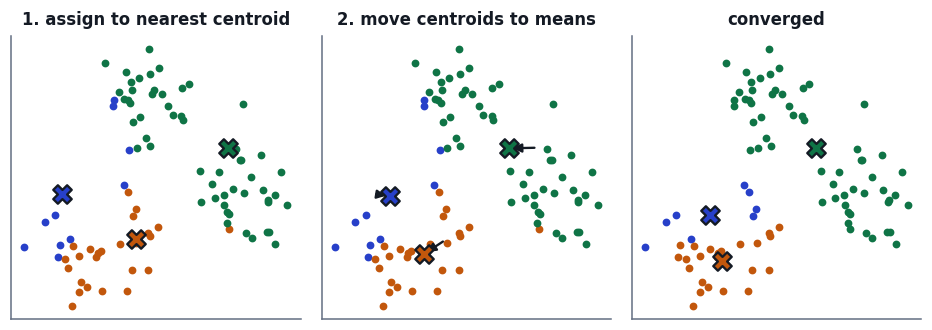
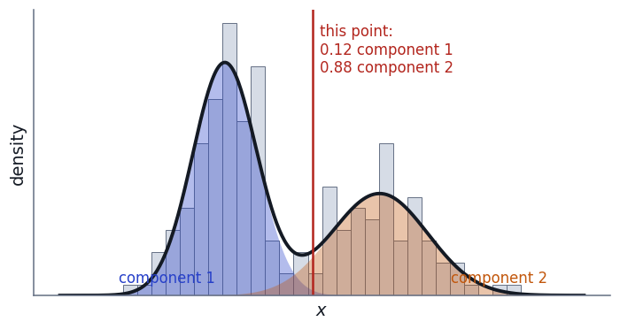
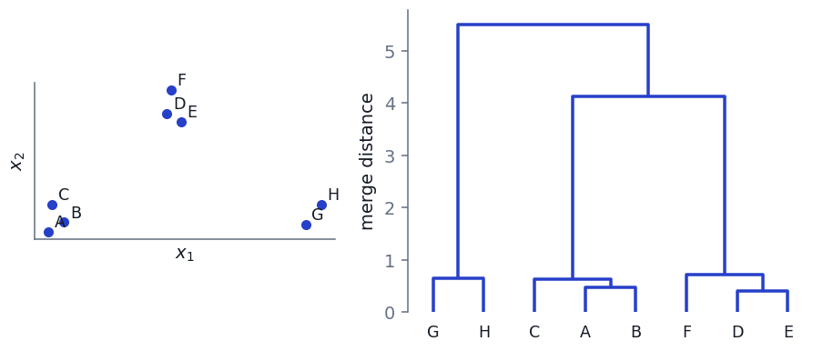
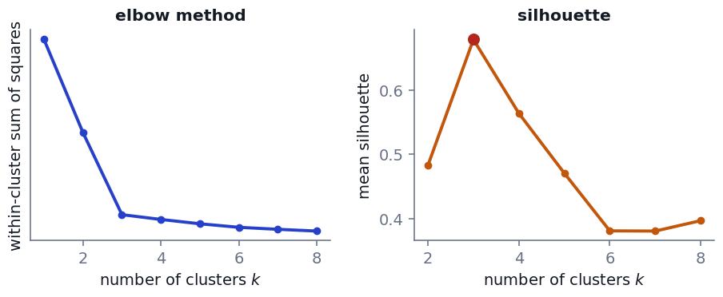
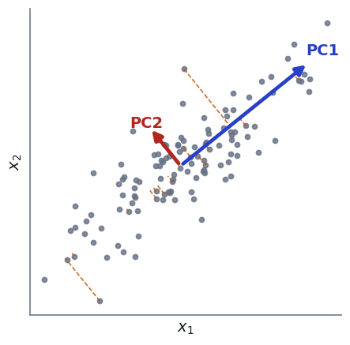
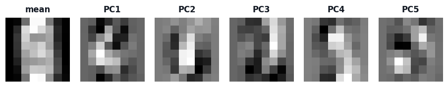
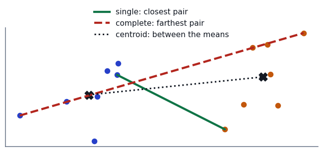

# Week 9: Unsupervised Learning

Sources: lecture deck W9 (112 pages, all pages read including the image-only formulas). There is no tutorial or lab for this topic, so the worked examples are my own and were checked in Python.

## The big picture

> **Where this fits:** Almost every method so far learned from labelled examples, and W9 is the unit where the labels disappear, so the task changes from predicting an answer to finding structure in the inputs.
>
> - Labels are expensive, so most data has none. That leaves two jobs: find groups of similar instances (clustering) and find a smaller set of new features (dimensionality reduction).
> - Before clustering we need to say what a good grouping is: points in a cluster close together, points in different clusters far apart.
> - $k$-means is the simplest way to get there: give every point to one of $k$ centres, move each centre to the middle of its points, and repeat.
> - Forcing each point into one cluster is crude when clusters overlap, so a Gaussian mixture fitted with EM gives each point a probability for each cluster instead.
> - Both of those need $k$ up front, so hierarchical clustering avoids the choice by building a whole tree of merges that you can cut later.
> - With no labels there is no accuracy to check, so next come tools for choosing $k$ (elbow, gap statistic) and for judging a clustering (silhouette, plus external scores on data with known labels).
> - Then we turn from rows to columns: PCA does for features what clustering does for instances, replacing many related features with a few new ones.
> - Eigenfaces shows PCA working on images, and because PCA gets expensive, we then meet alternatives such as Random Projections and autoencoders.
> - Last, semi-supervised learning sits between the two worlds: a few labels plus many unlabelled instances.

In supervised learning you are given labels. In unsupervised learning you only have the instances, and the job is to find structure in them. This deck covers two kinds of structure: **groups** of similar instances (clustering) and **a smaller set of new features** (dimensionality reduction). It ends with semi-supervised learning, which sits between supervised and unsupervised.

The parts fit together like this. $k$-means is the simplest clustering method: each point belongs to exactly one cluster. A Gaussian mixture fitted with EM is the probabilistic version: each point has a probability of belonging to each cluster. Hierarchical clustering avoids choosing $k$ by building a whole tree of merges. Because there are no labels, you then need separate tools to choose $k$ and judge quality: the elbow method, the gap statistic and silhouettes. PCA does for features what clustering does for instances: it summarises many related features with a few new ones. The maths most likely to be tested is the $k$-means iteration, the E and M step formulas, the linkage updates, the silhouette formula and the PCA recipe.

**Notation warning.** The deck reuses letters, so read each formula in context.

| Letter | Main meaning in this deck | Other meanings in the deck |
|---|---|---|
| $m$ | number of instances (W9 p.10, p.93) | number of eigenvectors kept in the figure on W9 p.94 |
| $n$ | number of features (W9 p.10, p.93) | number of instances (W9 p.64, p.94, p.98); component index in the E step sum (W9 p.47) |
| $k$, $K$ | number of clusters | number of eigenfaces kept; the $K$ of $k$-NN (W9 p.100); a merge level label (W9 p.67) |
| $d$ | distance function | number of pixels or dimensions (W9 p.94, p.96) |
| $P_i$ | cluster assigned to element $i$ (W9 p.15) | $P$ alone is a whole partition; $P(Y \mid h)$ is a probability |

## What unsupervised learning is for

> **Where this fits:** Labelling data takes people, time and money, so most data arrives with no labels and the supervised methods of W1 to W8 cannot be applied directly. This is the Frame the task stage: the answer to "is it supervised?" is no, so the job becomes discovering classes instead of predicting known ones. The results often feed back into supervised work, for example as new features for a later classifier.

**Supervised learning:** classes are known and need a definition in terms of the data. Its names include classification, discriminant analysis and class prediction. **Unsupervised learning:** classes are initially unknown and must be discovered from the data. Its names include cluster analysis and class discovery (W9 p.3).

We need it because most of the world's data is unlabelled, and getting humans to label data is difficult, time-consuming, expensive and error-prone (W9 p.4).

It is useful for (W9 p.5):

- simplifying a problem, for example by dimensionality reduction
- exploratory data analysis with visualisation
- transforming data to simplify a classification problem
- grouping instances into subsets
- discovering structure, such as hierarchies of subconcepts
- learning new features for later classification
- tracking concept drift over time
- learning generative models for images, text, video and speech

## Clustering: the setup

> **Where this fits:** You have a pile of instances and want to know which belong together, with nobody to tell you the right groups. This section fixes the vocabulary before any method appears: what a clustering is, what the input looks like, and what "good" means. It belongs to Frame the task, and its goal of homogeneous, well-separated clusters is what later methods turn into a number at Define the loss. It leans on the distance measures from W2, because "similar" means whatever your chosen distance says it means.

Clustering means finding groups of similar items. A clustering dataset is like a classification dataset without the class labels. Success is often measured subjectively, which is fine for exploratory analysis but a problem if you need quantitative results (W9 p.6).

**Ways to represent a clustering** (W9 p.7-8):

- a partition, where each point is in exactly one cluster
- overlapping clusters, shown as a Venn diagram
- probabilistic assignment, a table of each point's probability for each cluster, with each row summing to 1
- a dendrogram, a tree of nested clusters

**Two families** (W9 p.9). Partitioning methods usually need the number of clusters up front, then fit objects to clusters. Hierarchical methods are either **agglomerative** (bottom-up) or **divisive** (top-down). Agglomerative methods are often used in practice, because efficient exact algorithms exist and, more importantly, users can view the dendrogram.

**Formal setup** (W9 p.10). $X = \{x_1, \dots, x_m\}$ is the set of instances. $C = (C_1, \dots, C_k)$ is a partition of the $m$ elements into $k$ subsets. Each subset is a **cluster** and $C$ is a **clustering**. Input comes in two forms:

- feature vectors: an $m \times n$ matrix, which holds more information
- pairwise similarity or distance: an $m \times m$ matrix, which is generic given a suitable function

Usually $m \gg n$.

**Goal** (W9 p.11-13). Find clusters that are **homogeneous** (points in the same cluster are similar) and **well-separated** (points in different clusters are dissimilar). Both terms need a definition, so use a distance measure suited to the problem. The two goals interact: high homogeneity usually comes with low separation and vice versa, unless the data has clear structure. A bad clustering has small distances between points in different clusters and large distances between points in the same cluster.

## $k$-means clustering

> **Where this fits:** You want to split data into $k$ groups quickly, with each point in exactly one group. $k$-means is the simplest clustering method, and it covers three stages at once: Choose a model (each group is summed up by one centre), Define the loss (the within-cluster sum of squares) and Fit the model (alternate two steps). It reuses the centroid from W2's nearest centroid classifier, except that here the groups are discovered, not given by labels. Pick it when you want something simple and efficient and each point belongs in one cluster: EM in the next section is the soft alternative, and hierarchical clustering is the alternative when you don't want to fix $k$.

**Algorithm** (W9 p.14). Set $k$, by prior knowledge or by search. Choose $k$ initial centres at random. Then:

1. Assign each instance to the closest of the $k$ points.
2. Move each of the $k$ points to the mean of its cluster.
3. Repeat until the clustering is reasonably stable.

**Objective** (W9 p.15). With $d$ the Euclidean distance, $c_j$ the centroid of cluster $j$ and $P_i$ the cluster of element $i$, the slide writes
$$E_P = \sum_{i=1}^{m} d(x_i, c_{P_i}).$$
The criterion that $k$-means really minimises is the **within-cluster sum of squares**, so read $d$ here as squared distance. See "Where the slides are loose or wrong" below.

> **In plain words:** This is the scorecard for a clustering. For each point, find the centre of the cluster it was given, measure how far away that centre is, square the distance, and add the results over all points. A small total means every point sits close to its own centre, so the clusters are tight. The square is missing from the formula as the slide prints it, and it matters, because the mean is the best centre only for squared distance. Zero means every point sits exactly on a centre, which always happens at $k = m$, so the lowest score alone cannot tell you the best $k$.

**Why it stops.** The assignment step cannot increase the sum of squares, because each point moves to a centre at least as close. The update step cannot increase it either, because the mean is the point that minimises the sum of squared distances within a cluster. There are finitely many partitions, so the algorithm stops, but possibly at a **local** minimum.

**Second view of $k$-means** (W9 p.16). This is a greedy search. Start with an arbitrary partition $P$. For each element $i$ and each cluster $j \ne P(i)$, let $E_P^{ij}$ be the cost if $i$ moves to $j$. If the best such cost is below $E_P$, make that single move and repeat. Otherwise halt. It moves one element per pass, unlike the first version, which reassigns all points at once.

**Properties** (W9 p.17-18). Means move to minimise a squared-error criterion. It is an approximate way of getting maximum likelihood estimates of means. Each point is assumed to be in exactly one cluster. If clusters blend, use fuzzy $k$-means, which allows overlapping clusters.

**Slide example** (W9 p.19-22). There are 11 points with centroids starting at $(3.2, 9.8)$ and $(9.3, 7.1)$. The first five points go to centroid 1 and the other six to centroid 2. The new centroids are $(2.0, 5.0)$ and $(5.8, 1.8)$, and nothing changes after that. Solution quality depends on the distribution of the points, the choice of $k$, outliers and the initial centroids.

**Choice of $k$** (W9 p.23-25). If you ask for $k = 3$ on data with two poorly separated groups, $k$-means still returns three clusters, splitting one natural group.

**Outliers** (W9 p.26-27). A mean is pulled strongly by extreme points, so an outlier can drag a centroid away and distort the clusters. Two remedies are given:

- remove points that are much further from the centroids than the others, ideally monitoring them over a few iterations first
- cluster a small random sample, which is unlikely to contain an outlier, then assign the remaining points by distance, similarity or classification

**Initial seeds** (W9 p.28-29). Different seeds can give very different results. Toy example: four points at the corners of a rectangle. Centres at the midpoints of the two **long** sides are a local minimum, since no point wants to move, yet the cost is higher than with centres at the midpoints of the short sides. Two fixes are given:

- restart with different random seeds, which can be time-consuming
- use $k$-means++, which initialises the centroids far apart from each other

**Remarks** (W9 p.30). $k$-means is still the most popular algorithm because it is simple and efficient. There is no clear evidence that another clustering algorithm is better in general. Comparing clustering algorithms is hard, because nobody knows the correct clusters.

### Applications of $k$-means

> **Where this fits:** These show what clustering is for once it works. Image segmentation uses the centroids to simplify a picture, and the bag of visual words uses them to build features, so each image becomes a histogram of length $k$ that can be compared with other images. That second use is the Prepare the data stage, with $k$-means as a tool for making features, not the end result. It is the visual version of the bag of words for text in W3.

**Image segmentation** (W9 p.31-32). The goal is to partition an image into regions of reasonably homogeneous appearance. Cluster the pixels and redraw each pixel with its centroid. $K = 2$ gives a two-tone picture, and $K = 10$ is close to the original.

**Bag of (visual) words** (W9 p.33-38):

1. Feature extraction: find patches, normalise them and compute a SIFT descriptor for each.
2. Dictionary learning: pool the descriptors from many images and cluster them with $k$-means.
3. The centroids form the **visual vocabulary**, with each centroid a visual word.
4. Image representation: assign each descriptor in an image to its nearest word and build a frequency histogram. The histogram has one bin per word, so its length is $k$.
5. Application: compare histograms for image retrieval.

## Mixture models and EM

> **Where this fits:** $k$-means gives each point to one cluster, which is a poor description of a point in the overlap between two groups, so a Gaussian mixture assumes the data came from several bell curves and asks how likely each point is to have come from each one. The mixture is the model (Choose a model) and EM is how you fit it (Fit the model), using the maximum likelihood idea from R2 and W3. Gaussian Naive Bayes in W3 also fits normal curves, but there the class labels were given, and here they are hidden. Pick it over $k$-means when you want a probability for each point, or when clusters differ in size and each Gaussian gets its own variance.

**When to use EM** (W9 p.39). Use it when data is only partially observable. That covers unsupervised learning, where the class value is unobservable, and supervised learning with some unobservable attributes. Uses include training Bayesian belief networks, unsupervised clustering ($k$-means, AUTOCLASS) and learning hidden Markov models (the Baum-Welch algorithm). This course focuses on EM for $k$-means, a specific case of EM for Gaussian mixture models.

**Finite mixtures** (W9 p.40-42). Each instance is generated by choosing one of the $k$ Gaussians and then sampling from it. It is called finite because there is a finite number of generating distributions. The slide on W9 p.40 says the Gaussian is chosen with uniform probability. The example on W9 p.42 has unequal weights: $\mu_A = 50, \sigma_A = 5, p_A = 0.6$ and $\mu_B = 65, \sigma_B = 2, p_B = 0.4$.

**Why a mixture** (W9 p.44-45). One Gaussian fitted to two-humped data puts its peak in the trough between the humps. A mixture with $K = 2$ fits both humps.

**The problem** (W9 p.43). Instances come from a mixture of $k$ Gaussians with unknown means and identity covariance. We do not know which Gaussian produced each instance. We want the maximum likelihood estimates of $\mu_1, \dots, \mu_k$.

**Hidden variables** (W9 p.46). For $k = 2$, the full description of an instance is $y_i = \langle x_i, z_{i1}, z_{i2} \rangle$. Here $x_i$ is observed and $z_{ij}$ is not. In $k$-means $z_{ij}$ is 1 if $x_i$ came from Gaussian $j$ and 0 otherwise. In general it is the probability of belonging to Gaussian $j$.

> **In plain words:** Each instance really has two parts: the value you can see, and a tag saying which Gaussian produced it, which you can't see. The $z_{ij}$ are those missing tags, one for each instance and each Gaussian. In $k$-means a tag is a firm yes or no, and in general it is a probability. With the tags known, each mean would be an ordinary average, and with the means known, the tags can be estimated, so EM goes back and forth between the two.

**Algorithm** (W9 p.47-48). Pick a random initial $h = \langle \mu_1, \mu_2 \rangle$, then iterate.

**E step.** Compute the expected value of each hidden variable, assuming the current $h$ holds:
$$E[z_{ij}] = \frac{p(x = x_i \mid \mu = \mu_j)}{\sum_{n=1}^{2} p(x = x_i \mid \mu = \mu_n)} = \frac{e^{-\frac{1}{2\sigma^2}(x_i - \mu_j)^2}}{\sum_{n=1}^{2} e^{-\frac{1}{2\sigma^2}(x_i - \mu_n)^2}}$$
Here $n$ just indexes components. The Gaussian's constant cancels only because the variance is shared. Equal mixing weights are also assumed.

> **In plain words:** This works out how much of a point each Gaussian claims, given the current guess at the means. For one point, score how plausible it is under each Gaussian (the closer the point is to that mean, the higher the score), then divide each score by the total so that the shares add up to 1. A share near 1 means this Gaussian almost certainly produced the point, and a point exactly halfway between the two means gets one half each. The shorter form with only exponentials relies on the conditions above: a shared variance and equal weights, so nothing else differs between the components.

**M step.** Compute the new maximum likelihood hypothesis, assuming each $z_{ij}$ takes its expected value, and replace $h$ by $h'$:
$$\mu_j \leftarrow \frac{\sum_{i=1}^{m} E[z_{ij}]\, x_i}{\sum_{i=1}^{m} E[z_{ij}]}$$
This is a weighted mean, so the denominator is the total weight for component $j$, not $m$.

> **In plain words:** This re-estimates each mean using the shares from the E step. Take an average of all the points, where each point counts for as much as Gaussian $j$ claimed it: a point claimed 0.9 pulls on this mean nine times as hard as a point claimed 0.1. You divide by the total of the shares, not the number of points, because this Gaussian only owns that much of the data. If every share were exactly 0 or 1, this would become the ordinary mean of the cluster's points, which is the $k$-means update.

In short (W9 p.49): the E step calculates probabilities for each instance, and the M step estimates parameters from those probabilities. EM produces **soft assignments**.

**What EM guarantees** (W9 p.50, p.55). It converges to a **local** maximum likelihood $h$ and provides estimates of the $z_{ij}$. Precisely, it finds a local maximum of $E[\ln P(Y \mid h)]$. $Y$ is the complete data, observed plus unobserved, and the expectation is over the possible values of the unobserved variables.

**General EM problem** (W9 p.55). Given observed data $X$, unobserved data $Z$ and a parameterised distribution $P(Y \mid h)$ with $y_i = x_i \cup z_i$, find the $h$ that locally maximises $E[\ln P(Y \mid h)]$.

> **In plain words:** $E[\ln P(Y \mid h)]$ is the score EM is trying to raise. Take a candidate set of parameters $h$ and ask how probable it makes the complete data, including the parts you can't see. Since those parts are unknown, average that answer over their possible values. A higher score means the parameters explain the data better. "Local" means EM stops at the top of a nearby hill, which need not be the highest one, so the result depends on the starting point, as with $k$-means seeds.

**Link to $k$-means** (W9 p.51-52). The figure on W9 p.51 shows $k$-means as alternating an E step (assign points to centres) and an M step (move centres to the means). You can see the link from the E step formula (this limit argument is not on the slides): as $\sigma^2 \to 0$, the nearest mean takes all the weight, so $E[z_{ij}]$ becomes 0 or 1 and the M step becomes a plain cluster mean. As $\sigma^2 \to \infty$, every weight tends to $1/k$.

> **In plain words:** The variance $\sigma^2$ acts like a softness dial on the E step. Turn it down towards zero and each Gaussian becomes so narrow that the nearest mean takes the whole point, which is the hard assignment of $k$-means. Turn it up very high and the Gaussians are so wide that they can't be told apart, so every point splits evenly between them. So hard $k$-means sits at one extreme of soft EM.

The "mouse" figure on W9 p.52 has a big head and two small ears. $k$-means cuts into the big cluster, while EM recovers the three groups, because a Gaussian mixture with separate variances can fit clusters of different sizes.

**Extending the mixture model** (W9 p.53-54):

- more than two distributions: allowed
- several attributes: easy if independence is assumed
- correlated attributes: difficult; model them jointly with a multivariate normal and a symmetric covariance matrix, which has $n + n(n-1)/2$ distinct entries for $n$ attributes
- nominal attributes: easy if independent; correlated ones need more parameters
- missing values: easy
- other distributions: log-normal if a minimum is given, log-odds if bounded above and below, Poisson for integer counts
- cross-validation can estimate $k$, but it is time-consuming

**WSI example** (W9 p.56-58). Whole-slide images are classified via patches. Patches go through feature extraction to a 512-D code. An EM loop then alternates selecting discriminative patches with updating the weights of the patch-level model. Non-discriminative patches are neglected. A patch-level label histogram then feeds a WSI-level classifier.

## Hierarchical clustering

> **Where this fits:** $k$-means and EM both ask for the number of clusters before they start, and that is often the thing you don't know. Hierarchical clustering is the alternative: it builds a whole tree of nested clusters, and you decide afterwards where to cut. This is the Choose a model stage, and the key design choice is the linkage, which extends W2's distances between points to distances between clusters. Pick it when you want to see the structure in a dendrogram and can afford the computation, but remember that it produces a tree even when the data has no hierarchy.

**Two directions** (W9 p.60). **Bottom-up:** start with single-instance clusters and join the two closest clusters at each step. The design decision is how to measure the distance between clusters. **Top-down:** find two clusters, then recurse on each subset. It can be very fast for larger datasets. Both produce a **dendrogram**.

**Agglomerative algorithm** (W9 p.61, p.64). Start with a dissimilarity matrix $D$ and each point in its own cluster.

1. Find the smallest entry $d_{ij}$ and merge clusters $i$ and $j$.
2. Replace them in $D$ with one row and column for $i \cup j$.
3. Fill in the new entries with the update formula.
4. Repeat until one cluster remains, or until $K$ clusters remain.

**Update formula** (W9 p.61-62). This is the general rule that covers the linkage variants:
$$d_{k, i \cup j} = \alpha_i d_{ki} + \alpha_j d_{kj} + \gamma \lvert d_{ki} - d_{kj} \rvert$$

> **In plain words:** Once clusters $i$ and $j$ merge, every other cluster $k$ needs a distance to the new combined cluster. This rule gets it from numbers you already have, with no need to go back to the raw points. It blends the old distance from $k$ to $i$ with the old distance from $k$ to $j$, then adds or subtracts a share of the gap between them. The settings $\alpha_i$, $\alpha_j$ and $\gamma$ control the blend, and single, complete and average linkage are each one choice of those settings (the deck gives none for centroid linkage).

| Linkage | Distance between clusters | Update | $\alpha_i$, $\alpha_j$, $\gamma$ |
|---|---|---|---|
| Single | closest pair | $\min(d_{ki}, d_{kj})$ | $\frac{1}{2}, \frac{1}{2}, -\frac{1}{2}$ |
| Complete | furthest pair | $\max(d_{ki}, d_{kj})$ | $\frac{1}{2}, \frac{1}{2}, +\frac{1}{2}$ |
| Average | mean of all cross-cluster pairs | $\frac{n_i d_{ki} + n_j d_{kj}}{n_i + n_j}$ | $\frac{n_i}{n_i + n_j}, \frac{n_j}{n_i + n_j}, 0$ |
| Centroid | distance between centroids | recompute from the centroids | not given in the deck |

> **In plain words:** Each row is a different answer to "how far apart are these two groups?". Single linkage looks only at the closest pair, one point from each group, so one close pair is enough to join them. Complete linkage looks at the furthest pair, so every point in one group must be fairly close to every point in the other before they join. Average linkage averages over all the cross-group pairs, which is why its update weights by cluster size: a bigger cluster contributes more pairs. Centroid linkage ignores individual points and measures between the two cluster means.

The min and max forms work because $\min(a,b) = \frac{a+b}{2} - \frac{\lvert a-b \rvert}{2}$ and $\max(a,b) = \frac{a+b}{2} + \frac{\lvert a-b \rvert}{2}$.

> **In plain words:** These two identities show why the sign of $\gamma$ decides between single and complete linkage. Start at the halfway point between two numbers and move by half the gap between them: stepping down lands on the smaller number, and stepping up lands on the larger. So with both $\alpha$ values at one half, a negative $\gamma$ gives the minimum and a positive $\gamma$ gives the maximum.

Centroid linkage can give a merge at a **lower** height than the previous merge, because merging moves the centroid closer to a third point. The deck does not discuss this, but it follows from the definition.

**Dendrograms** (W9 p.65-67). At level 1, every point is in its own cluster. In the deck's example, $x_6$ and $x_7$ are most similar and merge at level 2. The dendrogram is drawn to scale, so heights show how similar the merged clusters are. Cutting it at a height gives a flat clustering. The set diagram on W9 p.67 shows the same hierarchy by set inclusion but does not show distance.

**Limitation** (W9 p.68). The method imposes a bias: you get a dendrogram even if the data has no hierarchical structure.

**Linkage changes the tree** (W9 p.69-71). On the microarray data, average, complete and single linkage give visibly different trees. The single-linkage tree is the most stringy, since one close pair is enough to join two clusters.

## Choosing the number of clusters

> **Where this fits:** $k$-means and EM need $k$, but with no labels you cannot pick it by accuracy, and the objective can't pick it either, because it usually falls as $k$ grows and reaches 0 at $k = m$. This is the Evaluate and select stage, the unsupervised counterpart of the validation tools in W2. The elbow method is the quick visual option, and the gap statistic is the more formal alternative, which compares your data with structureless data. The silhouette in the next section can do this job too.

**Elbow method** (W9 p.72-73). Compute the within-cluster dispersion, the total squared distance from each point to its centroid, for a range of $k$. Choose the $k$ after which adding clusters no longer improves the dispersion much. You cannot simply take the smallest dispersion: with $k = m$ every point is its own cluster and the dispersion is 0.

**Gap statistic** (W9 p.74-75):

1. Cluster the data and compute the total within-cluster variation $W_k$.
2. Generate $B$ reference datasets with a uniform random distribution, cluster each, and compute $W_{kb}$.
3. Compute $Gap(k) = \frac{1}{B}\sum_b \log(W_{kb}) - \log(W_k)$, and also the standard deviation $s_k$.
4. Choose the **smallest** $k$ with $Gap(k) \ge Gap(k+1) - s_{k+1}$.

A large gap means the data clusters much better than structureless data does. The rule picks the first $k$ where going to $k+1$ gives no clear gain. It does not pick the largest gap. In the plot on W9 p.75 the gap is highest at $k = 12$, but the rule picks $k = 6$.

> **In plain words:** Clusters usually get tighter as $k$ grows on any data, so tightness alone proves little. The gap asks how much tighter your clusters are than the ones you get from random data with no structure at the same $k$: cluster several random datasets, average the log of their within-cluster variation, and subtract the log of yours. A large value means your data really does clump at this $k$. The rule then looks for the first $k$ whose gap is at least as good as the next one's, after allowing for the noise $s_{k+1}$ in that next gap. So it prefers the smallest $k$ that is good enough, not the largest gap.

## Evaluating clusters

> **Where this fits:** Once you have clusters, how do you know they are any good when nobody knows the right answer? This is the Evaluate and select stage for clustering. The silhouette is an internal score that needs only the data, and it measures the homogeneity and separation goals from the setup section. External scores such as the Rand index are the alternative when you have a dataset with known labels, and they do the job that accuracy and the confusion matrix metrics do in W2.

**Silhouette** (W9 p.76-79). This compares each object's separation from other clusters with the homogeneity of its own cluster.

- $a(i)$ is the average dissimilarity between $x_i$ and the other elements of its own cluster.
- $d(i, C)$ is the average dissimilarity of $i$ to the elements of another cluster $C$.
- $b(i) = \min_C d(i, C)$ is the value for the nearest other cluster.

$$s(i) = \frac{b(i) - a(i)}{\max(a(i), b(i))} = \begin{cases} 1 - a(i)/b(i) & a(i) < b(i) \\ 0 & a(i) = b(i) \\ b(i)/a(i) - 1 & a(i) > b(i) \end{cases}$$

So $s(i) \in [-1, 1]$. If $b(i) \gg a(i)$ then $s(i)$ is near 1 and the object is well classified. If $s(i)$ is near $-1$ it can be viewed as misclassified. A silhouette plot shows which clusters are good. The average $s(i)$ lets you compare clusterings and estimate the number of clusters.

> **In plain words:** The silhouette asks of each point: does it fit its own cluster better than the next-best cluster? Take $a(i)$, its average distance to the others in its own cluster, and $b(i)$, its average distance to the members of the nearest other cluster. Subtract $a(i)$ from $b(i)$ and divide by the larger of the two, which keeps the answer between $-1$ and $1$ whatever the units. Near 1 means the other cluster is far away compared with its own, 0 means the point sits on the border between the two, and near $-1$ means it is closer to the other cluster, so it has probably been put in the wrong place. It needs at least two clusters, because with one cluster $b(i)$ doesn't exist.

**Reading the example** (W9 p.80-83). The data has four blobs, one far from the other three. The average scores are:

| $k$ | 2 | 3 | 4 | 6 |
|---|---|---|---|---|
| Average silhouette | 0.705 | 0.588 | 0.651 | 0.450 |

The highest average is at $k = 2$, even though four blobs are visible, because the far blob is so well separated. So look at the per-cluster plot as well. At $k = 4$ the clusters are similar in size and all do reasonably well.

**External evaluation** (W9 p.84). Use a dataset with known labels, cluster it, and score the outcome with the Rand index, F-measure or Jaccard index. The deck names these without formulas. The standard pair-counting forms below are what I used. For every pair of items, count:

- $TP$: together in both the clustering and the classes
- $FP$: together in the clustering only
- $FN$: together in the classes only
- $TN$: apart in both

$$\text{Rand} = \frac{TP + TN}{TP + FP + FN + TN}, \qquad \text{Jaccard} = \frac{TP}{TP + FP + FN}, \qquad F = \frac{2PR}{P + R}$$
with $P = TP/(TP + FP)$ and $R = TP/(TP + FN)$. These do not depend on cluster numbering, whereas plain accuracy does.

> **In plain words:** These scores grade a clustering against known classes without caring what the clusters are called. Instead of checking each item's label, take every pair of items and ask whether the clustering and the true classes agree about that pair: same group, or different groups? Rand is the share of all pairs on which they agree. Jaccard sets aside the pairs that both keep apart, and asks how many of the remaining pairs both put together. $F$ is the $F_1$ from W2 applied to pairs: $P$ is the share of the clustering's together-pairs that truly belong together, and $R$ is the share of truly together pairs that the clustering found.

**Clustering summary** (W9 p.85-87, p.110):

- There is no magic bullet: different techniques suit different aspects of the data.
- Hierarchical clustering shows the complete structure found without restricting the number of clusters, but it can be computationally expensive. Different linkages can give very different dendrograms, higher nodes can be very heterogeneous, and the problem may have no real hierarchy.
- $k$-means avoids some of those problems but has drawbacks. $k$ must be set in advance, and it cannot extract intermediate features, such as a subset of features in which a subset of objects is co-expressed.
- All these methods can cluster objects or features, but not both together (coupled two-way clustering).
- Should all points be clustered? Algorithms can be modified to allow points to be discarded.
- Visualisation matters: dendrograms and alternatives such as Self-Organizing Maps.
- To estimate quality: if the clusters are known, measure the proportion of disagreements to agreements. If unknown, measure homogeneity and separation, or use silhouettes.
- Clustering is only a first step. It is mainly exploratory, feeding into classification, modelling and hypothesis formation.

## Dimensionality reduction and PCA

> **Where this fits:** With many related features, using them all is unlikely to improve a model (partly the curse of dimensionality from W2), and picking a subset may be arbitrary. PCA replaces them with a few new features that keep as much of the data's spread as possible, so it is a Prepare the data step, and it uses no labels. It is the "dimensionality reduction" option that W1 listed beside subset selection and shrinkage, and W2 suggested it for correlated inputs to logistic regression. W5's feature maps build new features in a bigger space, PCA builds them in a smaller one, and Kernel PCA brings the W5 kernel idea back when you want non-linear axes.

**Why reduce dimensions** (W9 p.89). Each numeric feature is a dimension. Many features may be related, and including them all is unlikely to improve models, partly because of the curse of dimensionality. Feature selection may return arbitrary features. So look for a set of **new** features that is smaller than the original set and preserves as much of the information as possible.

**Key idea of PCA** (W9 p.90). Find a transformed space in which each new dimension captures the most variation in the data when the data is projected onto it. New features should be highly correlated with some original features but not with each other. That points to the variance-covariance matrix.

**Algorithm** (W9 p.93):

1. Take the data as an $m \times n$ matrix $X$.
2. Centre it by subtracting the mean of each column.
3. Construct the covariance matrix $C$ from the centred matrix.
4. Compute the eigenvector matrix $V$ (rotation) and eigenvalue matrix $S$ (scaling), with $V^{-1} C V = S$ and $S$ a diagonal $n \times n$ matrix.
5. Sort by decreasing eigenvalue, which is decreasing variance, keeping eigenvectors aligned.
6. Remove the columns of $S$ and $V$ whose eigenvalues are below a threshold.
7. Transform the original data using the remaining eigenvectors.

> **In plain words:** The covariance matrix $C$ is a table of how each pair of features varies together. An eigenvector of $C$ is a direction that $C$ only stretches and never turns, and its eigenvalue is the amount of stretch. In PCA, each eigenvector is one new axis through the data, and its eigenvalue is how much the data spreads out along that axis, so a big eigenvalue marks an important direction and a tiny one marks a direction where little happens. The recipe is then: centre the data, find the axes, rank them by spread, drop the thin ones, and describe each point using the axes that remain. The equation $V^{-1} C V = S$ says that when measured along these axes, $C$ has nothing off its diagonal, so the new features don't vary together at all.

**The maths behind the recipe.** The deck gives the recipe but no proof. The derivation below is standard material, not on the slides, but it is short and worth knowing. For centred data and a unit vector $v$, the projection of $x$ is $v^\top x$, and its variance is $v^\top C v$. Maximise this subject to $v^\top v = 1$ with the Lagrangian $L = v^\top C v - \lambda(v^\top v - 1)$. Setting $\nabla_v L = 2Cv - 2\lambda v = 0$ gives $Cv = \lambda v$. Then $v^\top C v = \lambda$. So the best direction is the eigenvector with the largest eigenvalue, and the variance along it is that eigenvalue.

> **In plain words:** This explains why eigenvectors appear at all. Pick a direction, drop every point onto that line like a shadow, and measure how spread out the shadows are: that spread is $v^\top C v$. The direction must be a unit vector, otherwise you could raise the score by making $v$ longer without finding a better direction. Searching for the best direction under that limit, using the same multiplier device as the Lagrange method in W5, leads to $Cv = \lambda v$, so the only candidates are eigenvectors. At each one the spread equals $\lambda$, so the winner is the eigenvector with the largest eigenvalue.

Consequences:

- Each new feature is a linear combination of the original features, and its variance is $\lambda_j$.
- The new features are uncorrelated, since their covariance matrix is the diagonal matrix $S$.
- Total variance is unchanged: $\sum_j \lambda_j = \mathrm{trace}(C)$.
- The fraction of variance kept by the first $K$ components is $\sum_{j \le K} \lambda_j / \sum_j \lambda_j$.
- With the $1/n$ covariance, the total squared reconstruction error is $n$ times the sum of the dropped eigenvalues.

> **In plain words:** Explained variance answers "how much of the data's spread did I keep?". The new axes don't change the total spread, and the eigenvalues divide that total between them. Add up the eigenvalues you keep and divide by the sum of all of them: 1 means nothing was lost, and 0.9 means 90% of the spread survives. What you drop comes back as reconstruction error, so the bigger the dropped eigenvalues, the further the rebuilt points are from the originals overall (the $n$ in that last bullet is the number of instances, as in worked example 5). This counts spread only, and PCA never sees labels, so a high share doesn't promise that class differences survive.

**Example** (W9 p.91-95). A correlated 2-D cloud of 200 points gets two new axes, one long and one short. Dropping the second halves the dimensionality while keeping most of the variance. The inverse transform of the kept component puts all the points on a line.

The figure on W9 p.94 uses $C = \begin{pmatrix} 2.0 & 0.8 \\ 0.8 & 0.6 \end{pmatrix}$, with $\mathrm{cov}(h,u) = \frac{1}{n}\sum_i h_i u_i$ on centred data. Its eigenvalues are 2.363 and 0.237, so the first component keeps 90.9% of the variance.

**Summary points** (W9 p.105). PCA transforms the features to a new space. Every new feature is a linear combination of the original ones. Matrix operations translate, rotate and scale the data. The method is based on the covariance matrix and can be kernelised (KernelPCA), giving a new feature space with non-linear axes. PCA uses no labels.

## Eigenfaces

> **Where this fits:** A face image has one feature per pixel, so comparing faces directly means working in a very high-dimensional space. Eigenfaces is the PCA recipe applied to that problem, so the maths is the previous section again, at the Prepare the data stage. The short vectors it produces then go to the kNN classifier from W2, which makes this a complete example of reducing features first and classifying afterwards.

**Idea** (W9 p.96). Most face images lie near a low-dimensional subspace given by the first $k \ll d$ directions of maximum variance. PCA finds the vectors, or **eigenfaces**, that span it. Each face is then written as a linear combination of eigenfaces.

**Note the orientation here.** Each image is one long **column** vector, so $X$ is $d \times N$. In the PCA algorithm above, instances are rows.

**Training** (W9 p.97-99):

1. Align the training images $x_1, \dots, x_N$.
2. Compute the average face $\mu = \frac{1}{N}\sum_i x_i$.
3. Compute the centred data matrix $X_c = X - \mu \mathbf{1}^\top = X(I - \frac{1}{n}\mathbf{1}\mathbf{1}^\top)$.
4. Compute the covariance matrix $\Sigma = \frac{1}{n} X_c X_c^\top$.
5. Compute the eigenvectors $\phi_k$ of $\Sigma$.
6. Project each image: $x_i \to (x_i^c \cdot \phi_1, \dots, x_i^c \cdot \phi_K) \equiv (a_1, \dots, a_K)$.
7. Reconstruct an estimate: $x_i \approx \mu + a_1 \phi_1 + \dots + a_K \phi_K$.

> **In plain words:** Every face is stored as the average face plus a short list of adjustments. To get the list, subtract the average face, then measure how much of each eigenface is in what remains: each dot product gives one number, and the numbers $a_1$ to $a_K$ are the new compact description of the face. To rebuild the face, go the other way: start from the average face and add each eigenface in the amount its number says. The more eigenfaces you keep, the closer the rebuilt image is to the real one.

**Testing** (W9 p.100). For a query $t$, compute $((t - \mu) \cdot \phi_1, \dots, (t - \mu) \cdot \phi_K) \equiv (w_1, \dots, w_K)$. Subtract the training mean first. Compare $w$ with all $N$ training projections, using Euclidean distance and a $k$-nearest-neighbour decision. That "K" is unrelated to the number of components.

**Effect of $K$** (W9 p.101). Pictures at $K = 4, 200, 400$ show better reconstruction as $K$ grows. Keeping only the top $K$ eigenfaces reduces the dimensionality. Fewer eigenfaces means more information loss, and so less discrimination between faces.

## PCA alternatives and autoencoders

> **Where this fits:** PCA stops being feasible when there are very many features, because its cost is cubic in the number of features. This section lists other ways to do the same Prepare the data job. Random Projections are the choice when scale is the problem. An autoencoder gets reduced features a different way, using a neural network of the kind built in W8.

**Cost and alternatives** (W9 p.102). PCA is cubic in the number of original features, which is not feasible for very high-dimensional data. **Random Projections** approximate that sort of projection. They are more scalable, and they can be shown to preserve distance relations from the original data. Many other methods use the same matrix decomposition idea, such as finding topics in text (Latent Semantic analysis) and hidden sub-groups for recommender systems. Other alternatives named on W9 p.105 are Independent Component Analysis, Multi-dimensional Scaling and Word2Vec.

**Autoencoders** (W9 p.103-104). A neural network in two parts: the **encoder** maps $x$ to a code $z$, and the **decoder** rebuilds $\hat{x}$ from $z$. It is trained with the L2 loss $\lVert x - \hat{x} \rVert^2$ so that the features can reconstruct the original data. It does not use labels. The narrow middle layer gives the reduced features. Variants include sparse and variational autoencoders (W9 p.105).

> **In plain words:** This loss scores how well the network can copy its own input. Squeeze the input through the narrow middle layer, rebuild it on the other side, and add up the squared differences between the rebuilt version and the original. The loss can only be small if the narrow code kept what is needed to rebuild the input, which is why that code works as a compact set of features. The target is the input itself, so no labels are needed.

## Semi-supervised learning

> **Where this fits:** Often you have a few labels and a lot of unlabelled data, and labelling the rest is too expensive. Semi-supervised learning sits between supervised and unsupervised learning: it is a Frame the task choice that takes any supervised learner from the earlier units and grows its training data from the unlabelled instances. Self-training is the basic version with one classifier, and it relies on its own labels tending to be correct, because otherwise its errors are fed back into training. Co-training is the alternative when each instance has two views, assumed independent and compatible.

**Basic recipe** (W9 p.106). Learn an initial classifier from the labelled set and apply it to the unlabelled set. Retain the most confident predictions, learn a new classifier from the now-labelled data, and repeat until convergence. This helps when there is too little labelled training data, and it can be used with any supervised learner.

**Self-training** (W9 p.107). Given labelled $(x, y)$ and unlabelled $(x)$, repeat: train $h$ on the labelled data, then label the unlabelled data with $h$. It assumes the classifications by $h$ tend to be correct, especially the high-probability ones. If that fails, its errors are fed back into training.

**Co-training** (W9 p.108-109; Blum and Mitchell 1998). Use two views of an instance, $f_1$ and $f_2$, assumed **independent and compatible**. Train a separate model for each view on the small labelled set, use the models to label a subset of the unlabelled data, and repeat until no unlabelled examples remain. This is also called multi-view learning.

**Continuum of supervision** (W9 p.111). Supervised and unsupervised learning are two ends of a continuum. Between them are semi-supervised learning (a small labelled sample improved by a large unlabelled one, or a large unlabelled sample followed by learning classes from a small labelled one) and **active learning**, where the system acts to generate its own examples.

## Where the slides are loose or wrong

None of the questions in the bank depends on a disputed reading. Where the wording matters, the question states the convention.

- **Squared or plain distance (W9 p.15, p.18, p.72).** The formula on p.15 sums plain Euclidean distances, and the next line says "sum of squares or sum of distances". These are different objectives. The mean minimises the sum of **squared** distances, and p.18 and p.72 both use squared distances. Treat $k$-means as minimising the within-cluster sum of squares.
- **$k$-means++ (W9 p.29).** The slide says centroids are "maximally distant". The real algorithm picks each new seed at random with probability proportional to its squared distance from the nearest chosen seed, so "spread far apart" is the safe reading.
- **Uniform choice of component (W9 p.40, p.42).** p.40 says Gaussians are chosen uniformly, but the example on p.42 has weights 0.6 and 0.4. The E step on p.47 needs equal weights. With unequal weights or variances, you must put $p_j$ and $1/\sigma_j$ back in.
- **Identity covariance or $\sigma^2$ (W9 p.43, p.47).** p.43 assumes identity covariance, but p.47 keeps a general shared $\sigma^2$. Identity is the case $\sigma^2 = 1$.
- **"EM for $k$-means" (W9 p.39, p.46-49).** The deck uses this name for two things. p.46 says $z_{ij}$ is 0 or 1 in $k$-means, but p.47 computes soft expected values, and p.49 says "in $k$-means the probabilities are stored as instance weights". Keep them apart: hard $k$-means has $z_{ij} \in \{0, 1\}$, and EM for a mixture has soft $E[z_{ij}]$.
- **Parameter count (W9 p.53).** $n + n(n-1)/2$ counts the distinct entries of the covariance matrix: $n$ variances and $n(n-1)/2$ covariances. It leaves out the $n$ means, so a full Gaussian has $n + n(n+1)/2$ parameters. The bank asks only about covariance-matrix entries.
- **"EM is much more robust than $k$-means" (W9 p.110).** This is an overstatement. EM also finds only a local maximum and depends on its starting point (p.50). No question relies on this claim.
- **Update step (W9 p.61).** "Deleting column $i$ and row $j$" should mean removing the rows and columns of both $i$ and $j$, then adding one for $i \cup j$.
- **Dendrogram scale (W9 p.65-66, p.70-71).** p.66 uses a **similarity** scale, where higher means more similar and merges happen earlier. Heights in most other dendrograms are dissimilarities, where higher means later. Check the axis.
- **Label "$k = 8$" (W9 p.67).** The numbers 2 to 8 on the set diagram are merge levels, not cluster counts. At level $\ell$ of this 8-point example there are $9 - \ell$ clusters, so level 8 has one cluster.
- **Elbow wording (W9 p.72).** "Choose the $k$ that doesn't improve the dispersion much" means the point where further increases stop helping. In the plot on p.73 the curve even rises slightly from $k = 8$ to $k = 9$. An optimal clustering could not do that, so it reflects $k$-means stopping at a local minimum.
- **Silhouette $a(i)$ (W9 p.76).** The slide does not say whether $x_i$ itself is excluded from the average. The standard definition and scikit-learn exclude it, and the bank states this.
- **Silhouette at $k = 1$ (W9 p.79).** The plot shows 0 at $k = 1$, but $b(i)$ does not exist with one cluster, so the value is undefined. scikit-learn raises an error.
- **"0.75 and 0.02 of the variance" (W9 p.92).** These cannot be fractions of the variance, because two components of 2-D data would then sum to 1. They read as the variances along each component. As shares they would be about 0.974 and 0.026.
- **$1/n$ or $1/(n-1)$ (W9 p.94, p.98).** The deck divides by $n$. `np.cov` and scikit-learn's `PCA` divide by $n - 1$. Eigenvectors and variance ratios are the same either way, and only the eigenvalues scale.
- **Typos in eigenfaces (W9 p.97-100).** $N$ and $n$ both mean the number of images, and p.100 says "project y" where the query is called $t$.
- **Self-training (W9 p.106-107).** p.106 keeps only the most confident predictions, but p.107 labels all the unlabelled data. p.106 also says "each classifier" although there is only one. The first reading is the usual one.

## Worked examples

There are no official solutions for this topic. I made these examples up and checked each with the verification script.

### 1. $k$-means by hand

Points: $a(1,1), b(2,1), c(1,2), d(6,5), e(7,5), f(6,6)$. Take $k = 2$ with poor seeds $c_1 = (1,1)$ and $c_2 = (2,1)$.

**Pass 1, assign.** Squared distances to $c_1$ and $c_2$:

| Point | to $c_1$ | to $c_2$ | Cluster |
|---|---|---|---|
| $a$ | 0 | 1 | 1 |
| $b$ | 1 | 0 | 2 |
| $c$ | 1 | 2 | 1 |
| $d$ | 41 | 32 | 2 |
| $e$ | 52 | 41 | 2 |
| $f$ | 50 | 41 | 2 |

**Pass 1, update.** $c_1 = (1, 1.5)$ and $c_2 = (21/4, 17/4) = (5.25, 4.25)$. The within-cluster sum of squares is $W = 30$.

**Pass 2.** $b$ is now 1.25 from $c_1$ (squared) and 21.125 from $c_2$, so it moves. The clusters are $\{a,b,c\}$ and $\{d,e,f\}$. Then $c_1 = (4/3, 4/3)$, $c_2 = (19/3, 16/3)$ and $W = 8/3 \approx 2.67$.

**Pass 3.** Nothing moves, so the algorithm has converged. Note that $W$ fell at each step.

### 2. One EM iteration

Data $x = 0, 2, 3$, with $\sigma^2 = 1$, equal weights, and start $\mu_1 = 0, \mu_2 = 3$.

**E step.** With two components, $E[z_{i1}] = 1/(1 + \exp(-\frac{1}{2}[(x_i - \mu_2)^2 - (x_i - \mu_1)^2]))$.

| $x_i$ | $(x_i - \mu_1)^2$ | $(x_i - \mu_2)^2$ | $E[z_{i1}]$ | $E[z_{i2}]$ |
|---|---|---|---|---|
| 0 | 0 | 9 | $1/(1 + e^{-4.5}) = 0.989$ | 0.011 |
| 2 | 4 | 1 | $1/(1 + e^{1.5}) = 0.182$ | 0.818 |
| 3 | 9 | 0 | $1/(1 + e^{4.5}) = 0.011$ | 0.989 |

**M step.**
$$\mu_1 \leftarrow \frac{0.989(0) + 0.182(2) + 0.011(3)}{0.989 + 0.182 + 0.011} = \frac{0.397}{1.182} = 0.336$$
$$\mu_2 \leftarrow \frac{0.011(0) + 0.818(2) + 0.989(3)}{0.011 + 0.818 + 0.989} = \frac{4.603}{1.818} = 2.532$$

Further iterations converge to about 0.58 and 2.50. Hard $k$-means from the same start would put 0 alone and $\{2, 3\}$ together, with means 0 and 2.5.

### 3. Linkage on a small distance matrix

Points on a line at 1, 2, 4, 8, so the distances are:

| | 1 | 2 | 4 | 8 |
|---|---|---|---|---|
| 1 | 0 | 1 | 3 | 7 |
| 2 | 1 | 0 | 2 | 6 |
| 4 | 3 | 2 | 0 | 4 |
| 8 | 7 | 6 | 4 | 0 |

First merge in every case: $\{1, 2\}$ at height 1.

**Single.** 4 to $\{1,2\}$ is $\min(3,2) = 2$, and 8 to $\{1,2\}$ is 6. Merge 4 at height 2. Then 8 to $\{1,2,4\}$ is $\min(6,4) = 4$. Heights: 1, 2, 4.

**Complete.** 4 to $\{1,2\}$ is $\max(3,2) = 3$, and 8 to 4 is 4. Merge 4 at height 3. Then 8 to $\{1,2,4\}$ is $\max(7,6,4) = 7$. Heights: 1, 3, 7.

**Average.** 4 to $\{1,2\}$ is $(3+2)/2 = 2.5$, and 8 to $\{1,2\}$ is 6.5. Merge 4 at 2.5. Using the update with $n_i = 2, n_j = 1$: $d = (2 \times 6.5 + 1 \times 4)/3 = 17/3 \approx 5.67$. Heights: 1, 2.5, 5.67.

### 4. Silhouette

Points 0, 1 in one cluster and 4, 5 in the other.

For the point 0: $a = 1$, $b = (4 + 5)/2 = 4.5$, so $s = 3.5/4.5 = 0.778$.

For the point 1: $a = 1$, $b = (3 + 4)/2 = 3.5$, so $s = 2.5/3.5 = 0.714$.

By symmetry the point 4 has 0.714 and the point 5 has 0.778. The average is 0.746.

### 5. PCA on four points

Points $(5,7), (-1,1), (3,3), (1,5)$.

**Centre.** The mean is $(2,4)$, so the centred points are $(3,3), (-3,-3), (1,-1), (-1,1)$.

**Covariance (with $1/n$).** $\sum x^2 = 20$, $\sum xy = 16$, $\sum y^2 = 20$, so $C = \begin{pmatrix} 5 & 4 \\ 4 & 5 \end{pmatrix}$.

**Eigen-decomposition.** $\lambda_1 = 9$ with $v_1 = (1,1)/\sqrt{2}$, and $\lambda_2 = 1$ with $v_2 = (1,-1)/\sqrt{2}$. The first component keeps $9/10 = 90\%$ of the variance.

**Project.** Scores on $v_1$ are $3\sqrt{2}, -3\sqrt{2}, 0, 0$.

**Reconstruct from $v_1$ only.** The result is $(5,7), (-1,1), (2,4), (2,4)$. The last two points land on the mean, each with squared error 2. The total error is $4 = n\lambda_2$.

### 6. External evaluation

True classes $1,1,2,2$ and cluster labels $a,b,b,b$. There are 6 pairs: $TP = 1$, $FP = 2$, $FN = 1$, $TN = 2$. So Rand $= 3/6 = 0.5$, Jaccard $= 1/4 = 0.25$, $P = 1/3$, $R = 1/2$ and $F = 0.4$.

## Code you should recognise

This topic has no lab. These are the library patterns used in the question bank, and every behaviour listed was run.

**$k$-means.**

- `KMeans(n_clusters=2, init=centres, n_init=1).fit(X)` runs $k$-means from given centres, with one start.
- `n_init=10` restarts from 10 seeds and keeps the best.
- `km.labels_` gives a cluster number for each row, and `km.cluster_centers_` has shape `(k, n)`.
- `km.inertia_` is the **total squared** distance to the closest centre, not an average.

**Gaussian mixture.**

- `GaussianMixture(n_components=2).fit(X)` is fitted by EM.
- `gm.predict_proba(X)` has shape `(m, k)`, and each row sums to 1. These are the soft assignments.
- `gm.predict(X)` gives hard labels. `gm.means_` and `gm.weights_` hold the fitted parameters.

**Hierarchical clustering.**

- `Z = linkage(X, method='average')` from `scipy.cluster.hierarchy` has shape `(m-1, 4)`. Column 2 holds merge heights.
- `fcluster(Z, t=2, criterion='maxclust')` cuts the tree into at most 2 clusters.
- To pass precomputed distances, use `linkage(squareform(D))`. A square `D` passed directly is treated as feature rows, and SciPy warns about it.
- `AgglomerativeClustering(n_clusters=2, linkage='single').fit(X).labels_` is the scikit-learn route.

**Evaluation.**

- `silhouette_score(X, labels)` is the average $s(i)$, and `silhouette_samples` gives each $s(i)$. Both exclude the point itself from $a(i)$. The score raises an error if there is only one cluster.
- `rand_score(truth, labels)` ignores cluster numbering. `accuracy_score` does not, so it is the wrong tool for raw cluster IDs.

**PCA.**

- `pca = PCA(n_components=3); Z = pca.fit_transform(X)` turns an `(m, n)` input into `(m, 3)`.
- `pca.components_` has shape `(3, n)`, with one unit eigenvector per **row**.
- `pca.explained_variance_` holds eigenvalues using $1/(m-1)$. `pca.explained_variance_ratio_` holds their shares.
- `PCA(n_components=0.95)` keeps enough components for 95% of the variance.
- `pca.transform(X)` equals `(X - pca.mean_) @ pca.components_.T`. `pca.inverse_transform(Z)` maps back to the original space.
- Fit on the training data only, then `transform` both train and test.

**PCA by hand in NumPy.**

- `C = np.cov(X, rowvar=False)` treats columns as features. The default `rowvar=True` treats **rows** as variables, which gives an `(m, m)` matrix for `(m, n)` data. Add `bias=True` for $1/n$.
- `w, V = np.linalg.eigh(C)` returns eigenvalues in **ascending** order, with eigenvectors in the **columns** of `V`.
- So the first component is `V[:, -1]`. To sort: `idx = np.argsort(w)[::-1]; w, V = w[idx], V[:, idx]`.

**Soft E step in NumPy.**

- `w = np.exp(-0.5 * (x[:, None] - mu[None, :])**2 / s2)` has shape `(m, k)`.
- `r = w / w.sum(axis=1, keepdims=True)` normalises each instance across components.
- `mu = (r * x[:, None]).sum(axis=0) / r.sum(axis=0)` is the M step.

**Autoencoder in PyTorch.**

- `nn.Sequential(nn.Linear(784, 32), nn.ReLU(), nn.Linear(32, 784))` has a 32-unit bottleneck.
- The loss `((x - xhat)**2).mean()` compares the output with the **input**, so no labels are needed.

**Self-training.**

- In `SelfTrainingClassifier(LogisticRegression(), threshold=0.9).fit(X, y)`, the value `-1` in `y` marks an unlabelled instance.
- Only predictions with confidence strictly above the threshold become labels. `clf.transduction_` shows the labels at the end, with `-1` for anything never labelled.

## Formula sheet

| Name | Formula | Note | In words |
|---|---|---|---|
| Within-cluster sum of squares | $W = \sum_{i=1}^{m} \lVert x_i - c_{P_i} \rVert^2$ | what $k$-means minimises; $W = 0$ at $k = m$ | total squared distance from each point to its own centre |
| Centroid | $c_j = \frac{1}{\lvert C_j \rvert}\sum_{x \in C_j} x$ | the mean minimises squared distance | the average position of a cluster's points |
| E step | $E[z_{ij}] = \dfrac{e^{-\frac{1}{2\sigma^2}(x_i - \mu_j)^2}}{\sum_n e^{-\frac{1}{2\sigma^2}(x_i - \mu_n)^2}}$ | equal weights and shared $\sigma^2$ only | each Gaussian's share of a point; shares add up to 1 |
| M step | $\mu_j \leftarrow \dfrac{\sum_i E[z_{ij}]\, x_i}{\sum_i E[z_{ij}]}$ | weighted mean; divide by total weight, not $m$ | new mean: average of all points, weighted by their shares |
| EM target | $E[\ln P(Y \mid h)]$ | a local maximum; $Y$ is the complete data | how well $h$ explains the data, averaged over the hidden parts |
| Mixture posterior | $P(j \mid x) = \dfrac{p_j N(x; \mu_j, \sigma_j)}{\sum_l p_l N(x; \mu_l, \sigma_l)}$ | general form; keep $p_j$ and $1/\sigma_j$; not on the slides | the same share, with each component's weight and spread included |
| Covariance matrix entries | $n + n(n-1)/2$ | distinct entries for $n$ attributes | one variance per attribute plus one covariance per pair |
| General linkage update | $d_{k,i\cup j} = \alpha_i d_{ki} + \alpha_j d_{kj} + \gamma \lvert d_{ki} - d_{kj} \rvert$ | also written $d_{i\cup j,k}$ | blend of two old distances, plus or minus part of their gap |
| Single linkage | $\min(d_{ki}, d_{kj})$ | $\alpha_i = \alpha_j = \frac{1}{2}$, $\gamma = -\frac{1}{2}$ | clusters are as close as their closest pair |
| Complete linkage | $\max(d_{ki}, d_{kj})$ | $\alpha_i = \alpha_j = \frac{1}{2}$, $\gamma = +\frac{1}{2}$ | clusters are as far as their furthest pair |
| Average linkage | $\dfrac{n_i d_{ki} + n_j d_{kj}}{n_i + n_j}$ | $\alpha_i = \frac{n_i}{n_i + n_j}$, $\alpha_j = \frac{n_j}{n_i + n_j}$, $\gamma = 0$ | old distances averaged, weighted by cluster size |
| Gap statistic | $Gap(k) = \frac{1}{B}\sum_b \log(W_{kb}) - \log(W_k)$ | mean of logs; reference minus observed | how much tighter your clusters are than random data's |
| Gap rule | smallest $k$ with $Gap(k) \ge Gap(k+1) - s_{k+1}$ | not the maximum gap | first $k$ where one more cluster gives no clear gain |
| Silhouette | $s(i) = \dfrac{b(i) - a(i)}{\max(a(i), b(i))}$ | $b(i) = \min_C d(i, C)$; $s(i) \in [-1, 1]$ | own cluster versus nearest other cluster, scaled to between $-1$ and 1 |
| Rand index | $\dfrac{TP + TN}{TP + FP + FN + TN}$ | counts pairs; not on the slides | share of pairs where clustering and classes agree |
| Jaccard index | $\dfrac{TP}{TP + FP + FN}$ | counts pairs; not on the slides | like Rand, but ignoring pairs both keep apart |
| Covariance (deck) | $\mathrm{cov}(h,u) = \frac{1}{n}\sum_i h_i u_i$ | centred data; libraries use $n - 1$ | how much two centred features move together, on average |
| Diagonalisation | $V^{-1} C V = S$ | columns of $V$ are eigenvectors | along the eigenvector axes, features don't vary together |
| Eigenvalues of a $2 \times 2$ | $\lambda = \frac{T}{2} \pm \sqrt{\frac{T^2}{4} - \Delta}$ | $T$ is the trace and $\Delta$ the determinant | both eigenvalues straight from the trace and determinant |
| Projected variance | $\mathrm{Var}(v^\top x) = v^\top C v$ | $v$ must be a unit vector; equals $\lambda$ at an eigenvector; not on the slides | spread of the data's shadow on direction $v$ |
| Variance kept | $\sum_{j \le K} \lambda_j \big/ \sum_j \lambda_j$ | the denominator is $\mathrm{trace}(C)$ | share of total spread held by the top $K$ components |
| Eigenface projection | $w_k = (t - \mu) \cdot \phi_k$ | subtract the training mean first | how much of eigenface $k$ is in the centred query |
| Eigenface reconstruction | $x \approx \mu + \sum_k a_k \phi_k$ | add the mean back | average face plus a weighted sum of eigenfaces |
| Centring | $X_c = X(I - \frac{1}{n}\mathbf{1}\mathbf{1}^\top)$ | for images stored as columns | subtract the mean image from every image |
| Autoencoder loss | $\lVert x - \hat{x} \rVert^2$ | no labels | how far the rebuilt input is from the real input |

## Exam traps

- $k$-means reaches a **local** minimum and depends on the seeds. EM also reaches only a local maximum.
- The within-cluster sum of squares uses **squared** distance. Using the plain distance is a common slip.
- The mean minimises squared distance, and the median minimises absolute distance.
- A lowest within-cluster sum of squares does not mean the best $k$, since it reaches 0 at $k = m$.
- An outlier can capture its own centroid and force two natural clusters together.
- Hard assignment belongs to $k$-means. Soft assignment belongs to EM.
- The M step divides by $\sum_i E[z_{ij}]$, not by $m$.
- The exponent in the E step has $\frac{1}{2\sigma^2}$. Dropping the $\frac{1}{2}$ gives a wrong value.
- The short E step formula with exponentials only is valid for equal weights and a shared variance.
- EM still needs the number of components. It does not discover it by itself.
- Single linkage uses the **minimum** over pairs, so $\gamma = -\frac{1}{2}$. Complete uses the maximum, so $\gamma = +\frac{1}{2}$.
- Average linkage weights by cluster size. It is not the plain mean of $d_{ki}$ and $d_{kj}$.
- A similarity axis reads the opposite way to a distance axis.
- A dendrogram appears even when the data has no hierarchy.
- The gap rule takes the smallest passing $k$, using $s_{k+1}$. It does not take the largest gap.
- The gap formula averages logs. It does not take the log of an average.
- In the silhouette, $b(i)$ uses the **nearest** other cluster, and the denominator is the max of $a$ and $b$.
- The highest average silhouette need not match the number of visible blobs.
- Cluster numbers are arbitrary, so a labelling with swapped numbers has accuracy 0 but Rand index 1.
- PCA centres first and is unsupervised. Directions maximise variance, not class separation.
- The first component has the **largest** eigenvalue. `np.linalg.eigh` returns ascending order.
- Variance along a direction needs a **unit** vector.
- Total variance is the trace, not the sum of all entries of $C$.
- The deck uses $1/n$, while `np.cov` and `PCA` use $1/(n-1)$. Ratios are unaffected.
- `components_` holds components in rows, while `eigh` holds them in columns.
- A query image must be centred with the **training** mean before projecting.
- PCA must be fitted on training data only.
- With images as columns, $\Sigma$ is $d \times d$, not $N \times N$.
- PCA's cost is cubic in the number of features. Random Projections are cheaper, but they are not the PCA components.
- PCA axes are linear. Kernel PCA gives non-linear axes.
- Autoencoder targets are the inputs, not labels.
- Self-training uses one classifier. Co-training uses two or more views, assumed independent and compatible.

## Self-check

You should now be able to:

1. Run $k$-means by hand for a few iterations and compute the within-cluster sum of squares.
2. Explain why each $k$-means step cannot raise the objective, and show a local minimum on a rectangle.
3. Compute $E[z_{ij}]$ and the updated means for a small 1-D EM problem.
4. Explain how hard $k$-means relates to EM as $\sigma^2 \to 0$.
5. Run single, complete and average linkage on a small distance matrix, and use the general update formula.
6. Cut a dendrogram at a given height, on either a similarity or a distance scale.
7. Apply the elbow method and the gap rule, and compute a silhouette width and a Rand index.
8. Carry out PCA on a tiny dataset: centre, find covariance, find eigenvalues and eigenvectors, project, reconstruct, and report variance kept.
9. Derive $Cv = \lambda v$ from maximising projected variance.
10. Describe eigenface training and testing, the self-training loop and the co-training assumptions.
